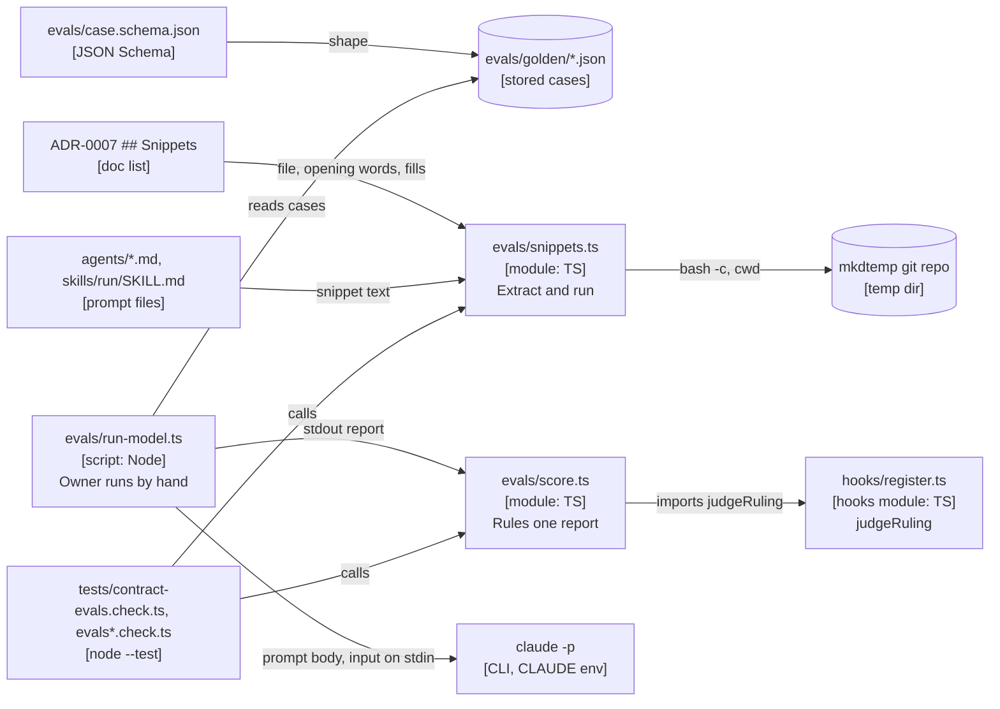

# ADR-0007: behaviour evals for the judge and cynic prompts

Status: proposed, 2026-10-29. Written by the design crew `eval-design` (wave 0), for foundry 0.10.0. It becomes accepted when the foreman merges the wave-0 crew under the owner-approved plan. Not repo ADR-0007, which is about plugin state.

## Context

Foundry checks its prompts with wording checks: `tests/*.check.ts` files that read a prompt and assert a string is in it. They prove the text is there, not that it works. The 0.9.1 red-team check (`897528e`) told the red team to compare `git rev-parse --git-dir` with `git rev-parse --git-common-dir`. Run from a subdirectory of the main checkout, the first prints an absolute path and the second a relative one, so the two differ and the check passes where it must fail. `4e43d5c` fixed it with `--path-format=absolute` (its commit message records the cause). The wording checks passed on both versions, because both carried the strings they looked for.

Nor does anything measure what the judge and cynic decide. The judge's first line (`VERDICT: PASS` or `VERDICT: FAIL`) gates every merge, and the cynic's `RECOMMEND:` line decides what reaches the owner. Past runs left those rulings on disk, in `<git common dir>/foundry/<run-id>/reports/*/*-judge*.md` and in `decisions.md` lines such as `cynic-3 RECOMMEND: answer`.

**The interface that can't take the work.** The wording checks are the only prompt checks foundry has. They take a prompt file and a string, so they can't run a command or score a ruling. A behaviour check needs a case shape, a scorer and a runner that the checks don't have.

**The owner's ruling (decisions.md, 16:08, this run):** no API runs; the work targets subscription users; nothing in the suites may need a model or the owner present; the owner runs the model evals by hand, once as a baseline between waves and once at the end; the model runner is an optional tool, never a gate, with no USD cap; ai 1 is not adopted as a standing rule.

## Decision

### 1. What is adopted

For foundry's judge and cynic prompts only (`agents/judge.md`, `agents/cynic.md`):

- **ai 2:** the eval set is checked in, as `plugins/foundry/evals/golden/*.json`, each case with its expected line. A fixed judge or cynic failure adds a case whose `source` is the file that records the right ruling. Adding a case needs no model.
- **ai 3:** the grader is deterministic code, `evals/score.ts`. It reads the `VERDICT:` or `RECOMMEND:` line. There is no model grader.

Not adopted: **ai 1**, by the owner's 16:08 ruling. No rule requires an eval run when a prompt changes, and no done-check or suite reads eval results. ai 2 and 3 stay dropped for every other prompt (the lead, architect, writer, devops, the skills, the catalog refresh).

P19 holds: the evals import only Node's standard library and foundry's own `hooks/register.ts`, with no ajv and no other package. P25 holds: no suite calls a model or needs a run dir.

### 2. The case shape

One case per file, `plugins/foundry/evals/golden/<id>.json`, one JSON object, under [`evals/case.schema.json`](../../evals/case.schema.json). The file name is the case's `id` plus `.json`.

| Key | Type | Value |
| --- | --- | --- |
| `id` | string | lowercase words of letters and digits joined by single hyphens; equals the file name without `.json` |
| `source` | string | the run file the case came from, as `.git/foundry/<run-id>/<path>`, with forward slashes, relative to the git common dir: strip the leading `.git/` and resolve the rest against `git rev-parse --git-common-dir`. Never an absolute path, never a `..` segment, never a backslash. |
| `role` | `"judge"` or `"cynic"` | which prompt the case tests |
| `input` | string | the brief handed to the role, verbatim (below) |
| `expected` | object | `{ "keyword", "kind" }`: `keyword` is `VERDICT` or `RECOMMEND`; `kind` is `PASS` or `FAIL` for `VERDICT`, and `answer`, `defer` or `pass` for `RECOMMEND` |

A judge case always has `keyword: "VERDICT"`; a cynic case always has `keyword: "RECOMMEND"`. The schema says so with two `allOf` conditionals.

**`input` for a judge case** is the brief the lead would hand the judge, rebuilt from the run dir: the crew's goal file (`goals/<crew>.md` in the same run dir, when it exists), the base and head SHAs and the done-check output that the judge file quotes, and the members' report paths it names. It never contains a line that starts with `VERDICT:`.

**`input` for a cynic case** is the item the foreman gave the cynic, rebuilt from the `decisions.md` line: the decision text and the citation field, without the cynic field or the outcome. It never contains the word `RECOMMEND`.

**`expected`** is the ruling the source file records. A judge file records it as its first line, `VERDICT: PASS` or `VERDICT: FAIL`. A `decisions.md` line records it in one of the forms `retro.py`'s `CYNIC_FIELD` and `RECOMMEND` patterns read (`scripts/retro.py:40-45`): `RECOMMEND: answer`, `cynic-3 RECOMMEND: answer`, `cynic-4: RECOMMEND: pass, option (a)`, or `cynic-1 RECOMMEND pass: ...`. So any check that looks for the keyword in a source file accepts it with or without a colon after `RECOMMEND`.

**Where `source` is checked.** `evals-build`'s done-check resolves each `source` against `git rev-parse --git-common-dir`, requires the file to exist, and requires the case's keyword and kind in it. That check lives in the done-check only, never in a suite: a fresh clone has no run dirs (P25).

**Personal data.** Run files hold absolute user paths and ACL lines with the owner's account name. A case's `input` strips them before it is committed (P8, P9); `evals-build`'s done-check greps `golden/` for them.

### 3. The golden set

At least 18 cases: at least 12 judge cases, 4 or more of them `FAIL`, and at least 6 cynic cases covering at least 2 `RECOMMEND` kinds. Sources come from the two earlier run dirs, `.git/foundry/40816bb1-1ec8-4755-8d97-0d12599e1e84/` and `.git/foundry/70917104-1578-48f5-8ac2-f9e48814b8cc/`.

These ids are required, with these sources and kinds. `evals-build` adds the rest.

| id | role | source | expected |
| --- | --- | --- | --- |
| `judge-redteam-reset` | judge | `.git/foundry/70917104-1578-48f5-8ac2-f9e48814b8cc/reports/redteam-reset/redteam-reset-judge.md` | `VERDICT` `PASS` |
| `judge-roles-1` | judge | `.git/foundry/40816bb1-1ec8-4755-8d97-0d12599e1e84/reports/roles/roles-judge.md` | `VERDICT` `FAIL` |
| `judge-roles-2` | judge | `.git/foundry/40816bb1-1ec8-4755-8d97-0d12599e1e84/reports/roles/roles-judge-2.md` | `VERDICT` `FAIL` |
| `judge-roles-3` | judge | `.git/foundry/40816bb1-1ec8-4755-8d97-0d12599e1e84/reports/roles/roles-judge-3.md` | `VERDICT` `FAIL` |
| `judge-roles-4` | judge | `.git/foundry/40816bb1-1ec8-4755-8d97-0d12599e1e84/reports/roles/roles-judge-4.md` | `VERDICT` `FAIL` |
| `judge-roles-5` | judge | `.git/foundry/40816bb1-1ec8-4755-8d97-0d12599e1e84/reports/roles/roles-judge-5.md` | `VERDICT` `FAIL` |
| `judge-roles-6` | judge | `.git/foundry/40816bb1-1ec8-4755-8d97-0d12599e1e84/reports/roles/roles-judge-6.md` | `VERDICT` `FAIL` |
| `judge-roles-7` | judge | `.git/foundry/40816bb1-1ec8-4755-8d97-0d12599e1e84/reports/roles/roles-judge-7.md` | `VERDICT` `FAIL` |
| `judge-foundry-protocol-1` | judge | `.git/foundry/40816bb1-1ec8-4755-8d97-0d12599e1e84/reports/foundry-protocol/foundry-protocol-judge.md` | `VERDICT` `FAIL` |
| `judge-foundry-protocol-2` | judge | `.git/foundry/40816bb1-1ec8-4755-8d97-0d12599e1e84/reports/foundry-protocol/foundry-protocol-judge-2.md` | `VERDICT` `PASS` |
| `cynic-answer-case-fold` | cynic | `.git/foundry/40816bb1-1ec8-4755-8d97-0d12599e1e84/decisions.md` (the 21:25 "case-folded qualified match" line) | `RECOMMEND` `answer` |
| `cynic-defer-log-promise` | cynic | `.git/foundry/70917104-1578-48f5-8ac2-f9e48814b8cc/decisions.md` (the 08:41 cynic-5 "rejecting $.ui.log promise" line) | `RECOMMEND` `defer` |
| `cynic-pass-seam-route` | cynic | `.git/foundry/40816bb1-1ec8-4755-8d97-0d12599e1e84/decisions.md` (the 09:50 cynic-1 "seam route" line) | `RECOMMEND` `pass` |

Checked at design time, from each listed judge file's first line: `roles-judge.md` to `roles-judge-7.md` and `foundry-protocol-judge.md` start `VERDICT: FAIL`; `redteam-reset-judge.md` and `foundry-protocol-judge-2.md` start `VERDICT: PASS`. `foundry-protocol-judge.md` is the catch on `gates.check.ts:88-102` (its finding at line 52). `judge-redteam-reset` is the PASS that took the red team's worktree premise on trust, the gap `897528e` and `4e43d5c` then closed. It records the accepted ruling. A prompt change that makes the judge FAIL it is a difference for the owner to read, not a regression by itself.

### 4. The scorer, `evals/score.ts`

Deterministic, no I/O. It imports `judgeRuling` from `../hooks/register.ts`, the hooks module's entry file, as `tests/gates.check.ts:90` already does under `node`. So the evals rule a `VERDICT:` line exactly as the merge gate does.

```ts
export type Expected =
  | { keyword: 'VERDICT'; kind: 'PASS' | 'FAIL' }
  | { keyword: 'RECOMMEND'; kind: 'answer' | 'defer' | 'pass' }
export type Kind = Expected['kind']
export type Score = { ok: boolean; got: Kind | undefined }
export function score(report: string, expected: Expected): Score
```

- `keyword: 'VERDICT'`: `got` is `judgeRuling(report).verdict`. That is the marker on the report's first non-empty line, after a BOM and `\r` are dropped: `PASS` when the line starts with `VERDICT: PASS`, `FAIL` when it starts with `VERDICT: FAIL`, else `undefined` (`register.ts:205-212`, `:506-530`). So `VERDICT:PASS` with no space scores `got: undefined`, never `PASS`, the way the gate rules it.
- `keyword: 'RECOMMEND'`: `got` is the kind on the first line of the report that matches `^\s*(?:cynic-\d+:?\s+)?RECOMMEND:?\s+(answer|defer|pass)\b`, after `\r` is dropped; else `undefined`. This is `retro.py`'s `CYNIC_FIELD` (`scripts/retro.py:44-45`) with leading space allowed and the `(xN)` count ignored. `RECOMMEND: drop` scores `got: undefined`.
- `ok` is `got === expected.kind`.
- An `expected` that pairs a keyword with a kind outside its list, or names another keyword, throws a `TypeError` (core 6).

### 5. The snippet runner, `evals/snippets.ts`

The runner pulls the shell snippets this ADR's `## Snippets` list names out of the shipped prompts and runs them in a throwaway git repo. No fence in the prompts has a language tag at `da17861` (`agents/judge.md:62`, `agents/lead.md:169`, `skills/retro/SKILL.md:18`), so the list picks the snippets, not a tag.

```ts
export type Where = 'root' | 'subdir' | 'worktree'
export type SnippetLine = { file: string; opening: string; form: 'fenced' | 'inline'; fills: Record<string, string> }
export type RunResult = { ok: boolean; code: number | null; stdout: string; stderr: string }
export function parseSnippets(adrText: string): SnippetLine[]
export function extractSnippet(promptPath: string, line: SnippetLine): string | undefined
export function runSnippet(script: string, fills: Readonly<Record<string, string>>, where?: Where): RunResult
```

**`parseSnippets`** reads the lines after the `## Snippets` heading, up to the next line that starts with `## `. Each line that starts with `- ` must match

```
^- (plugins/foundry/\S+\.md): `([^`]+)` \((fenced|inline); placeholders: (.+)\)$
```

and gives `file` (repo-relative, forward slashes), `opening`, `form` and `fills`. The placeholders field is `none`, giving `{}`, or a list joined by `, ` of `<name>=<value>` pairs, each matching `^(<[a-z][a-z0-9-]*>)=(\S+)$`; the key keeps its angle brackets. A `- ` line that doesn't match, or a bad pair, throws an `Error` that quotes the line, so a typo can't drop a snippet silently. Other lines are prose and are skipped. Order is kept.

**`extractSnippet`** reads `promptPath` as UTF-8, drops a BOM and every `\r`, and returns `undefined` when the file can't be read or holds no match.

- `fenced`: a fence is a line whose text, leading spaces dropped, starts with three backticks; its body runs to the next such line. The snippet is the body of the first fence whose first body line, leading spaces dropped, starts with `opening`, its lines joined with `\n`.
- `inline`: outside fence bodies, the snippet is the text of the first single-backtick code span (`` `[^`\n]+` ``) that starts with `opening`.

**`runSnippet`** fills each key of `fills` by replacing every occurrence of the key, angle brackets included, with its value. If the result still matches `<[a-z][a-z0-9-]*>`, it runs nothing and returns `{ ok: false, code: null }` with the placeholder named in `stderr`. Otherwise:

1. It makes `fs.realpathSync.native(fs.mkdtempSync(join(os.tmpdir(), 'foundry-snippet-')))` and a repo under it, as `tests/e2e/cleanup.e2e.ts:42-53` does. The repo has local `user.name`, `user.email`, `commit.gpgsign false` and `core.autocrlf false`, and two commits: the first adds `a.txt` (`one\n`) and `sub/b.txt` (`b\n`), the second changes `a.txt` to `two\n`. So `HEAD~1` and `HEAD` exist, their diff is not empty, and its patch id is the same in every temp repo.
2. `where` picks the working directory: `root` (the default) is the repo, `subdir` is its `sub/`, and `worktree` is a linked worktree that `git worktree add <tmp>/wt -b eval-wt` makes.
3. It runs `bash -c` with `set -euo pipefail`, a newline and the filled script, through `spawnSync` without a shell, with `windowsHide`, a 30-second timeout, and the caller's environment minus every `GIT_*` variable. A pipe's failure is the script's failure.
4. It removes the temp dir in a `finally`, with `rmSync` recursive, forced, `maxRetries: 10`.

It returns `ok: code === 0`, `code` (the exit status, or `null` on a timeout or spawn error), and `stdout` and `stderr` with `\r` dropped. It never runs in, or reads, the caller's checkout.

### 6. The 0.9.1 git-dir check, fed to the runner

The red-team check is inline code in `judge.md`'s red-team section, not a fence. Its rule is a comparison of two commands, so the contract test feeds it to `runSnippet` as one comparison script, built from literal strings:

- **Broken, from `897528e`:** `[ "$(git rev-parse --git-dir)" = "$(git rev-parse --git-common-dir)" ]`
- **Fixed, from `4e43d5c`:** `[ "$(git rev-parse --path-format=absolute --git-dir)" = "$(git rev-parse --path-format=absolute --git-common-dir)" ]`

The script exits 0 when the two are equal, which is the main checkout: the red team must refuse to run there. In the main checkout's `subdir` the broken script must give `ok: false` (the paths differ, so the broken check let the red team through), and the fixed script `ok: true`. In a linked `worktree` the fixed script gives `ok: false`, because a worktree's git dir and common dir differ. The test also builds the same comparison from the two inline spans `extractSnippet` finds in today's `judge.md` (the last two `## Snippets` lines) and requires the fixed results. A runner that never runs the script can't give both answers.

### 7. The model runner, `evals/run-model.ts`

An optional tool for the owner, never a gate. It runs from the checkout under test (`node plugins/foundry/evals/run-model.ts`), and it is outside every suite.

- **Binary.** It spawns the path in the `CLAUDE` environment variable, else `claude`, without a shell, the way `scripts/catalog-refresh/run.sh:8` takes `CLAUDE`.
- **Fixed case list.** Every `golden/*.json` file, sorted by `id`, one at a time. It takes no flag that picks or adds cases.
- **Per case.** `-p`, the prompt on stdin (the case's `input`), `--system-prompt` with the body of `agents/<role>.md` after its frontmatter, `--model` and `--effort` from that frontmatter, `--no-session-persistence`, `--output-format text`, and a fixed `--allowedTools` list (P20): `Read Grep Glob Bash(git log:*) Bash(git show:*) Bash(git diff:*) Bash(git rev-parse:*)` for the judge, `Read Grep Glob` for the cynic. No write tool either way. The working directory is the checkout's root (`git rev-parse --show-toplevel`). So the run tests the prompt in the checkout, not the installed plugin.
- **Bound.** A per-case timeout, `CASE_TIMEOUT_MS = 600000`, kills the child and scores the case `timeout`. With the fixed case list, that bounds the run (P26). No `--max-budget-usd`, by the owner's ruling.
- **Scoring.** `score` from `score.ts`, on the child's stdout.
- **Output.** One stdout line per case, `<id> ok|miss|timeout expected=<kind> got=<kind|none>`, then `score <ok>/<total> at <HEAD sha>`. It writes each raw report and a `results.json` to a new `mkdtemp` dir under `os.tmpdir()` (prefix `foundry-evals-`), whose path it prints. It writes nothing in the checkout, and nothing under `.git/` or `.claude/`.
- **Results are not committed.** Raw model output can carry local paths (P8), and no rule reads results (ai 1 is not adopted). The owner pastes the `score` line to the foreman, who logs it in `decisions.md` with its SHA: the baseline on the wave-1 merge SHA, the after run on the final SHA.
- **Test.** Its only test runs it with `CLAUDE` pointing at a stub in `tests/fixtures/claude-stub/` that prints a canned `VERDICT:` line. `evals-build` picks a stub that spawns on Windows and Linux without a shell.



*The evals area and what it reads; `run-model.ts` sits outside every suite.* Traces to: this ADR; `plugins/foundry/hooks/register.ts:205-212`, `:506`; `tests/gates.check.ts:90`; `tests/e2e/cleanup.e2e.ts:42-53`; `scripts/catalog-refresh/run.sh:8`.

```mermaid
sequenceDiagram
  participant T as contract-evals.check.ts
  participant S as snippets.ts
  participant P as prompt file
  participant G as temp git repo
  T->>S: parseSnippets(ADR-0007 text)
  S-->>T: SnippetLine[]
  loop each line
    T->>S: extractSnippet(promptPath, line)
    S->>P: read
    S-->>T: snippet text, or undefined (test fails)
    T->>S: runSnippet(text, line.fills)
    S->>G: mkdtemp, git init, two commits
    S->>G: bash -c "set -euo pipefail; text"
    G-->>S: exit code, stdout
    S->>G: rm -rf
    S-->>T: RunResult
  end
```

*One snippet check, as the contract test drives it.* Traces to: sections 5 and 6 above.

### 8. Checks that move to the evals

Wave 2 (`prompt-rules`) deletes the wording checks in `## Checks replaced`; `tests/contract-replaced.check.ts` pins that. `tests/packs.check.ts` stays: it checks the packs' form, which is not judge or cynic behaviour, so P12 and the entry-points table keep naming it.

A check moves only when a suite check covers what it asserts. Two do. The judge.md and SKILL.md patch-command checks assert `git patch-id --stable` is in the file; the snippet check runs that command and compares its id with `PATCH_COMMAND`'s (`register.ts:422`). The cynic Items check in `deferred-sweep.check.ts` stays: in the suite the cynic cases only score their own recorded `expected` lines and nothing reads `cynic.md`, so no suite check covers it. Most wording checks pin a report literal or a section's order, which no case scores, so they stay too.

## Snippets

- plugins/foundry/agents/judge.md: `git diff --no-color` (fenced; placeholders: <base>=HEAD~1, <head>=HEAD)
- plugins/foundry/agents/lead.md: `git diff --no-color` (fenced; placeholders: <base>=HEAD~1, <head>=HEAD)
- plugins/foundry/skills/run/SKILL.md: `git diff --no-color` (inline; placeholders: <base>=HEAD~1, <head>=HEAD)
- plugins/foundry/agents/judge.md: `git rev-parse --path-format=absolute --git-dir` (inline; placeholders: none)
- plugins/foundry/agents/judge.md: `git rev-parse --path-format=absolute --git-common-dir` (inline; placeholders: none)

## Checks replaced

Each line: `- <test file>: <test name> (covered by <ref>)`. `<ref>` is `case <id>` or `case <id>, <id>, ...` (each a `golden/<id>.json`), or `snippet <file>: \`<opening>\`` (a `## Snippets` line with that file and those opening words). A `case` ref matches `^case ([a-z0-9]+(?:-[a-z0-9]+)*(?:, [a-z0-9]+(?:-[a-z0-9]+)*)*)$`; a `snippet` ref matches ``^snippet (\S+\.md): `([^`]+)`$``.

- plugins/foundry/tests/gates.check.ts: judge.md names the patch command (covered by snippet plugins/foundry/agents/judge.md: `git diff --no-color`)
- plugins/foundry/tests/gates.check.ts: run skill merge rule names the patch command (covered by snippet plugins/foundry/skills/run/SKILL.md: `git diff --no-color`)

## Seams

The contract tests pin these. Wave 0's test-writer writes them; wave 1's `evals-build` builds to them.

`tests/contract-evals.check.ts` (run with `node --test`; red until `evals/score.ts` and `evals/snippets.ts` exist):

1. `score` on `VERDICT: PASS` and on `VERDICT: FAIL` reports, against both kinds; on `VERDICT:PASS` with no space, `got` is `undefined` and `ok` is false against `PASS`; a leading blank line, a BOM and CRLF don't change the result.
2. `score` on each `RECOMMEND` kind, in the forms `RECOMMEND: answer`, `cynic-4: RECOMMEND: defer (x2)` and `cynic-1 RECOMMEND pass: ...`; `RECOMMEND: drop` gives `got: undefined`; an `expected` of `{ keyword: 'VERDICT', kind: 'answer' }` throws a `TypeError`.
3. `parseSnippets` on this ADR's text returns at least the five lines above, and throws on a malformed `- ` line.
4. For every parsed line, `extractSnippet` on the named file under the repo root returns a string (a missing snippet fails the test), and `runSnippet` with the line's `fills` gives `ok: true`. A fenced snippet prints at least one line. A snippet that contains `git patch-id` gives the same first stdout field as `runSnippet(PATCH_COMMAND, same fills)`, with `PATCH_COMMAND` imported from `hooks/register.ts`.
5. `runSnippet` with an unfilled `<head>` gives `ok: false` and `code: null`.
6. The git-dir scripts of section 6: broken in `subdir` gives `ok: false`; fixed in `subdir` gives `ok: true`; fixed in `worktree` gives `ok: false`; the same comparison from today's `judge.md` spans gives the fixed results.
7. The golden set: every `golden/*.json` parses, carries each key in `case.schema.json`'s `required`, has `id` equal to its file name, `role` in the schema's enum, and a `source` that starts with `.git/foundry/` and has no `..`, no backslash and no drive letter. At least 18 cases; at least 12 judge, 4 or more `FAIL`; at least 6 cynic over at least 2 kinds. Each id in section 3's table exists with its role and kind. For each case, `score` of its own expected line (`VERDICT: PASS`, `RECOMMEND: answer`, ...) is `ok`. No judge `input` has a line starting `VERDICT:`, and no cynic `input` contains `RECOMMEND`. The schema's `required` is checked by hand: no ajv (P19).

`tests/contract-replaced.check.ts` (run with `node --test`; red until wave 2 deletes the checks):

1. It parses `## Checks replaced` with `^- (plugins/foundry/tests/[^:]+\.check\.ts): (.+) \(covered by (.+)\)$`, and requires at least one line.
2. For each line, the test name appears in its file neither as `'<name>'`, `"<name>"` nor `` `<name>` ``, or the file is gone.
3. For each `case` ref, `plugins/foundry/evals/golden/<id>.json` exists. For each `snippet` ref, a `## Snippets` line has that file and those opening words.

## Consequences

- A broken snippet in a listed prompt now fails `node --test plugins/foundry/tests/contract-evals.check.ts plugins/foundry/tests/evals*.check.ts`, which a wording check could not do. Moving or rewording a listed snippet's opening words means editing its `## Snippets` line in the same change.
- Judge and cynic behaviour is measured only when the owner runs `run-model.ts`. No rule requires an eval run when a prompt changes, so a prompt change can lower the score unseen until the next owner run. That is the trade the owner's ruling accepts. The cynic Items check in `deferred-sweep.check.ts` stays in the suite, because no suite eval reads `cynic.md`; the three required cynic cases measure the same rule only when the owner runs the model.
- `expected` is the ruling a run recorded, so the set measures drift from accepted rulings. A ruling later shown wrong (such as `judge-redteam-reset`) stays as recorded until a fix adds a case whose source records the right one.
- A judge case names commits from past runs. On a clone where a FAIL head was never merged and has been garbage-collected, the judge can't read that diff; the owner reads that case's result as noise.
- `snippets.ts` spawns `bash` from `PATH`. On Windows that is Git Bash in this repo's setup (`where bash` prints `C:\Program Files\Git\usr\bin\bash.exe` only); a machine where WSL's `bash.exe` comes first on `PATH` would run the snippet in WSL. TODO: not handled; no override is added until a caller needs one (P11).
- Nothing in the evals reads `.git/foundry/` at test time; only `evals-build`'s done-check does.
