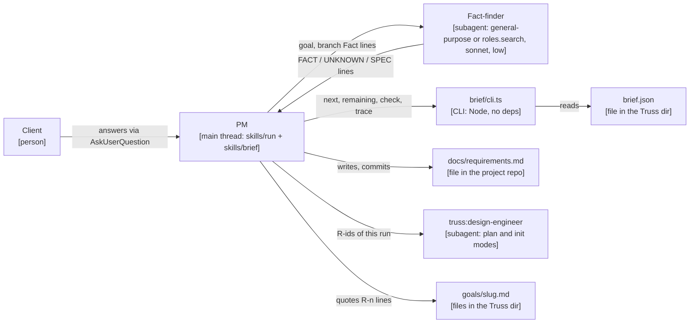
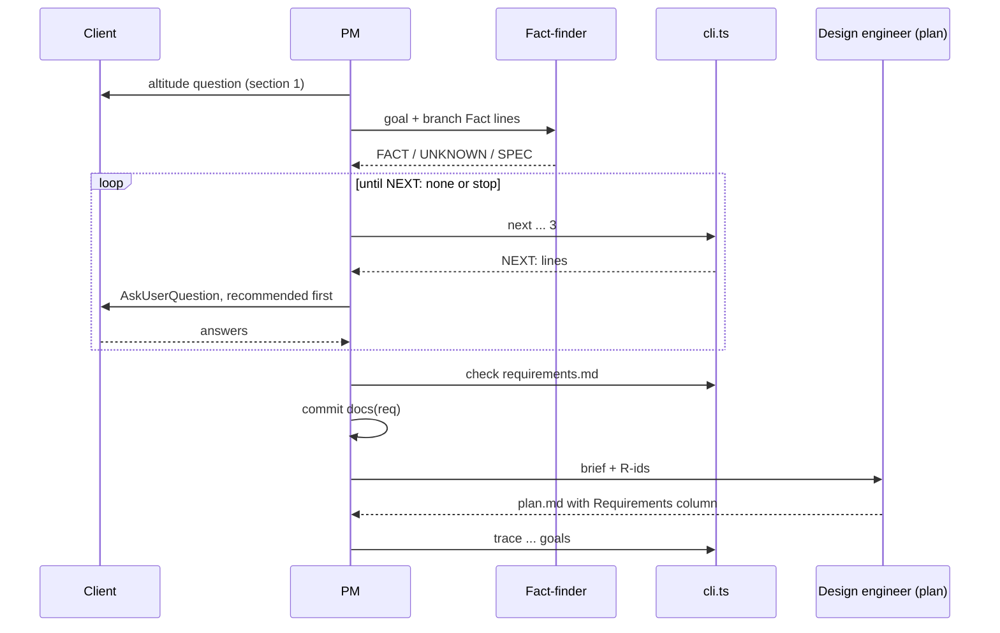

# ADR-0008: the client brief and the requirements ledger

Status: proposed, 2026-10-29. Written by the mid-run design slice `interview-design` (stage 1), against `fa0fa9f`. It becomes accepted when the PM (project manager) merges this crew. Not repo ADR-0008.

VERDICT: change. The interface that can't take the work is the path from the client's goal to the plan design engineer's brief (`skills/run/SKILL.md` sections 1 to 4, lines 77-127). The PM asks the client one altitude question (line 79), answers four depth-pass questions itself (lines 81-90), and hands the goal and those answers to the design engineer (lines 121-127). Nothing in that path asks the client about requirements, nothing records the answers, and nothing carries a requirement from one run to the next. The design engineer can't fill the gap: it has no `AskUserQuestion` (`agents/design-engineer.md:6`), and in init mode it works only from code (`agents/design-engineer.md:49`), so an empty repo gives it nothing to design from. The change adds a new module (the client brief skill and its ledger code), a new stored data shape (`requirements.md`) and new seams into the run skill and the design engineer.

## Context

The client asked for this in the frozen-scope addition logged in this run: "the client brief would cover what the client wants, details on requirements, including things that people dont think of first - such as hosting, integrations, etc. it would likely need to be dynamic."

The prior discussion the client pointed at (gate 2, "An intent ledger that reads what exists and asks only about the gaps", quoted in the crew's goal file) proposed: read existing specs first and ask only about gaps; write `docs/requirements.md` with numbered requirements (R-n), acceptance examples, non-goals and NFRs with numbers; let the principle packs set the depth; "facts are the agent's job, decisions are the client's"; one classification sets client brief depth; stop when the client says stop or the goal is small; never let the checking engineer answer for the client; on an empty repo, design from the ledger. This ADR adopts all of it, with three changes, each argued below: the branches live in the client brief skill, not in the pack files; facts never become requirements; and process size is left to ADR-0009.

What the code allows today:

- Only the main thread talks to the client (`skills/run/SKILL.md:8`). Subagents can't ask the client anything, so the client brief has to be a skill the PM follows, with subagents only for facts.
- The hooks gate only `truss:*` Agent calls (`hooks/register.ts:568`), so a `general-purpose` fact-finder started before any plan exists is not refused.
- The checking engineer rules on items only once the plan is approved (`skills/run/SKILL.md:39`). The client brief runs before the plan, so no checking engineer sees its questions or answers them.
- `tests/packs.check.ts:96` pins that `skills/principles/` holds only `SKILL.md` and the seven packs, and each pack's form is rules paired with tests (`packs.check.ts:110-125`). Client brief questions are a different kind of thing from reviewer rules.
- The QC engineer already treats the goal file as approved scope (`agents/qc-engineer.md:18`), so a requirement quoted in a goal file is something the QC engineer checks the diff against without any change to `qc-engineer.md`.
- A crew diff that edits the architecture doc is a finding unless the crew is a design crew (`agents/qc-engineer.md:47`). The doc amendment below is therefore its own design crew.

## Decision

### 1. Where it runs

A new skill, `truss:brief` (`skills/brief/SKILL.md`), followed by the PM in the main thread. It is the only part of Truss that calls `AskUserQuestion`. It starts at most one subagent, the fact-finder (section 4), which reads the repo and reports facts. No subagent, no checking engineer and no design engineer answers a question meant for the client. A fact-finder line that recommends a decision is ignored.

Deterministic steps run as one CLI, `brief/cli.ts`, built on `brief/ledger.ts` (section 7). The skill and the run skill call it with `node <plugin>/brief/cli.ts <command> ...`, where `<plugin>` is two levels above the skill's base directory, as in `skills/run/SKILL.md:125`.



Caption: the client brief's parts as this ADR designs them. Traces to `skills/run/SKILL.md:8` (only the PM talks to the client) and `:119-127` (the design engineer brief); the rest is new.

### 2. When it runs: the hook point

In `skills/run/SKILL.md`, a new subsection `### Brief the client` at the end of section 1, "Check the altitude", after the client picks the goal and before section 2, "Run a short depth pass". It says, in substance: run the `truss:brief` skill with the Skill tool, with args `<goal> | <truss dir>/brief.json | <requirements path>`, and go on to section 2 when it returns. That is the only new step; sections 2 to 10 keep their order. If ADR-0009 restructures the run, the client brief moves with the goal-choosing step it follows. A goal that enters a running plan (ADR-0010) can call the same skill with its own state path; ADR-0010 decides whether and where. The CLI takes the state path as an argument, so nothing here fixes one name except `<truss dir>/brief.json` for the run's first goal.

The requirements path is `<dir of the architecture key>/requirements.md`: `docs/requirements.md` when `architecture` is `docs/architecture.md`, as in this repo. With no `.claude/truss.json` (the greenfield path, section 9) it is `docs/requirements.md`.

### 3. Classification: one size sets the depth

The PM sizes the goal as `small`, `standard` or `large`, writes it to `brief.json` and logs one line in `decisions.md`: `- HH:MM | brief size <size>, packs <list> | <reason> | none | followed`.

- **small** when all hold: the goal names the files, command or module it changes; it states or implies its own done condition; it adds no external service, no stored data shape and no user-facing surface; the repo is not greenfield. The PM decides this from the goal text alone, before any fact-finding. A small goal gets no fact-finder and no questions: the PM writes one functional R-n from the goal itself (`Source: goal`) and goes to section 6.
- **large** when any holds: the repo is greenfield; the goal adds a product, app, service or module that doesn't exist yet; it adds an external service or integration; it adds a stored data shape; or, after fact-finding, it touches the domains of three or more packs besides `core`.
- **standard** otherwise.

The size is recorded and nothing else here reads it. Whether process size (crews, members, gates) follows the same size is ADR-0009's call.

The packs come from `skills/principles/SKILL.md`, "Pick the packs", applied to the goal and the fact-finder's lines; `core` is always in. On a greenfield repo the client's answer to the `outcome` branch picks them.

### 4. Facts first

For `standard` and `large`, before any question, the PM starts one fact-finder in the foreground:

```
Agent({
  subagent_type: "<roles.search from .claude/truss.json, else general-purpose>",
  name: "interview-facts",
  model: "sonnet",
  effort: "low",
  description: "Find facts for the client brief",
  prompt: "<goal>, <repo>, <requirements path>, and each candidate branch id with its Fact line"
})
```

Its brief says: read only; report what the repo says, never what to decide; one line per finding, in exactly these forms:

- `FACT: <branch id> | <fact> | <path:line>`
- `UNKNOWN: <branch id>`
- `SPEC: <path> | <what it specifies>` for an existing spec, plan, issue export or `requirements.md` entry the goal touches.

The PM reads every `SPEC:` path itself. For each branch a `FACT:` line or an open R-n settles, it sets `visits[<id>] = { "by": "fact", "note": "<fact> (<path:line>)" }`. Facts are context for the design engineer; they never become requirements. Only decisions do. This is the "facts are the agent's job" rule made literal: a requirement always records a choice someone made (the client, the client's goal text, or a default the client allowed).

### 5. Branches: what "dynamic" means

The questions come from `skills/brief/branches.md`, one `## <id>` section per branch, each a block of `Field: value` lines:

| Field | Required | Value |
| --- | --- | --- |
| `Pack` | yes | one of `core service frontend data ai infra library` |
| `Visit` | yes | comma-and-space list from `standard`, `large`, `opened`. Never `small`. |
| `Fact` | no | what the fact-finder looks for, with typical paths |
| `Ask` | yes | the question, in product terms |
| `Recommend` | yes | how to pick the recommended answer from the facts |
| `Writes` | yes | `functional`, `nfr`, `constraint` or `non-goal` |
| `Opens` | no | comma-and-space list of branch ids an answer can make relevant |

The branches live in the client brief skill, not in the pack files: packs are reviewer rules with a test each, and `packs.check.ts:96` keeps their directory to the seven packs. A pack contributes branches by its `Pack:` value.

The file holds at least these ids. Core, always candidates: `outcome`, `users`, `acceptance`, `non-goals`, `hosting`, `environments`, `integrations`, `auth`, `secrets`, `data-sensitivity`, `scale`, `latency`, `availability`, `cost`, `compliance`. Pack branches: service `authz`, `idempotency`, `rate-limits`, `webhooks`; frontend `browsers`, `accessibility`, `i18n`; data `retention`, `backfill`, `lineage`; ai `model-choice`, `eval-set`, `model-cost`; infra `iac`, `regions`, `ci-cd`; library `consumers`, `versioning`. `hosting` opens `environments` and `cost`; `integrations` opens `webhooks` and `secrets`; `auth` opens `authz`; `data-sensitivity` opens `compliance` and `retention`. Every branch whose only `Visit` value is `opened` is named in some other branch's `Opens`.

A branch is a candidate when it has no entry in `visits` and either its id is in `opened`, or the size is in its `Visit` and its pack is `core` or in `packs`. `next` walks candidates in file order and returns up to `max` of them, stopping after the first one that has `Opens`, because that answer can change the queue. So the next question depends on the last answer (through `opened` and `closed`) and on what is known (through `fact` visits).

The loop:

1. Run `node <plugin>/brief/cli.ts next <skill base>/branches.md <truss dir>/brief.json 3`. `NEXT: none` ends the loop.
2. Ask the returned branches in one `AskUserQuestion` call, one question per branch. Each question cites what the facts already say. The first option is the recommended answer, its label ending ` (Recommended)`, so "yes" accepts it. One or two alternatives follow. The last option is `Stop the brief`.
3. For each answer: when it is too vague for its `Writes` kind (an `nfr` answer with no number, a `functional` answer with no example), ask one follow-up on that branch before recording it. Then set `visits[<id>] = { "by": "client", "note": "<the answer>" }`. Add to `opened` each id from the branch's `Opens` that the answer makes relevant. Set `visits[<id>] = { "by": "closed", "note": "<why>" }` for each branch the answer rules out (an answer "runs only on my laptop" closes `environments` and `availability`).
4. When an answer conflicts with an open R-k, ask one question: "R-k says X; this goal needs Y. Replace R-k?", recommending the replacement.
5. Rewrite `brief.json` with Write and go to step 1.

### 6. The stop rule

The client brief stops when `next` prints `NEXT: none`, when the goal is small (section 3), or when the client says stop: the `Stop the brief` option, or an "Other" answer such as "stop", "enough" or "go". On stop the PM sets `stopped: true`, runs `node <plugin>/brief/cli.ts remaining <skill base>/branches.md <truss dir>/brief.json`, and for each branch it prints sets `visits[<id>] = { "by": "default", "note": "<the recommended answer>" }`, which writes a requirement with `Source: default` (subject to the first client decision below). The checking engineer never answers in the client's place, here or later.

For `standard` and `large`, after the requirements are written (section 7) and before the commit, one last question: "Build against R-a to R-b as written in `<requirements path>`?", recommended answer "Yes". Any other answer edits the file, reruns `check` and asks again.

### 7. `requirements.md`, the stored shape

One file per project, append-only by id. The PM writes it with Edit or Write. Crews never edit it: no crew owns it, and the QC engineer's ownership check covers that.

```
# Requirements

Kept by truss's client brief (ADR-0008). Ids are never reused.

## R-1: Owners can export their invoices as CSV
Status: open
Kind: functional
Added: 2026-10-29T19:42:00Z | add invoice export
Source: client
Example: Given an account with 3 invoices, when the client clicks Export, then a CSV with 3 rows downloads.

## R-2: The export finishes quickly for large accounts
Status: open
Kind: nfr
Measure: p95 under 5 s at 10,000 invoices
Added: 2026-10-29T19:42:00Z | add invoice export
Source: default

## Non-goals
- No PDF export.
```

Rules `parseRequirements` enforces (BOM and `\r` dropped first):

- Prose may sit under `# Requirements` before the first `## `. After that, every non-blank line is a heading, a field line or a non-goal line.
- A requirement heading is `## R-<n>: <title>`. Ids are unique and `n` strictly increases down the file.
- Field lines: `Status:` is `open`, `met`, `dropped` or `replaced by R-<k>` with `k` a later id in the file. `Kind:` is `functional`, `nfr` or `constraint`. `Added:` is `<RFC 3339 date-time> | <goal>`; the time is the run's `## Run` start. `Source:` is `client`, `default`, `goal` or `repo:<path>`. `Example:` may repeat. `Measure:` is free text. `Status`, `Kind`, `Added` and `Source` are required.
- `functional` needs at least one `Example:`; `nfr` needs a `Measure:` with a digit; `constraint` needs neither. Hosting, integrations, auth, secrets, data sensitivity and compliance answers are `constraint`; scale, latency, availability and cost are `nfr`.
- `## Non-goals` is required, holding zero or more `- <text>` lines. Any other `## ` heading is an error.

Error strings, exactly: `R-<n>: missing <Field>`, `R-<n>: bad <Field>: <value>`, `R-<n>: functional needs an Example`, `R-<n>: nfr needs a Measure with a number`, `R-<n>: duplicate id`, `R-<n>: id out of order`, `R-<n>: replaced by unknown R-<k>`, `line <i>: unexpected: <text>` (1-based), `missing ## Non-goals`.

New requirements take ids from the highest in the file plus one. The ids this run accepted go in `brief.json` as `requirements`. The PM runs `node <plugin>/brief/cli.ts check <requirements path>` until it prints `OK:`, then commits the file alone on the target branch, as the extend pass does (`skills/run/SKILL.md:146`): `git switch <target>` if needed, `git add <requirements path>`, check `git status --porcelain`, `git commit -m "docs(req): <goal, short>"`. It logs `- HH:MM | requirements R-a..R-b accepted (client brief) | <size> | none | followed`. Crews work in worktrees that see only committed files, so the commit comes before section 4.

**Kept current across runs.** The next run's fact-finder reads the file (`SPEC:` lines), so its open requirements settle branches as facts and the client brief asks only about gaps. A change of mind is a new id plus `Status: replaced by R-<new>` on the old one; nothing is deleted. At section 10 the PM sets `Status: met` on each id in `brief.json`'s `requirements` whose citing crews all merged, runs `check`, and commits `docs(req): met R-...`. An id whose crew was dropped stays `open`.

### 8. Tracing R-n to plan, goal files and QC engineers

- **Plan.** Section 4's design engineer brief gets one more bullet: the requirements path and this run's R-ids. In `agents/design-engineer.md` plan mode, the inputs name both, and `plan.md`'s crew table (`design-engineer.md:101`) gains a `Requirements` column: the R-ids the crew serves, comma-separated, or `none`. Every run R-id is served by at least one crew. One that no crew can serve goes under an `Unserved:` line in `plan.md` with a reason. `plan.json` and `plan.schema.json` don't change.
- **Plan check.** The PM sends a plan back (section 4's list) when a run R-id is neither served nor under `Unserved:`. Section 5 lists each `Unserved:` id and each `Source: default` requirement under the plan table; dropping an unserved id is the client's ruling, recorded by `Status: dropped`. The client-approval table gets a `Requirements` column.
- **Goal files.** Section 6's goal file gets a `## Requirements` section, one line per R-id the crew serves, `- R-<n>: <title>` with the title copied exactly. Before the first foreman starts, the PM runs `node <plugin>/brief/cli.ts trace <requirements path> <truss dir>/brief.json <truss dir>/goals` and fixes the goal files until it prints `OK:`.
- **QC engineers.** No change to `qc-engineer.md`. The goal file is already approved scope (`qc-engineer.md:18`), so the QC engineer checks the diff against the quoted R-n lines, and work outside them is the usual `QUESTION: outside approved scope`.



Caption: one run from goal to the first foreman with the client brief in place. Traces to `skills/run/SKILL.md:77-127` and `:206-208`; the client brief steps are new.

### 9. The greenfield path

A repo is greenfield when `git ls-files -- . ':!docs/**' ':!.claude/**' ':!README*' ':!LICENSE*' ':!.gitignore' ':!.gitattributes'` prints nothing. In section 0, when init is missing and the repo is greenfield, the PM asks section 1's altitude question, runs the client brief with size `large` and requirements path `docs/requirements.md` (the fact-finder runs only when `docs/` has files, which it reads as specs), commits the file, and then runs `truss:init` with the arg `Greenfield: <repo>/docs/requirements.md`. The run then continues at section 2.

`skills/init/SKILL.md` passes that line into the design engineer's init brief. `agents/design-engineer.md` init mode gains a greenfield paragraph: with that line and no code, the module map lists planned modules, each labelled `planned` and citing the R-ids it serves; ADRs record the decisions the requirements fix (hosting, data store, auth provider) and cite R-ids in their context; diagram captions trace to R-ids where there is no source file. The rule that every claim comes from what the design engineer read still holds: here what it read is the ledger.

### 10. Models and gates

The fact-finder is the only new agent: Sonnet at effort `low`, model and effort set on the call. No new Opus agent, nothing at `high` or `xhigh`, no Fable. No gate changes: QC engineers, proved-red acceptance tests, head and patch binding, disjoint ownership and the client's rulings on frozen scope, deploys and pushes all hold. Merge mode and target are untouched here (ADR-0009 settles the asking). No suite calls a model or needs the client: every seam below is pure code over files.

## Seams

The crews' Sonnet test-writers pin these with `node --test` contract tests, written before the builder starts.

1. `brief/ledger.ts` exports `PACKS`, `parseBranches(md): Branch[]`, `remainingBranches(branches, state): Branch[]`, `nextBranches(branches, state, max): Branch[]`, `parseRequirements(md): { requirements, nonGoals, errors }`, `goalRequirementLines(text)`, `checkTrace(ledger, runIds, goals: { name, text }[]): string[]`. Erasable TypeScript only (no enums, no parameter properties), imports with `.ts` extensions, Node standard library only (P19).
2. `parseBranches` throws an `Error` naming the branch for: a missing required field, a bad `Pack`, `Visit` or `Writes` value, an unknown field line, a duplicate id, an id not matching `^[a-z0-9]+(?:-[a-z0-9]+)*$`, and an `Opens` id with no branch.
3. `nextBranches` returns `[]` for size `small` and for `stopped: true`; follows section 5's candidate and batching rule; throws `RangeError` for `max` below 1. `remainingBranches` ignores `stopped` and batching.
4. `parseRequirements` gives no errors on section 7's example (with a BOM and CRLF too) and each listed error string for its case. `checkTrace` reports, in this order and form: per goal file sorted by name, per `- R-<n>: ` line in its `## Requirements` section, `TRACE: unknown R-<n> in <name>`, `TRACE: text differs R-<n> in <name>` or `TRACE: not open R-<n> in <name>`; then per run id, `TRACE: run id not in ledger R-<n>` or `TRACE: uncovered R-<n>`.
5. `brief/cli.ts` exports `COMMANDS` (`next` 2-3 args, `remaining` 2, `check` 1, `trace` 3) and `main(argv): { code, out }`, and runs `main` only when it is the entry script (`resolve(process.argv[1] ?? '') === fileURLToPath(import.meta.url)`; Node 22 has no `import.meta.main`). Output lines: `NEXT: <id> | <pack> | <ask> | <recommend> | opens: <ids or none>`, or `NEXT: none`; `OK: <n> requirements, <m> non-goals`; `OK: <k> requirements traced to <g> goal files`; each error as `ERROR: <text>` or the `TRACE:` line. Exit 0 on OK, 1 on ledger or trace errors, 2 on usage, unreadable files, a bad state file or a branches parse error. A state file is valid when it has a string `goal`, a `size` of the three, arrays `packs`, `opened` and `requirements`, an object `visits` and a boolean `stopped`.
6. `skills/brief/branches.md` parses with `parseBranches` and holds section 5's ids with their packs, at least two branches per non-core pack, and no unreachable `opened`-only branch. `skills/brief/SKILL.md` has frontmatter `name: brief`; its first fence starting `# Requirements` parses with no errors and has a functional, an nfr and a non-goal; every `brief/cli.ts <command>` it names is in `COMMANDS`, and it names `next`, `remaining` and `check`; every fence starting `Agent({` sets `model: "sonnet"` or `"opus"` and `effort: "low"` or `"medium"`.
7. `skills/run/SKILL.md`: every inline code span `` `node <...>brief/cli.ts <command> <args>` `` names a command in `COMMANDS` with an argument count in range, counting a token that contains `<...>` (spaces allowed inside the brackets) as one argument; `trace` is among them. Its first fence starting `## Requirements` (the goal-file example) passes `checkTrace` with no errors against the ledger parsed from the client brief skill's `# Requirements` fence, with the fence's ids as run ids.

`agents/design-engineer.md` and `skills/init/SKILL.md` get prose changes with no code seam. No wording test pins them; their crew's QC engineer checks them against sections 8 and 9, and `packs.check.ts` and `init.check.ts` must stay green.

## Client decisions

- When you stop the client brief early, should Truss fill the questions it didn't ask with its recommended answers (written as requirements marked `Source: default` and listed under the plan for you to see), or leave them out so nothing is built on them? Recommended: fill them with the defaults. The plan shows each one, and the client brief stays short.
- Should the requirements live in the project repo as `docs/requirements.md`, committed like the architecture doc (visible to anyone who can read the repo, including public repos such as this one), or stay private in the session's Truss dir under `.git`? Recommended: commit them in the repo. Crews' worktrees see only committed files, and a session dir doesn't follow you to your other machine or to the next session.

## Files touched

New:
- brief/ledger.ts
- brief/cli.ts
- tests/contract-interview.check.ts
- skills/brief/SKILL.md
- skills/brief/branches.md
- tests/interview-skill.check.ts
- tests/interview-wiring.check.ts

Edited:
- skills/run/SKILL.md: section 0 (greenfield paragraph), section 1 (new `### Brief the client`), section 4 (one brief bullet; one send-back reason), section 5 (`Requirements` column; defaults and `Unserved:` under the table), section 6 (goal file `## Requirements` and the `trace` run), section 10 (mark `met`)
- agents/design-engineer.md: init mode greenfield paragraph; plan mode inputs and the `plan.md` `Requirements` column
- skills/init/SKILL.md: pass the `Greenfield:` line into the design engineer brief
- README.md: the new skill and `docs/requirements.md`
- docs/architecture.md: the client brief module, its seams, `requirements.md` and `brief.json` under "On disk", with this ADR's diagrams
- docs/architecture.md: Truss's entry links this ADR and names `requirements.md`

Not touched: `hooks/register.ts`, `docs/plan.schema.json`, `agents/qc-engineer.md`, `agents/foreman.md`, `skills/principles/*`, `skills/retro/SKILL.md`, `.claude-plugin/plugin.json`. No existing test pins behaviour this design removes: it removes none. `grep -n "altitude\|depth pass" tests/*.ts` finds no test on sections 1 and 2; `deferred-sweep.check.ts:56-64` pins strings in section 10 that the `met` step adds to, not replaces.

## Build crews

- interview-ledger | owns: brief/ledger.ts, brief/cli.ts, tests/contract-interview.check.ts | acceptanceTest: node --test tests/contract-interview.check.ts | after: none
- interview-skill | owns: skills/brief/SKILL.md, skills/brief/branches.md, tests/interview-skill.check.ts | acceptanceTest: node --test tests/interview-skill.check.ts | after: interview-ledger
- interview-wiring | owns: skills/run/SKILL.md, agents/design-engineer.md, skills/init/SKILL.md, README.md, tests/interview-wiring.check.ts | acceptanceTest: node --test tests/interview-wiring.check.ts && node --test tests/packs.check.ts tests/init.check.ts | after: prompt-rules, interview-skill
- interview-doc | owns: docs/architecture.md | acceptanceTest: grep -q 'skills/brief' docs/architecture.md && grep -q 'requirements[.]md' docs/architecture.md && grep -q '0008-owner-interview' docs/architecture.md | after: interview-wiring

`interview-doc` is a design crew (verdict `design`; its design engineer writes the doc in design mode), because only a design crew may edit the architecture docs (`qc-engineer.md:47`). `interview-wiring` and the speed-design and intake-design build crews all edit `skills/run/SKILL.md`, and `interview-doc` shares both architecture docs with their doc crews; the PM orders those across ADRs.

How each acceptance test was proved, at `fa0fa9f` and on a throwaway sample in a scratch copy (`git archive HEAD plugins/truss docs/architecture.md`, never committed):

- **interview-ledger.** Red: `Could not find 'tests/contract-interview.check.ts'`, exit 1. Green: a sample `ledger.ts` and `cli.ts` built to Seams 1-5 and a sample test of five cases (branches parse and `Opens` errors; `nextBranches` small, stopped, batching, opened, pack and `RangeError`; `parseRequirements` clean with BOM and CRLF, plus five error strings; `checkTrace` unknown, uncovered and text-differs; `main` over temp files for `next`, `check`, `trace`, usage and a bad state): 5 pass, exit 0.
- **interview-skill.** Red: file not found, exit 1. Green: a generated `branches.md` with section 5's 33 ids, a sample `SKILL.md` with an `Agent({` fence and section 7's example, and a test of Seam 6: 5 pass, exit 0.
- **interview-wiring.** Red: file not found, exit 1; with the sample ledger and skill present and main's `run/SKILL.md`, the sample test fails both cases (`no trace call`, `no ## Requirements fence in run SKILL.md`). Green: the same test after appending a sample `trace` span and a `## Requirements` fence citing `R-1`: 2 pass; then `packs.check.ts` and `init.check.ts`: 64 pass, exit 0. The `&&` matters: `node --test missing.check.ts packs.check.ts init.check.ts` at `fa0fa9f` exits 0 with 64 passes, so one `node --test` over all three would be green before any work.
- **interview-doc.** Red: the three greps find 0, 0 and 0 matches, exit 1. Green: after appending one sample line to each doc, exit 0.

## Consequences

- Every `standard` or `large` run now starts with questions, so it reaches the plan later. A small goal costs nothing extra beyond one R-n line and one commit.
- `docs/requirements.md` becomes a long-lived stored shape. Its parser is the contract; changing a field later needs a new ADR and a change to every reader (`cli.ts` and the tests).
- Requirements reach QC engineers only through goal files. A crew whose goal file quotes no R-n is judged as today.
- The branch list sets what "things people don't think of first" means. A gap in it is a gap in every client brief until someone adds a branch; adding one needs no code change, only a passing `interview-skill.check.ts`.
- `AskUserQuestion` limits (questions per call, options per question) are the tool's, read at build time. TODO: not checked from this repo; the design asks at most 3 questions per call with 3 to 4 options each, inside what the builder must confirm.
