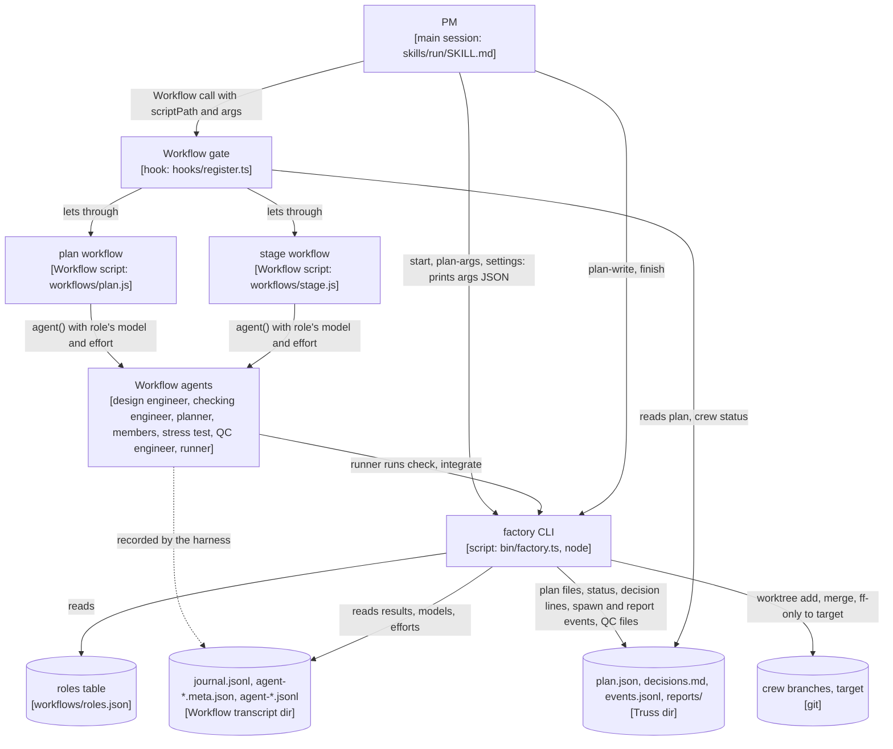
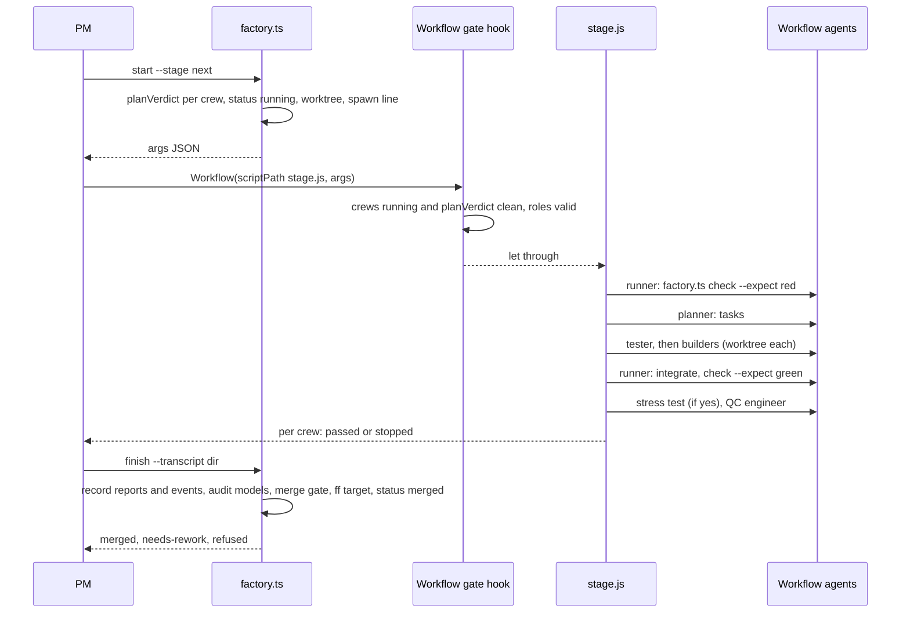

# ADR-0009: a Workflow factory: crews run as Workflow scripts, gates move into a deterministic CLI and a Workflow-call hook

Status: proposed, 2026-10-29. Written by the mid-run design slice `speed-design` (stage 1) of Truss session dd6ebfbb, for the Truss release after 0.10.0. It becomes accepted when the PM (project manager) merges `speed-design` under the client-approved scope. Not repo ADR-0009.

VERDICT: change. The interface that can't take the work is the crew-start seam: `on('tool.call', { tool: 'Agent' })` in `hooks/register.ts:1641`, the single handler that holds the main-session model rule, the in-crew model and effort gates, the rework-allowance gate, the plan gates (approval, stage, `maxParallelCrews`) and the `spawn` line. A Workflow script's `agent()` is not an Agent tool call, so none of it runs (probe, below). Running crews from Workflow needs a new seam: a deterministic CLI (`bin/factory.ts`) that applies the exported verdict functions that don't depend on `crewOf`, a hook on the main session's `Workflow` call, and a post-run audit of the Workflow transcripts. The checks keyed on `crewOf(callerId)` (`agentVerdict`, `effortVerdict`, the rework-allowance gate) can't run on this path, because a workflow agent has no `truss:foreman` ancestor; the script makes every member, QC engineer and stress-test `agent()` call itself, and each of those checks is replaced by a named script rule, CLI check or audit (Decision 4, "What replaces the foreman's gates"). Most of these are "the CLI and the audit check", not "a hook refuses". The plan file, the events file and the QC-file merge gate keep their shapes.

## Context

The client, in decisions.md (frozen scope, item 6): "i have used /workflows and they are much faster. in this case i kind of want the factory to use workflow to expedite. the factory in itself is kind of a goal target. but its just painfully slow right now. and we need to make it way much faster. also stop asking for same question of sequential to main". The client's rulings bind this design: no API runs in any suite; a model and an effort on every agent and every Workflow `agent()` (Sonnet for code, Opus for judgment, never Fable, no Opus at high or xhigh); merge sequential to main, standing; and the gates hold.

Today a crew is a `truss:foreman` started with the Agent tool. The foreman reads, splits, starts each member, waits for its report, merges, runs the checks and starts the QC engineer (`agents/foreman.md` sections 3 to 9). Every hand-off between those steps is a model turn of the foreman, and every hand-off between crews and stages is a model turn of the PM (`skills/run/SKILL.md` sections 6 to 9).

## Measurements

Measured by crew member `speed-design-measure` from the raw logs of five run segments; full detail in `<git common dir>/foundry/dd6ebfbb-e054-4fae-9182-67b695ddbcbe/reports/speed-design/speed-design-measure.md` and its scratch tables (`crews.txt`, `brk.txt`, `tr.txt`, `ask.txt`). Segments: A = run dir `dd6ebfbb-e054-4fae-9182-67b695ddbcbe`, events.jsonl L1-43; B1 and B2 = `70917104-1578-48f5-8ac2-f9e48814b8cc` L1-60 and L61-95; C3 and C4 = `40816bb1-1ec8-4755-8d97-0d12599e1e84` L9-103 and L104-258. events.jsonl times are UTC; decisions.md times are local (UTC-4), minute resolution. Design engineer and checking engineer spans come from the first and last record of each subagent transcript (`~/.claude/projects/C--sw-claude-mods/<session>/subagents/agent-*.jsonl`), because events.jsonl doesn't log main-session design engineers or checking engineers. Client waits come from AskUserQuestion tool_use to tool_result in the main transcript. A 600.0 min machine sleep in C3 (events L16 to L17) is excluded.

Measured wall: 848.1 min (A 121.0, B1 85.3, B2 70.7, C3 206.9, C4 364.2).

| Step | Minutes | Share | Source |
| --- | --- | --- | --- |
| Planning, design engineer rounds (13 rounds over 5 segments; A 7.4 / 9.7 / 11.5, C4 10.1 / 15.0 / 13.6 / 5.2) | 131.6 min | 15.5% | subagent transcripts, first to last record; A agent ids a8056994118e44f82, ac931894a572dd9ac, a275b370b6db59455 |
| Planning, checking engineer calls (10 calls; A 2.1 / 5.3) | 36.4 min | 4.3% | subagent transcripts; A a86c26549b4b03223, a8c87507a87e788c0 |
| Planning, waiting on the client (A: one question, 19:53:01Z to 20:08:22Z, 15.3 min) | 45.4 min | 5.4% | main transcript A L368 |
| Planning, PM gap (nothing running, not waiting on the client; C4 33.7) | 53.4 min | 6.3% | C4: checker-1 end 13:49:56Z to design engineer-2 start 14:22:59Z, decisions 10:16 |
| Planning total, run start to approval | 266.8 min | 31.5% | decisions.md run header and approval line per segment; A 19:42:11Z to 20:38:01Z = 55.8 min |
| Crew build, first-pass members | 156.9 min | 18.5% | events.jsonl spawn to first report, per member |
| QC engineer and stress test, first round | 109.4 min | 12.9% | events.jsonl |
| Repair and stress-test loops (C4 71.1: worktrees-cleanup 6 stress-test rounds, truss-protocol 5) | 125.6 min | 14.8% | C4 events L147-L230; C3 L72-L94 |
| Foreman turnaround (foreman alive, no member running; 84 gaps, mean 1.7 min, max 6.8) | 97.5 min | 11.5% | events.jsonl, report to next spawn within a crew |
| Merge wait and crews done but waiting to be resumed | 24.5 min | 2.9% | decisions.md merge lines; C3 protocol and readonly-guard queued 59.6 and 59.2 min behind hooks-gates |
| PM idle or unattributed after approval | 42.2 min | 5.0% | C4 22.8, incl. the e2e foreman that ended its turn and was never woken: last member report 17:55:37Z, stall tag L238 18:11:45Z, repair foreman 18:21:38Z |
| Client wait after approval, checking engineer pre-merge reviews | 25.0 min | 2.9% | C4 L10525 (14.5 min repair question); B1, B2 checking engineer reviews |

The top sinks, in the order this design attacks them:

1. Serial design engineer and checking engineer rounds: 168.0 min. C3 and C4 each ran 3 or 4 design engineer rounds; C4's design engineer-3 ran 13.6 min writing about 670 lines of Python acceptance tests and was stopped by the client (decisions 10:57). In A, the reconcile design engineer waited 15.3 min for a client answer to a checking engineer finding before it could start.
2. Repair and stress-test loops: 125.6 min wall. Stress-test rounds have no bound: `agents/foreman.md:64` says "After the fixes, run a fresh stress test", and checker-7 named that line as the root of C4's loops.
3. PM gaps and idle: 100.8 min (planning gap 53.4, idle 42.2, plus resume-pending time).
4. Foreman turnaround: 97.5 min over 84 gaps, all segments.
5. Client waits: 60.9 min inside the measured window. The merge-mode and target question was asked in 5 of 5 runs and answered "sequential to main" each time (main transcript A L533, B1 L491, B2 L1544, C3 L6579, C4 L8953); its bundled waits total 7.5 min, an upper bound, since it always rode inside the approval prompt.

Spot-checked by this design engineer against the logs: `dd6ebfbb/events.jsonl` line 1 is eval-design's foreman spawn at 2026-10-29T20:39:10.008Z and line 9 its final report at 21:08:10.935Z, which is the 29.0 min stage-0 crew; `dd6ebfbb/decisions.md` line 1 is the run header `## Run 2026-10-29T19:42:11Z` and line 24 the approval with `approvedAt 2026-10-29T20:38:01Z`, which is the 55.8 min planning total for A.

What a script removes outright is waiting, not work: foreman turnaround (97.5 min), PM gaps and idle (100.8 min) and the planning waits that sat between rounds. Together that is 198.3 min, 23% of the measured wall. Bounding design engineer rounds to two and stress-test rounds to the rework allowance cuts into the next 293.6 min (sinks 1 and 2). The member and QC engineer work itself (266.3 min) is not made shorter; it is run without gaps.

## Probe

Source: `<git common dir>/foundry/dd6ebfbb-e054-4fae-9182-67b695ddbcbe/probe-workflow.md`, Workflow run `wf_25508836-f05`, five `agent()` calls run by the PM (subagents can't call Workflow). This design engineer read the run's files at `~/.claude/projects/C--sw-claude-mods/dd6ebfbb-e054-4fae-9182-67b695ddbcbe/subagents/workflows/wf_25508836-f05/`.

What Workflow can do for truss:

- **`agent()` can be any Truss type, with an exact model and effort.** `agentType: "truss:checking-engineer"` with `model: "opus", effort: "low"` ran as truss:checking-engineer on claude-opus-5-5 at low; `truss:foreman` with sonnet, low ran as truss:foreman on claude-sonnet-5-5 at low. So a script can run design engineer, checking engineer, QC engineer, stress test, writer, builder and test-writer.
- **Worktree isolation works as the Agent tool's does.** `isolation: "worktree"` gave `.claude/worktrees/wf_25508836-f05-4` on branch `worktree-wf_25508836-f05-4` at the session's HEAD (fa0fa9f), sharing the git common dir. Without it an agent runs in the session cwd, which for this PM is the Truss dir inside `.git`: no work tree.
- **The run leaves a machine-readable record.** `journal.jsonl` holds one `{"type":"started","key","agentId","label","phase"}` and one `{"type":"result","key","agentId","result"}` line per agent. Each `agent-<id>.meta.json` holds `agentType` and, only when the script set one, `model` (`agent-a3789c47e8d483cda.meta.json` has `"model":"opus"`; the no-model checking engineer's `agent-afbe368ff16694927.meta.json` has none). Each `agent-<id>.jsonl` transcript records the model the agent actually ran on (`"model":"claude-opus-5-5"`) and its effort (`"effort":"low"`). A CLI can audit a finished run from these files without any model.
- **`agent()` returns the agent's final text, or a schema-validated object** (workflow-authoring skill). The foreman-at-cap result in `journal.jsonl` is its full `CHECKPOINT:` report text.

What breaks:

- **No spawn gate fires.** All of them live in `on('tool.call', { tool: 'Agent' })` (`register.ts:1641-1715`). The no-model checking engineer ran on the session model (Opus at medium; on a Fable session it would have been Fable). A foreman started at the 4-crew cap. events.jsonl got no spawn line.
- **Report capture keys by raw agent id.** `classic.SubagentStop` (`register.ts:1816`) fired and wrote `reports/a5b5d3f425eea653f/`, because `crewOf` treats any `truss:foreman` as a crew foreman named by its id. A non-foreman workflow agent has no foreman ancestor, so `crewOf` returns nothing and no report is saved at all.
- **Injected git status is not a fact.** The foreman-at-cap agent reported another crew's branch from the session's git snapshot.
- **A workflow agent has no Agent and no Workflow tool** (probe 2, run `wf_455979bb-efb`: the default workflow subagent, `general-purpose` and `kit:builder`, whose definition says "All tools", each listed its own tools; all three have SendMessage and none has Agent or Workflow). So a workflow member can't start a nested helper that inherits the session model, and a `truss:foreman` run by `agent()` could not delegate to members. That `truss:foreman` has no Agent tool is inferred from `kit:builder`, not run. The gap that remains is the script's own `agent()` calls, which no hook sees.
- **A script has no file system, no shell and no clock** (`Date.now()` and argless `new Date()` throw). Every deterministic step it needs (plan checks, acceptance test runs, merges, patch ids, status edits, decision stamping) has to run as a command, and the script can only reach a command through an agent that has Bash.

Not verified by the probe, and handled below without relying on them: whether `tool.call` fires for the main session's own `Workflow` call (the hook in Decision 6 is the first place that would show it; the CLI and the audit hold the gates if it doesn't); whether `scriptPath` accepts a file inside the plugin (Decision 6 has a fallback); whether the Workflow call blocks the PM's turn until the script returns (Decision 1, "start, stale runs", covers a run that dies either way); and what `agent()` returns when the agent ends with SubagentHandback rather than final text.

Not verified, outside those four: that a `truss:foreman` started by `agent()` has no Agent tool (inferred from `kit:builder`, probe 2); whether a SendMessage from a workflow agent reaches the PM or a foreman (probe 2 did not test it); whether Workflow accepts a script file that the CLI placed in the session's `workflows/scripts/` dir (the probe's script ran from there, but the harness wrote it); that agent transcripts are appended every turn while the agent runs (the liveness check in "start, stale runs", rule 3, and `finish` without `--result` rely on it).

What moves where:

| Step | Today | Here |
| --- | --- | --- |
| Plan checks (approval vs stage 0, disjoint `owns`, slug pattern, proved acceptance tests) | PM reads the draft (`SKILL.md` section 4) | `factory.ts plan-check` |
| Plan files from the design engineer's report | hook plan-file route, Agent-tool design engineers only | `factory.ts plan-write`, same rules, from the Workflow journal |
| Stage, cap and approval gates, `status: running`, spawn line | hook on Agent; PM edits `plan.json` | `factory.ts start`, using the exported `planVerdict` |
| Acceptance test runs, red and green | foreman's Bash | `factory.ts check`, called from the script through a Sonnet runner |
| Merging member branches into the crew branch | foreman's Bash | `factory.ts integrate` |
| Reports, spawn and report events, model audit | hook on SubagentStop and Agent | `factory.ts finish` (record step), from the journal and transcripts |
| Merge gate (newest QC file, PASS, no UNSCOPED, Head or Patch), merge, `status: merged` | PM's Bash and Edit (`SKILL.md` section 9) | `factory.ts finish` (merge step), using the exported `qcRuling`, `latestQc`, `patchIdOf`, `PATCH_COMMAND`, and `mergeHeadVerdict`, a fail-closed wrapper around the exported `headVerdict` (Decision 1, "finish, merge step") |
| Decision lines | PM's Edit, stamped by the hook | the CLI writes stamped lines itself with the exported `stampDecisions` and `localTime` |

## Decision

Truss gets a second crew engine. When the PM's session has the Workflow tool, every crew that has no `commissioning-engineer` member and no client-called `high` or `xhigh` effort runs as a Workflow script; all others, and every crew in a run without Workflow, run on the foreman path as today. So does every crew of a `single`-mode run. The split is made per crew by `start` from the goal file's `## Engine` section (Decision 1, "start, engine split"). Foreman-path crews are started and merged by the PM as today, and `stage.js` and `finish` never see them. Planning runs as a Workflow script whenever Workflow is there. The parts:

*The Workflow engine's parts and what passes between them. Traces to: `hooks/register.ts:1641-1715` (the Agent gates it mirrors), `:327-349` (`planVerdict`), `:499-565` (`qcRuling`, `patchIdOf`, `headVerdict`), `:848-904` (the plan-file route), and the probe run's `journal.jsonl` and `agent-*.meta.json`.*

*One stage, from start to merge. Traces to: `skills/run/SKILL.md` sections 6 and 9 (today's steps), `agents/foreman.md` sections 1, 3, 6, 7, 9 and 12 (the chain stage.js runs), the probe's `journal.jsonl`.*

### 1. The factory CLI, `bin/factory.ts`

One file, run as `node <plugin>/bin/factory.ts <command> [flags]`, where `<plugin>` is the absolute plugin dir (`args.truss.plugin` inside a script). No command depends on the caller's cwd when `--dir` and `--repo` are given, and the scripts and the PM always give both, as absolute paths. This matters because a Workflow agent with no isolation runs in the session cwd, which for the PM is the Truss dir inside `.git` (probe) (Node 22 strips the types, as the `tests/*.check.ts` files already rely on). It imports only Node built-ins and the exported functions of `../hooks/register.ts`, the hooks module's entry file, as `tests/contract-evals.check.ts:16` already does. Every command prints exactly one JSON object on one line to stdout and exits 0 when it did what was asked, 1 when a gate or an expectation refused, and 2 on a usage or I/O error (with `{"error": "<message>"}`). Every command is idempotent: run twice, it leaves the same state and prints the same result (core 7). The one exception is `check`, which adds a new record file each time it runs and never changes an old one.

The CLI is the only writer of a crew's `status` on the Workflow path. Statuses keep `plan.schema.json`'s four values: `planned`, `running`, `merged` and `dropped`. `start` moves a crew from `planned` to `running`, and `finish` moves it from `running` to `merged`. Neither command ever changes a crew that is `merged` or `dropped`, and neither restarts a `running` one except through `start --slug` (below). It never runs `git push`, never opens a PR, and never touches any remote.

Common flags: `--dir <truss dir>` (absolute), `--repo <repo root>` (absolute; default the cwd's `git rev-parse --show-toplevel`).

| Command | Does | Prints |
| --- | --- | --- |
| `settings --repo R` | Reads `merge` and `target` from `R/.claude/truss.json`. Missing `merge` is `sequential`; missing `target` is `git -C R branch --show-current`. | `{"merge":"sequential","target":"main","source":".claude/truss.json"}`; `source` is `default` when neither key is set, `mixed` when one is. Keys in exactly this order. |
| `plan-args --dir D --repo R --brief-file B [--fix E] [--scripts-dir S]` | Builds the plan workflow's `args`: `{"truss":{"kind":"plan","dir","repo","plugin","schema","architecture","maxParallelCrews","reworkAllowance","roles","scriptPath"},"brief":"<text of B>"}`. `plugin` is the absolute plugin dir, `schema` its `docs/plan.schema.json`, `roles` from `workflows/roles.json`. `scriptPath` is the file the PM passes to `Workflow`: `<plugin>/workflows/plan.js`, or, with `--scripts-dir S` (an absolute dir), a byte-for-byte copy the CLI wrote to `S/truss-plan.js` (Decision 6, "scriptPath fallback"). | the args object |
| `plan-write --dir D --transcript T --label L` | Takes the `result` of the agent labelled `L` from `T/journal.jsonl` (the last such line). Applies the plan-file route's rules exactly (`register.ts:879-904`): both fenced blocks present (`fencedBlock`, exported), `parsePlan` accepts the JSON, an existing approved plan is never overwritten; writes `plan.json` with `approvedAt: null` and `plan.md`. | `{"written":true}` or `{"written":false,"reason":"<the route's reason text>"}` (exit 1) |
| `plan-check --dir D` | Checks `D/plan.json`: `version` 2, `approval` is `client` exactly when a stage-0 crew exists, each slug matches `^(?!.*-[0-9]+$)[a-z0-9]+(?:-[a-z0-9]+)*$` and is not the reserved `truss`, every crew `status` is `planned` on an unapproved plan, no two crews of one stage own a common path (two globs overlap when equal, or when the literal part of one before its first `*`, `?` or `[` is a prefix of the other's), and lists each crew with `acceptanceTestProved: false`. | `{"ok":true,"unproved":[...]}` or `{"ok":false,"errors":["<slug>: <rule>", ...]}` (exit 1) |
| `approve --dir D --by client\|auto` | Sets `approvedAt` to now (`toISOString`, `Z` offset) and appends the stamped decision line `- HH:MM \| plan approved (<by>): merge <mode>, target <branch> from <source>; approvedAt <ts>; scope frozen \| ... \| none \| followed`. Refuses when `approvedAt` is already set. | `{"approvedAt":"..."}` |
| `start --dir D --repo R --stage <n\|next> [--type role=agentType ...] [--no-workflow] [--scripts-dir S]` | Picks the stage. `next` means the lowest stage that has any crew whose status is `planned` or `running`; `n` must be that same stage, otherwise `start` refuses. A `running` workflow crew that is stale (below) keeps that stage open, and `start` lists it under `stale` so the PM restarts it with `--resume stale`; `start` never restarts it by itself. A `running` crew whose newest run holds its labels but was never recorded by `finish` is listed under `unfinished`, and the PM runs `finish` on that run first ("start, stale runs"). It considers only that stage's `planned` crews, in queue order. The free slots are `maxParallelCrews` minus the number of `running` crews in the plan, each counted once whatever its engine. `start` fills them in queue order and splits by engine ("start, engine split" below). For a workflow crew it: refuses the crew on `planVerdict`, with the hook's text; sets its `status` to `running`; creates the crew worktree `R/.claude/worktrees/truss-<slug>` on branch `truss-<slug>` from the target's head, or reuses it when the worktree is already there; appends `{"event":"spawn","crew":slug,"agent":slug,"agentId":null,"type":"workflow-crew","model":null,"effort":null,"by":"factory"}` and a decision line. It reads the goal file `D/goals/<slug>.md`'s `## Approved scope`, `## High-impact paths`, `## Stress test` and `## Engine` sections. A `running` crew is never in a plain `--stage` result. | `{"truss":{"kind":"stage","dir","repo","plugin","target","reworkAllowance","roles","scriptPath","crews":[<crew entry>]},"foremen":[{"slug","reason"}],"refused":[{"slug","reason"}],"stale":[{"slug","since"}],"unfinished":[{"slug","run"}]}`. `scriptPath` is as in `plan-args`, for `stage.js`. A crew entry is `{"slug","stage","goalFile","goal","owns","acceptanceTest","highImpact","stressTest","scope","worktree","branch","base","architecture","adrs","resume","tasks","done","answers","spent","labelFrom"}`. `base` is defined once, below ("start, base"). On a fresh start, `resume` is `null`, `tasks` and `done` and `answers` are `[]`, `spent` is `0`, and `labelFrom` is `{}`. |
| `start --dir D --repo R --slug S --resume answers --transcript T --answers F` | Restarts one stopped workflow crew, which must be `running` and have a `by: "factory"` spawn line. `T` is the stopped stage.js run, and `F` is a JSON file `[{"at": "<task name or step>", "text": "<the answer>"}]` that the PM writes from the client's or its own ruling. From `T/journal.jsonl` it takes the planning engineer's last accepted `tasks`, the `<slug>-planner*` result with the highest number. A task is in `done` when its member's result has `marker: "DONE"` and that member's `branch` is an ancestor of the crew branch (`git merge-base --is-ancestor`), so git decides, not a model's report. | The same object, with one crew entry: `resume: "answers"`, its `tasks`, `done` and `answers`, plus `spent` and `labelFrom` as below. |
| `start --dir D --repo R --slug S --resume merge-ready` | Restarts one workflow crew that `finish` sent back as `rework` with `why` `conflict` or `reqc`, or that stopped at the scope or QC engineer step. | One crew entry with `resume: "merge-ready"`; its `base` is the target head last merged into the crew branch ("start, base"). |
| `start --dir D --repo R --slug S --resume stale` | Restarts one workflow crew left `running` by a stage.js run that died ("start, stale runs"). It refuses a crew that is not stale: rule 1 failing, or the newest run being recorded without an `incomplete` line, gives `why: "not stale"`; a newest run that holds the crew's labels and is not recorded gives `why: "run not finished"`, and rule 3 failing gives `why: "run may be live"`. On success it appends a fresh `{"event":"spawn",...,"by":"factory"}` line for the crew, with a new `ts`, so rule 3 reads the restart time. | One crew entry with `resume: "stale"`, its `tasks` and `done` rebuilt as for `--resume answers`, plus `spent` and `labelFrom`. |
| `sync --dir D --slug S` | In the crew worktree, runs `git merge <target>`, never a rebase. On a conflict it leaves the merge in progress. | `{"merged":true,"head":"<sha>"}` or `{"merged":false,"conflicts":["<path>", ...]}` (exit 1) |
| `check --dir D --slug S --cwd W --expect red\|green` | Runs the plan's `acceptanceTest` for `S` (from `plan.json`, never from the caller) with `bash -c` in `W`; records `D/checks/<S>-<n>.json` with the command, exit code, `git -C W rev-parse HEAD` and the last 40 lines of output. | `{"ok":<expectation met>,"exit":N,"head":"<sha>","tail":"..."}`; exit 1 when not met |
| `integrate --dir D --slug S --branch B` | In the crew worktree: `git merge --no-ff B`. On conflict, leaves the merge in progress. | `{"merged":true,"head":"<sha>"}` or `{"merged":false,"conflicts":["<path>", ...]}` (exit 1) |
| `owns-check --dir D --slug S` | `git diff --name-only <base>...HEAD` in the crew worktree against the crew's `owns` globs (`path.matchesGlob`). | `{"ok":true}` or `{"ok":false,"outside":[...]}` (exit 1) |
| `finish --dir D --repo R --transcript T [--result R]` | `R` is a JSON file holding the value `Workflow(stage.js)` returned, which the PM saves. With `--result`: the record step, then the merge step, below. Without it (the Workflow call errored, or the session died, so there is no return value): first the liveness rule (rule 3 of "start, stale runs") for run `T`, for every crew that has a label in `T`. While it fails, `finish` refuses with `why: "run may be live"` and writes nothing, so `incomplete` is only ever written for a run that passed the liveness bound. Then the record step and the audit for run `T` only, nothing merged. For each crew that has a label in `T`, `finish` appends one `{"v":1,"ts":"...","event":"incomplete","crew":"<slug>","run":"<run id>"}` line to `events.jsonl` and lists the slug under `incomplete`. | `{"merged":[...],"rework":[{"slug","why"}],"blocked":[{"slug","why"}],"refused":[{"slug","why"}],"audit":[{"label","why"}],"incomplete":["<slug>", ...]}`; `incomplete` is `[]` with `--result` |

**start, engine split.** Each goal file carries a `## Engine` section, written by the PM in `SKILL.md` section 6. Its first word is `workflow` or `foreman`, followed by the reason when it is `foreman`. The PM writes `foreman` when the crew has a `commissioning-engineer` member, or when the client raised any of its members to `high` or `xhigh`; it writes `workflow` otherwise. `start` overrides the section to `foreman` for every crew when `settings` gives `merge: single`, or when the PM passes `--no-workflow` because its session has no Workflow tool. A goal file with no `## Engine` section is `foreman`, so the default is today's behaviour. Then, in queue order within the cap:

- a `foreman` crew goes to `foremen` with its reason. `start` doesn't mark it `running`, doesn't make a worktree and writes no spawn line. The PM starts its `truss:foreman` with the Agent tool and edits its `status` to `running`, both exactly as today, so the Agent hook's `planVerdict` still gates it. That status is how a later `start` knows the foreman has started: only `planned` crews are ever returned. A foreman crew that `start` returned but the PM hasn't started yet is still `planned`, so running `start` again returns it again, which keeps `start` idempotent. The PM merges a foreman crew under `SKILL.md` section 9 as today, never through `finish`. Each returned foreman crew takes one of this call's slots, and each `running` foreman crew counts against the cap like any other, so `start` never puts more than `maxParallelCrews` crews in flight in all;
- a `workflow` crew goes to `truss.crews`, as the row above says. Only these reach `stage.js`. Because `workflowRoleVerdict` refuses a `commissioning` role and `roles.json` has none, a deploy crew can't run as a script, even by mistake.

**start, allowance and label numbering across runs.** A crew can run in several stage.js runs: a fresh start, then resumes. So `start` reads what earlier runs left in `D/reports/<slug>/` and passes two fields in every crew entry:

- `spent` is the crew's repair spend so far. It counts the crew's QC engineer FAILs (`qcFails`, exported) plus its stress-test reports after the first one (`<slug>-stress-2.md` and up).
- `labelFrom` maps each role to the next free number: `{"qc": 3}` when `<slug>-qc.md` and `<slug>-qc-2.md` exist.

stage.js counts from both. Every run's reports are on disk before a stale restart, because `start --resume stale` accepts only a run that `finish` has recorded (rule 2 below), so `spent` and `labelFrom` count every run, including a dead one's QC engineer FAILs and labels. So a resumed run never reuses a label, `finish` never overwrites a report, and the allowance is never reset by a resume. `finish` adds an `audit` entry, and writes nothing, when a report file it is about to write already exists with different text.

**start, base.** `<base>` is never a stored SHA that can go stale. Every command that needs it computes it in the crew worktree as `git merge-base <target> HEAD`, where `<target>` is the `settings` target. That is the target head last merged into the crew branch: the target's head at `start` until the first `sync` (step R1) or `finish` step 2 merges the target in, then the head of the latest such merge. It is the rule of `agents/foreman.md:211` ("the target head last merged in"). `owns-check` diffs `<base>...HEAD` with that value, so after a `sync` it lists only the crew's own files and not other crews' merged files. The crew entry's `base` and the `base` that stage.js passes to the QC engineer are this value at the time the entry is built, and the `base` in a `passed` result is the value at the QC engineer step. A restart recomputes it, never reuses an old entry's.

**start, stale runs.** A `running` workflow crew whose stage.js run died (a session crash, a Workflow tool error, the PM's turn ending mid-run) has no stopped result and would hold its stage open for ever. It is stale when all of these hold, each read from a file:

1. `plan.json` says `status: "running"` and `events.jsonl` has a `by: "factory"` spawn line for the crew;
2. no run holds one of the crew's labels (the run died before its first agent), or the newest Workflow run that does is recorded with an `incomplete` line for that run id (`finish` without `--result`). The runs are the `T/../*/` dirs, and a label belongs to the crew by the parse in "Labels". A newest run that holds labels and is not recorded (no `spawn` line with `by: "workflow:<run id>"`) is never stale: its reports are not on disk yet, so a restart would undercount `spent` and reuse its labels. `start` lists the crew under `unfinished`. A run recorded without an `incomplete` line returned and was finished, and its restart is `--resume answers` or `--resume merge-ready`, never `--resume stale`;
3. liveness: the `ts` of the crew's newest `by: "factory"` spawn line (`start --resume stale` appends a fresh one, so a restart resets the clock) and the newest mtime over that run's `journal.jsonl` and every `agent-*.jsonl` in it are all more than `STALE_MS` old, a constant in `factory.ts`: 30 minutes (1800000 ms). The check assumes a running agent appends to its own transcript every turn (not verified; see the Probe section). The Bash tool's 10-minute maximum timeout bounds a foreground call, but background Bash, Monitor and MCP calls have no cap, so 30 minutes is a chosen margin, not a proof or a measurement. `journal.jsonl` alone is not enough: it changes only when an agent starts or returns, so a live run whose current agent works for more than 30 minutes would look stale.

Each `running` workflow crew is in one of four states, read from files. **Live**: rule 3 fails; `start --resume stale` refuses with `why: "run may be live"`, which keeps a second stage.js run off a live crew, and `finish` without `--result` refuses the same way. A live run is not yet recorded, so `start` also lists its crew under `unfinished` until the run ends. **Returned and finished**: the newest run that holds its labels is recorded without an `incomplete` line; it stopped or went to `rework` or `blocked`, and its restart is `--resume answers` or `--resume merge-ready`. **Unfinished**: the newest run that holds its labels is not recorded, because the PM's session died before `finish` or it skipped `finish`; `start` lists the crew under `unfinished`, and `--resume stale` on it refuses with `why: "run not finished"`. **Stale**: no run holds its labels, or the newest one that does is recorded with `incomplete`, and rule 3 holds. The PM's procedure: when `Workflow(stage.js)` returns, it saves the value and runs `finish --transcript T --result R`. When the call errors, or after a session restart, it runs `finish --transcript T` on each run `start` lists under `unfinished`: with `--result R` when it saved R, without `--result` when the value is lost (the session died before saving it). Without `--result`, `finish` records the run's agents, merges nothing and marks the run `incomplete`. Then, once `start` lists the crew under `stale`, it runs `start --slug <s> --resume stale`, `Workflow(stage.js)`, and `finish --result`. `start --resume stale` restarts a stale crew in its existing worktree and on its existing branch, never from a clean base, so committed work stays: when the crew branch has no commit beyond `<base>`, `tasks` and `done` are empty and the chain runs from step 1; otherwise `tasks` is the `<slug>-planner*` result with the highest number in the dead run's `journal.jsonl`, and `done` is decided by git exactly as for `--resume answers` (the member's branch is an ancestor of the crew branch). Member branches the dead run never merged are left alone and are not merged. `spent` and `labelFrom` come from the reports on disk, and every earlier run's reports are on disk because rule 2 requires the run recorded, so the allowance is not reset and no label is reused. A stale restart passes every gate a fresh start passes: the Workflow gate re-applies `planVerdict` to the crew, and stage.js applies the same role rules, red-first rule and rework allowance (Decision 4, "Restarts").

**Labels.** A Workflow agent's label is `<slug>-<role>` or `<slug>-<role>-<n>`, where `<n>` is 2 or more. Labels from the plan script use the reserved slug `truss`, which `plan-check` refuses as a crew slug: `truss-designer`, `truss-designer-2`, `truss-checker`, `truss-checker-2`. A role key matches `^[a-z]+$`: no hyphen and no digit. `workflowRoleVerdict` refuses any other key. That makes the parse unique by construction:

1. Strip a trailing `-<n>` when the label has one. A slug never ends in `-<digits>`, and a role has no digit, so a trailing digit run can only be `<n>`.
2. The last `-` segment is the role.
3. Everything before that is the slug.

A crew label maps to exactly one `(slug, role, n)`, and two different crews can never make the same label. Crews `x` and `x-test` with roles `tester` and `writer` give `x-tester`, `x-writer`, `x-test-tester` and `x-test-writer`, all distinct. `x-test-writer` parses only as slug `x-test`, role `writer`. This is why the roles are named `planner` and `tester`, not `planning-engineer` and `test-writer`. The hyphenated names could collide: under them, crew `x`'s `test-writer` and crew `x-test`'s `writer` both give `x-test-writer`. The agent type keeps its file name, `truss:planning-engineer`. A tester's commits still carry `Truss-Role: test-writer`, the value `agents/foreman.md:77` lists and `agents/qc-engineer.md:48` checks.

**finish, record step.** Each `started` line's label in `T/journal.jsonl` is parsed as above. The label belongs to a crew only when its slug exactly equals a crew that has a `by: "factory"` spawn line and status `running`, and its role is a key of `roles.json`. A label that fails to parse, or whose slug names no such crew, is filed nowhere and gets an `audit` entry. For each crew label: writes the agent's `result` text to `D/reports/<slug>/<label>.md` (a schema result is written as its `report` field), sets that file's mtime to the last timestamp in `T/agent-<id>.jsonl` (when the agent finished, so `latestQc`'s newest-file rule orders QC engineers truthfully), and appends a `spawn` line (`agentId`, `type` from the meta file's `agentType`, `model` and `effort` as the transcript records them, `by: "workflow:<run id>"`, the run id being `T`'s folder name) and a `report` line (`marker` from `markerOf`). It also audits each agent of the run, crew or not, and adds an `audit` entry when: the meta file has no `model`; the transcript's model family (`family`, exported) is not `opus` or `sonnet`; the effort is `max`, or `high` or `xhigh` on any role; a `-qc` or `-stress` label ran as a type other than `truss:qc-engineer`; or a `-qc` transcript has a `Write` or `Edit` tool use.

**finish, session audit.** The run's own transcript dir is not enough: a main-session Workflow call from any other script can start `truss:*` agents that `finish` would never see. So `finish` also scans every Workflow run of this session, `T/../*/`, whose first transcript record is at or after the run start, the timestamp of the newest `## Run <ts>` header in `D/decisions.md` (not `approvedAt`, so `plan.js` runs and any ad hoc `truss:*` run during planning are covered; with no such header, every run counts). A run is Truss's when every one of its labels parses (Labels, above) to the slug `truss` or to a factory-started crew. A run is in scope when it is Truss's, or when any of its agents has an `agentType` starting with `truss:`. Runs out of scope are not audited at all: a client's own `/workflows` run with no Truss agent never blocks a merge. For each run in scope, `finish` adds an `audit` entry, labelled `<run id>/<label>`, for each agent that meets either condition:

- its `agentType` starts with `truss:` and its run is not Truss's;
- its meta file has no `model`, or its transcript's model family is not `opus` or `sonnet`.

So a `truss:*` agent anywhere in the session is still covered.

While any session-audit entry stands, `finish` merges nothing at all. Every crew of the stage is listed under `refused` with `why: "session audit"`, the entries go in a stamped decision line, and the PM takes them to the client. Rerunning `finish` after the client rules gives the same result until the offending run is gone or the client says to merge anyway, which the PM records as a decision line that `finish` reads (`audit waived: <run id>`).

**finish, merge step**, crews in plan order, the gate of `SKILL.md` section 9 in code. Only `merge: sequential` is supported. When `settings` gives `single`, `start` puts every crew on the foreman path (below) and `finish` refuses, with `{"error":"single merge mode runs on the foreman path"}` and exit 2. `finish` only ever touches crews that have a `by: "factory"` spawn line; foreman-path crews are merged by the PM under `SKILL.md` section 9 exactly as today. For each such `running` crew that has a label in `T`, in plan order, whose newest QC file this run (`latestQc`, since `approvedAt`) is a `qcRuling` PASS with no UNSCOPED line:

1. Refuse when any `audit` entry names one of its agents, when events.jsonl has no `by: "factory"` spawn line for it, when `owns-check` fails, when `qcFails` for it is more than `reworkAllowance` (a PASS after a spent allowance doesn't count; a decision line `re-planned: <slug> from qc-<k>`, the PM's logged successor re-plan, starts a fresh count, so only `-qc-<k>` and later QC files count, here and in `start`'s `spent`), or when the crew's lowest-numbered `D/checks/<slug>-<n>.json` is missing or has `exit` 0. That file is the red record: `check` wrote it, so the red-first rule rests on a file the CLI wrote and not on the runner's relay.
2. In the crew worktree, `git merge <target>` (never rebase), the same merge as `sync`. On a conflict, `finish` aborts the merge, so the crew worktree is clean again, and lists the crew under `rework` with `why: "conflict"`. The merge is redone later, in the stage.js step R1 of a `merge-ready` restart, where the resolver resolves it.
3. Compute `PATCH_COMMAND` with `<base>` the target head just merged in (`git merge-base <target> HEAD` after step 2, "start, base"), always, before comparing anything. Then, when HEAD equals the QC engineer's `Head:` the PASS stands; otherwise when the patch equals the QC engineer's `Patch:` and `check --expect green` passes on the merged head, the PASS stands. The rule is `mergeHeadVerdict(plan, qc, head, patch)`, defined in `factory.ts` and failing closed. The exported `headVerdict(plan, qc, head, patch)` (`register.ts:558-565`) is fail-open by design for the stop gate: it passes when `head` or `patch` is undefined, and it passes a plan below v2. `mergeHeadVerdict` takes the same `plan` argument and first refuses when `qc.head`, `qc.patch`, `head` or `patch` is undefined (an empty or failed `git diff`, so `patchIdOf` returns undefined), whatever the plan version. So the below-v2 pass of `headVerdict` never applies on this path. The patch is always computed and must be defined, even when HEAD equals the QC engineer's `Head:`. Only then does it call `headVerdict` on the defined values. Such a crew goes under `refused` with `why: "patch id unavailable"` and is not merged. Any other mismatch is `rework` with `why: "reqc"`.
4. Fast-forward the target. First, `git -C R worktree list --porcelain` finds the worktree, if any, that has `<target>` checked out.
   - The target is checked out and that tree is clean (`git -C <it> status --porcelain --untracked-files=no` is empty): `git -C <it> merge --ff-only truss-<slug>`. "Dirty" means tracked changes only, so a stray untracked file in the client's checkout doesn't block a merge; if the `--ff-only` merge fails for any reason, including an untracked file in its way, the crew is `rework` with `why: "target moved"` as below. TODO: the build's test should run a merge that an untracked file blocks, to confirm git's failure and the `why` text.
   - The target is checked out and that tree is dirty (tracked changes): nothing is touched. The crew goes under a new `blocked` list, `[{"slug","why":"target checked out dirty: <path>"}]`, and the PM tells the client. A crew under `blocked` stays `running`, and the next `finish` tries it again.
   - The target is checked out nowhere: `git -C R update-ref refs/heads/<target> <crew head> <old target head>`, a compare-and-swap that fails when the target moved.
   - Only a failed `--ff-only` or a failed compare-and-swap is `rework` with `why: "target moved"`.

   `git fetch . <src>:<target>` is never used, because git refuses it when the target is checked out anywhere.
5. Set `status` to `merged`, append the decision line, remove the crew's member worktrees whose branches are ancestors of the crew branch (`git merge-base --is-ancestor`), and remove the crew worktree.

Crews of a later stage are never touched by `finish`.

### 2. The roles table, `workflows/roles.json`

The one source of every Workflow agent's type, model, effort and isolation. `start` and `plan-args` copy it into `args.truss.roles`; `--type role=agentType` replaces `agentType` only, for the roles marked `typeFromProject`, with the project agent the PM picked in `SKILL.md` section 3 (default `general-purpose`).

| Role | agentType | model | effort | isolation | Notes |
| --- | --- | --- | --- | --- | --- |
| `designer` | `truss:design-engineer` | `opus` | `medium` | `worktree` | plan mode |
| `checker` | `truss:checking-engineer` | `opus` | `medium` | none | |
| `planner` | `truss:planning-engineer` | `opus` | `medium` | none | read-only; reads the crew worktree by absolute path |
| `tester` | project, `typeFromProject` | `sonnet` | `medium` | `worktree` | |
| `builder` | project, `typeFromProject` | `sonnet` | `medium`, or `low` when the task says so | `worktree` | |
| `resolver` | project builder type | `sonnet` | `medium` | none | works in the crew worktree by absolute path; merge conflicts only; its commits carry `Truss-Role: resolver` |
| `writer` | `truss:writer` | `opus` | `medium` | `worktree` | |
| `rca` | `general-purpose` | `opus` | `medium` | none | writes no code |
| `stress` | `truss:qc-engineer` | `opus` | `medium` | `worktree` | brief opens `Stress test:` |
| `qc` | `truss:qc-engineer` | `opus` | `medium` | none | |
| `runner` | `general-purpose` | `sonnet` | `low` | none | runs one command the script writes out in full, `node <args.truss.plugin>/bin/factory.ts <command> --dir <D> --repo <R> ...` with every path absolute, and returns its stdout and exit code; it never changes directory and never composes a command itself |

No `foreman`, no `commissioning-engineer`, no `integrator`. A `truss:foreman` in a script would trip the foreman stop gate and the raw-id report capture (probe), and it would have no Agent tool to delegate with (probe 2, inferred), so the table never holds one. `workflowRoleVerdict(roles)` (Decision 6) refuses a table with any model but `opus` or `sonnet`, any effort but `low` or `medium`, a missing model or effort, a `foreman` or `commissioning` role, or a role key that doesn't match `^[a-z]+$` (Decision 1, "Labels").

### 3. The plan workflow, `workflows/plan.js`

Run by the PM in place of `SKILL.md` section 4's design engineer and checking engineer calls, with `Workflow({ scriptPath: <args.truss.scriptPath>, args: <plan-args output> })`, where `scriptPath` is `<plugin>/workflows/plan.js` unless the fallback of Decision 6 applies. Every `agent()` call in both scripts goes through one function, `spawn(role, label, prompt, opts)`, which takes `agentType`, `model`, `effort` and `isolation` from `args.truss.roles[role]` and throws before calling `agent()` when the role is missing or fails the same rules as `workflowRoleVerdict`. No other `agent(` call exists in the file.

1. `truss-designer`: `spawn('designer', ...)` with the brief from `args.brief`, its first line exactly `Mode: plan`, and the schema `{report: string, planJson: string, planMd: string}` (so the result doesn't depend on SubagentHandback inside a workflow, which the probe didn't test). The brief tells it the two blocks go in `planJson` and `planMd` as well as fenced in `report`.
2. `truss-checker`: the verdict review of `SKILL.md` section 4 ("Have a checking engineer review the verdicts"), with the design engineer's `planJson`, `planMd` and the architecture doc's path. The script reads every `REVIEW:` and `Client:` line from its text.
3. When any `REVIEW: disagree`: one reconcile round, `truss-designer-2` with the same brief plus the checking engineer's lines, then `truss-checker-2` told the reconcile round has happened. Never a third design engineer. No client question stops the script: client items are collected and returned.
4. Returns `{designerLabel, reviews: [...lines], client: [...Client lines that name a trigger], stillDisagree: bool}`.

Then the PM runs `plan-write` with the returned label and `plan-check`. When `plan-check` fails, the PM runs plan.js once more, as a new run. Its args come from `plan-args --fix <errors file>`, which adds the errors to `args.brief` and sets `args.truss.fix: true`. A fix run starts one design engineer only, labelled `truss-designer-3`, then one checking engineer, `truss-checker-3`, with no reconcile round. So planning never runs more than three design engineers in all, and it never relies on the Workflow cache. When `plan-check` fails a second time, the PM sends the errors to the client. `UNCOVERED:` lines in the design engineer's report make the script return `{uncovered: [...]}` before any checking engineer; the extend pass of `SKILL.md` section 4 runs as today.

### 4. The stage workflow, `workflows/stage.js`

Run by the PM with `Workflow({ scriptPath: <args.truss.scriptPath>, args: <start output> })`, where `scriptPath` is `<plugin>/workflows/stage.js` unless the fallback of Decision 6 applies. It runs every crew in `args.truss.crews` at once (each crew is an independent chain, `pipeline()` style, no barrier between crews) and returns when every crew has passed or stopped. Labels follow Decision 1's "Labels" rule. The first agent of a role is `<slug>-<role>`. A further agent of the same role, such as a second builder or a fresh QC engineer, is `<slug>-<role>-<n>`. Numbering starts at `labelFrom[role]` when that is set, and otherwise goes plain, then 2. A member's task name goes in its prompt and its result, never in its label. So `finish` files reports under today's names (`<slug>-qc-2.md`), parses every label back to one crew, and never overwrites a report from an earlier run. Each crew's chain, which is `agents/foreman.md` sections 1 and 3 to 9 as code:

1. **Red first.** `runner`: `factory.ts check --expect red`. Not met: stop `BLOCKED:` with the output.
2. **Split.** `planner` (agent type `truss:planning-engineer`) with the goal file path, the crew worktree, owns, high-impact paths, approved scope, architecture doc and ADRs, and a schema: `{tasks: [{name, role: "tester"|"builder"|"writer", effort: "low"|"medium", files: [...], reads: [...], brief, after: [...names]}], stop: null | {tag: "QUESTION"|"BLOCKED"|"PROPOSAL", text}}`. The script checks, as plain code: every file matches the crew's `owns`; two tasks share a file only when one is in the other's `after` chain; every builder is `after` every tester; names are unique. One failed check sends the errors to a fresh `<slug>-planner-2`; a second failure stops `BLOCKED:`.
3. **Members.** Each task starts when the tasks in its `after` list are integrated. Its brief carries the job, `Approved scope:` (the goal file's section, verbatim), its files and reads, its check, the instruction to run `git merge <crew branch>` first, and these, verbatim: the "be brave" rule, the proof rule of `agents/foreman.md` section 5, the fetch rule of `agents/foreman.md:75`, the `Truss-Crew: <slug>` and `Truss-Role: <role>` trailer rule (role `tester` writes `Truss-Role: test-writer`, the others their role key, so a resolver writes `Truss-Role: resolver`), the line "you have no Agent tool; do the work yourself" (probe 2), and "commit on your branch and report the branch and commit". Its schema: `{task, marker: "DONE"|"CHECKPOINT"|"QUESTION"|"BLOCKED"|"PROPOSAL", branch, commit, proof, text}`, where `task` echoes the task name. The script overwrites `task` with the name it assigned, so a model can't change it. `DONE`: `runner` runs `integrate`, one integration at a time per crew; a conflict goes to `resolver`, then `integrate` again. `CHECKPOINT`: one fresh member from its text, then `BLOCKED:`. `QUESTION`, `BLOCKED`, `PROPOSAL`: the crew stops with that tag and text.
4. **Green.** `runner`: `check --expect green`. A failure runs the escalation ladder of `agents/foreman.md` section 7 in code: two fix attempts by one fresh builder, then `rca`, then one fresh builder with its analysis, then `BLOCKED:` with the failing output.
5. **Stress test**, when `stressTest` is true: `stress` with the head SHA, crew branch, goal file, ADRs, high-impact paths. One round (client ruling 06:22, "One round, real defects"): the stress test classes each finding as a real defect, under `## Findings` and counted on its `STRESSTEST <n>` line, or a test gap, under `## Notes`. When `n` is above 0, one fresh builder gets the findings, then integrate and green; there is no second stress test. The crew keeps the `## Notes` bullets as its `deferred` list. A stress test that gives no `STRESSTEST` line twice stops the crew `BLOCKED:`. The round adds nothing to the spend; when the spend is already more than `reworkAllowance` before it, the crew stops `BLOCKED: rework allowance spent`.
6. **Scope.** `runner`: `owns-check`. Files outside: stop `QUESTION:` asking the PM for the extension.
7. **QC engineer.** `qc`, never a builder, with the goal file path, the crew worktree as checkout, the head SHA, the crew branch, the base, the diff command (`<base>...HEAD`, with `<base>` from "start, base"), the high-impact paths, architecture doc and ADRs, every member's `proof`, the stress test's last report, and `Approved scope:` as its own field, plus the line that a `Truss-Role: resolver` commit touching an acceptance test test file is a FAIL like a `builder` one (`agents/qc-engineer.md:48` names only `builder`; the brief carries the extension, so `qc-engineer.md` is unchanged); it states the SHA and patch id under `## Proof checked`. Its result's first line decides (`VERDICT: PASS` or `VERDICT: FAIL`, the `qcRuling` rule, reimplemented in the script and pinned to the export by a test). No verdict line: one fresh QC engineer, then `BLOCKED:`. FAIL adds 1 to the spend. When the spend, which starts from `spent` and counts this run's QC engineer FAILs (the stress test adds nothing: `stage.js:118`), is more than `args.truss.reworkAllowance`, stop with `BLOCKED: rework allowance spent: <slug>, spend <n>, reworkAllowance <b>` and the findings; else a fresh builder with the findings, integrate, green, a fresh QC engineer.
8. Returns `{slug, state: "passed", head, base, qc: "<label>", deferred: [...]}`, with `deferred` (the stress test's `## Notes` bullets) present only when `stressTest` is true, or `{slug, state: "stopped", tag, text, at}`. `at` is the task name when a member stopped. Otherwise it is one of `red`, `split`, `green`, `stress`, `scope`, `qc`, `R1`.

**What replaces the foreman's gates.** No `truss:foreman` runs in a Workflow crew, and none could delegate: a workflow agent has no Agent tool (probe 2). stage.js plays the foreman's orchestration role and makes every member, QC engineer and stress-test `agent()` call itself, so a member never starts a nested helper. On the foreman path three gates key on `crewOf(callerId)`, which finds a `truss:foreman` ancestor: `agentVerdict` and `effortVerdict` (`register.ts:264-279`), which refuse a member's Agent call without a model or an allowed effort, and the rework-allowance gate, which refuses QC-named spawns after the allowance. A workflow agent has no such ancestor, so none of the three can fire. The Workflow path enforces each as follows, and the enforcement is the script's, the CLI's and the audit's, not a hook's refusal:

- **Model and effort per `agent()`.** Every `agent()` call takes its `agentType`, `model`, `effort` and `isolation` from `roles.json` through `spawn()`, which throws before calling `agent()` when the role has no model or an effort outside `low` and `medium`. Before the run, `workflowRoleVerdict` checks the table: in `start` and `plan-args` (the CLI) and in the Workflow gate, if the hook fires. It carries the rule of `agentVerdict` and `effortVerdict` (model present, effort named, never `max`) and is stricter (only `opus` or `sonnet`, only `low` or `medium`); the CLI and hook don't call the two exports themselves, because both return undefined without a `crewOf` ancestor. After the run, `finish` reads each agent's real model and effort from its transcript and its meta file and refuses to merge on a miss (record step, audit). A script that skipped `spawn()` is caught only by this audit, after the tokens are spent.
- **Rework allowance.** stage.js counts the spend from `spent` and stops the crew before it issues the next QC engineer, stress-test or fix-builder `agent()` call once the spend is more than `reworkAllowance` (steps 5 and 7). `finish` checks `qcFails` against `reworkAllowance` before it merges (merge step, item 1). So the script holds the spend down, and `finish` refuses the merge if the script didn't.
- **QC-named spawns.** The label and type rules (`-qc` and `-stress` must run as `truss:qc-engineer`, Decision 1, record step) are audit checks too.

**Restarts.** A crew entry's `resume` field picks the chain:

- `null`: steps 1 to 8 as above.
- `"stale"`: for a crew left `running` by a dead run ("start, stale runs"). It skips step 1 when `tasks` is not empty, since the crew already has commits. When `tasks` is empty, it runs from step 1, since the branch has no work. With `tasks`, it validates them as step 2 does, runs step 3 for the tasks not in `done`, and then runs steps 4 to 8 including the stress test.
- `"answers"`: for a stop at `split` or at a task. It skips step 1, since the crew already has work and its check may be green. When the stop was at `split`, it re-runs step 2 with the `answers` added to the planner's brief. Otherwise it keeps `tasks` as given, re-runs the same validation as step 2, and runs step 3 for the tasks not in `done` only, each task's brief getting the `answers` entries whose `at` is that task's name. Then steps 4 to 8. A stop at `red` is never restarted: the PM takes it to the client as an acceptance test problem.
- `"merge-ready"`: for `finish`'s `rework` (`conflict` or `reqc`) and for stops at `scope` or `qc`. Step R1: `runner` runs `sync`. On a conflict, `resolver` resolves it in the crew worktree and commits, and `runner` runs `sync` again, which must report `merged: true`; a second conflict stops `BLOCKED:` at `R1`. Then steps 4, 6, 7 and 8, with no stress test, since its findings were fixed before. A stop at `scope` restarts only after the PM has the client's extension and has edited the crew's `owns` in `plan.json`; that is the one plan edit allowed mid-run, and it is logged like every frozen-scope ruling.

A restart is always a new stage.js run with one crew, never `resumeFromRunId`. The probe didn't check how the Workflow cache keys agents when `args` change, so nothing here relies on the cache. `spent` and `labelFrom` carry over what earlier runs did.

The script never merges into the target, never pushes, never deploys, and asks the client nothing.

### 5. The planning engineer, `agents/planning-engineer.md`

A new read-only agent (`model: opus`, `effort: medium` in its front matter) whose only job is `agents/foreman.md` sections 2 and 3 for one crew: the depth pass, then the split by the leaf test, returned in the schema above. It names the exact files, functions and line ranges each member reads, like the foreman does. It carries the fetch rule word for word (ADR-0005 section 2), never names a sample domain (`tests/gates.check.ts:190-205` scans every `agents/*.md`), writes nothing, and starts no agent.

### 6. The Workflow gate, `hooks/register.ts`

Three additions, nothing else in the file changes:

- `export` on the existing `fencedBlock` (`register.ts:848`), for `plan-write`.
- Two pure exported functions. `workflowRoleVerdict(roles: unknown): { deny: string } | undefined`, the rules of Decision 2. `workflowCallVerdict(plan: Plan | undefined, input: { script?: unknown; scriptPath?: unknown; scriptText?: unknown; args?: unknown; pluginDir: string; pluginScriptTexts: readonly string[] }): { deny: string } | undefined`. Here `scriptText` is the inline `script`, or the text of the `scriptPath` file that the handler read (undefined when it can't be read), `pluginDir` is the absolute plugin dir the handler computes from its own module path, and `pluginScriptTexts` is the text of `<pluginDir>/workflows/plan.js` and `stage.js` as the handler read them. Call a script "Truss's" when the resolved `scriptPath`, with `\` turned into `/`, equals `<pluginDir>/workflows/plan.js` or `<pluginDir>/workflows/stage.js`, or when `scriptText` equals one of `pluginScriptTexts` byte for byte. The second test is the scriptPath fallback (below): a copy of the plugin's script is Truss's under any name or path, an inline script with that exact text is too, and a copy with any edit is not. The checks, in this order:
  - no plan, or a plan below version 2: undefined;
  - the script is not Truss's, and its text contains `truss:`, or the `scriptPath` file can't be read: refused, "Truss agents run in a Workflow only from the plugin's plan.js and stage.js". This covers inline scripts and any other file, so no script outside the plugin can start a `truss:*` agent with an inherited model while a run is on;
  - the script is not Truss's, and its text has no `truss:`: undefined, since this is not a Truss workflow. Its agents are still covered by `finish`'s session audit for model family;
  - the script is Truss's and `args.truss` is absent or not an object: refused;
  - `workflowRoleVerdict(args.truss.roles)` refuses: that refusal;
  - `kind: "plan"` on a plan whose `approvedAt` is set: refused;
  - `kind: "stage"`: for each crew slug, refused unless its plan `status` is `running` and `planVerdict(plan, slug)` is undefined.
  Every refusal starts with `[truss] Refused:`, like the others.
- One handler, `on('tool.call', { tool: 'Workflow' }, ...)`, placed right after the Agent handler (after `register.ts:1715`), for main-session calls only (`e.agentId === undefined`): reads the plan within `PLAN_READ_MS`, returns the verdict's deny or calls `next(e)`, logs each refusal with `logRule`, and fails open through `.catch(failOpen)` like every other handler.

**scriptPath fallback.** Whether `Workflow` accepts a `scriptPath` inside the plugin dir is not verified (Probe). If the first live call is refused for that reason, the PM reruns `plan-args` or `start` with `--scripts-dir <the session's workflows/scripts dir>`, the dir the probe's script ran from (`~/.claude/projects/<project>/<session>/workflows/scripts/`). The CLI copies `plan.js` or `stage.js` there byte for byte as `truss-plan.js` or `truss-stage.js` and sets `args.truss.scriptPath` to the copy. The gate still recognises it, by content: the copy's text equals the plugin file's, so `workflowCallVerdict` treats it as Truss's and applies every check below it (args, roles table, plan status, `planVerdict`). Whether Workflow accepts a file the CLI put in that dir, and not only one the harness wrote, is not verified; if it doesn't, the last fallback is the inline `script` parameter with the same text, which the same equality test accepts. If neither works, the Workflow engine can't run in that session and `start --no-workflow` puts every crew on the foreman path (Decision 1, "start, engine split").

If the first live run shows `tool.call` doesn't fire for `Workflow`, nothing refuses a script before it runs. The model rule then holds after the run, not before it. `finish`'s session audit sees every Workflow run of the session that is in scope (Decision 1, "finish, session audit"). It flags a `truss:*` agent in a run that isn't Truss's, and any agent of an in-scope run that has no explicit model or a model family other than opus or sonnet. While any such entry stands, `finish` refuses every merge, and the refusal goes to the client in a decision line. So an agent on the wrong model can still run and spend tokens, but its work can't reach the target. The other gates still hold where they bite: `start` refuses, and the scripts' `spawn()` throws. The live run that checks whether the hook fires is the first item of "Not verified yet" for the arch-docs crew, and the `run-procedure` crew's SKILL.md text tells the PM to log which of the two cases it saw.

### 7. The PM's procedure, `skills/run/SKILL.md`

Edits limited to these places, so ADR-0008's and ADR-0010's builds can hook in at their named steps:

- **Section 4**, design engineer and checking engineer: when Workflow is available, replace the Agent calls, the marker-file `find` check and the send-back rounds with: write the brief to `<truss dir>/plan-brief.md`, run `plan-args`, `Workflow(plan.js)`, `plan-write`, `plan-check`; resume once on a failed `plan-check`. The send-back reasons stay, now applied by `plan-check` and the checking engineer. The foreman-path text stays for sessions without Workflow.
- **Section 5**, merge mode and target: delete "Ask the client two more things" and its two bullets. In both kinds of run the PM runs `factory.ts settings`, shows the result in the plan table as information, and logs it; it never asks the client for merge mode or target. The client's standing ruling is recorded where it stands across runs: the build adds `"merge": "sequential"` and `"target": "main"` to this repo's `.claude/truss.json`, keys `truss-config.schema.json:35-43` already defines. A run that needs `single` mode gets it only from that config key or a client instruction in the run's own words, never from a question. A `single` run puts every crew on the foreman path. `docs/truss-config.schema.json`'s descriptions of `merge` and `target`, which today say "of auto-started runs", become "of every run; the PM never asks". The README's config table changes the same way. Approval itself stays: the client still approves a plan with a stage 0, and `approve --by client` runs only after the client's yes.
- **Section 6**, start: goal files gain a fixed `## Approved scope` section (the decision lines that bear on the crew, verbatim) a `## Stress test` section whose first word is `yes` or `no`, and a `## Engine` section whose first word is `workflow` or `foreman`, set by the rule in Decision 1 ("start, engine split"). `start` returns the crews under `foremen`, which the PM starts as foremen and merges by this section's and section 9's foreman-path text. For Workflow crews, replace the Agent foreman call and the hand edits of `status` with `start`, `Workflow(stage.js)`, then `finish`; a stopped crew's tag is handled as in section 7. Once the PM has the answer, it writes the answers file and runs `start --slug <s> --resume answers --transcript <the stopped run> --answers <file>`, then `Workflow(stage.js)` with that output, then `finish`. When `Workflow(stage.js)` returns, the PM saves the value to a file `R` and runs `finish --transcript T --result R`. After a session restart or a Workflow error, it runs `finish --transcript T` on each run `start` lists under `unfinished`: with `--result R` if it saved R, else without `--result` (recording the partial agents and the `incomplete` lines; it refuses with `run may be live` until the run's transcripts are older than `STALE_MS`). Then, for each crew `start` lists under `stale`, it runs `start --slug <s> --resume stale`, then `Workflow(stage.js)` with that output, then `finish --result`; if `start --resume stale` refuses with `run may be live`, it waits and tries again. It logs the restart as a decision line. Repeat `start --stage next` until the last stage has merged: each call starts only `planned` crews, up to the free slots, and reports any stale crew that is holding the stage open.
- **Section 9**, merge: for Workflow crews the gate is `finish`; `rework: conflict` and `rework: reqc` go back through `start --slug <s> --resume merge-ready` and a new `stage.js` run. That run's step R1 redoes `git merge <target>` through `sync`, and the resolver resolves any conflict, before green, scope and QC engineer. A `blocked` crew (target checked out dirty) waits for the client, and the PM runs `finish` again after the client's answer. The section's existing gate text stays as the foreman path's rule, so `tests/gates.check.ts:68-83` keep passing.

### 8. What doesn't change

`docs/plan.schema.json` (no field is added: the engine follows from the crew's members, and `status` keeps its four values), `docs/events.schema.json` (`by: "factory"` and `by: "workflow:<run id>"` are strings it already allows), `agents/foreman.md` (the foreman path keeps it as is), `agents/qc-engineer.md` and `agents/design-engineer.md` (their reports are read the same way), and the merge gate's rules. `agents/foreman.md:78` lists the `Truss-Role` values `test-writer`, `builder`, `writer`, `commissioning`, `stress` and `designer`; the Workflow path adds `resolver` for the resolver of Decision 2. No build crew below owns `agents/foreman.md` or `agents/qc-engineer.md`, so the new value is defined in the member and QC engineer briefs that `stage.js` writes (Decision 4, steps 3 and 7), not in those files. TODO: if the client wants `resolver` in the foreman path's list too, `prompt-rules` (the crew that edits `agents/foreman.md`) must carry it.

## Gates kept

| Gate | How it survives | What breaks if it didn't |
| --- | --- | --- |
| QC engineer never the builder | The QC engineer is its own `spawn('qc')` with type `truss:qc-engineer`; the planning engineer's schema can't assign `qc`; `finish` audits that `-qc` and `-stress` labels ran as `truss:qc-engineer` and that no QC engineer transcript has a Write or Edit. Builders still may not edit the acceptance test tests, which the QC engineer checks from the `Truss-Role` trailers as today. | A builder could pass its own work. |
| Acceptance tests proved red | `stage.js` step 1 runs `check --expect red` before any member; the command comes from `plan.json`, not from the caller. `finish` refuses a merge when the crew's first `checks/<slug>-<n>.json` is missing or not red, so the check does not rest on the runner's relay. Plan time is unchanged: the design engineer proves each `acceptanceTest` and `plan-check` lists every `acceptanceTestProved: false`. | A crew could start on a check already green, and its PASS would prove nothing. |
| PASS bound to head and patch id | QC files are written from the journal by `finish` with their real finish time, and the merge step runs `qcRuling`, `latestQc` and `mergeHeadVerdict` (the exported `headVerdict` behind a fail-closed guard, so an undefined head or patch id refuses the merge) with `PATCH_COMMAND`, the same exported code the foreman stop gate uses; a Patch match counts only with `check --expect green` re-run on the merged head. | A PASS on one head could merge another. |
| Disjoint file ownership | `plan-check` refuses overlapping `owns` within a stage; `stage.js` refuses member tasks outside `owns` or sharing files without order; `finish` runs `owns-check` before every merge. | Two crews could edit one file in parallel and the later merge would silently win. |
| Explicit models, never Fable, no Opus at high or xhigh | Not the hook's `agentVerdict` and `effortVerdict`: those key on `crewOf(callerId)` and can't fire for a workflow agent (probe 2: no Agent tool, no nested spawns; probe: no gate sees the script's own `agent()`). Instead: one `roles.json`; `spawn()` throws on a role without model or effort (the script's own rule); `workflowRoleVerdict` refuses a bad roles table in `start`, `plan-args` and, if the hook fires, the Workflow gate; `finish` audits the model and effort each agent actually ran on from its transcript and refuses to merge a crew with any failure (the CLI and audit check, after the run). The hook refuses any main-session Workflow script that is not Truss's and names a `truss:` type. `finish`'s session audit covers every Workflow run since the run start that is Truss's or has a `truss:*` agent, and blocks all merges on a `truss:*` agent outside Truss's runs, or on any agent of those runs that has no explicit model, even when the hook never fired. An unrelated run, with no Truss agent and no Truss labels, is ignored. The main session's own Agent calls keep `mainCallVerdict`. | A missed `model` inherits the session model (probe: Opus at medium; on a Fable session, Fable). What this design cannot do is stop such an agent before it runs: it blocks its work from the target. |
| Stage, cap and approval gates | `start` applies `planVerdict` before it marks a crew `running`; the Workflow gate re-applies it for every crew in `args`; `finish` merges only crews with a `by: "factory"` spawn line, so a crew that `start` didn't start can't merge through it. Foreman-path crews keep the Agent hook's `planVerdict`, and `start` counts them against the cap. | A stage could start on unmerged code, or past `maxParallelCrews` (probe: a fifth foreman at a cap of 4). |
| Rework allowance | The foreman path's allowance gate keys on `crewOf` and can't fire here. `stage.js` stops with `BLOCKED: rework allowance spent`, before it issues the next QC engineer, stress-test or fix `agent()` call, when the spend passes `reworkAllowance` (the script's rule); `finish` refuses a PASS that came after a spent allowance (`qcFails`). Effort is never raised to get past it. | Loops like C4's six stress-test rounds (75.4 min wall) run without end. |
| Client rules on frozen scope | `PROPOSAL:` and out-of-`owns` files stop the crew and go to the PM, who takes them through the checking engineer and the client as `SKILL.md` section 7 says. Scripts quote approved scope verbatim from the goal file. | A script could build past the scope the client froze. |
| Production deploys | No `commissioning-engineer` role exists in `roles.json`, and `workflowRoleVerdict` refuses one; a crew with commissioning engineer runs on the foreman path, where `agents/foreman.md:67` sends a production deploy to the client first. | A script could deploy to production unasked. |
| Pushes and PRs | No `factory.ts` command touches a remote; `finish` only fast-forwards the local target. Pushes and PRs stay the PM's, under `SKILL.md` section 10 and the client's merge-ownership grant. | Work could leave the machine without the client's say. |

Faster here means fewer waits between checked steps, not fewer checks. It does not mean every foreman-path check runs unchanged. The checks keyed on `crewOf(callerId)` (`agentVerdict`, `effortVerdict`, the rework-allowance gate) can't run for a workflow agent, and stage.js makes the member, QC engineer and stress-test calls itself, so the Workflow path swaps them for script rules, CLI checks and a transcript audit (Decision 4, "What replaces the foreman's gates"); the rest of the table holds as written. Three checks run there in code that ran in prose before (the merge gate, the model audit, the owns check).

## Consequences

- Foreman turnaround (97.5 min measured) and the PM's per-step gaps after approval go away for Workflow crews: the script starts the next agent as the last returns. The member and QC engineer work is the same work.
- Planning runs at most two design engineer rounds and two checking engineer calls with no PM gap between them, and client items from the checking engineer wait for the single approval prompt instead of blocking the reconcile round (A's 15.3 min).
- The merge-mode and target question is gone from every run.
- `/truss` sees a Workflow crew's agents only after `finish` records them; while a stage runs, its progress is in `/workflows`. Stall and idle-foreman prompts don't apply to Workflow crews: a stopped crew is a returned result, not a silent foreman.
- Within a stage, a Workflow crew that passes early waits for the stage's script to return before it merges, and crews queued beyond `maxParallelCrews` start in the next `start --stage next`. Measured merge waits were 24.5 min in total; this design doesn't make them shorter for queued crews.
- Foremen can't message each other mid-run on the Workflow path; a collision shows up at `integrate` or `finish` as `rework`.
- A model can still be wrong inside a script's runner: it relays a command's JSON. The merge doesn't rest on that relay: `finish` re-reads the QC files, recomputes the patch id with a fail-closed rule, re-runs the green check itself, and reads the CLI's own `checks/<slug>-<n>.json` for the red record.
- Two engines must stay in step. The CLI and the hook import the same verdict functions, and the script tests pin the script's copies (`qcRuling`'s first-line rule, the role rules) against the exports.
- Accepted risk: the stale rule's `STALE_MS` of 30 minutes is a chosen margin, not a proof. The Bash tool's 10-minute cap bounds a foreground call, but background Bash, Monitor and MCP calls have no cap, so a wrong bound can let a restart overlap a live run.

## Seams to pin

The test-writers of the build crews pin these with `node --test` contract tests; no test calls a model, the Workflow tool or the client.

- `factory.ts` commands, flags, one-line JSON output and exit codes (Decision 1), including these cases:
  - the engine split;
  - `start`'s status rules: `--stage next` picks the lowest stage with a `planned` or `running` crew; only `planned` crews start; `merged`, `dropped` and `running` crews are never re-marked; a returned foreman stays `planned` until the PM marks it; the cap counts each `running` crew once, whatever its engine;
  - `--resume answers`, `--resume merge-ready` and `--resume stale` entries; `stale` only for a `running` crew with a `by: "factory"` spawn line, no run holding its labels or a newest run recorded with an `incomplete` line, and a spawn line, journal and every agent transcript older than `STALE_MS`, and `start --stage next` listing it under `stale`; a newest run that holds its labels and is unrecorded is listed under `unfinished` and `--resume stale` refuses with `why: "run not finished"`; `--resume stale` appends a fresh `by: "factory"` spawn line with a new `ts`; a restarted crew keeps its worktree and branch;
  - the stale rule's cases: a dead run with partial agents, after `finish` without `--result`, restarts, and then `spent` counts the dead run's QC engineer FAILs and `labelFrom` skips its labels; `finish` without `--result` on a run with a transcript write inside `STALE_MS` refuses with `why: "run may be live"` and writes nothing; a live run with a recent agent-transcript write (journal old) refuses `--resume stale` with `why: "run may be live"`; a run recorded without an `incomplete` line is not stale; `finish` without `--result` merges nothing and lists the crews under `incomplete`;
  - `<base>`: `git merge-base <target> HEAD` equals the start head before a `sync`, and the merged target head after one, so `owns-check` lists none of another crew's merged files;
  - the fail-closed merge rule `mergeHeadVerdict(plan, qc, head, patch)`: a PASS with an undefined `head` or `patch` (empty diff, `patchIdOf` undefined) is refused, where the exported `headVerdict` passes it; a below-v2 plan with an undefined patch is refused too, including when HEAD equals the QC engineer's `Head:`; plus a crew with no red `checks/<slug>-<n>.json` refused;
  - `--scripts-dir` copying `plan.js` and `stage.js` byte for byte and setting `scriptPath`;
  - `--resume answers` and `--resume merge-ready` entries, with `spent` and `labelFrom` carried from existing reports;
  - the label parse, with crews `x` and `x-test` and roles `tester` and `writer`: four distinct labels, and `x-test-writer` maps only to (`x-test`, `writer`);
  - `workflowRoleVerdict` refusing a role key with a hyphen or a digit;
  - the session audit: covering runs since the newest `## Run` header, plan.js runs included; blocking every merge on a `truss:*` agent outside Truss's runs, and ignoring a run with no Truss agent and no Truss labels;
  - the target fast-forward: the target checked out and clean (an untracked file does not make it dirty), checked out and dirty with a tracked change (`blocked`), and checked out nowhere (compare-and-swap);
  - `single` mode's refusal.

  Pinned in `tests/factory.check.ts`, against temporary git repos and Truss dirs the test builds, and Workflow transcript fixtures in `tests/fixtures/workflow-run/` copied in shape from the probe's `journal.jsonl` and `agent-*.meta.json` (no model output beyond short strings).
- `workflowRoleVerdict`, `workflowCallVerdict` (including a byte-identical copy of `stage.js` at another path counting as Truss's, and an edited copy not) and the `fencedBlock` export: `tests/workflow-gate.check.ts`, importing `../hooks/register.ts`.
- `plan.js` and `stage.js` control flow: `tests/workflows.check.ts` loads each script's text, replaces its leading `export const meta` with `const meta`, and runs the body as an async function with stubbed `agent`, `parallel`, `pipeline`, `phase`, `log`, `args` and `allowance`. Each stubbed `agent()` returns a scripted result by label. The tests assert the call order and options: every call has `model` and `effort` from `args.truss.roles`; no call is a `truss:foreman`; red check before any member; builders after testers; QC engineer after green and stress test; at most two design engineers; allowance stop text counting from `spent`; labels numbered from `labelFrom`; `resume: "answers"` skipping the red check and the done tasks; `resume: "merge-ready"` starting with `sync`; stops returned, never answered. So the scripts have no `import` and use only those globals.
- `.claude/truss.json` resolves to `{"merge":"sequential","target":"main","source":".claude/truss.json"}` through `settings`: `tests/run-procedure.check.ts`.

## Client decisions

1. **Stress-test rounds share the rework allowance.** Today a crew with a stress test re-runs it after every fix with no limit (`agents/foreman.md:64`); in C4 that was six rounds and 75.4 min on one crew. Proposed: on the Workflow path, every stress-test round after the first counts against the run's `reworkAllowance` (default 2), the same allowance as QC engineer FAILs; when it runs out, the crew stops and you get the open breaks, as you do for a spent QC engineer allowance today. Recommended: yes. Saying no keeps stress tests unbounded on the Workflow path too.
2. **The Workflow path is the default.** Proposed: whenever the session has the Workflow tool, crews run as Workflow scripts, except crews with a deploy member or with an effort you raised, which stay on today's foreman path. The cost you see: while a stage runs you watch it in `/workflows`, and `/truss` fills in each crew when the stage ends. Recommended: yes. Saying no makes it opt-in per run.

## Files touched

New:

- bin/factory.ts
- workflows/roles.json
- workflows/plan.js
- workflows/stage.js
- agents/planning-engineer.md
- tests/factory.check.ts
- tests/fixtures/workflow-run/ (journal.jsonl, agent-*.meta.json, agent-*.jsonl fixtures)
- tests/workflow-gate.check.ts
- tests/workflows.check.ts
- tests/run-procedure.check.ts

Edited:

- hooks/register.ts (the `export` on `fencedBlock` at :848; `workflowRoleVerdict` and `workflowCallVerdict` next to `mainCallVerdict` at :567; one `on('tool.call', { tool: 'Workflow' })` handler after :1715)
- skills/run/SKILL.md (sections 4, 5, 6 and 9 as Decision 7 names)
- .claude/truss.json (adds `"merge": "sequential"`, `"target": "main"`)
- docs/truss-config.schema.json (the `merge` and `target` descriptions at :35-43 only: "of every run; the PM never asks"; no key, type or enum changes)
- README.md (the Workflow engine, one section; the `merge` and `target` rows of the config table at :125-126)
- .claude-plugin/plugin.json (version bump)

Architecture-doc changes, made by the PM's `arch-docs` design crew, not by any build crew below and not by this ADR (crews never edit the architecture doc, Truss ADR-0001 line 144). That crew runs once ADR-0008, ADR-0009 and ADR-0010 have all merged and applies all three in one pass. The sections ADR-0009 needs changed:

- docs/architecture.md, "Roles and who talks to whom": the planning engineer role, and Workflow crews that have no foreman.
- docs/architecture.md, "The run lifecycle": the Workflow path of Decision 7 (plan.js, start, stage.js, finish), the foreman path as the fallback, and merge mode and target read from config, never asked; with the two diagrams above.
- docs/architecture.md, "On disk": `checks/<slug>-<n>.json`, the `by: "factory"` and `by: "workflow:<run id>"` spawn lines, and report files written by `finish`.
- docs/architecture.md, "Hooks": a "Workflow calls" subsection next to "Agent calls" for the Workflow gate of Decision 6, and the `fencedBlock` export under its seams.
- docs/architecture.md, "Failing open" and "Not verified yet": the gate's fail-open, and the four unverified Workflow facts in Probe.
- docs/architecture.md, "Module map", the Truss table under `### truss`: rows for `bin/factory.ts`, `workflows/` and `agents/planning-engineer.md`, and the `.claude/truss.json` row now carrying `merge` and `target` for this repo.

Existing tests that pin behaviour this design removes: none. A grep of `tests/` for `Merge mode`, `merge mode`, `Target branch`, `two more things`, `plan-mark`, `designer-plan`, `-newer` and `run_in_background` finds no match. Tests that pin text this design keeps, and that must stay green in the crew that edits the file: `tests/gates.check.ts:68-83` (section 9's merge rule: `Head: `, `Patch: `, `git patch-id --stable`, "newest QC file ... approvedAt", `UNSCOPED`, the re-run tie) in `run-procedure`; `tests/gates.check.ts:190-205` (no sample domain in any `agents/*.md`) in `factory-scripts`.

## Build crews

- workflow-gate | owns: hooks/register.ts, tests/workflow-gate.check.ts | acceptanceTest: node --test tests/workflow-gate.check.ts && node -e "import('./hooks/register.ts').then(m=>process.exit(typeof m.workflowCallVerdict==='function'&&typeof m.workflowRoleVerdict==='function'&&typeof m.fencedBlock==='function'?0:1))" | after: none
- factory-cli | owns: bin/factory.ts, workflows/roles.json, tests/factory.check.ts, tests/fixtures/workflow-run/** | acceptanceTest: node --test tests/factory.check.ts && node bin/factory.ts settings --repo . | grep -q '"merge":"sequential"' | after: workflow-gate
- factory-scripts | owns: workflows/plan.js, workflows/stage.js, agents/planning-engineer.md, tests/workflows.check.ts | acceptanceTest: node --test tests/workflows.check.ts && test -f agents/planning-engineer.md | after: prompt-rules, workflow-gate
- run-procedure | owns: skills/run/SKILL.md, .claude/truss.json, docs/truss-config.schema.json, README.md, .claude-plugin/plugin.json, tests/run-procedure.check.ts | acceptanceTest: node --test tests/run-procedure.check.ts && node bin/factory.ts settings --repo . | grep -q '"target":"main","source":".claude/truss.json"' | after: prompt-rules, workflow-gate, factory-cli, factory-scripts

Crew notes:

- `workflow-gate` edits only the three places Decision 6 names in `register.ts`, a file ADR-0008's and ADR-0010's builds may also edit; the PM sequences them. It keeps `claude plugin test plugins/truss` green (435 pass on fa0fa9f).
- `factory-scripts` waits for `prompt-rules` because its member briefs and `crew-planner.md` copy the fetch rule and `agents/foreman.md` sections 5 and 7, which `prompt-rules` may reword. Its test pins the scripts' role rules and first-line verdict rule against `workflowRoleVerdict` and `qcRuling` from `register.ts`.
- `factory-cli` and `factory-scripts` can run in parallel: the scripts' tests stub the runner, and the CLI's JSON is pinned in Decision 1.
- `run-procedure` is the only crew that edits files `prompt-rules` edits (`skills/run/SKILL.md`, `README.md`, `.claude-plugin/plugin.json`); its version bump follows whatever `prompt-rules` set.
- How each acceptance test was proved: run from this crew's worktree at main (fa0fa9f), each exits 1 because its test file doesn't exist (`Could not find 'tests/<file>'`), and for `run-procedure` also because `bin/factory.ts` doesn't exist. Each passed, exit 0, on a hand-made sample under the session scratchpad (`samples/<crew>/`, never committed): a copy of the repo paths with a minimal test file and a minimal implementation of exactly what the second half of the command checks. The commands and outputs are in this crew's report.
