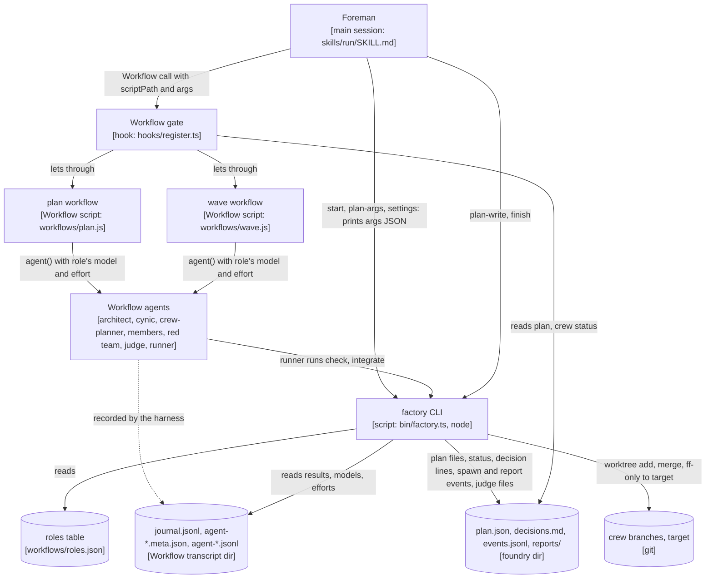
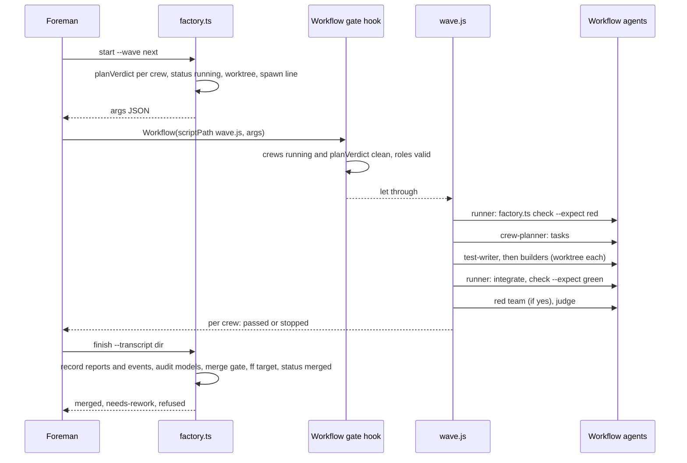

# ADR-0009: a Workflow factory: crews run as Workflow scripts, gates move into a deterministic CLI and a Workflow-call hook

Status: proposed, 2026-10-29. Written by the mid-run design slice `speed-design` (wave 1) of foundry session dd6ebfbb, for the foundry release after 0.10.0. It becomes accepted when the foreman merges `speed-design` under the owner-approved scope. Not repo ADR-0009.

VERDICT: change. The interface that can't take the work is the crew-start seam: `on('tool.call', { tool: 'Agent' })` in `plugins/foundry/hooks/register.ts:1641`, the single handler that holds the main-session model rule, the in-crew model and effort gates, the repair-budget gate, the plan gates (approval, wave, `maxParallelCrews`) and the `spawn` line. A Workflow script's `agent()` is not an Agent tool call, so none of it runs (probe, below). Running crews from Workflow needs a new seam: a deterministic CLI (`bin/factory.ts`) that applies the same exported verdict functions, a hook on the main session's `Workflow` call, and a post-run audit of the Workflow transcripts. The plan file, the events file and the judge-file merge gate keep their shapes.

## Context

The owner, in decisions.md (frozen scope, item 6): "i have used /workflows and they are much faster. in this case i kind of want the factory to use workflow to expedite. the factory in itself is kind of a goal target. but its just painfully slow right now. and we need to make it way much faster. also stop asking for same question of sequential to main". The owner's rulings bind this design: no API runs in any suite; a model and an effort on every agent and every Workflow `agent()` (Sonnet for code, Opus for judgment, never Fable, no Opus at high or xhigh); merge sequential to main, standing; and the gates hold.

Today a crew is a `foundry:lead` started with the Agent tool. The lead reads, splits, starts each member, waits for its report, merges, runs the checks and starts the judge (`agents/lead.md` sections 3 to 9). Every hand-off between those steps is a model turn of the lead, and every hand-off between crews and waves is a model turn of the foreman (`skills/run/SKILL.md` sections 6 to 9).

## Measurements

Measured by crew member `speed-design-measure` from the raw logs of five run segments; full detail in `<git common dir>/foundry/dd6ebfbb-e054-4fae-9182-67b695ddbcbe/reports/speed-design/speed-design-measure.md` and its scratch tables (`crews.txt`, `brk.txt`, `tr.txt`, `ask.txt`). Segments: A = run dir `dd6ebfbb-e054-4fae-9182-67b695ddbcbe`, events.jsonl L1-43; B1 and B2 = `70917104-1578-48f5-8ac2-f9e48814b8cc` L1-60 and L61-95; C3 and C4 = `40816bb1-1ec8-4755-8d97-0d12599e1e84` L9-103 and L104-258. events.jsonl times are UTC; decisions.md times are local (UTC-4), minute resolution. Architect and cynic spans come from the first and last record of each subagent transcript (`~/.claude/projects/C--sw-claude-mods/<session>/subagents/agent-*.jsonl`), because events.jsonl doesn't log main-session architects or cynics. Owner waits come from AskUserQuestion tool_use to tool_result in the main transcript. A 600.0 min machine sleep in C3 (events L16 to L17) is excluded.

Measured wall: 848.1 min (A 121.0, B1 85.3, B2 70.7, C3 206.9, C4 364.2).

| Step | Minutes | Share | Source |
| --- | --- | --- | --- |
| Planning, architect rounds (13 rounds over 5 segments; A 7.4 / 9.7 / 11.5, C4 10.1 / 15.0 / 13.6 / 5.2) | 131.6 min | 15.5% | subagent transcripts, first to last record; A agent ids a8056994118e44f82, a86c26549b4b03223, a275b370b6db59455 |
| Planning, cynic calls (10 calls; A 2.1 / 5.3) | 36.4 min | 4.3% | subagent transcripts; A ac931894a572dd9ac, a8c87507a87e788c0 |
| Planning, waiting on the owner (A 15.9: one question, 19:53:01Z to 20:08:22Z) | 45.4 min | 5.4% | main transcript A L368 |
| Planning, foreman gap (nothing running, not waiting on the owner; C4 33.7) | 53.4 min | 6.3% | C4: cynic-1 end 13:49:56Z to architect-2 start 14:22:59Z, decisions 10:16 |
| Planning total, run start to approval | 266.8 min | 31.5% | decisions.md run header and approval line per segment; A 19:42:11Z to 20:38:01Z = 55.8 min |
| Crew build, first-pass members | 156.9 min | 18.5% | events.jsonl spawn to first report, per member |
| Judge and red team, first round | 109.4 min | 12.9% | events.jsonl |
| Repair and red-team loops (C4 71.1: worktrees-cleanup 6 red-team rounds, foundry-protocol 5) | 125.6 min | 14.8% | C4 events L147-L230; C3 L72-L94 |
| Lead turnaround (lead alive, no member running; 84 gaps, mean 1.7 min, max 6.8) | 97.5 min | 11.5% | events.jsonl, report to next spawn within a crew |
| Merge wait and crews done but waiting to be resumed | 24.5 min | 2.9% | decisions.md merge lines; C3 protocol and readonly-guard queued 59.6 and 59.2 min behind hooks-gates |
| Foreman idle or unattributed after approval | 42.2 min | 5.0% | C4 22.8, incl. the e2e lead that ended its turn and was never woken: last member report 17:55:37Z, stall tag L238 18:11:45Z, repair lead 18:21:38Z |
| Owner wait after approval, cynic pre-merge reviews | 25.0 min | 2.9% | C4 L10525 (14.5 min repair question); B1, B2 cynic reviews |

The top sinks, in the order this design attacks them:

1. Serial architect and cynic rounds: 168.0 min. C3 and C4 each ran 3 or 4 architect rounds; C4's architect-3 ran 13.6 min writing about 670 lines of Python done-checks and was stopped by the owner (decisions 10:57). In A, the reconcile architect waited 15.3 min for an owner answer to a cynic finding before it could start.
2. Repair and red-team loops: 125.6 min wall. Red-team rounds have no bound: `agents/lead.md:64` says "After the fixes, run a fresh red team", and cynic-7 named that line as the root of C4's loops.
3. Foreman gaps and idle: 100.8 min (planning gap 53.4, idle 42.2, plus resume-pending time).
4. Lead turnaround: 97.5 min over 84 gaps, all segments.
5. Owner waits: 60.9 min inside the measured window. The merge-mode and target question was asked in 5 of 5 runs and answered "sequential to main" each time (main transcript A L533, B1 L491, B2 L1544, C3 L6579, C4 L8953); its bundled waits total 7.5 min, an upper bound, since it always rode inside the approval prompt.

Spot-checked by this architect against the logs: `dd6ebfbb/events.jsonl` line 1 is eval-design's lead spawn at 2026-10-29T20:39:10.008Z and line 9 its final report at 21:08:10.935Z, which is the 29.0 min wave-0 crew; `dd6ebfbb/decisions.md` line 1 is the run header `## Run 2026-10-29T19:42:11Z` and line 24 the approval with `approvedAt 2026-10-29T20:38:01Z`, which is the 55.8 min planning total for A.

What a script removes outright is waiting, not work: lead turnaround (97.5 min), foreman gaps and idle (100.8 min) and the planning waits that sat between rounds. Together that is 198.3 min, 23% of the measured wall. Bounding architect rounds to two and red-team rounds to the repair budget cuts into the next 293.6 min (sinks 1 and 2). The member and judge work itself (266.3 min) is not made shorter; it is run without gaps.

## Probe

Source: `<git common dir>/foundry/dd6ebfbb-e054-4fae-9182-67b695ddbcbe/probe-workflow.md`, Workflow run `wf_25508836-f05`, five `agent()` calls run by the foreman (subagents can't call Workflow). This architect read the run's files at `~/.claude/projects/C--sw-claude-mods/dd6ebfbb-e054-4fae-9182-67b695ddbcbe/subagents/workflows/wf_25508836-f05/`.

What Workflow can do for foundry:

- **`agent()` can be any foundry type, with an exact model and effort.** `agentType: "foundry:cynic"` with `model: "opus", effort: "low"` ran as foundry:cynic on claude-opus-5-5 at low; `foundry:lead` with sonnet, low ran as foundry:lead on claude-sonnet-5-5 at low. So a script can run architect, cynic, judge, red team, writer, builder and test-writer.
- **Worktree isolation works as the Agent tool's does.** `isolation: "worktree"` gave `.claude/worktrees/wf_25508836-f05-4` on branch `worktree-wf_25508836-f05-4` at the session's HEAD (fa0fa9f), sharing the git common dir. Without it an agent runs in the session cwd, which for this foreman is the foundry dir inside `.git`: no work tree.
- **The run leaves a machine-readable record.** `journal.jsonl` holds one `{"type":"started","key","agentId","label","phase"}` and one `{"type":"result","key","agentId","result"}` line per agent. Each `agent-<id>.meta.json` holds `agentType` and, only when the script set one, `model` (`agent-a3789c47e8d483cda.meta.json` has `"model":"opus"`; the no-model cynic's `agent-afbe368ff16694927.meta.json` has none). Each `agent-<id>.jsonl` transcript records the model the agent actually ran on (`"model":"claude-opus-5-5"`) and its effort (`"effort":"low"`). A CLI can audit a finished run from these files without any model.
- **`agent()` returns the agent's final text, or a schema-validated object** (workflow-authoring skill). The lead-at-cap result in `journal.jsonl` is its full `CHECKPOINT:` report text.

What breaks:

- **No spawn gate fires.** All of them live in `on('tool.call', { tool: 'Agent' })` (`register.ts:1641-1715`). The no-model cynic ran on the session model (Opus at medium; on a Fable session it would have been Fable). A lead started at the 4-crew cap. events.jsonl got no spawn line.
- **Report capture keys by raw agent id.** `classic.SubagentStop` (`register.ts:1816`) fired and wrote `reports/a5b5d3f425eea653f/`, because `crewOf` treats any `foundry:lead` as a crew lead named by its id. A non-lead workflow agent has no lead ancestor, so `crewOf` returns nothing and no report is saved at all.
- **Injected git status is not a fact.** The lead-at-cap agent reported another crew's branch from the session's git snapshot.
- **A script has no file system, no shell and no clock** (`Date.now()` and argless `new Date()` throw). Every deterministic step it needs (plan checks, done-check runs, merges, patch ids, status edits, decision stamping) has to run as a command, and the script can only reach a command through an agent that has Bash.

Not verified by the probe, and handled below without relying on them: whether `tool.call` fires for the main session's own `Workflow` call (the hook in Decision 6 is the first place that would show it; the CLI and the audit hold the gates if it doesn't); whether `scriptPath` accepts a file inside the plugin; whether the Workflow call blocks the foreman's turn until the script returns; and what `agent()` returns when the agent ends with SubagentHandback rather than final text.

What moves where:

| Step | Today | Here |
| --- | --- | --- |
| Plan checks (approval vs wave 0, disjoint `owns`, slug pattern, proved done-checks) | foreman reads the draft (`SKILL.md` section 4) | `factory.ts plan-check` |
| Plan files from the architect's report | hook plan-file route, Agent-tool architects only | `factory.ts plan-write`, same rules, from the Workflow journal |
| Wave, cap and approval gates, `status: running`, spawn line | hook on Agent; foreman edits `plan.json` | `factory.ts start`, using the exported `planVerdict` |
| Done-check runs, red and green | lead's Bash | `factory.ts check`, called from the script through a Sonnet runner |
| Merging member branches into the crew branch | lead's Bash | `factory.ts integrate` |
| Reports, spawn and report events, model audit | hook on SubagentStop and Agent | `factory.ts finish` (record step), from the journal and transcripts |
| Merge gate (newest judge file, PASS, no UNSCOPED, Head or Patch), merge, `status: merged` | foreman's Bash and Edit (`SKILL.md` section 9) | `factory.ts finish` (merge step), using the exported `judgeRuling`, `latestJudge`, `headVerdict`, `patchIdOf`, `PATCH_COMMAND` |
| Decision lines | foreman's Edit, stamped by the hook | the CLI writes stamped lines itself with the exported `stampDecisions` and `localTime` |

## Decision

foundry gets a second crew engine. When the foreman's session has the Workflow tool, every crew that has no `devops` member and no owner-called `high` or `xhigh` effort runs as a Workflow script; all others, and every crew in a run without Workflow, run on the lead path as today. Planning runs as a Workflow script whenever Workflow is there. The parts:

*The Workflow engine's parts and what passes between them. Traces to: `plugins/foundry/hooks/register.ts:1641-1715` (the Agent gates it mirrors), `:327-349` (`planVerdict`), `:499-565` (`judgeRuling`, `patchIdOf`, `headVerdict`), `:848-904` (the plan-file route), and the probe run's `journal.jsonl` and `agent-*.meta.json`.*

*One wave, from start to merge. Traces to: `skills/run/SKILL.md` sections 6 and 9 (today's steps), `agents/lead.md` sections 1, 3, 6, 7, 9 and 12 (the chain wave.js runs), the probe's `journal.jsonl`.*

### 1. The factory CLI, `plugins/foundry/bin/factory.ts`

One file, run with `node plugins/foundry/bin/factory.ts <command> [flags]` from the repo root (Node 22 strips the types, as the `tests/*.check.ts` files already rely on). It imports only Node built-ins and the exported functions of `../hooks/register.ts`, the hooks module's entry file, as `tests/contract-evals.check.ts:16` already does. Every command prints exactly one JSON object on one line to stdout and exits 0 when it did what was asked, 1 when a gate or an expectation refused, and 2 on a usage or I/O error (with `{"error": "<message>"}`). Every command is idempotent: run twice, it leaves the same state and prints the same result (core 7). It never runs `git push`, never opens a PR, and never touches any remote.

Common flags: `--dir <foundry dir>` (absolute), `--repo <repo root>` (absolute; default the cwd's `git rev-parse --show-toplevel`).

| Command | Does | Prints |
| --- | --- | --- |
| `settings --repo R` | Reads `merge` and `target` from `R/.claude/foundry.json`. Missing `merge` is `sequential`; missing `target` is `git -C R branch --show-current`. | `{"merge":"sequential","target":"main","source":".claude/foundry.json"}`; `source` is `default` when neither key is set, `mixed` when one is. Keys in exactly this order. |
| `plan-args --dir D --repo R --brief-file B` | Builds the plan workflow's `args`: `{"foundry":{"kind":"plan","dir","repo","plugin","schema","architecture","maxParallelCrews","repairBudget","roles"},"brief":"<text of B>"}`. `plugin` is the absolute plugin dir, `schema` its `docs/plan.schema.json`, `roles` from `workflows/roles.json`. | the args object |
| `plan-write --dir D --transcript T --label L` | Takes the `result` of the agent labelled `L` from `T/journal.jsonl` (the last such line). Applies the plan-file route's rules exactly (`register.ts:879-904`): both fenced blocks present (`fencedBlock`, exported), `parsePlan` accepts the JSON, an existing approved plan is never overwritten; writes `plan.json` with `approvedAt: null` and `plan.md`. | `{"written":true}` or `{"written":false,"reason":"<the route's reason text>"}` (exit 1) |
| `plan-check --dir D` | Checks `D/plan.json`: `version` 2, `approval` is `owner` exactly when a wave-0 crew exists, each slug matches `^(?!.*-[0-9]+$)[a-z0-9]+(?:-[a-z0-9]+)*$`, every crew `status` is `planned` on an unapproved plan, no two crews of one wave own a common path (two globs overlap when equal, or when the literal part of one before its first `*`, `?` or `[` is a prefix of the other's), and lists each crew with `doneCheckProved: false`. | `{"ok":true,"unproved":[...]}` or `{"ok":false,"errors":["<slug>: <rule>", ...]}` (exit 1) |
| `approve --dir D --by owner\|auto` | Sets `approvedAt` to now (`toISOString`, `Z` offset) and appends the stamped decision line `- HH:MM \| plan approved (<by>): merge <mode>, target <branch> from <source>; approvedAt <ts>; scope frozen \| ... \| none \| followed`. Refuses when `approvedAt` is already set. | `{"approvedAt":"..."}` |
| `start --dir D --repo R --wave <n\|next> [--type role=agentType ...]` | For the wave's crews in queue order, up to `maxParallelCrews` minus those `running`: refuses a crew on `planVerdict` (same text as the hook), sets its `status` to `running`, creates or reuses the crew worktree `R/.claude/worktrees/foundry-<slug>` on branch `foundry-<slug>` from the target's head, appends `{"event":"spawn","crew":slug,"agent":slug,"agentId":null,"type":"workflow-crew","model":null,"effort":null,"by":"factory"}` and a decision line. Reads from the goal file `D/goals/<slug>.md` its `## Approved scope`, `## High-impact paths` and `## Red team` (first word `yes` or `no`) sections. A crew already `running` with its worktree is returned again unchanged. | `{"foundry":{"kind":"wave","dir","repo","plugin","target","repairBudget","roles","crews":[{"slug","wave","goalFile","goal","owns","doneCheck","highImpact","redTeam","scope","worktree","branch","base","architecture","adrs"}]},"refused":[{"slug","reason"}]}` |
| `check --dir D --slug S --cwd W --expect red\|green` | Runs the plan's `doneCheck` for `S` (from `plan.json`, never from the caller) with `bash -c` in `W`; records `D/checks/<S>-<n>.json` with the command, exit code, `git -C W rev-parse HEAD` and the last 40 lines of output. | `{"ok":<expectation met>,"exit":N,"head":"<sha>","tail":"..."}`; exit 1 when not met |
| `integrate --dir D --slug S --branch B` | In the crew worktree: `git merge --no-ff B`. On conflict, leaves the merge in progress. | `{"merged":true,"head":"<sha>"}` or `{"merged":false,"conflicts":["<path>", ...]}` (exit 1) |
| `owns-check --dir D --slug S` | `git diff --name-only <base>...HEAD` in the crew worktree against the crew's `owns` globs (`path.matchesGlob`). | `{"ok":true}` or `{"ok":false,"outside":[...]}` (exit 1) |
| `finish --dir D --repo R --transcript T` | The record step, then the merge step, below. | `{"merged":[...],"rework":[{"slug","why"}],"refused":[{"slug","why"}],"audit":[{"label","why"}]}` |

**finish, record step.** For each `started` line in `T/journal.jsonl` whose label starts with a `running` crew's slug followed by `-`: writes the agent's `result` text to `D/reports/<slug>/<label>.md` (a schema result is written as its `report` field), sets that file's mtime to the last timestamp in `T/agent-<id>.jsonl` (when the agent finished, so `latestJudge`'s newest-file rule orders judges truthfully), and appends a `spawn` line (`agentId`, `type` from the meta file's `agentType`, `model` and `effort` as the transcript records them, `by: "workflow:<run id>"`, the run id being `T`'s folder name) and a `report` line (`marker` from `markerOf`). It also audits each agent of the run, crew or not, and adds an `audit` entry when: the meta file has no `model`; the transcript's model family (`family`, exported) is not `opus` or `sonnet`; the effort is `max`, or `high` or `xhigh` on any role; a `-judge` or `-redteam` label ran as a type other than `foundry:judge`; or a `-judge` transcript has a `Write` or `Edit` tool use.

**finish, merge step**, crews in plan order, the gate of `SKILL.md` section 9 in code. For each `running` crew of the wave whose newest judge file this run (`latestJudge`, since `approvedAt`) is a `judgeRuling` PASS with no UNSCOPED line:

1. Refuse when any `audit` entry names one of its agents, when events.jsonl has no `by: "factory"` spawn line for it, when `owns-check` fails, or when `judgeFails` for it is more than `repairBudget` (a PASS after a spent budget doesn't count).
2. In the crew worktree, `git merge <target>` (never rebase). A conflict: abort the merge and list the crew under `rework` with `why: "conflict"`.
3. When HEAD equals the judge's `Head:` the PASS stands. Otherwise compute `PATCH_COMMAND` with `<base>` the target head just merged in; when it equals the judge's `Patch:` and `check --expect green` passes on the merged head, the PASS stands (`headVerdict`). Otherwise list it under `rework` with `why: "rejudge"`.
4. Fast-forward the target: `git -C R merge --ff-only foundry-<slug>` when `R` has the target checked out and a clean tree; otherwise `git -C R fetch . foundry-<slug>:<target>`. A refusal is `rework` with `why: "target moved"`.
5. Set `status` to `merged`, append the decision line, remove the crew's member worktrees whose branches are ancestors of the crew branch (`git merge-base --is-ancestor`), and remove the crew worktree.

Crews of a later wave are never touched by `finish`.

### 2. The roles table, `plugins/foundry/workflows/roles.json`

The one source of every Workflow agent's type, model, effort and isolation. `start` and `plan-args` copy it into `args.foundry.roles`; `--type role=agentType` replaces `agentType` only, for the roles marked `typeFromProject`, with the project agent the foreman picked in `SKILL.md` section 3 (default `general-purpose`).

| Role | agentType | model | effort | isolation | Notes |
| --- | --- | --- | --- | --- | --- |
| `architect` | `foundry:architect` | `opus` | `medium` | `worktree` | plan mode |
| `cynic` | `foundry:cynic` | `opus` | `medium` | none | |
| `crew-planner` | `foundry:crew-planner` | `opus` | `medium` | none | read-only; reads the crew worktree by absolute path |
| `test-writer` | project, `typeFromProject` | `sonnet` | `medium` | `worktree` | |
| `builder` | project, `typeFromProject` | `sonnet` | `medium`, or `low` when the task says so | `worktree` | |
| `resolver` | project builder type | `sonnet` | `medium` | none | works in the crew worktree by absolute path; merge conflicts only |
| `writer` | `foundry:writer` | `opus` | `medium` | `worktree` | |
| `rca` | `general-purpose` | `opus` | `medium` | none | writes no code |
| `redteam` | `foundry:judge` | `opus` | `medium` | `worktree` | brief opens `Red team:` |
| `judge` | `foundry:judge` | `opus` | `medium` | none | |
| `runner` | `general-purpose` | `sonnet` | `low` | none | runs one `factory.ts` command |

No `lead`, no `devops`, no `integrator`. A `foundry:lead` in a script would trip the lead stop gate and the raw-id report capture (probe), so the table never holds one. `workflowRoleVerdict(roles)` (Decision 6) refuses a table with any model but `opus` or `sonnet`, any effort but `low` or `medium`, a missing model or effort, or a `lead` or `devops` role.

### 3. The plan workflow, `plugins/foundry/workflows/plan.js`

Run by the foreman in place of `SKILL.md` section 4's architect and cynic calls, with `Workflow({ scriptPath: "<plugin>/workflows/plan.js", args: <plan-args output> })`. Every `agent()` call in both scripts goes through one function, `spawn(role, label, prompt, opts)`, which takes `agentType`, `model`, `effort` and `isolation` from `args.foundry.roles[role]` and throws before calling `agent()` when the role is missing or fails the same rules as `workflowRoleVerdict`. No other `agent(` call exists in the file.

1. `architect-plan`: `spawn('architect', ...)` with the brief from `args.brief`, its first line exactly `Mode: plan`, and the schema `{report: string, planJson: string, planMd: string}` (so the result doesn't depend on SubagentHandback inside a workflow, which the probe didn't test). The brief tells it the two blocks go in `planJson` and `planMd` as well as fenced in `report`.
2. `cynic-1`: the verdict review of `SKILL.md` section 4 ("Have a cynic review the verdicts"), with the architect's `planJson`, `planMd` and the architecture doc's path. The script reads every `REVIEW:` and `Owner:` line from its text.
3. When any `REVIEW: disagree`: one reconcile round, `architect-plan-2` with the same brief plus the cynic's lines, then `cynic-2` told the reconcile round has happened. Never a third architect. No owner question stops the script: owner items are collected and returned.
4. Returns `{architectLabel, reviews: [...lines], owner: [...Owner lines that name a trigger], stillDisagree: bool}`.

Then the foreman runs `plan-write` with the returned label and `plan-check`. When `plan-check` fails, the foreman resumes the same script (`resumeFromRunId`) with the errors added to `args.brief`; the cached prefix returns instantly. When it fails a second time, the foreman sends the errors to the owner. `UNCOVERED:` lines in the architect's report make the script return `{uncovered: [...]}` before any cynic; the extend pass of `SKILL.md` section 4 runs as today.

### 4. The wave workflow, `plugins/foundry/workflows/wave.js`

Run by the foreman with `Workflow({ scriptPath: "<plugin>/workflows/wave.js", args: <start output> })`. It runs every crew in `args.foundry.crews` at once (each crew is an independent chain, `pipeline()` style, no barrier between crews) and returns when every crew has passed or stopped. Labels are `<slug>-<role>`, then `<slug>-<role>-2` and up for a fresh agent of the same role, so `finish` files them as today's report names (`<slug>-judge-2.md`). Each crew's chain, which is `agents/lead.md` sections 1 and 3 to 9 as code:

1. **Red first.** `runner`: `factory.ts check --expect red`. Not met: stop `BLOCKED:` with the output.
2. **Split.** `crew-planner` with the goal file path, the crew worktree, owns, high-impact paths, approved scope, architecture doc and ADRs, and a schema: `{tasks: [{name, role: "test-writer"|"builder"|"writer", effort: "low"|"medium", files: [...], reads: [...], brief, after: [...names]}], stop: null | {tag: "QUESTION"|"BLOCKED"|"PROPOSAL", text}}`. The script checks, as plain code: every file matches the crew's `owns`; two tasks share a file only when one is in the other's `after` chain; every builder is `after` every test-writer; names are unique. One failed check sends the errors to a fresh `crew-planner-2`; a second failure stops `BLOCKED:`.
3. **Members.** Each task starts when the tasks in its `after` list are integrated. Its brief carries the job, `Approved scope:` (the goal file's section, verbatim), its files and reads, its check, the instruction to run `git merge <crew branch>` first, and these, verbatim: the "be brave" rule, the proof rule of `agents/lead.md` section 5, the fetch rule of `agents/lead.md:75`, the `Foundry-Crew: <slug>` and `Foundry-Role: <role>` trailer rule, and "commit on your branch and report the branch and commit". Its schema: `{marker: "DONE"|"CHECKPOINT"|"QUESTION"|"BLOCKED"|"PROPOSAL", branch, commit, proof, text}`. `DONE`: `runner` runs `integrate`, one integration at a time per crew; a conflict goes to `resolver`, then `integrate` again. `CHECKPOINT`: one fresh member from its text, then `BLOCKED:`. `QUESTION`, `BLOCKED`, `PROPOSAL`: the crew stops with that tag and text.
4. **Green.** `runner`: `check --expect green`. A failure runs the escalation ladder of `agents/lead.md` section 7 in code: two fix attempts by one fresh builder, then `rca`, then one fresh builder with its analysis, then `BLOCKED:` with the failing output.
5. **Red team**, when `redTeam` is true: `redteam` with the head SHA, crew branch, goal file, ADRs, high-impact paths. Each break goes to a fresh builder, then integrate, green, and a fresh red team. Rounds count against the repair budget (Owner decisions, item 1).
6. **Scope.** `runner`: `owns-check`. Files outside: stop `QUESTION:` asking the foreman for the extension.
7. **Judge.** `judge`, never a builder, with the goal file path, the crew worktree as checkout, the head SHA, the crew branch, the base, the diff command, the high-impact paths, architecture doc and ADRs, every member's `proof`, the red team's last report, and `Approved scope:` as its own field; it states the SHA and patch id under `## Proof checked`. Its result's first line decides (`VERDICT: PASS` or `VERDICT: FAIL`, the `judgeRuling` rule, reimplemented in the script and pinned to the export by a test). No verdict line: one fresh judge, then `BLOCKED:`. FAIL: when the FAILs so far are more than `args.foundry.repairBudget`, stop with `BLOCKED: repair budget spent: <slug>, <n> judge FAILs, repairBudget <b>` and the findings; else a fresh builder with the findings, integrate, green, a fresh judge.
8. Returns `{slug, state: "passed", head, base, judge: "<label>"}` or `{slug, state: "stopped", tag, text, at: "<step>"}`.

The script never merges into the target, never pushes, never deploys, and asks the owner nothing.

### 5. The crew planner, `plugins/foundry/agents/crew-planner.md`

A new read-only agent (`model: opus`, `effort: medium` in its front matter) whose only job is `agents/lead.md` sections 2 and 3 for one crew: the depth pass, then the split by the leaf test, returned in the schema above. It names the exact files, functions and line ranges each member reads, like the lead does. It carries the fetch rule word for word (ADR-0005 section 2), never names a sample domain (`tests/gates.check.ts:190-205` scans every `agents/*.md`), writes nothing, and starts no agent.

### 6. The Workflow gate, `plugins/foundry/hooks/register.ts`

Three additions, nothing else in the file changes:

- `export` on the existing `fencedBlock` (`register.ts:848`), for `plan-write`.
- Two pure exported functions. `workflowRoleVerdict(roles: unknown): { deny: string } | undefined`, the rules of Decision 2. `workflowCallVerdict(plan: Plan | undefined, input: { script?: unknown; scriptPath?: unknown; args?: unknown }): { deny: string } | undefined`:
  - no plan, or a plan below version 2: undefined;
  - an inline `script` whose text contains `foundry:`: refused, "foundry workflows run from the plugin's scripts by scriptPath";
  - `args.foundry` absent: undefined (not foundry's workflow);
  - `scriptPath` not ending in `/workflows/plan.js` or `/workflows/wave.js` (after `\` becomes `/`): refused;
  - `workflowRoleVerdict(args.foundry.roles)` refuses: that refusal;
  - `kind: "plan"` on a plan whose `approvedAt` is set: refused;
  - `kind: "wave"`: for each crew slug, refused unless its plan `status` is `running` and `planVerdict(plan, slug)` is undefined.
  Every refusal starts with `[foundry] Refused:`, like the others.
- One handler, `on('tool.call', { tool: 'Workflow' }, ...)`, placed right after the Agent handler (after `register.ts:1715`), for main-session calls only (`e.agentId === undefined`): reads the plan within `PLAN_READ_MS`, returns the verdict's deny or calls `next(e)`, logs each refusal with `logRule`, and fails open through `.catch(failOpen)` like every other handler.

If the first live run shows `tool.call` doesn't fire for `Workflow`, the gates still hold where they bite, in `start` (refuses), the scripts' `spawn()` (throws), and `finish` (refuses to merge); the hook is the early refusal, not the only one.

### 7. The foreman's procedure, `plugins/foundry/skills/run/SKILL.md`

Edits limited to these places, so ADR-0008's and ADR-0010's builds can hook in at their named steps:

- **Section 4**, architect and cynic: when Workflow is available, replace the Agent calls, the marker-file `find` check and the send-back rounds with: write the brief to `<foundry dir>/plan-brief.md`, run `plan-args`, `Workflow(plan.js)`, `plan-write`, `plan-check`; resume once on a failed `plan-check`. The send-back reasons stay, now applied by `plan-check` and the cynic. The lead-path text stays for sessions without Workflow.
- **Section 5**, merge mode and target: delete "Ask the owner two more things" and its two bullets. In both kinds of run the foreman runs `factory.ts settings`, shows the result in the plan table as information, and logs it; it never asks the owner for merge mode or target. The owner's standing ruling is recorded where it stands across runs: the build adds `"merge": "sequential"` and `"target": "main"` to this repo's `.claude/foundry.json`, keys `foundry-config.schema.json:35-43` already defines. A run that needs `single` mode gets it only from that config key or an owner instruction in the run's own words, never from a question. Approval itself stays: the owner still approves a plan with a wave 0, and `approve --by owner` runs only after the owner's yes.
- **Section 6**, start: goal files gain a fixed `## Approved scope` section (the decision lines that bear on the crew, verbatim) and a `## Red team` section whose first word is `yes` or `no`; for Workflow crews, replace the Agent lead call and the hand edits of `status` with `start`, `Workflow(wave.js)`, then `finish`; a stopped crew's tag is handled as in section 7, and the foreman resumes the same run with the answer added to that crew's `args` entry (`answers`), so the agents before the stop come back from the cache. Repeat `start --wave next` until the last wave has merged.
- **Section 9**, merge: for Workflow crews the gate is `finish`; `rework: conflict` and `rework: rejudge` go back through `wave.js` with that crew alone and `args.foundry.crews[0].resume: "merge-ready"`, which runs only the resolver, green and judge steps. The section's existing gate text stays as the lead path's rule, so `tests/gates.check.ts:68-83` keep passing.

### 8. What doesn't change

`docs/plan.schema.json` (no field is added: the engine follows from the crew's members, and `status` keeps its four values), `docs/events.schema.json` (`by: "factory"` and `by: "workflow:<run id>"` are strings it already allows), `agents/lead.md` (the lead path keeps it as is), `agents/judge.md` and `agents/architect.md` (their reports are read the same way), and the merge gate's rules.

## Gates kept

| Gate | How it survives | What breaks if it didn't |
| --- | --- | --- |
| Judge never the builder | The judge is its own `spawn('judge')` with type `foundry:judge`; the crew-planner's schema can't assign `judge`; `finish` audits that `-judge` and `-redteam` labels ran as `foundry:judge` and that no judge transcript has a Write or Edit. Builders still may not edit the done-check tests, which the judge checks from the `Foundry-Role` trailers as today. | A builder could pass its own work. |
| Done-checks proved red | `wave.js` step 1 runs `check --expect red` before any member; the command comes from `plan.json`, not from the caller. Plan time is unchanged: the architect proves each `doneCheck` and `plan-check` lists every `doneCheckProved: false`. | A crew could start on a check already green, and its PASS would prove nothing. |
| PASS bound to head and patch id | Judge files are written from the journal by `finish` with their real finish time, and the merge step runs `judgeRuling`, `latestJudge` and `headVerdict` with `PATCH_COMMAND`, the same exported code the lead stop gate uses; a Patch match counts only with `check --expect green` re-run on the merged head. | A PASS on one head could merge another. |
| Disjoint file ownership | `plan-check` refuses overlapping `owns` within a wave; `wave.js` refuses member tasks outside `owns` or sharing files without order; `finish` runs `owns-check` before every merge. | Two crews could edit one file in parallel and the later merge would silently win. |
| Explicit models, never Fable, no Opus at high or xhigh | One `roles.json`; `spawn()` throws on a role without model or effort; the Workflow gate refuses a bad roles table; `finish` audits the model and effort each agent actually ran on from its transcript and refuses to merge a crew with any failure. The main session's own Agent calls keep `mainCallVerdict`. | A missed `model` inherits the session model (probe: Opus at medium; on a Fable session, Fable). |
| Wave, cap and approval gates | `start` applies `planVerdict` before it marks a crew `running`; the Workflow gate re-applies it for every crew in `args`; `finish` refuses a crew with no `by: "factory"` spawn line. | A wave could start on unmerged code, or past `maxParallelCrews` (probe: a fifth lead at a cap of 4). |
| Repair budget | `wave.js` stops with `BLOCKED: repair budget spent` when FAILs pass `repairBudget`; `finish` refuses a PASS that came after a spent budget (`judgeFails`). Effort is never raised to get past it. | Loops like C4's six red-team rounds (75.4 min wall) run without end. |
| Owner rules on frozen scope | `PROPOSAL:` and out-of-`owns` files stop the crew and go to the foreman, who takes them through the cynic and the owner as `SKILL.md` section 7 says. Scripts quote approved scope verbatim from the goal file. | A script could build past the scope the owner froze. |
| Production deploys | No `devops` role exists in `roles.json`, and `workflowRoleVerdict` refuses one; a crew with devops runs on the lead path, where `agents/lead.md:67` sends a production deploy to the owner first. | A script could deploy to production unasked. |
| Pushes and PRs | No `factory.ts` command touches a remote; `finish` only fast-forwards the local target. Pushes and PRs stay the foreman's, under `SKILL.md` section 10 and the owner's merge-ownership grant. | Work could leave the machine without the owner's say. |

Faster here means fewer waits between checked steps, not fewer checks: every check that runs on the lead path runs on the Workflow path, and three run there in code that ran in prose before (the merge gate, the model audit, the owns check).

## Consequences

- Lead turnaround (97.5 min measured) and the foreman's per-step gaps after approval go away for Workflow crews: the script starts the next agent as the last returns. The member and judge work is the same work.
- Planning runs at most two architect rounds and two cynic calls with no foreman gap between them, and owner items from the cynic wait for the single approval prompt instead of blocking the reconcile round (A's 15.3 min).
- The merge-mode and target question is gone from every run.
- `/foundry` sees a Workflow crew's agents only after `finish` records them; while a wave runs, its progress is in `/workflows`. Stall and idle-lead prompts don't apply to Workflow crews: a stopped crew is a returned result, not a silent lead.
- Within a wave, a Workflow crew that passes early waits for the wave's script to return before it merges, and crews queued beyond `maxParallelCrews` start in the next `start --wave next`. Measured merge waits were 24.5 min in total; this design doesn't make them shorter for queued crews.
- Leads can't message each other mid-run on the Workflow path; a collision shows up at `integrate` or `finish` as `rework`.
- A model can still be wrong inside a script's runner: it relays a command's JSON. Nothing merges on that relay alone: `finish` re-reads the judge files, recomputes the patch id and re-runs the green check itself.
- Two engines must stay in step. The CLI and the hook import the same verdict functions, and the script tests pin the script's copies (`judgeRuling`'s first-line rule, the role rules) against the exports.

## Seams to pin

The test-writers of the build crews pin these with `node --test` contract tests; no test calls a model, the Workflow tool or the owner.

- `factory.ts` commands, flags, one-line JSON output and exit codes (Decision 1): `tests/factory.check.ts`, against temporary git repos and foundry dirs the test builds, and Workflow transcript fixtures in `tests/fixtures/workflow-run/` copied in shape from the probe's `journal.jsonl` and `agent-*.meta.json` (no model output beyond short strings).
- `workflowRoleVerdict`, `workflowCallVerdict` and the `fencedBlock` export: `tests/workflow-gate.check.ts`, importing `../hooks/register.ts`.
- `plan.js` and `wave.js` control flow: `tests/workflows.check.ts` loads each script's text, replaces its leading `export const meta` with `const meta`, and runs the body as an async function with stubbed `agent`, `parallel`, `pipeline`, `phase`, `log`, `args` and `budget`. Each stubbed `agent()` returns a scripted result by label. The tests assert the call order and options: every call has `model` and `effort` from `args.foundry.roles`; no call is a `foundry:lead`; red check before any member; builders after test-writers; judge after green and red team; at most two architects; budget stop text; stops returned, never answered. So the scripts have no `import` and use only those globals.
- `.claude/foundry.json` resolves to `{"merge":"sequential","target":"main","source":".claude/foundry.json"}` through `settings`: `tests/run-procedure.check.ts`.

## Owner decisions

1. **Red-team rounds share the repair budget.** Today a crew with a red team re-runs it after every fix with no limit (`agents/lead.md:64`); in C4 that was six rounds and 75.4 min on one crew. Proposed: on the Workflow path, every red-team round after the first counts against the run's `repairBudget` (default 2), the same budget as judge FAILs; when it runs out, the crew stops and you get the open breaks, as you do for a spent judge budget today. Recommended: yes. Saying no keeps red teams unbounded on the Workflow path too.
2. **The Workflow path is the default.** Proposed: whenever the session has the Workflow tool, crews run as Workflow scripts, except crews with a deploy member or with an effort you raised, which stay on today's lead path. The cost you see: while a wave runs you watch it in `/workflows`, and `/foundry` fills in each crew when the wave ends. Recommended: yes. Saying no makes it opt-in per run.

## Files touched

New:

- plugins/foundry/bin/factory.ts
- plugins/foundry/workflows/roles.json
- plugins/foundry/workflows/plan.js
- plugins/foundry/workflows/wave.js
- plugins/foundry/agents/crew-planner.md
- plugins/foundry/tests/factory.check.ts
- plugins/foundry/tests/fixtures/workflow-run/ (journal.jsonl, agent-*.meta.json, agent-*.jsonl fixtures)
- plugins/foundry/tests/workflow-gate.check.ts
- plugins/foundry/tests/workflows.check.ts
- plugins/foundry/tests/run-procedure.check.ts

Edited:

- plugins/foundry/hooks/register.ts (the `export` on `fencedBlock` at :848; `workflowRoleVerdict` and `workflowCallVerdict` next to `mainCallVerdict` at :567; one `on('tool.call', { tool: 'Workflow' })` handler after :1715)
- plugins/foundry/skills/run/SKILL.md (sections 4, 5, 6 and 9 as Decision 7 names)
- .claude/foundry.json (adds `"merge": "sequential"`, `"target": "main"`)
- plugins/foundry/README.md (the Workflow engine, one section)
- plugins/foundry/.claude-plugin/plugin.json (version bump)

Architecture-doc changes, made by the foreman's `arch-docs` design crew, not by any build crew below and not by this ADR (crews never edit the architecture doc, foundry ADR-0001 line 144). That crew runs once ADR-0008, ADR-0009 and ADR-0010 have all merged and applies all three in one pass. The sections ADR-0009 needs changed:

- plugins/foundry/docs/architecture.md, "Roles and who talks to whom": the crew-planner role, and Workflow crews that have no lead.
- plugins/foundry/docs/architecture.md, "The run lifecycle": the Workflow path of Decision 7 (plan.js, start, wave.js, finish), the lead path as the fallback, and merge mode and target read from config, never asked; with the two diagrams above.
- plugins/foundry/docs/architecture.md, "On disk": `checks/<slug>-<n>.json`, the `by: "factory"` and `by: "workflow:<run id>"` spawn lines, and report files written by `finish`.
- plugins/foundry/docs/architecture.md, "Hooks": a "Workflow calls" subsection next to "Agent calls" for the Workflow gate of Decision 6, and the `fencedBlock` export under its seams.
- plugins/foundry/docs/architecture.md, "Failing open" and "Not verified yet": the gate's fail-open, and the four unverified Workflow facts in Probe.
- docs/architecture.md, "Module map", the foundry table under `### foundry`: rows for `bin/factory.ts`, `workflows/` and `agents/crew-planner.md`, and the `.claude/foundry.json` row now carrying `merge` and `target` for this repo.

Existing tests that pin behaviour this design removes: none. A grep of `plugins/foundry/tests/` for `Merge mode`, `merge mode`, `Target branch`, `two more things`, `plan-mark`, `architect-plan`, `-newer` and `run_in_background` finds no match. Tests that pin text this design keeps, and that must stay green in the crew that edits the file: `tests/gates.check.ts:68-83` (section 9's merge rule: `Head: `, `Patch: `, `git patch-id --stable`, "newest judge file ... approvedAt", `UNSCOPED`, the re-run tie) in `run-procedure`; `tests/gates.check.ts:190-205` (no sample domain in any `agents/*.md`) in `factory-scripts`.

## Build crews

- workflow-gate | owns: plugins/foundry/hooks/register.ts, plugins/foundry/tests/workflow-gate.check.ts | doneCheck: node --test plugins/foundry/tests/workflow-gate.check.ts && node -e "import('./plugins/foundry/hooks/register.ts').then(m=>process.exit(typeof m.workflowCallVerdict==='function'&&typeof m.workflowRoleVerdict==='function'&&typeof m.fencedBlock==='function'?0:1))" | after: none
- factory-cli | owns: plugins/foundry/bin/factory.ts, plugins/foundry/workflows/roles.json, plugins/foundry/tests/factory.check.ts, plugins/foundry/tests/fixtures/workflow-run/** | doneCheck: node --test plugins/foundry/tests/factory.check.ts && node plugins/foundry/bin/factory.ts settings --repo . | grep -q '"merge":"sequential"' | after: workflow-gate
- factory-scripts | owns: plugins/foundry/workflows/plan.js, plugins/foundry/workflows/wave.js, plugins/foundry/agents/crew-planner.md, plugins/foundry/tests/workflows.check.ts | doneCheck: node --test plugins/foundry/tests/workflows.check.ts && test -f plugins/foundry/agents/crew-planner.md | after: prompt-rules, workflow-gate
- run-procedure | owns: plugins/foundry/skills/run/SKILL.md, .claude/foundry.json, plugins/foundry/README.md, plugins/foundry/.claude-plugin/plugin.json, plugins/foundry/tests/run-procedure.check.ts | doneCheck: node --test plugins/foundry/tests/run-procedure.check.ts && node plugins/foundry/bin/factory.ts settings --repo . | grep -q '"target":"main","source":".claude/foundry.json"' | after: prompt-rules, workflow-gate, factory-cli, factory-scripts

Crew notes:

- `workflow-gate` edits only the three places Decision 6 names in `register.ts`, a file ADR-0008's and ADR-0010's builds may also edit; the foreman sequences them. It keeps `claude plugin test plugins/foundry` green (435 pass on fa0fa9f).
- `factory-scripts` waits for `prompt-rules` because its member briefs and `crew-planner.md` copy the fetch rule and `agents/lead.md` sections 5 and 7, which `prompt-rules` may reword. Its test pins the scripts' role rules and first-line verdict rule against `workflowRoleVerdict` and `judgeRuling` from `register.ts`.
- `factory-cli` and `factory-scripts` can run in parallel: the scripts' tests stub the runner, and the CLI's JSON is pinned in Decision 1.
- `run-procedure` is the only crew that edits files `prompt-rules` edits (`skills/run/SKILL.md`, `plugins/foundry/README.md`, `.claude-plugin/plugin.json`); its version bump follows whatever `prompt-rules` set.
- How each done-check was proved: run from this crew's worktree at main (fa0fa9f), each exits 1 because its test file doesn't exist (`Could not find 'plugins/foundry/tests/<file>'`), and for `run-procedure` also because `bin/factory.ts` doesn't exist. Each passed, exit 0, on a hand-made sample under the session scratchpad (`samples/<crew>/`, never committed): a copy of the repo paths with a minimal test file and a minimal implementation of exactly what the second half of the command checks. The commands and outputs are in this crew's report.
