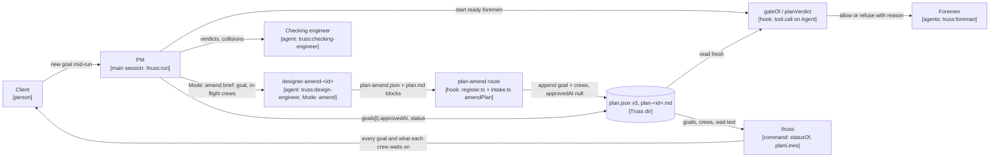
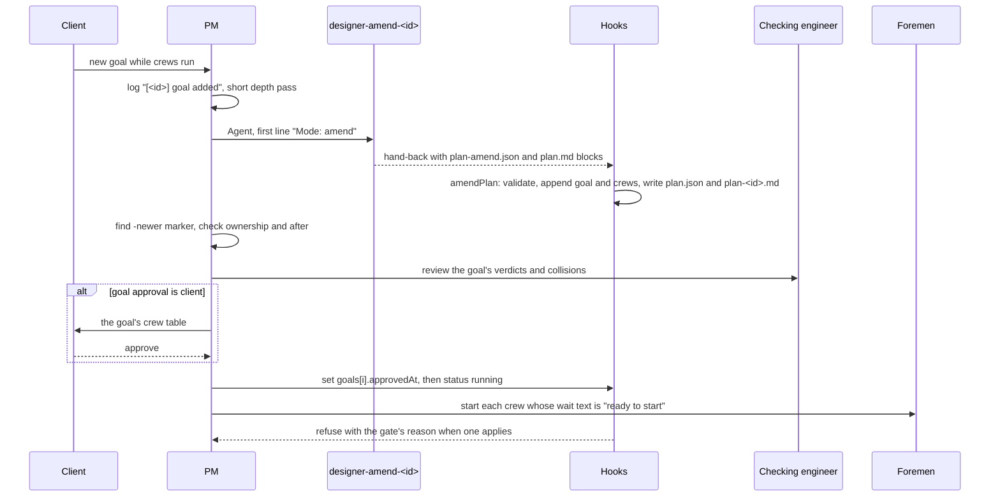

# ADR-0010: mid-run intake, several goals in one run

Status: proposed, 2026-10-29. Written by the design crew `intake-design` (a mid-run design slice in stage 1), for the Truss release after 0.10.0. It becomes accepted when the PM (project manager) merges this crew. Not repo ADR-0010.

Amended 2026-10-30, for the client's ruling (decisions.md, 19:51): "Approvals are not a mandatory step. If there is a reason for human oversight, ask for approval only then". A goal's `approval` is `"client"` only when a client trigger of run/SKILL.md section 4 applies to it, and `"auto"` otherwise, whether or not the goal has a stage-0 crew. The schema row for `goals[].approval`, the amend refusal on `approval` against stage 0, and the first Client decision below are changed to match. The code has no such refusal (`hooks/intake.ts:41-42` checks only that `approval` is `auto` or `client`). The per-crew `after` field (gate 6) was not approved and is not built: `plan.schema.json` has no `after`, and `gateOf` (`hooks/register.ts:331`) has no gate for it. The `after` text below is the original design, not what shipped.

VERDICT: change. The interface that can't take the work is `plan.json` with its plan-file route and gates (`docs/plan.schema.json`; `hooks/register.ts` `Plan`, `planVerdict`, `planLines`, `keepReason`, `routePlanFiles`). It holds one goal, has no way to append crews once `approvedAt` is set, and runs one global stage sequence, so a goal added mid-run either waits for every crew already in flight or is hand-edited into a stage it doesn't belong to.

## Context

The client's words (decisions.md, 17:35): "add another work here to add ability to start new crews mid-way. our factory cant tell users that it is working on something and cant pick more work..."

What happens today, checked against the code at `fa0fa9f`:

1. **One plan per session.** `planPath(dir)` is `${dir}/plan.json` (`hooks/register.ts:287-289`), and `dir` is `<git common dir>/truss/<session id>` (`trussDir`, `:126-129`). The schema has a single `goal` string (`docs/plan.schema.json`, `properties.goal`). This run's `plan.json` still carries only the first goal: its `goal` field holds the anti-bloat text, and the three goals added at 17:35 appear only as crews and in `decisions.md`.
2. **The plan-file route never writes over an approved plan.** `keepReason` (`:859-869`) returns `'it is approved'` unless `approvedAt === null`, and `routePlanFiles` (`:879-905`) then logs `plan-file route kept the existing plan: it is approved` and writes nothing. The claim is right, with one detail: the plan is kept for any `approvedAt` other than exactly `null`, including a missing one. So no plan design engineer can add a goal's crews once the run is approved.
3. **`decisions.md` is per session, and retro splits it by `## Run`.** `isDecisionLog` (`:655-657`) matches `/truss/<session>/decisions.md`. `skills/run/SKILL.md:24` writes one `## Run <start> | <goal>` heading per run. `scripts/retro.py:47` (`HEADING`) and `read_decisions` (`:193-241`) split on that heading only, and `read_plan` (`:385-414`) counts crews for the whole plan, with no per-goal view.
4. **The only ways to add crews are a mid-run design slice or a hand edit.** `skills/run/SKILL.md:274-288` (section 7, "Run a mid-run design slice") is written for a foreman's design `PROPOSAL:`. It covers adding a design crew, not a new goal. This run used it for client goals (decisions.md 17:35). At 16:42 the PM had first sent the new goals to their own sessions, because "one session holds one plan.json and one decisions.md". Then the PM hand-edited three design crews into stage 1 of `plan.json`. The goal-file claim is right.
5. **The stage gate and cap are global.** `planVerdict` (`:327-348`): the stage gate refuses a crew while any other crew in a lower stage isn't `merged` or `dropped` (`:334-342`), whatever goal that crew serves. The cap counts every other crew whose `status` is `running` against `maxParallelCrews` (default `DEFAULT_CAP = 4`, `:285`, `:343-347`). In this run the effect shows: `prompt-rules` (stage 2) now waits on `intake-design`, `speed-design` and `interview-design` as well as on its own goal's `evals-build`, because the hand-edit put them in stage 1.
6. **`/truss` shows no goals and no reasons.** `statusOf` (`:1261-1312`) puts `planLines` (`:356-367`) above the live-crew lines. `planLines` prints one line per crew, `- stage <w>: <slug>, <verdict>, <status>`. The only reason it ever gives is `, waits for the client's approval` (`:363`). It names no goal and doesn't say what a planned crew is waiting for.

## Options

- **A. Amend mode: one plan per session, goals appended under the approved plan (chosen).** A new design engineer mode hands back one goal's crews. A new hook route appends them to `plan.json` and leaves every existing byte of meaning untouched. The gates become goal-aware.
- **B. Several plans per session (`plan-<goal>.json`).** Rejected. The cap and cross-goal file ownership need every running crew. So `planVerdict`, `planCrewFor` and `planLines` would all read and merge N files, and slug uniqueness across files would go unchecked. `retro.py read_plan` reads one file, and `runStart` (`:443-448`) needs one `approvedAt`. It is more files and more readers for the same data.
- **C. One session per goal (what 16:42 did).** Rejected. Two sessions on one repo can't see each other's `plan.json`. The cap stops being a cap (each session allows `maxParallelCrews`), nothing checks file ownership across them, and the client has two `/truss` views and two logs.
- **D. Keep hand-editing `plan.json` (17:35).** Rejected. Nothing validates the edit, the added goal isn't recorded as a goal, and section 7's rules (meant for foreman proposals) get stretched over client goals.
- **E. Append the new goal's crews as stages after the last stage.** Rejected. Under the global stage gate the new goal waits for everything in flight, so the factory still "cant pick more work" in practice.

## Decision

### 1. `plan.json` version 3: goals, a crew's goal, a crew's `after`

`docs/plan.schema.json` gains version `3`. The version enum becomes `[1, 2, 3]`. The `reworkAllowance` conditional's `if` becomes `{"version": {"enum": [2, 3]}}`, so v3 requires `reworkAllowance` too. New fields:

| Field | Where | Type | Meaning |
|---|---|---|---|
| `goals` | top level, optional, v3 only | array, `minItems: 1`, of goal objects | The goals added after the run's approval, in the order they were added. The run's first goal stays in the top-level `goal`, `approval` and `approvedAt`, unchanged; its id is the reserved word `run`. |
| `goals[].id` | goal object, required | string, the crew-slug pattern `^(?!.*-[0-9]+$)[a-z0-9]+(?:-[a-z0-9]+)*$`, `maxLength: 100`, `not: {"const": "run"}` | The goal's handle in `/truss`, in crews' `goal` field and in `decisions.md` tags. |
| `goals[].goal` | required | string, `minLength: 1` | The goal as the client gave it. |
| `goals[].addedAt` | required | string, `format: date-time` | When the hook appended it (its clock, RFC 3339 UTC, `Z`). |
| `goals[].approval` | required | `"auto"` or `"client"` | `"client"` only when a client trigger of section 4 of run/SKILL.md applies to the goal, else `"auto"`. A stage-0 crew doesn't by itself make it `"client"`. |
| `goals[].approvedAt` | required | string `date-time` or `null` | Null until the PM logs (auto) or the client approves (client). A conditional mirrors the top-level one: `approval: "auto"` requires a string, so an auto goal on disk fails the schema until the PM logs it, exactly as an auto plan does today. |
| `crews[].goal` | crew, optional, v3 only | string, crew-slug pattern | The id of the goal the crew serves. Absent means `run`, and `"run"` written out means the same and is always valid; no `goals` entry is needed for it. |
| `crews[].after` | crew, optional, v3 only | array of crew-slug strings, `minItems: 1`, `uniqueItems: true` | Crews, in any goal, that must be `merged` or `dropped` before this crew starts. It is the only cross-goal ordering. |

A top-level `allOf` conditional forbids `goals` when `version` is 1 or 2, and forbids `goal` and `after` on any crew then (`crews.items.not.anyOf: [{required:[goal]},{required:[after]}]`). The schema can't check that `goal` names an entry or that `after` names a crew. The hooks check both and refuse on failure (section 3). Existing v1 and v2 plans validate unchanged. Every crew of a v2 plan belongs to `run`, so all hook behaviour on them is unchanged, apart from the `/truss` suffixes in section 5.

Stages are numbered per goal: an added goal's first stage is its stage 0. The existing schema rules apply within each goal: stage 0 means `verdict: "design"`, and `clientApproval` only on design crews.

### 2. Amend mode and the plan-amend route

**Design engineer.** `agents/design-engineer.md` gains `## amend mode` after `## design mode`. The PM starts it. Its brief's first line is exactly `Mode: amend`. The brief carries the goal id, the goal text, the Truss dir, the schema path, and the in-flight crews from `plan.json`: each crew's slug, goal, `owns`, `status`, and the goal id it serves. The design engineer applies plan mode's verdict and breakdown rules, with crews, stages and verdicts, acceptance tests proved, `estAgents` and the leaf test, to the new goal only. On top of plan mode's rules it never edits or reorders an existing crew. No new crew's `owns` may match a path owned by a crew of another goal that isn't `merged` or `dropped`, unless the new crew's `after` names that crew. A new crew that needs another goal's unmerged interface names that crew in `after`. Its hand-back carries the plan-mode report lines plus two fenced blocks: ```` ````json plan-amend.json ```` holding `{ "goal": { "id", "goal", "approval" }, "crews": [ ... ] }`, and ```` ````markdown plan.md ```` holding the goal's readable plan (plan mode's `plan.md` content, for this goal only). The design engineer writes no file but its untracked scratch, as in plan mode.

**Hook detection.** In the `tool.call` handler on `Agent` (it starts at `register.ts:1641`; today's `planCall` detection is `:1681`), a main-session `truss:design-engineer` call whose prompt's first line, trimmed as today, is `Mode: amend` is tracked like a plan call. `State.pendingPlanCalls` (`:796`) becomes a `Map<string, 'plan' | 'amend'>` keyed by tool_use_id. `State.planDesigners` (`:794`) becomes a `Map<string, 'plan' | 'amend'>` keyed by agent id, with its binding at `:1581` and `:1694` and its clear at `:1557-1558`. At the hand-back (`:1759-1761`), a `'plan'` id goes to `writePlanFiles` as today. An `'amend'` id goes to the new `writeAmendFiles`, which shares the `state.planRoute` chain (`:873-877`), so plan and amend routes never interleave.

**Merge rule.** The new file `hooks/intake.ts` exports a pure `amendPlan(existing: unknown, amend: unknown, now: string): { plan: Record<string, unknown>; id: string } | { reason: string }`. It imports nothing from `register.ts`. The route reads `plan.json` fresh inside the chain, calls it, and writes the result with `JSON.stringify(plan, null, 2) + '\n'`. It writes the `plan.md` block to `<truss dir>/plan-<id>.md` and never touches `plan.md`. `amendPlan` refuses, and the route writes nothing and logs `plan-amend route wrote nothing: <reason>`, when:

- there's no readable plan (`parsePlan` undefined), or its top-level `approvedAt` isn't a string: `the plan isn't approved; give the goal to the plan designer instead`. Before approval the scope isn't frozen, so the PM re-plans with plan mode;
- either block is missing or not JSON, or the amend isn't an object;
- `goal.id` fails the slug pattern or is `run`; `goal.goal` isn't a non-empty string; `goal.approval` isn't `auto` or `client`;
- `crews` isn't a non-empty array of objects, or a crew's `slug` fails the pattern, repeats within the amend, or equals a slug of an existing crew outside this goal;
- an `after` entry names no crew in the existing plan or the amend;
- `goal.id` already exists in `goals` and that goal has `approvedAt` set (`goal <id> is approved`) or any crew of it isn't `planned` (`goal <id> has started crews`).

On success it returns the existing object with these changes only. Each amend crew gets `goal` set to the id and `status` set to `"planned"`, whatever the hand-back carried. `version` becomes `3`. Then one of two paths applies:

- **Add** (`goal.id` isn't in `goals`): `goals` becomes the old `goals` (or `[]`) plus `{ id, goal, addedAt: now, approval, approvedAt: null }` at the end, and `crews` becomes the old crews plus the amend's crews at the end.
- **Replace** (`goal.id` is in `goals`, its `approvedAt` is null and all its crews are `planned`; the send-back path, section 4): the goal's entry stays at its index in `goals`, with `goal` and `approval` from the amend and its **original `addedAt` kept**. Its old crews are removed, and the amend's crews go in, in amend order, at the index the first old crew had in `crews`. The goal keeps its place in the queue, so a reconcile round never sends a goal behind goals added after it. A goal whose old crews were all removed by hand has no index left; its new crews then go at the end.

Because the replace path keeps `addedAt` and the position, sending the same amend twice leaves `plan.json` byte-identical (core 7). Every other top-level field and every crew object of another goal deep-equals its value before the write. **That is what keeps existing crews' approval intact:** the top-level `approval` and `approvedAt`, each existing crew's `status`, `stage` and `clientApproval`, and every earlier goal's entry pass through untouched. It logs `plan-amend route added goal <id>: <n> crews` (core 8). `routePlanFiles` and `keepReason` don't change: a `Mode: plan` hand-back over an approved plan is still kept.

### 3. The gates (`planVerdict`)

`Plan` (`:282`) and `parsePlan` (`:296-305`) also carry `goal` and `goals`. `planVerdict` keeps its signature and its `${MARK} Refused: ` prefix. It is rebuilt on a new `register.ts` function `gateOf(plan, name): { deny: string; waits: string } | undefined`, which runs these checks in order. First match wins:

| # | Gate | Refusal text (after `[truss] Refused: `) | `/truss` wait text |
|---|---|---|---|
| 1 | run approval: top-level `approval === 'client' && approvedAt === null` (unchanged) | `this run changes the design; get the client's approval first` | `waits for the client's approval of the plan` |
| 2 | the crew's `goal` is a string other than `run` and names no entry in `goals` (new). `run`, written or absent, always passes | `<slug> names goal <id>, which isn't in the plan` | `waits for a fix: goal <id> isn't in the plan` |
| 3 | goal approval: the crew's goal entry has `approval === 'client' && approvedAt === null` (new) | `goal <id> changes the design; get the client's approval first` | `waits for the client's approval of goal <id>` |
| 4 | `clientApproval === 'pending'` (unchanged) | `<slug> waits for the client's approval` | `waits for the client's approval` |
| 5 | an `after` entry names no plan crew (new) | `<slug> waits for <x>, which isn't in the plan` | `waits for a fix: <x> isn't in the plan` |
| 6 | an `after` crew isn't `merged` or `dropped` (new) | `<slug> waits for <a, b> to merge` (in `after` order) | `waits for <a, b> to merge` |
| 7 | stage gate, now **within the crew's goal only** | `stage <n> isn't merged yet: <slugs>` for `run`; `stage <n> of goal <id> isn't merged yet: <slugs>` for an added goal | `waits for stage <n> to merge: <slugs>` |
| 8 | cap, **global across goals** (unchanged) | `<running> crews running, the cap is <cap>; start <slug> when one merges` | `waits for a free slot: <running> of <cap> running` |

A crew's goal is `goalOf(crew)`, exported from `intake.ts`: the crew's `goal` when it is a string, else `run`. A crew with `goal: "run"` and one with no `goal` are the same goal everywhere: in gate 2, the stage gate, `/truss` and retro. So a mid-run design slice proposed by a `run` crew may carry `goal: "run"` or leave it out. Gate 7 filters `others` by `goalOf(c) === goalOf(target)` before today's lower-stage check. A non-array `after` is ignored, as other malformed fields are today. A non-string entry inside one counts as naming no crew (gate 5, printed with `planField`). The duplicate-slug and successor rules (`planCrewFor`, `:312-321`) don't change.

**How stages and `maxParallelCrews` interleave goals.** Each goal runs its own stage sequence, so a new goal's stage 0 can start while the run goal is mid-stage-2. `after` is the only coupling between goals. All goals share one `maxParallelCrews` from the plan, and the queue order is still the `crews` array. Added goals' crews sit at its end, so at equal readiness older goals' crews start first. The PM's start rule (section 6 of run/SKILL.md) becomes: start the planned crews whose wait text is `ready to start` (section 5), in array order, at most `maxParallelCrews` minus the running ones. The amend can't change `maxParallelCrews`. The PM edits it only on the client's word, logged.

**Disjoint ownership across goals** stays a plan-time rule, as within a goal today (the hooks never compare `owns`). The design engineer enforces it in amend mode (section 2), and the PM sends back an amendment that breaks it (section 4). The QC engineer still checks each diff against its crew's `owns`. Two crews that touch one file are either in one goal's two stages or ordered by `after`.

### 4. Scope approval and the checking engineer for an added goal

run/SKILL.md gains `### Take a new goal mid-run`, in section 7 after "Run a mid-run design slice". It is a new subsection; sections 1-6 are only referenced, not rewritten. The PM does this:

1. **What counts as a new goal.** A client message asking for work that no crew in `plan.json` covers, sent after `approvedAt` is set. The client's request is the client's ruling on frozen scope, so no further scope question is asked. A change to an in-flight crew's work isn't a new goal; it takes the `PROPOSAL:` path. A foreman or the PM can't start a goal. The PM's own idea goes to a checking engineer and then the client, under "Build only approved scope" rule 2, and becomes a goal only on the client's yes. Before `approvedAt` is set, the PM folds the request into the plan with a fresh plan design engineer instead. The PM never tells the client to open another session.
2. **Acknowledge and log.** The PM tells the client in one line that it takes the request as goal `<id>` and that running crews continue. It logs `- HH:MM | [<id>] goal added: <goal on one line> | client request mid-run | none | followed`. It picks `<id>` from the goal's words, in the crew-slug pattern, unique among goal ids, never `run`.
3. **Short altitude and depth pass** (sections 1-2), asking only what the goal leaves open.
4. **Amend design engineer.** It starts `designer-amend-<id>` (`model: "opus"`, `effort: "medium"`, foreground, first line `Mode: amend`) with a fresh `mktemp` marker, as in section 4. After the hand-back it runs `find "<truss dir>/plan.json" "<truss dir>/plan-<id>.md" -newer "<marker>"`, then `rm` the marker. Both files must be listed; the debug log line `truss: plan-amend route ...` says why one is missing.
5. **Check the amendment** against section 4's send-back list. It also checks that no new crew's `owns` overlaps an unmerged crew of another goal unless `after` names it.
6. **Checking engineer.** A checking engineer reviews the new goal's verdicts and the cross-goal collisions, exactly as in "Have a checking engineer review the verdicts". A `REVIEW: disagree` does not send the goal back; a gameable acceptance test does. Then a fresh amend design engineer runs under the next unused name, with the same brief plus the findings, and the route replaces the still-unapproved goal (section 2). The client hears about a verdict only on the section-4 triggers.
7. **Approve and freeze the goal's scope** with section 5's rules applied to the goal. For an `auto` goal, the PM sets `goals[i].approvedAt` to its log time and starts. For a `client` goal, it shows the goal's crews in the section-5 table, waits for the client, then sets `goals[i].approvedAt`. Merge mode and target are the run's and are never asked again. The top-level `approval` and `approvedAt` and the other goals' entries are never edited. "Build only approved scope" applies per goal, from that goal's `approvedAt`.
8. **Start** per section 3 above. Goal files and foreman briefs are written as in section 6; a foreman's brief also names its goal id.

Section 7's "Run a mid-run design slice" stays for a foreman's design `PROPOSAL:` within one goal. A slice joins the proposing crew's goal (its `goal` field set to that id).

### 5. What the client sees in `/truss`

`planLines` (`:356-367`) changes in two ways.

**Wait suffix.** Every crew whose `status` is `planned` gets `, ` plus its wait text from `gateOf`, or `, ready to start` when no gate refuses it. Other statuses get no suffix. The old `, waits for the client's approval` is now gate 4's wait text, so a pending crew's line reads as before.

**Goal grouping.** Only when `goals` is a non-empty array. The header becomes `Plan (<n> crews, <k> goals, approval <a><waiting>):`, with `k = 1 + goals.length` and `<a><waiting>` as today. Each goal then gets a line, and its crews follow it in today's order (stage, then array index). The `run` goal comes first, then `goals` in array order, then any unknown goal ids that crews name, in order of first appearance. A goal line is `Goal <id> (approval <a>[, waiting for the client][, done]): <text>`. `<text>` is the goal with each whitespace run collapsed to one space, cut to its first 99 characters plus `…` when longer than 100. `waiting for the client` shows when that goal's (for `run`, the top level's) `approval` is `client` and `approvedAt` is null. `done` shows when every crew of the goal is `merged` or `dropped`. An unknown id's line is `Goal <id> (not in the plan):`. Without `goals`, there are no goal lines and the header is today's.

Example. Take a plan with the four `run` crews of this session's `plan.json` (`eval-design`, `hooks-cleanup`, `evals-build`, `prompt-rules`, with their current stages, verdicts and statuses) and its real top-level `goal`, `approval: "client"` and a set `approvedAt`. Add one goal through amend mode: `{ "id": "intake", "goal": "Mid-run intake: start new crews mid-run, tell the client what is in progress, take more work", "approval": "client" }`, already approved. Its crews are `intake-design` (stage 0, design, running), then `intake-gates` and `intake-retro` (stage 1, change, planned, each with `after: ["prompt-rules"]`). The speed and client brief goals are left out to keep the example short. `/truss` prints exactly this:

```
Plan (7 crews, 2 goals, approval client):
Goal run (approval client): Make truss prod-grade on quality and bloat, from the reviewed anti-bloat analysis: (1) hook clean…
- stage 0: eval-design, design, merged
- stage 1: hooks-cleanup, extend, merged
- stage 1: evals-build, change, running
- stage 2: prompt-rules, change, planned, waits for stage 1 to merge: evals-build
Goal intake (approval client): Mid-run intake: start new crews mid-run, tell the client what is in progress, take more work
- stage 0: intake-design, design, running
- stage 1: intake-gates, change, planned, waits for prompt-rules to merge
- stage 1: intake-retro, change, planned, waits for prompt-rules to merge
```

The run goal's text is 1419 characters once whitespace is collapsed, so it is cut to its first 99 characters (ending `hook clean`) plus `…`. The intake text is 91 characters and is printed whole. Both `intake-*` build crews are refused by gate 6 (`after`) before gate 7 (the stage gate) is reached, so their lines name `prompt-rules`. Without the `after` entries they would read `waits for stage 0 to merge: intake-design`. The live-crew block below it (`statusText`, `:697-728`) doesn't change. The PM answers a progress question from this view or from `plan.json`, one line per goal.

### 6. `decisions.md` and retro, per goal

- **No new heading.** An added goal shares its run's `## Run` heading, its plan, its QC engineer window (`runStart` reads the top-level `approvedAt`, `:443-448`) and its event log, so retro's run split stays as it is.
- **Tag.** Every decision line about an added goal starts its decision field with `[<id>] `, for example `- HH:MM | [intake] intake-gates status running | ... | none | followed`. Lines about the run goal carry no tag. run/SKILL.md "Decisions and the decision log" says so in one sentence.
- **retro.py.** `new_run` gains an internal `"_goals": {}` (not printed, like `_dt`). In `read_decisions`, a line counted in `decisions.total` whose decision field (`fields[0].strip()`) matches `^\[([a-z0-9]+(?:-[a-z0-9]+)*)\] ` adds 1 to `_goals[<tag>]`. `retro()` adds a top-level key `goals` **only when** `plan.json` has a non-empty `goals` array, so every existing output, and the exact-key tests that pin it (`tests/test_contract_retro.py:58-61`, `tests/test_contract_leftovers.py:182`), stay as they are. `goals` is a list, `run` first and then the plan's goals in order. Each entry is `{ "id", "goal", "addedAt", "crews", "estAgents", "status", "decisions" }`. `goal` and `addedAt` come from the plan (`goal` is the top-level text for `run`; `addedAt` is `"not recorded"` for `run`). `crews`, `estAgents` and `status` are counted as `read_plan` does, over that goal's crews only, using `goalOf`'s rule. `decisions` counts, in the **last** run (the last heading, or the whole log when there is none), the tagged lines for that id. `run` gets the untagged lines plus lines tagged with an id the plan doesn't have.
- **retro/SKILL.md** section 2 gains one bullet: when `goals` is present, report one row per goal (crews, `estAgents`, status counts, decisions). A goal with crews but 0 decisions is reported as is; it is not an anomaly and gets no `CAUSE:` line.

### Diagrams



What the build adds around `plan.json`. Traces to `hooks/register.ts:873-905` (plan route and its chain), `:327-348` (gates), `:1261-1312` (status), `:1681-1694` and `:1759-1761` (design engineer detection and hand-back), and `skills/run/SKILL.md:104-139` (plan design engineer brief).



Taking a goal mid-run, end to end. Traces to `skills/run/SKILL.md:104-139` (marker and `find -newer`), `:150-162` (checking engineer review), `:172-204` (approval), `:206-264` (start and refusals), and `hooks/register.ts:1681-1694` and `:1759-1761`.

### Principles

- core 5: the seam is `plan.schema.json` v3 plus `amendPlan`'s signature.
- core 6: `amendPlan` validates the hand-back and writes nothing on failure.
- core 7: sending the same amend twice gives the same plan.
- core 8: every route outcome is a debug-log line.
- core 13: each build crew's acceptance test reruns its new test against `fa0fa9f`'s code and requires it to fail.
- ai 9: ordering, approval and the cap stay in hook code, not in the prompt. The prompt changes only say when to start the amend design engineer and how to read its result.

No principle is added or broken.

## Client decisions

- When a goal you add mid-run has a design (stage-0) crew, should it wait for you to approve its plan before it starts? Recommended: no, unless there is a reason for human oversight. Approvals are not a mandatory step. A goal waits for you only when a client trigger of section 4 applies; otherwise it starts at once and shows up in the end-of-run report.

## Files touched

- hooks/intake.ts (new: `goalOf`, `RUN_GOAL`, `amendPlan`, the goal-text cut used by `planLines`)
- hooks/register.ts (`Plan` and `parsePlan` at :282-305; `planVerdict` at :327-348 rebuilt on a new `gateOf`; `planLines` at :356-367; `State.planDesigners` and `pendingPlanCalls` at :794-796, :1530, :1556-1557, :1581; design engineer detection at :1681-1694; hand-back routing at :1759-1761; new `writeAmendFiles` and `routeAmendFiles` beside `routePlanFiles` at :873-905)
- tests/intake-gates.test.ts (new)
- tests/v03.test.ts (the four plan-line expectations at :358, :360, :376, :464 gain wait suffixes)
- docs/plan.schema.json (version 3, `goals`, crew `goal` and `after`, their conditionals)
- agents/design-engineer.md (new `## amend mode` section and its report block)
- skills/run/SKILL.md (new `### Take a new goal mid-run` in section 7; section 6's start rule and the refusal list name the new gates; one sentence on the `[<id>]` tag under "Decisions and the decision log")
- tests/intake-schema.check.ts (new)
- docs/architecture.md, changed by the PM's `arch-docs` design crew, **not by a build crew**: `### decisions.md grammar` (:270), `### plan.json` (:282), `### Plan gates (0.3.0)` (:415) and `### /truss` (:641), plus the two diagrams above. Per ADR-0001:143-144, crews never edit the architecture doc. `arch-docs` runs after ADR-0008, ADR-0009 and this ADR merge. It owns both architecture docs, applies all three ADRs in one pass, and runs before any build crew that depends on them.
- README.md (one paragraph on adding goals mid-run)
- scripts/retro.py (`new_run`, `read_decisions`, a per-goal reader beside `read_plan`, the conditional `goals` key in `retro()`)
- tests/test_contract_retro_intake.py (new)
- skills/retro/SKILL.md (one bullet in section 2)

## Build crews

- intake-gates | owns: hooks/intake.ts, hooks/register.ts, tests/intake-gates.test.ts, tests/v03.test.ts, docs/plan.schema.json, agents/design-engineer.md, skills/run/SKILL.md, README.md, tests/intake-schema.check.ts | acceptanceTest: git ls-files --error-unmatch hooks/intake.ts tests/intake-gates.test.ts tests/intake-schema.check.ts && claude plugin test plugins/Truss && node --test tests/intake-schema.check.ts && T=$(mktemp -d) && git archive -o "$T/a.tar" fa0fa9f hooks tests/harness.ts .claude-plugin docs/plan.schema.json && tar -x -f "$T/a.tar" -C "$T" && cp tests/intake-gates.test.ts tests/intake-schema.check.ts "$T/tests/" && ! claude plugin test "$T/plugins/Truss" && ! node --test "$T/tests/intake-schema.check.ts" | after: prompt-rules, arch-docs
- intake-retro | owns: scripts/retro.py, tests/test_contract_retro_intake.py, skills/retro/SKILL.md | acceptanceTest: git ls-files --error-unmatch tests/test_contract_retro_intake.py && python -m unittest discover -s tests -p "test_*.py" && T=$(mktemp -d) && git archive -o "$T/a.tar" fa0fa9f scripts && tar -x -f "$T/a.tar" -C "$T" && mkdir -p "$T/tests" && cp tests/test_contract_retro_intake.py "$T/tests/" && ! python -m unittest discover -s "$T/tests" -p test_contract_retro_intake.py | after: prompt-rules, arch-docs

**Why two crews, and why the prompt edits ride with the hooks.** The two crews share no file. The prompt and doc edits (`design-engineer.md`, `run/SKILL.md`, the README) have no check that could fail for them alone, so by the floor rule they ride with the crew whose behaviour they describe. The QC engineer checks them against this ADR. Each crew: `kit:test-writer` (sonnet, medium) writes the new test first, and the builder may not edit it; `kit:builder` (sonnet, medium); for `intake-gates` also a writer (sonnet, medium) for the prompt and README edits, never the architecture doc; `truss:qc-engineer` (opus, medium). Neither suite calls a model.

**`after`.** Both crews wait for `prompt-rules`, which owns `skills/run/SKILL.md` and `skills/retro/SKILL.md` and edits the `tests/*.check.ts` wording checks. ADR-0008 (client brief) and ADR-0009 (speed) build crews will also want `register.ts`, `run/SKILL.md`, `design-engineer.md` or `plan.schema.json`. Their slugs don't exist yet, so the PM adds whichever of them shares a file with `intake-gates` to its `after` (or the reverse) when it turns the three ADRs into crews. `intake-retro` shares no file with them as far as this ADR can see. Both crews also wait for `arch-docs`, the PM's design crew for the architecture docs (see Files touched). `arch-docs` is the PM's slug for that crew; this ADR doesn't create it.

**What the contract tests pin.** `tests/intake-gates.test.ts` imports only from `claude-code/testing`, `./harness` and names `../hooks/register` exports at `fa0fa9f` (such as `FOREMAN_TYPE`). It never imports `../hooks/intake`, so its run against `fa0fa9f`'s code fails on assertions, not on a missing module. Every Agent call in it sets `model` and `effort` (a v2+ plan refuses a main-session `truss:*` call without `effort`, `mainCallVerdict` `:567-571`). It pins, through the Agent `tool.call` entry, the design engineer hand-back and `command.run` `truss`:
1. an added goal's stage-1 crew isn't held by the run goal's unmerged stage 0, and the run goal's own stage gate is unchanged;
2. the `stage <n> of goal <id> isn't merged yet` text;
3. gates 2, 3, 5 and 6, each refusal text exact;
4. the cap counts running crews of every goal;
5. a `Mode: amend` hand-back on an approved plan takes the add path: the goal is appended (`approvedAt: null`, `addedAt` from the harness clock) and its crews are appended at the end of `crews` (`status: "planned"`, `goal` set). Every pre-existing crew and top-level field deep-equals its value before. `plan-<id>.md` is written and `plan.md` is not;
6. each refusal in section 2 leaves `plan.json` byte-identical and logs `plan-amend route wrote nothing: `;
7. the replace path: an amend for an existing unapproved, unstarted goal, sent after a later goal was added, keeps that goal's index in `goals` and its original `addedAt` (the harness clock having moved on), and puts its new crews at its first old crew's index, ahead of the later goal's crews. Sending the same amend a second time leaves `plan.json` byte-identical. An amend for an approved goal, or for one with a crew that isn't `planned`, is refused;
8. a `Mode: plan` hand-back over an approved plan is still kept;
9. `/truss`'s wait suffixes, `ready to start`, the goal lines with the 100-character cut, `done` and `not in the plan`, and no goal lines without `goals`. The section-5 example plan prints exactly the example's ten lines;
10. a crew with `goal: "run"` is let through gate 2 when `goals` has no `run` entry, is stage-gated together with crews that have no `goal`, and is listed under `Goal run`.

`tests/intake-schema.check.ts` pins the `plan.schema.json` v3 edit. `claude plugin test` gives tests no fs (`tests/contract.check.ts:7-8`), and the repo has no JSON-schema validator (no `ajv` or `jsonschema` in `tests/`, `hooks/` or `scripts/`). So, like `tests/contract.check.ts:84-95`, the check reads the schema as JSON under `node --test` and asserts its keywords. It adds no dependency and uses no network. It pins:
- `version.enum` is `[1, 2, 3]`, and the `reworkAllowance` conditional's `if` covers 2 and 3;
- `goals` is an array with `minItems: 1` of closed objects (`additionalProperties: false`) requiring `id`, `goal`, `addedAt`, `approval`, `approvedAt`; `id` has the slug pattern and `not: {const: "run"}`; `addedAt` is `date-time`; `approvedAt` is `date-time` or null, with the `auto` ⇒ string conditional;
- crew `goal` has the slug pattern, and crew `after` is a slug array with `minItems: 1` and `uniqueItems: true`;
- the conditional for version 1 or 2 forbids top-level `goals` and crew `goal` and `after`;
- the existing top-level and crew `required` lists and `additionalProperties: false` are unchanged.

The check doesn't run the schema on instance plans. The hooks never validate `plan.json` against the schema; they read it with `parsePlan` and their own field checks, which items 3, 5 and 10 above pin. The design engineer validates its draft with ajv (`agents/design-engineer.md`, plan mode). The `intake-gates` foreman runs that ajv command once by hand on a valid v3 plan, a v2 plan, and a v2 plan carrying `goals`, and reports the three results. That is a proof step, not a gate, because it downloads ajv.

`tests/test_contract_retro_intake.py` (Python, like the other retro contract tests, such as `tests/test_contract_retro_080.py`; `retro.py` is Python and those tests run with `python -m unittest`) builds its fixtures in a tempdir and runs `retro.py` by subprocess. It pins the `goals` entries (`run` first, then counts per goal, `"not recorded"` `addedAt` for `run`), tagged-decision counting over the last run only, unknown tags counting to `run`, and the key's absence without `goals`.

**Existing tests that pin behaviour this design removes.** Only the planned-crew lines without a suffix are removed: `tests/v03.test.ts:358`, `:360`, `:376` and `:464`. They go to `intake-gates`. No other `*.test.ts` checks `/truss` output for a planned crew. A file-by-file grep for files holding both `planned` and a status call found only `tests/v03.test.ts`. Line `:347` keeps passing, because gate 4's wait text is the old suffix. No retro test changes, because the `goals` key is absent without plan goals.

**How the acceptance tests were proved** (outputs in the crew's report):

- **Red at `fa0fa9f`.** Run from this worktree at HEAD `fa0fa9f`, both checks fail at their first step: `git ls-files --error-unmatch` exits 1 with `error: pathspec 'hooks/intake.ts' did not match any file(s) known to git`, and the same for `tests/test_contract_retro_intake.py`. At that HEAD `claude plugin test plugins/truss` gives 435 pass, 0 fail, and `python -m unittest discover -s tests -p "test_*.py"` gives 147 tests OK, so the full-suite steps aren't red for an unrelated reason.
- **Green on a hand-made sample.** A throwaway clone in the scratchpad (`intake-sample/repo`), never pushed, had three sample changes. The first was a 5-line `hooks/intake.ts` (`goalOf`), a one-line goal filter in `planVerdict`'s stage gate, and a two-test `intake-gates.test.ts`. The second was a sample `read_goals` in `retro.py` and a two-test `test_contract_retro_intake.py`. Each was committed in the clone. In the clone, `git ls-files --error-unmatch` exited 0 for both checks, `claude plugin test plugins/truss` gave 437 pass, 0 fail, and the Python suite ran 149 tests, OK. **The revert step:** the `fa0fa9f` hooks, harness and plugin.json, or `scripts/`, with the sample test added, failed as required. `claude plugin test` gave 1 pass, 1 fail (`Expected: undefined`, `Received: "[truss] Refused: stage 0 isn't merged yet: a"`); unittest gave `FAILED (errors=1)` on `KeyError: 'goals'`. So `!` turns both green.
- **The schema step** (added in this ADR's second revision). At `fa0fa9f`, the `intake-gates` check still fails at its first step, `git ls-files --error-unmatch`, on the missing `hooks/intake.ts`. A one-test sample `intake-schema.check.ts` (asserting `version.enum` includes 3 and `goals` is an array) was run with `node --test` in two scratch trees outside git. Against a sample schema it gave `# pass 1`, `# fail 0`, exit 0. Against `fa0fa9f`'s `plan.schema.json` it gave `not ok 1`, `error: 'no version 3'`, exit 1. So the negated step turns green. The check finds the schema relative to its own file, so it reads the archived copy in `$T`.
- **What differs from the literal command.** The worktree-isolation guard refused git commands it couldn't verify, including running a check script inside the clone and `git archive -o` to a path outside the worktree. So the steps ran one by one, and the `fa0fa9f` tree came from `cp` out of this clean worktree at `fa0fa9f` instead of `git archive`. The archive-into-`mktemp -d`-then-`claude plugin test "$T/plugins/truss"` mechanism was itself run once from this worktree (with `git archive ... | tar -x`), on `status-judge.test.ts`: 5 pass, exit 0. The build crew's foreman runs each literal command once before members start.

## Consequences

- A client can add a goal at any point after approval. The factory says it has taken the goal, keeps running crews going, and shows every goal and every crew's blocker in one `/truss` view.
- A v2 plan behaves as today, apart from the new `/truss` suffixes. A plan becomes v3 the first time a goal is appended, and its existing crews belong to `run`.
- Goals no longer block each other through stages, so the cap and `after` do the throttling. A forgotten `after` between goals that touch one file is caught only by the design engineer, the PM's check and the QC engineer, as within a goal today. The hooks still don't compare `owns`.
- `plan.md` stays the first goal's plan, and each added goal has `plan-<id>.md`.
- Retro attributes crews and decisions per goal only when the plan has goals and the PM tags its lines. Untagged lines count to `run`, so a forgotten tag under-counts an added goal and never miscounts a run.
