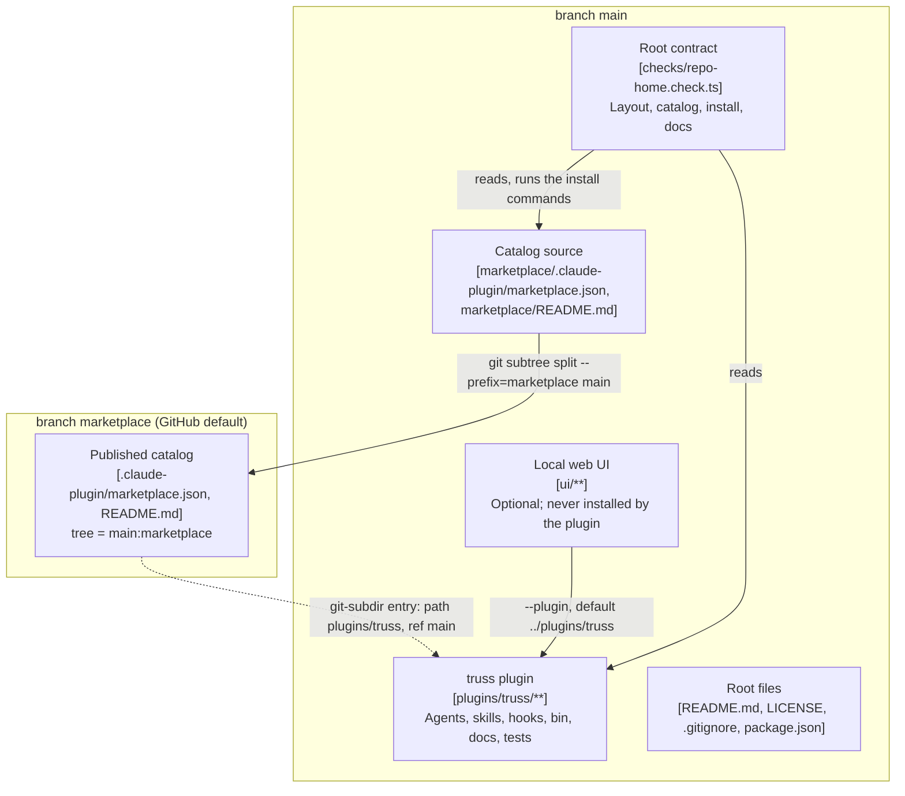
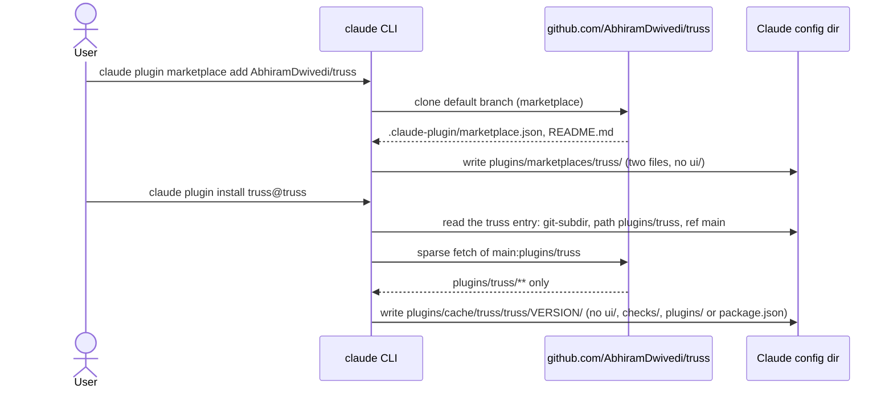

# ADR-0013: plugin layout: the plugin in plugins/truss, the catalog on a marketplace branch

The move to plugins/truss/ is not done yet: today every plugin path (agents/, skills/, hooks/, bin/, docs/, .claude-plugin/ and the rest) stays at the repo root until the later goal (plugin-move) merges, and neither plugins/truss/ nor marketplace/ exists in this repo yet.

Status: proposed, 2026-10-31. Written by the design crew `home-design` (stage 0 of goal `repo-home`). It becomes accepted when the PM (project manager) merges this crew. The goal's approval is `auto`, under the client's pre-approval of 04:29 ("don't wait for me, go with the recommended layout"), after plan-check and checker-13's review (decisions.md, 06:06). This ADR is design only: nothing moves in goal `repo-home`.

VERDICT: change. Two modules change, both as design in this goal. **marketplace** is a new module and seam: the repo has no catalog today (`git ls-files` lists `.claude-plugin/plugin.json` and no `marketplace.json`), so `truss@truss` can't install. **repo-layout** changes: the plugin root becomes plugins/truss/ in the later goal, and main gains a marketplace/ directory. A third module, **ui-server**, changes in the later goal only (see "Seams after the move").

Decided by: client

Every section below that names plugins/truss/, marketplace/ or the `marketplace` branch describes the layout **after** the later goal. Until then, read those paths as planned, not real: a crew in goal `repo-home` or earlier finds the plugin at the root.

## Context

The client asked mid-run (decisions.md, 04:26) for this repo, github.com/AbhiramDwivedi/truss, to become the standalone home of the truss plugin and its optional local web UI: its own marketplace, so users install from AbhiramDwivedi/truss rather than claude-ops, install docs that match, and "the whole repo structure" geared for a plugin plus the UI.

Today:

- The plugin is the repo root. `.claude-plugin/plugin.json` sits at the root, with `"version": "0.12.0"` and `"license": "MIT"`.
- `ui/` sits beside the plugin's own directories at the root. `ui/server/main.ts:43` takes the plugin to be ui/'s parent: `resolve(args.plugin ?? join(uiDir, '..'))`.
- The repo has no catalog. README.md:16-17 tells users to install from claude-ops: `claude plugin marketplace add AbhiramDwivedi/claude-ops` and `claude plugin install truss@claude-ops`.
- `.claude/truss.json` points at `docs/architecture.md` and `docs/adr`.

Every ADR in the ADR dir reaches each later crew: `cmdStart()` in `bin/factory.ts:779-780` lists every `<arch dir>/adr/*.md` into the crew's start context. That is why this ADR opens with the `not done yet` line.

## The client's rulings

The client gave two rulings that bind the layout. Word for word:

1. Ruling 1 (decisions.md, 04:28): "as long as people are able to just use the plugin, anot not ui, i am fine by that. when they install plugin only, they should not get ui code. if that doesnt work by keeping plugin in repo root, do it differently"
2. Ruling 2 (decisions.md, 05:07): "i dont see a reason why ui should be in marketplace"

Read together (plan-repo-home.md, "Client rulings"): a user who runs the two documented commands, `claude plugin marketplace add AbhiramDwivedi/truss` and `claude plugin install truss@truss`, gets no `ui/` anywhere under their Claude config. That covers the plugin cache under `<config>/plugins/cache/` and the marketplace clone under `<config>/plugins/marketplaces/`. Ruling 1 allows the layout to change if the root can't meet it. Ruling 2 is why the catalog leaves main.

The rulings settle the fork, so this ADR's marker line is `Decided by: client`. It is not the engineer-default marker that ADR-0005 section 6 defines and that `scripts/retro.py:750` counts by exact line match.

## Options

Each option was checked against both rulings. The proofs ran at plan time, on Claude Code 2.1.316, each with an isolated `CLAUDE_CONFIG_DIR` (plan-repo-home.md, "Layout proofs").

| Option | Result | Why |
| --- | --- | --- |
| A. Plugin at the root, catalog source `"./"` | Rejected | The plugin cache held ui/. Fails ruling 1. |
| B. Plugin moved to plugins/truss/, catalog on the default branch of main (root `.claude-plugin/marketplace.json`, source `./plugins/truss`) | Rejected | The plugin cache had no ui/, but the marketplace clone under `<config>/plugins/marketplaces/truss/` held `plugins` and `ui`: the clone is the whole default branch. Fails ruling 2. A git-subdir source into the same repo changes nothing here, because the marketplace clone is still the whole default branch. |
| C. Option B plus `claude plugin marketplace add --sparse .claude-plugin plugins` | Rejected as the mechanism | Proven to work: the marketplace clone held only `plugins`, and no ui/ was under the config. But every user must remember a flag, and the command the client fixed has none. The README may mention it. |
| D. Sparse defaults in marketplace.json | Rejected | No such field. The top-level fields are `name`, `owner`, `plugins`, `$schema`, `description`, `version`, `metadata.*`, `forceRemoveDeletedPlugins`, `allowCrossMarketplaceDependenciesOn` and `renames`. `sparsePaths` exists only on the marketplace *source*, which the user's command or settings set. |
| E. Catalog on its own `marketplace` branch, but not the default branch; users run `claude plugin marketplace add AbhiramDwivedi/truss#marketplace` (or `@marketplace`) | Fallback | Supported (`owner/repo@ref` or `owner/repo#ref`), and it needs no GitHub setting. But it changes the install command the client gave. It becomes the documented command if the client declines the default-branch flip. |
| F. The UI in its own repo | Rejected | It meets both rulings, but it needs a new GitHub repo (a client action) and breaks the goal: this repo is the home of the plugin *and* its UI. |
| G. Earlier rejections, kept | Rejected | A separate release machinery; moving only ui/ elsewhere; splitting docs out of the plugin (plan-repo-home.md counts 17 test and bin files that read docs relative to the plugin root). |
| **H. Plugin in plugins/truss/ on main; the catalog on its own `marketplace` branch, which is the GitHub default branch; one git-subdir entry into main:plugins/truss** | **Chosen** | The only option that meets both rulings with the two commands the client fixed, unflagged. |

## Decision

### 1. The layout after the later goal

main holds:

- the plugin at plugins/truss/, moved wholesale: agents, skills, hooks, workflows, bin, brief, scripts, types, tests, evals, docs (with architecture.md and adr/), retro, README.md (the full manual), CHANGELOG.md, tsconfig.json and .claude-plugin/, plus a copy of LICENSE;
- ui/ at the root, beside plugins/;
- checks/, with the root contract `checks/repo-home.check.ts`;
- a marketplace/ directory with exactly two files:
  - `marketplace/.claude-plugin/marketplace.json`: name `truss`, owner the repo owner, and one entry with no `version` (plugin.json keeps the version):

    ```json
    {"name":"truss","source":{"source":"git-subdir","url":"AbhiramDwivedi/truss","path":"plugins/truss","ref":"main"}}
    ```

  - `marketplace/README.md`: the GitHub landing page, with the install commands and a pointer to main;
- the root files: a developer README.md, LICENSE, .gitignore, and package.json with scripts only.

main has **no root `.claude-plugin/`**. If the default-branch flip were ever undone, `marketplace add AbhiramDwivedi/truss` would then fail loudly instead of silently cloning ui/.

### 2. The marketplace branch

- The PM publishes the `marketplace` branch from main with `git subtree split --prefix=marketplace main`. Its tree always equals `main:marketplace`.
- The GitHub default branch of AbhiramDwivedi/truss becomes `marketplace`. The marketplace source's `ref` defaults to the repository's default branch (marketplace-reference, "Fields by type"), so `claude plugin marketplace add AbhiramDwivedi/truss` clones only that branch: two files.
- `claude plugin install truss@truss` then fetches plugins/truss from main. A `git-subdir` source is "one subdirectory of a git repository, fetched with a sparse checkout" (marketplace-reference, "Plugin sources").
- The entry's `"ref":"main"` is required. Without it, a git-subdir fetch would land on the default branch, which is the two-file marketplace branch.

### 3. What stays plugin-relative

The plugin moves as one directory, so every path the code resolves from the plugin's own location still resolves after the move:

- `pluginDirOf()` in `hooks/register.ts:1145` returns the parent of the hooks module's directory;
- `const PLUGIN` in `bin/factory.ts:32` is two directories above `bin/factory.ts`, and `bin/factory.ts:331` passes `${PLUGIN}/docs/plan.schema.json` as the plan schema;
- `skills/retro/SKILL.md:16` finds `${CLAUDE_PLUGIN_ROOT}/scripts/retro.py`, or `scripts/retro.py` two directories above the skill;
- `agents/design-engineer.md:78` finds the schema at `<principles skill base dir>/../../docs/plan.schema.json`;
- `workflowCallVerdict` in `hooks/register.ts:710` matches `${dir}/workflows/plan.js` and `${dir}/workflows/stage.js` (`:722-723`), and `hooks/register.ts:2021` reads both from `${pluginDir}/workflows/`.

What does not stay relative is listed under "Seams after the move".

### 4. The default-branch flip is a client decision at ship time

Switching the GitHub default branch (`gh repo edit AbhiramDwivedi/truss --default-branch marketplace`) is a repository setting outside the repo, so the client decides it at ship time, after the marketplace branch is published (plan-repo-home.md, PM and client action 2; decisions.md, 05:20 and 05:24). It is cheap to undo. If the client declines, or the real-GitHub check fails, the fallback is option E: document `claude plugin marketplace add AbhiramDwivedi/truss#marketplace`. Nothing in goal `repo-home` waits on the flip.

### 5. CI is left out

CI is an external service, and the client didn't ask for it.

## Architecture-doc text for the later goal

docs/architecture.md belongs to the `retro-design` crew, so goal `repo-home` doesn't edit it. The later goal pastes this section into plugins/truss/docs/architecture.md. Until then it describes a planned layout: none of these paths exist yet.

### Repo layout after the move



*The two branches after the move. Solid arrows are writes or reads; the dotted arrow is the catalog entry's reference into main.*
Traces to: ADR-0013 Decision 1 and 2; plan-repo-home.md, "The layout decision".

### Install flow



*The two documented commands. Neither step downloads ui/.*
Traces to: ADR-0013 Decision 2; marketplace-reference ("Plugin sources", "Fields by type").

### Module map after the move

| Module | Path | Responsibility | Built by |
| --- | --- | --- | --- |
| plugin | `plugins/truss/**` | The truss plugin: everything that today sits at the root, moved with no content change except the fixes under "Seams after the move". | later goal, crew `plugin-move` |
| marketplace | `marketplace/.claude-plugin/marketplace.json`, `marketplace/README.md`; the `marketplace` branch | The catalog `truss` with one git-subdir entry into main:plugins/truss, and the GitHub landing page. | `plugin-move` (catalog), `repo-docs` (README); the PM publishes the branch |
| repo-layout | root `README.md`, `LICENSE`, `.gitignore`, `package.json`, `checks/**` | Developer docs, licence, ignore rules, root scripts with no dependencies, the root contract. | `home-hygiene` (LICENSE, .gitignore), `home-design` (contract), `plugin-move` and `repo-docs` (the rest) |
| ui-server (and the ui seam files) | `ui/**` | The optional local web UI (ADR-0011). Its default `--plugin` becomes `../plugins/truss` from ui/. | later goal, crew `plugin-move` (seam files only) |

### Seams after the move

| Seam | Producer | Consumer | Contract | Pinned by |
| --- | --- | --- | --- | --- |
| The catalog entry | marketplace | Claude Code's installer | `{"source":"git-subdir","url":"AbhiramDwivedi/truss","path":"plugins/truss","ref":"main"}`, no `version` | `checks/repo-home.check.ts`, suite `repo-home marketplace` |
| The published branch | the PM's publish step | `claude plugin marketplace add` | `origin/marketplace^{tree}` equals `main:marketplace` | the sync check in "Ship steps"; TODO: no automated check yet, the later goal adds one |
| The install result | Claude Code | the user | no `ui/` anywhere under the config; one version dir; its version equals plugins/truss's plugin.json | `checks/repo-home.check.ts`, suite `repo-home install` |
| The plugin root the UI loads | plugin | ui | today `ui/server/main.ts:43` defaults to ui/'s parent; after the move, `../plugins/truss` | the ui seam files below |
| The architecture doc paths | repo-layout | truss hooks and `bin/factory.ts` | `.claude/truss.json` names `plugins/truss/docs/architecture.md` and `plugins/truss/docs/adr` | `checks/repo-home.check.ts`, suite `repo-home layout` |

The ui files that take the plugin or repo root to be ui/'s parent. At commit dbb7700, `git grep -nE "dirname\(uiDir\)|resolve\(uiDir, *'\.\.'\)|join\(uiDir, *'\.\.'\)" -- ui/` lists nine:

- `ui/server/main.ts:43`
- `ui/contract/state.check.ts:14`
- `ui/contract/e2e/live-status.spec.ts:14`
- `ui/contract/e2e/retro-stage.spec.ts:15`
- `ui/e2e/harness.ts:23`
- `ui/test/session/session.test.ts:12`
- `ui/test/state/design.test.ts:16`
- `ui/test/state/retro.test.ts:17`
- `ui/test/state/store.test.ts:16`

Two more resolve the root another way, so that grep misses them: `ui/contract/live.check.ts:16` (`dirname(dirname(dirname(fileURLToPath(import.meta.url))))`) and `ui/spike/run.ts:13` (`resolve(here, '..', '..')`). The later goal recounts all of them at its own amend, since more ui crews may land first.

Other files the move must fix, from the plan's scratch move (plan-repo-home.md, "Later goal"): `tests/run-procedure.check.ts` (two tests read `.claude/truss.json` at its REPO path) and `evals/run-model.ts:142-143`.

## Consequences

- github.com/AbhiramDwivedi/truss shows the marketplace branch's README, not the manual. The manual lives on main.
- A bare `git clone` lands on `marketplace`, so contributors clone with `git clone -b main`.
- Pull requests need `--base main`. truss itself always names `main`: `git grep -nwE 'gh pr|origin/HEAD|symbolic-ref' -- agents skills bin workflows hooks` prints nothing at dbb7700.
- Every change to `main:marketplace/` needs a re-publish of the branch, so the later goal adds a sync check.
- The claude-ops truss entry must change in the same release as the move, to the git-subdir entry with `"ref":"main"` (client ruling, decisions.md 05:07). After the move, claude-ops' current `{"source":"github","repo":"AbhiramDwivedi/truss"}` finds no plugin.json at the root.
- The PM's live `--plugin-dir <repo>` session loses its plugin when the move merges, and restarts on `--plugin-dir <repo>/plugins/truss`.
- When plugin-move merges, it rewrites this ADR's opening `not done yet` line to say the move is done.

### Ship steps (the PM, after the later goal merges; not run)

1. Publish: `git push origin "$(git subtree split --prefix=marketplace main)":refs/heads/marketplace`.
2. With the client's yes, flip the default branch: `gh repo edit AbhiramDwivedi/truss --default-branch marketplace`.
3. Real-GitHub check: with an isolated `CLAUDE_CONFIG_DIR`, run the two documented commands, then confirm `find "$CLAUDE_CONFIG_DIR" -type d -name ui` prints nothing and `cache/truss/truss/<version>/.claude-plugin/plugin.json` exists. If it fails, fall back to option E.
4. Sync check, after every change to `main:marketplace/`: `test "$(git rev-parse origin/marketplace^{tree})" = "$(git rev-parse main:marketplace)"`.
5. After a second publish, check that `claude plugin marketplace update truss` works.

## Scope of the proof

- The plan-time runs covered the whole isolated config dir: the plugin cache, the marketplace clone and temp clones.
- They ran against a local smart-HTTP copy of the repo on 127.0.0.1 (a Node wrapper around `git http-backend`), reached through git `url.<local>.insteadOf` rules for the github.com HTTPS and SSH forms. They did not run against github.com. The real GitHub main had no marketplace.json and no plugins/truss at the time, so their success could not have come from github.com.
- Dumb HTTP failed with `dumb http transport does not support shallow capabilities`, and a `file://` source gave `Invalid marketplace source format`.
- On that host the git-subdir `owner/repo` shorthand resolved to the GitHub SSH URL form (`git@` plus the host), so the redirect must cover the SSH forms too.
- Two things stay unverified until the later goal ships and the PM runs ship steps 3 and 5 against real GitHub:
  - GitHub's default-branch behaviour for `claude plugin marketplace add owner/repo`;
  - whether `claude plugin marketplace update` fast-forwards across re-published subtree-split commits.

The contract `checks/repo-home.check.ts` repeats these runs on every check: it serves a snapshot of the repo over smart HTTP, with HEAD set to `refs/heads/marketplace` to model the GitHub default branch, and runs the two documented commands literally.

## Not confirmed

- GitHub's default-branch behaviour for `marketplace add`, and `marketplace update` across subtree-split re-publishes (above).
- TODO: the automated sync check between `origin/marketplace` and `main:marketplace`; the later goal designs it.

## Fetched

- https://code.claude.com/docs/en/plugin-marketplaces: fetched by the design engineer at plan time (plan-repo-home.md, "Sources fetched").
- https://code.claude.com/docs/en/plugins/marketplace-reference.md: fetched at plan time, and again by this ADR's writer on 2026-10-31 to confirm `owner/repo@ref` and `owner/repo#ref`, `sparsePaths` on the marketplace source only (set by `--sparse`), the git-subdir sparse checkout, `ref` defaulting to the repository's default branch, and the top-level field list. That page now also lists `metadata.pluginRoot` among the top-level fields; it adds no sparse default, so option D's finding stands.

## Amendment (goal plugin-move)

Written by the design crew `move-design` (stage 0 of goal `plugin-move`), at main 1cc086f. It updates this ADR for what main gained since it was written, and settles the open sync-check TODO. Where it differs from the sections above, the amendment wins. Every line number below is at 1cc086f.

### 1. The moved list gains resources/

Decision C6 (decisions.md, 11:38): plugins/truss must carry the top-level `resources/` module (ADR-0015), which landed after this ADR. Re-listed from `git ls-tree --name-only HEAD` at 1cc086f, the move takes these 17 paths into plugins/truss/: `agents`, `bin`, `brief`, `docs`, `evals`, `hooks`, `resources`, `retro`, `scripts`, `skills`, `tests`, `types`, `workflows`, `.claude-plugin`, `tsconfig.json`, `README.md`, `CHANGELOG.md`. It also:

- copies `LICENSE` to `plugins/truss/LICENSE`;
- untracks the 24 `tests/__pycache__/*.pyc` files tracked at 1cc086f (`git ls-files tests/__pycache__` lists 24); `.gitignore` already ignores them.

### 2. The sync check is a PM ship step

The sync check between `origin/marketplace` and `main:marketplace` is a PM ship step, not an automated check: after every change to `main:marketplace/`, the PM re-publishes the branch and runs ship step 4 above, `test "$(git rev-parse origin/marketplace^{tree})" = "$(git rev-parse main:marketplace)"`. This replaces the TODO in "Seams after the move" and in "Not confirmed". No crew of goal plugin-move builds a check for it.

### 3. The ui seam files: 13

The recount at 1cc086f, `git grep -nE "dirname\(uiDir\)|resolve\(uiDir, *'\.\.'\)|join\(uiDir, *'\.\.'\)" -- ui/`, lists 10 files:

- `ui/contract/e2e/live-status.spec.ts:14`
- `ui/contract/e2e/retro-stage.spec.ts:15`
- `ui/contract/state.check.ts:14`
- `ui/e2e/harness.ts:23`
- `ui/server/main.ts:43`
- `ui/test/session/session.test.ts:12`
- `ui/test/state/design.test.ts:16`
- `ui/test/state/notices.test.ts:14`
- `ui/test/state/retro.test.ts:17`
- `ui/test/state/store.test.ts:16`

Three more take the plugin to be ui/'s parent another way, so the grep misses them:

- `ui/contract/live.check.ts:16`, `dirname(dirname(dirname(fileURLToPath(import.meta.url))))`, passed as the `--plugin` root at `:136`;
- `ui/spike/run.ts:13`, `resolve(here, '..', '..')`, used as the plugin path at `:33` and `:68`;
- `ui/e2e/session.spec.ts:14`, which reads `ui/contract/fixtures/sdk-stream.jsonl` through the harness's `root`.

The total is 13, replacing the nine-plus-two list above. `ui/contract/live.check.ts` and `ui/spike/run.ts` must pass `join(root, 'plugins', 'truss')` as the plugin root.

### 4. The plugin files that break under a pure move: 6

- `tests/contract-stubs.check.ts`
- `tests/evals-run-model.check.ts`
- `evals/run-model.ts:140-143` (the case's worktree is a detached `git worktree add` of HEAD, and `:143` removes `evals/golden` from its root)
- `tests/main-edit-gate.check.ts:117-122` (it reads `../.claude/truss.json` from the tests dir, and builds `${repoRoot}/hooks/register.ts` and `${repoRoot}/docs/requirements.md` from the repo root)
- `tests/retro/cli.check.ts:664` (`join(PLUGIN, 'ui', 'README.md')`)
- `tests/run-procedure.check.ts:22` (`const REPO = PLUGIN`) and `:149-150` (it asserts `architecture` `docs/architecture.md` and `adr` `docs/adr`)

This replaces the two-file list above.

### 5. The seams the move pins

- `ui/server/main.ts`: the default plugin dir becomes `join(uiDir, '..', 'plugins', 'truss')`; `--plugin` still overrides it.
- `.claude/truss.json`: `architecture` = `plugins/truss/docs/architecture.md`, `adr` = `plugins/truss/docs/adr`; `merge` and `target` stay. The PM updates plan.json's `architecture` after the merge (C4).
- `marketplace/.claude-plugin/marketplace.json`: one plugin `truss`, source `git-subdir`, url `AbhiramDwivedi/truss`, path `plugins/truss`, ref `main`.
- Root `package.json`: `test` and `test:ui` scripts and no dependencies.

`checks/repo-home.check.ts` (suites `repo-home layout` and `repo-home marketplace`) and the plugin-move acceptance test pin all four, so no new contract test is needed.

### 6. The architecture-doc text now lives in the doc

The "Architecture-doc text for the later goal" section above is now the `## Repo layout (ADR-0013)` section of `docs/architecture.md`, updated for `resources/` and these seams. It moves with the doc to `plugins/truss/docs/architecture.md`.
