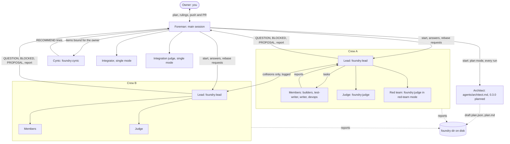

# foundry architecture

foundry is three kinds of file. The protocol lives in prompts: the foreman's in `skills/run/SKILL.md`, and the five agent definitions in `agents/` (`lead`, `judge`, `cynic`, `writer`, `devops`). The rules a prompt can't be trusted to keep live in one hooks module, `hooks/register.ts`, which `hooks/hooks.json` loads. `types/index.d.ts` declares the one value the module keeps in Claude Code's plugin state.

The prompts decide what agents should do. The hooks refuse the calls that break the chain of command, save reports to disk, and wake the foreman when something needs it.

Foundry 0.3.0 adds a design phase: an architect, principle packs, a plan file and waves. [ADR-0001](adr/0001-design-phase.md) decides it; this doc describes it and marks each part "0.3.0, planned" until it is built. None of it exists in the plugin yet: there is no `agents/architect.md`, no `skills/principles/`, no `init`, and no hook reads `plan.json`. The plan file's contract is [`plan.schema.json`](plan.schema.json), with an example in [`plan.example.json`](plan.example.json).

## Roles and who talks to whom



Only the foreman talks to the owner. Only leads message the foreman, so a member's question reaches the foreman through its lead. Leads message each other only when their work collides: a file another crew owns, a shared interface that changes, or the merge order. The hooks enforce the message rules for everything inside a crew (see [Hooks](#hooks)). The cynic, the integrator, the integration judge and (0.3.0, planned) the architect in `plan` mode are started by the foreman, so they sit outside every crew. The hooks don't police them and don't save their reports.

| Agent | Started by | Model and effort | Edits files |
| --- | --- | --- | --- |
| Foreman | You, with `/foundry:run` | The session's | Only `decisions.md`, `plan.md`, goal files, and the fast-forward in `sequential` mode; from 0.3.0 (planned), `plan.json` and `plan.md` once the architect has drafted them: it sets `approval`, `approvedAt` and each crew's `status`, and for a mid-run design slice adds the crew, moves its dependants a wave later and sets `ownerApproval` |
| Architect, 0.3.0, planned | `init`: the `foundry:init` skill (planned), run by you as `/foundry:init` or by the foreman when a run finds no architecture doc. `plan`: the foreman, at the start of every run. `design`: the design crew's lead | Opus, `high` | Only the architecture doc and the ADR directory, plus `.claude/foundry.json` in `init` mode and `plan.json` and `plan.md` in `plan` mode; never source or tests |
| Cynic, `cynic-<n>` | Foreman, fresh for each batch | Opus, `high` | No |
| Lead, `<slug>` | Foreman, in the background, in a worktree | Opus, `medium` | Merges and rebases the crew branch; writes code only for conflicts and small fixes the checks demand |
| Members, named after their lead | Lead | Set on every call; Sonnet for mechanical work, Opus for judgment | Yes, each in its own worktree |
| Judge, `<crew>-judge`, then `-2`, `-3` | Lead | Opus, one level above the strongest builder, `high` to `xhigh` | No |
| Red team, `<crew>-redteam` | Lead, when the plan says yes | Opus, `high` | Only inside its own worktree and temp dirs; never commits |
| Integrator | Foreman, `single` mode | `general-purpose`, Opus, `high` | Yes, the integration branch |
| Integration judge | Foreman, `single` mode | Opus, `xhigh` | No |

The architect (0.3.0, planned) will be `agents/architect.md`. It loads the principle packs the work touches from the `skills/principles/` skill (also planned) and runs in three modes ([ADR-0001](adr/0001-design-phase.md), sections 2 and 3):

- `init`: started by the `foundry:init` skill. Writes the project's architecture doc (principles, module map, ADRs for decisions already in the code) and `.claude/foundry.json`.
- `plan`: started by the foreman at the start of every run, outside every crew, like the cynic. For a goal, gives each touched module an `extend` or `change` verdict and splits the work into crews and waves by the leaf test, as a draft `plan.json` plus a readable `plan.md`. The foreman owns both files after that.
- `design`: a member of a wave-0 design crew, started by that crew's lead. Writes the ADR and architecture-doc change for each `change` verdict, and names the seams the crew's test-writer must pin with contract tests.

Its tools are Read, Grep, Glob, Bash (read-only git, plus the done-check commands it proves in `plan` mode), Skill, and Write and Edit for the files in the table above. Crews never edit the architecture doc or ADRs; a design change they need goes to the foreman as `PROPOSAL:`, which the foreman can take up as a mid-run design slice (lifecycle step 8).

A crew, as the hooks see it, is a `foundry:lead` with no parent (the main thread started it) and every agent whose parent chain reaches it. A `foundry:lead` started by some other agent is not a crew.

## The run lifecycle

The 0.3.0 additions are marked; all of them are planned, not built.

0. Init (0.3.0, planned): When a run finds no architecture doc, the foreman runs the `foundry:init` skill, which starts the architect in `init` mode; the owner can also run `/foundry:init`. If the repo already has an architecture doc of its own, `init` extends it rather than replacing it; otherwise it writes `docs/architecture.md`, with ADRs in `docs/adr/`. It records the doc's path in `.claude/foundry.json`.
1. Altitude: The foreman asks the owner once whether the goal is the end or a step toward a bigger outcome, and describes the bigger version.
2. Depth pass: The foreman answers four questions (what a top practitioner would add, the rawest material, the practitioner's tools, what besides a model verifies the result). The answers decide which crews exist.
3. Inventory: The foreman lists the agent types and skills the session can use.
4. Split: Crews own disjoint files, each with a done-check it can't game, its high-impact paths, a red team yes or no, and a resource slice (port range, database or temp directory). From 0.3.0 (planned), the foreman starts the architect in `plan` mode for this, at the start of every run. It gives one verdict per touched module, `extend` by default, splits the work into crews and waves by the leaf test, runs each crew's done-check once to prove it, and estimates agents per crew. A plan whose total is over `agentCap` is re-planned with fewer, larger crews or more waves before anyone sees it. The architect drafts `plan.json` and `plan.md`; the foreman owns both after that. A cynic reviews the verdicts on its own; if the two disagree, the architect gets one round to reconcile. The owner is asked only when they still disagree, or a change breaks a declared principle, adds an external service or recurring cost, or changes a stored data shape in a way that's hard to undo. `plan.json` has no fields for a crew's high-impact paths, red team or resource slice, which the 0.2.1 foreman sets in its plan table and each lead's brief (`skills/run/SKILL.md`); ADR-0001 doesn't say who sets them from 0.3.0.
5. Approval and freeze: The foreman shows the plan table and asks for the merge mode and target branch. On approval it writes `plan.md`. From here the scope is frozen, and only the owner can change it. From 0.3.0 (planned), the pause depends on the plan. An extend-only run, with no wave 0, doesn't pause: the foreman logs the plan, sets `approval: "auto"` and `approvedAt` to now, and starts the crews without asking. Its merge mode and target come from `.claude/foundry.json` (`merge`, `target`); without them the merge mode is `sequential` and the target is the current branch, and the foreman logs which it used. The owner sees the plan in the end-of-run report. A run with a wave 0 gets `approval: "owner"` and `approvedAt: null`: the foreman shows the plan table with the ADRs, asks for the merge mode and target as in 0.2.1, and sets `approvedAt` when the owner approves. Later waves start as earlier ones merge, with no further pause. `approvedAt` is null only while a run waits for the owner. In either case, questions still reach the owner through the cynic's escalation rules.
6. Leads start: The foreman writes `goals/<slug>.md` for each crew and starts all leads in one message. From 0.3.0 (planned), leads start by wave. Wave 0 holds the `change` work (ADRs, the architecture-doc change, the contract tests) and merges before any other wave starts; each wave merges before the next starts. Within a wave, at most `maxParallelCrews` crews run at once; the rest queue and start as running ones merge. The queue order is the order of the `crews` array within the wave. The foreman sets each crew's `status` in `plan.json` as it starts and merges.
7. Inside each crew: The lead runs its checks to prove its environment works, runs a full depth pass, splits the work into member tasks, and delegates. Members report with proof. The lead merges the members' branches with `git merge --no-ff`, runs the checks, then runs the red team (when there is one) and a fresh judge. Before the judge it compares its diff with the files it owns and asks the foreman for any extension. Every member commit carries `Foundry-Crew: <slug>` and `Foundry-Role: <role>` trailers. The judge reads the role with `git log --format='%H %(trailers:key=Foundry-Role,valueonly)'` and fails the crew if a `builder` commit touched the done-check tests. A file outside the crew's ownership is a `QUESTION:` for the foreman in the judge's findings, not a FAIL by itself. From 0.3.0 (planned), the judge also asks whether the diff conforms to the architecture doc's principles and module map, and to the run's ADRs. A violation that doesn't affect the done-check is a QUESTION. One that breaks a declared principle is a FAIL.
8. Messages: Leads send the foreman `QUESTION:`, `BLOCKED:` or `PROPOSAL:`. The foreman settles what it can and logs it. Items for the owner go through a cynic first. From 0.3.0 (planned), when the foreman takes up a design proposal, it runs a mid-run design slice. It adds a design crew (`verdict: "design"`) to the earliest wave that hasn't started yet, and moves only the crews that depend on the slice, and haven't started, one wave later; running crews and crews that don't depend on it keep their wave. The run-level `approval` and `approvedAt` don't change. The slice waits for the owner only when one of the owner triggers in step 4 applies: the foreman then sets the crew's `ownerApproval` to `"pending"`, and to `"approved"` when the owner answers. Otherwise the slice starts like any crew.
9. Pre-merge review: A cynic reads each crew's final report and the plan, and checks for drift and overlap between crews.
10. Judge-gated merge: The foreman reads the crew's highest-numbered judge file itself and merges only on `VERDICT: PASS` whose `## Proof checked` SHA matches the crew branch head. In `sequential` mode each lead rebases onto the target in turn, a fresh judge rules if the head moved, and the foreman fast-forwards. In `single` mode an integrator merges every crew branch into `foundry-<short goal>` and an integration judge rules on it.
11. End-of-run report: Crew summaries and what merged where, checks and verdicts, decisions and cynic overrules, deferred items, and the high-impact files that changed. The foreman then asks before every push and PR, unless the project grants it merge ownership. Production deploys always go to the owner.

## On disk

Everything for a session lives under one folder:

```
<git common dir>/foundry/<session id>/
  decisions.md               foreman: one line per decision, `- HH:MM | decision | reason | cynic | followed`
  plan.md                    foreman: the approved plan, written once the owner approves
                             (0.3.0, planned: the architect drafts it with plan.json; the foreman owns it after that)
  plan.json                  0.3.0, planned: the architect drafts it; the foreman owns it after that; hooks only read it
  goals/<slug>.md            foreman: each crew's goal, done-check, owned files, high-impact paths
  reports/<crew>/<agent>.md  plugin: each crew agent's last report, judges' included
  reports/<crew>/<agent>.interim.md  plugin: a lead's interim stop
  messages.jsonl             plugin: lead-to-lead messages
  messages.<n>.jsonl         plugin: the log rolled over, past 3 MiB
```

The plugin writes only `reports/` and the message logs. The foreman writes `decisions.md`, `plan.md` and `goals/`, as `skills/run/SKILL.md` tells it to; the plugin only stamps the time on new `decisions.md` lines (see Decision times).

The folder is `git rev-parse --path-format=absolute --git-common-dir` run in the session's working directory, plus `foundry/<session id>`. Every worktree of a repo shares one git common dir, so all crews write to the same place. Outside git the base is `$HOME/.claude` (or `%USERPROFILE%\.claude`). The path is worked out once per session and cached; a `/clear` works it out again. Session ids, crew names and agent names pass through `safeName` in `register.ts`: anything other than letters, digits, `.`, `_` and `-` becomes `-`, and the result is cut to 100 characters.

A report file is named after the agent's spawn name, else its id, under its crew's folder. A judge's report is `reports/<crew>/<crew>-judge.md`, then `<crew>-judge-2.md` and so on; those are the merge-gate files. A red team is named `<crew>-redteam` so its report never lands on one. A successor lead `<slug>-2` is a crew of its own as far as the hooks go, with its own folder.

Each line of `messages.jsonl` is `{ "ts", "from", "to", "summary" }`, where `from` and `to` are crew names and `summary` is the `SendMessage` summary. Only messages between two leads of different crews are logged. When the log is 3 MiB or more, the next append first copies it to `messages.<n>.jsonl` at the first free `n` and starts a new log.

`plan.json` (0.3.0, planned) is the seam between the architect, the foreman and the hooks: the goal, the architecture doc's path, `approval`, `approvedAt`, `agentCap`, `maxParallelCrews`, and one entry per crew with its wave, verdict, modules, owned paths, done-check, whether that check was proved, estimated agents, an optional `ownerApproval` and status. [`plan.schema.json`](plan.schema.json) is the contract; [ADR-0001](adr/0001-design-phase.md), section 8, is the source. The rules it adds:

- `approval` (`auto` or `owner`) is set once, at plan time. It's `owner` exactly when the plan has a wave-0 crew; mid-run slices never change it.
- `approvedAt` is null only while a run waits for the owner, so an `auto` run always has it.
- `verdict`: `design` is a crew that writes ADRs and contract tests; `change` is a build crew whose module's design changed, so it runs after the design crew; `extend` is a build crew working inside the existing design.
- `ownerApproval` (`pending` or `approved`) is set only on mid-run design slices that wait for the owner.
- Within a wave, the order of the `crews` array is the queue order.
- The agent total is the sum of `estAgents`, so it isn't stored.
- `version` goes up whenever a field is added; the schema allows no other properties.

One file lives in the project repo, not the foundry folder:

```
<repo>/.claude/foundry.json  0.3.0, planned: the project's foundry config
```

`init` writes only `architecture` and `adr`. The owner can add the other keys by hand; each has a default:

| Key | Written by | Default | Used for |
| --- | --- | --- | --- |
| `architecture` | `init` | `docs/architecture.md`, unless the repo has an architecture doc of its own | The architecture doc's path |
| `adr` | `init` | `docs/adr` | The ADR directory |
| `agentCap` | the owner | 40 | The most agents a plan may estimate |
| `maxParallelCrews` | the owner | 4 | The most crews running at once |
| `merge` | the owner | `sequential` | Merge mode of auto-started runs |
| `target` | the owner | the current branch | Target branch of auto-started runs |

Two kinds of state don't go to the foundry folder:

- `foundry.limitReset` in Claude Code's plugin state, `{ resetsAt, fired }`: the five-hour reset a wake is armed for and whether it has gone out. It survives a hot reload of the hooks module.
- The module's memory: every agent seen this session with its spawn name, parent and model, each agent's start and last activity time, each agent's status at the last heartbeat, the stalled set, each lead's tag, idle period and final-report time, the stop-gate counters, and when the main session was last active. A reload or `/clear` starts it over, except the main session's last activity, which `/clear` keeps.

## Hooks

All of these are in `hooks/register.ts`.

| Event | What it does |
| --- | --- |
| `classic.SessionStart`, main session only | Adds `[foundry] dir: <path>` to the context, so the foreman never derives the folder itself. |
| `session.start` | Registers `/foundry`, starts the one-minute heartbeat, and re-arms a pending limit-reset wake from plugin state. |
| `session.end` with reason `clear` | Clears the module's memory. |
| `agent.spawn` | Records each agent's spawn name, type, parent, model and start time, and counts the spawn as activity. |
| `tool.call` on `SendMessage` | Enforces who a crew agent may message, logs lead-to-lead messages, and tracks each lead's tag for `/foundry`. |
| `tool.call` on `Agent` | Refuses crew agents' calls without `model` or `effort`, or with `effort: "max"`. Adds the report-path note to calls that start a lead or a crew member. |
| `tool.call` on `Agent`, 0.3.0, planned | Refuses starting a lead that `plan.json` holds back: the wave gate, the parallel cap and the run-level and crew-level approval gates (see [Plan gates](#plan-gates-030-planned)). |
| `tool.call` on `Write`, `Edit` | Stamps the clock's time on new lines of this session's `decisions.md`. |
| `tool.call`, any tool | Records activity, the main session's too. On `SubagentHandback`, refuses an empty hand-back from a crew agent and captures the report. |
| `turn.step` | Records activity for each model request, the main session's too. |
| `classic.SubagentStop` | Runs the lead stop gate and saves the stopping agent's report. |
| `session.measure`, `classic.StopFailure` | Arm the limit-reset wake. |
| `command.run` for `foundry` | Prints the crew status. |

### Message rules

A member may message its own lead and the other members of its crew. A lead may message `main`, its own members and the other leads. An address resolves to the agent with that id; else to the live agents with that name, a trailing ` [ref]` dropped; else to the newest agent seen with that name. Refusals, word for word, with `<...>` filled in:

- A member to `main`: `[foundry] Refused: crew members message only their own lead and the other members of their crew. Put your question in a message to your lead, <lead>, which asks "main" for you.`
- A member to anyone else outside its crew, or to an unknown address: `[foundry] Refused: crew members message only their own lead and the other members of their crew. To reach anyone else, tell your lead, <lead>.`
- A lead to another crew's member: `[foundry] Refused: a lead reaches another crew only through its lead. Send it to that crew's lead, <lead>, instead.`
- A lead to an unknown address, or to an agent outside every crew: `[foundry] Refused: a lead reaches another crew only through its lead. Message "main", your own members, or another crew's lead.`
- A name that resolves to live agents in different crews: `[foundry] Refused: more than one live agent is named "<address>", in different crews. Address it by its agent id.`

A lead's message to `main` that starts with `QUESTION:`, `BLOCKED:` or `PROPOSAL:` sets its tag in `/foundry`; an untagged one clears it. Any message from the foreman to a lead clears that lead's tag.

### Agent calls

From inside a crew, every Agent call needs `model`, and `effort` set to `low`, `medium`, `high` or `xhigh`:

- No model: ``[foundry] Refused: inside a crew, every Agent call sets `model`: "opus" for judgment-heavy work (design, debugging, review, tricky code), "sonnet" for mechanical or well-specified work. Call Agent again with model set.``
- No effort, or an unknown one: ``[foundry] Refused: inside a crew, every Agent call sets `effort` to one of "low", "medium", "high" or "xhigh": "low" for lookups and mechanical edits, "medium" for well-specified work, "high" or "xhigh" for hard design, debugging or review. Call Agent again with effort set.``
- `effort: "max"`: `[foundry] Refused: effort "max" is not allowed inside a crew; "xhigh" is the top. Call Agent again with effort set to "low", "medium", "high" or "xhigh".`

The model check runs first. The foreman's own Agent calls aren't checked, though the skill tells it to set both.

A call that starts a lead from the main thread, or any agent from inside a crew, gets this note in its result: `[foundry] If <name>'s report does not reach you, read <path> once it stops.`

### Plan gates (0.3.0, planned)

None of these is in `hooks/register.ts` yet; the hooks crew lands them. Each applies to an Agent call that starts a `foundry:lead` whose slug is in `plan.json`, and is refused with the reason below ([ADR-0001](adr/0001-design-phase.md), section 9):

- Wave gate: refused while any crew in an earlier wave isn't `merged` or `dropped`. Reason: `wave <n> isn't merged yet: <slugs>`.
- Parallel cap: refused while `maxParallelCrews` crews are already `running`. Reason: `<running> crews running, the cap is <cap>; start <slug> when one merges`.
- Approval gate, run level: while `approval` is `owner` and `approvedAt` is null, starting any lead in the plan is refused. Reason: `this run changes the design; get the owner's approval first`.
- Approval gate, crew level: a crew whose `ownerApproval` is `pending` is refused on its own. Reason: `<slug> waits for the owner's approval`.

With no plan file, or a slug not in it, no gate applies, so 0.2.1 runs keep working. The hooks treat `plan.json` as read-only and fail open like every other foundry hook. They trust the foreman's `status` field: a crew marked `merged` too early gets past the wave gate. The judge-gated merge is still the real control.

### Report capture

When a crew agent stops, the hook writes its last assistant message to its report file. When the agent sent its report through `SubagentHandback`, the hook writes that message instead, and the stop that follows leaves the file alone. A lead's hand-back is written only if it would pass the stop gate; otherwise the stop decides what's written.

A crew agent's hand-back under 40 characters once trimmed (`HANDBACK_MIN`), or one that is only `placeholder`, `todo` or `tbd`, is refused. A hand-back that starts `QUESTION:`, `BLOCKED:`, `PROPOSAL:` or `CHECKPOINT:` is exempt from the length, but is refused when nothing, or only a stand-in, follows the tag: `[foundry] Refused: that hand-back is too short to be a report. Hand back your real report: what you did, the branch, and proof.` If the crew can't be read, the hand-back goes through.

### The lead stop gate

A lead's stop is checked against its hand-back, else its last message. It goes through when the text starts with `CHECKPOINT:`, `BLOCKED:`, `QUESTION:` or `PROPOSAL:`, or has a `## Proof` heading, or while the lead's tagged message to `main` is unanswered (its tag in `/foundry`; any message from the foreman clears it). Otherwise the stop is sent back with:

`[foundry] Not done yet: finish with your report, in the sections Summary, Branch, Changes, Proof, Checks run and Open questions (each a "## " heading), or, if you cannot finish, start your final message with CHECKPOINT:, BLOCKED:, QUESTION: or PROPOSAL:.`

The gate sends a stop back at most twice in a row (`LEAD_STOP_BLOCKS`), then lets the next one through, so a lead can't loop forever. A stop while the lead still has work out is interim and always goes through: a descendant is live, or a background task belonging to a descendant is running or pending. A stop excused by an unanswered tag is interim too. An interim stop's text is saved to `<agent>.interim.md` and doesn't change the report file, its tag or the lead's idle period. A stop the gate sends back is saved nowhere. The gate applies to `foundry:lead` agents only.

### Heartbeat and stalls

Every 60 seconds the module checks each crew agent listed as `running`. An agent counts as active at its spawn, each tool call and each model request. One with nothing on record starts counting from the first check. One that is `running` now but wasn't at the last check, or wasn't listed then, counts as active now and leaves the stalled set: a resumed agent isn't reported on its old activity. An agent idle for 15 minutes or more is reported once, until it is active again, with a toast, `[foundry] stalled: <agent> (crew <crew>), no activity for <n>m`, and a prompt to the main session:

`[foundry] stalled: <agent> in crew <crew>, no activity for <n>m. Check /foundry and message the <crew> lead. Read its transcript tail before you stop it; a resumed agent may be compacting.`

### Idle leads

The same check looks at each listed lead that a check saw go from `running` to stopped, is now `idle` (never `waiting`, `killed`, `failed` or `completed`) and has no member at work. A lead first seen stopped, as after a reload, is never a candidate until it runs and stops again. A candidate is excused while it waits on the foreman (a `QUESTION:`, `BLOCKED:` or `PROPOSAL:` tag) or after a final report (a `## Proof` section, `CHECKPOINT:` or `BLOCKED:`) in its current stint. A stint begins at the check that sees the lead running again; activity alone doesn't start one, so a sign-off after a final hand-back doesn't undo it. The report and tag in its report file count as well when written in the stint, so a reloaded module doesn't prompt for a lead that already reported. Otherwise its idle period starts at the first check, and after 15 minutes the main session gets one prompt per period:

`[foundry] idle lead: <lead> in crew <crew>, no report for <n>m and no member at work. Read its last message and resume it with SendMessage, or start <crew>-2 from its report.`

The period ends when the lead runs again or a report of its own is captured. The successor named is the crew's next one: `auth` gives `auth-2`, `auth-2` gives `auth-3`.

### Limit-reset wake

Two events arm it, and only while a lead is live: a `session.measure` showing the five-hour window at 100 percent, or a `StopFailure` with error `rate_limit` (the hook then reads the session's usage, and arms only if that shows the five-hour window at 100 percent too). The module sets a timer for two minutes after `resetsAt` and records the reset in plugin state. When the timer fires, it claims the reset in plugin state and sends:

`[foundry] limit reset: the five-hour usage window reset at <resetsAt>. Check /foundry and message each lead whose crew isn't done to resume.`

The wake goes out once per `resetsAt`. A hot reload cancels the timer with the old module, and `session.start` arms it again from plugin state. If the main session made a tool call or model request after `resetsAt`, the reset is claimed and no prompt goes out: the foreman is already at work.

### Decision times

A `Write` or `Edit` of `<foundry dir>/decisions.md` for this session has each new line that starts `- HH:MM |` rewritten with the clock's local time. A line keeps its time when that `HH:MM` is already on a decision line of the text the call replaces: the file on disk for a `Write`, `old_string` for an `Edit`. So a reworded line keeps its time, and only new lines are stamped. An `Edit` changes only `new_string`. A log written through Bash isn't seen. Line endings are kept. Any other file, and another session's log, is left alone.

### `/foundry`

Prints `Crews (<n>):` and one line per lead: name, status (`ended` once the agent list drops it), live members by model family, then one of `waiting on you: <question>`, `blocked: <text>`, `proposal: <text>`, `waiting on members`, `no report yet` or `last report <time> ago`, then `last active <time> ago`. Under each lead it lists stalled agents, the verdict in the highest-numbered judge file and the report folder, then one line per member: `<name> <status> <n>m (<family>), last activity <time> ago` (or `no activity seen`), timed from its spawn or first sighting. The last lines name the message log, when there is one, and `Foundry dir: <path>`. With no crews it prints `No foundry crews in this session. Start them with /foundry:run.` If reading the crews fails: `foundry could not read the crews; see the debug log.`

From 0.3.0 (planned), `/foundry` first shows each crew's wave, verdict and status from `plan.json`, then the lines above.

### Failing open

Each hook step runs inside a guard. If foundry's code throws, the guard logs `foundry: <step> failed, letting the call through: <error>` or `foundry: a hook failed and was skipped: <error>` to the debug log, and the call goes on as if the plugin weren't installed. A step that fails refuses nothing.

## Failure modes and recovery

**A stalled agent.** The heartbeat prompts the foreman. The foreman messages the stalled agent's lead, or the lead itself, and asks for its state. `/foundry` keeps showing the agent as stalled until it does something. Before stopping it, the foreman or lead reads its transcript tail: a resumed agent may be compacting.

**An idle lead.** A lead seen to go idle without a final report in its stint, while no member works, gets one `[foundry] idle lead:` prompt after 15 minutes. The foreman resumes it with a message, or starts its successor from its report.

**The usage limit.** When the five-hour window runs out while crews work, the limit-reset wake prompts the foreman after the reset. The foreman messages each lead that hasn't sent its final report: "Usage limit reset. Resume from where you stopped."

**A lead stops with work left.** Its report starts with `CHECKPOINT:`. The foreman starts a fresh lead, `<slug>-2` (then `-3`), from that report. The successor's brief names the original goal file, the predecessor's branch and commit, and the crew's original base commit; the successor resets its worktree to the predecessor's branch first. Its members, judges and report folder carry its own name. The other leads are told the new name. A member that stops with `CHECKPOINT:` is handled the same way inside the crew: a fresh member from its handoff note, never a resume.

**A lead tries to stop without a report.** The stop gate sends it back, at most twice in a row. After that the stop goes through, and the foreman sees a report that isn't in the fixed format.

**A lost hand-back.** Hand-backs from nested agents have been lost on some machines. The report is on disk anyway: the lead reads `reports/<crew>/<member>.md`, and the foreman reads `reports/<lead>/<lead>.md`, at the path in the `[foundry]` note from the Agent call.

**A judge FAIL.** The lead sends the findings to a builder. Each later judge is a fresh agent under the next unused name, never a resume, and any fix after a FAIL or a red-team break needs a fresh judge. When two fix attempts at one level end with the same check failing, the lead climbs the ladder: Sonnet, then Opus at `medium`, `high`, `xhigh`, each step a fresh agent whose first deliverable is a root-cause analysis with evidence. When `xhigh` fails twice, the lead sends `BLOCKED:` with the failing check, its output and the theories ruled out, and the foreman takes it to the owner. In `single` mode an integration-judge FAIL goes back to the integrator, and a fresh `integration-judge-2` rules next.

**A verdict on the wrong commit.** The foreman merges only when the judge file's `## Proof checked` SHA equals `git rev-parse <crew branch>`. After a rebase that moved the head, the old PASS doesn't count.

**A reload mid-session.** The module's memory starts over. An agent that ended before the reload resolves to no crew, so a message to it from a crew agent is refused. A pending limit-reset wake survives in plugin state.

## Not verified yet

- Everything marked 0.3.0 is a decision in [ADR-0001](adr/0001-design-phase.md), not built code. The one checked piece is that [`plan.example.json`](plan.example.json) validates against [`plan.schema.json`](plan.schema.json).

- No prompt in 0.2.0, neither the skill nor any of the five agents, has run as a live agent in a 0.2 run. The hooks are covered by `tests/crew.test.ts`, `tests/hooks.test.ts` and `tests/v02.test.ts`, which run `register.ts` against the mock engine from `claude-code/testing`.
- A lead's status after it ends a turn while its members still run is unobserved. `/foundry` shows `waiting on members` for a lead that isn't `running` and has live descendants, and the stall check skips any agent that isn't `running`; both rest on that status.
- Capturing a report from `SubagentHandback` is covered by tests, not observed live.
- The limit-reset wake rests on three things a probe confirmed: `$.clock` timers run from `session.start`, a hot reload cancels them (so the wake is re-armed from plugin state), and `$.prompt.submit` wakes an idle session. Nobody has yet seen the wake fire after a real usage-limit stop.
- Where an organization manages Claude Code, `SubagentStop` hooks run only in plugins it lists. There, reports come only from the hand-back tool. The lead stop gate is a `SubagentStop` hook too, so it shouldn't run there either; that is inferred from the code, not seen.
- `/goal` is session-only: a Stop hook on the main session judges it, so a lead can't use it. Foundry uses the goal file and the lead stop gate instead (backlog item 20).
- The gate's two-block bound relies on the engine setting `stop_hook_active` on the stop after a block. That comes from the hook type docs and hasn't been seen live. Claude Code also lets a stop through itself after 8 consecutive blocks.

*Drafted with AI assistance and reviewed by the author.*
