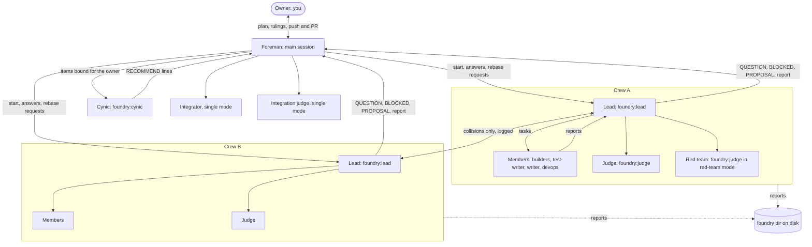

# foundry architecture

foundry is three kinds of file. The protocol lives in prompts: the foreman's in `skills/run/SKILL.md`, and the five agent definitions in `agents/` (`lead`, `judge`, `cynic`, `writer`, `devops`). The rules a prompt can't be trusted to keep live in one hooks module, `hooks/register.ts`, which `hooks/hooks.json` loads. `types/index.d.ts` declares the one value the module keeps in Claude Code's plugin state.

The prompts decide what agents should do. The hooks refuse the calls that break the chain of command, save reports to disk, and wake the foreman when something needs it.

## Roles and who talks to whom



Only the foreman talks to the owner. Only leads message the foreman, so a member's question reaches the foreman through its lead. Leads message each other only when their work collides: a file another crew owns, a shared interface that changes, or the merge order. The hooks enforce the message rules for everything inside a crew (see [Hooks](#hooks)). The cynic, the integrator and the integration judge are started by the foreman, so they sit outside every crew. The hooks don't police them and don't save their reports.

| Agent | Started by | Model and effort | Edits files |
| --- | --- | --- | --- |
| Foreman | You, with `/foundry:run` | The session's | Only `decisions.md`, `plan.md`, goal files, and the fast-forward in `sequential` mode |
| Cynic, `cynic-<n>` | Foreman, fresh for each batch | Opus, `high` | No |
| Lead, `<slug>` | Foreman, in the background, in a worktree | Opus, `medium` | Merges and rebases the crew branch; writes code only for conflicts and small fixes the checks demand |
| Members, named after their lead | Lead | Set on every call; Sonnet for mechanical work, Opus for judgment | Yes, each in its own worktree |
| Judge, `<crew>-judge`, then `-2`, `-3` | Lead | Opus, one level above the strongest builder, `high` to `xhigh` | No |
| Red team, `<crew>-redteam` | Lead, when the plan says yes | Opus, `high` | Only inside its own worktree and temp dirs; never commits |
| Integrator | Foreman, `single` mode | `general-purpose`, Opus, `high` | Yes, the integration branch |
| Integration judge | Foreman, `single` mode | Opus, `xhigh` | No |

A crew, as the hooks see it, is a `foundry:lead` with no parent (the main thread started it) and every agent whose parent chain reaches it. A `foundry:lead` started by some other agent is not a crew.

## The run lifecycle

1. Altitude: The foreman asks the owner once whether the goal is the end or a step toward a bigger outcome, and describes the bigger version.
2. Depth pass: The foreman answers four questions (what a top practitioner would add, the rawest material, the practitioner's tools, what besides a model verifies the result). The answers decide which crews exist.
3. Inventory: The foreman lists the agent types and skills the session can use.
4. Split: Crews own disjoint files, each with a done-check it can't game, its high-impact paths, a red team yes or no, and a resource slice (port range, database or temp directory).
5. Approval and freeze: The foreman shows the plan table and asks for the merge mode and target branch. On approval it writes `plan.md`. From here the scope is frozen, and only the owner can change it.
6. Leads start: The foreman writes `goals/<slug>.md` for each crew and starts all leads in one message.
7. Inside each crew: The lead runs its checks to prove its environment works, runs a full depth pass, splits the work into member tasks, and delegates. Members report with proof. The lead merges the members' branches with `git merge --no-ff`, runs the checks, then runs the red team (when there is one) and a fresh judge.
8. Messages: Leads send the foreman `QUESTION:`, `BLOCKED:` or `PROPOSAL:`. The foreman settles what it can and logs it. Items for the owner go through a cynic first.
9. Pre-merge review: A cynic reads each crew's final report and the plan, and checks for drift and overlap between crews.
10. Judge-gated merge: The foreman reads the crew's highest-numbered judge file itself and merges only on `VERDICT: PASS` whose `## Proof checked` SHA matches the crew branch head. In `sequential` mode each lead rebases onto the target in turn, a fresh judge rules if the head moved, and the foreman fast-forwards. In `single` mode an integrator merges every crew branch into `foundry-<short goal>` and an integration judge rules on it.
11. End-of-run report: Crew summaries and what merged where, checks and verdicts, decisions and cynic overrules, deferred items, and the high-impact files that changed. The foreman then asks before every push and PR, unless the project grants it merge ownership. Production deploys always go to the owner.

## On disk

Everything for a session lives under one folder:

```
<git common dir>/foundry/<session id>/
  decisions.md               foreman: one line per decision, with the cynic's recommendation
  plan.md                    foreman: the approved plan, written once the owner approves
  goals/<slug>.md            foreman: each crew's goal, done-check, owned files, high-impact paths
  reports/<crew>/<agent>.md  plugin: each crew agent's last report, judges' included
  messages.jsonl             plugin: lead-to-lead messages
  messages.<n>.jsonl         plugin: the log rolled over, past 3 MiB
```

The plugin writes only `reports/` and the message logs. The foreman writes the other three, as `skills/run/SKILL.md` tells it to.

The folder is `git rev-parse --path-format=absolute --git-common-dir` run in the session's working directory, plus `foundry/<session id>`. Every worktree of a repo shares one git common dir, so all crews write to the same place. Outside git the base is `$HOME/.claude` (or `%USERPROFILE%\.claude`). The path is worked out once per session and cached; a `/clear` works it out again. Session ids, crew names and agent names pass through `safeName` in `register.ts`: anything other than letters, digits, `.`, `_` and `-` becomes `-`, and the result is cut to 100 characters.

A report file is named after the agent's spawn name, else its id, under its crew's folder. A judge's report is `reports/<crew>/<crew>-judge.md`, then `<crew>-judge-2.md` and so on; those are the merge-gate files. A red team is named `<crew>-redteam` so its report never lands on one. A successor lead `<slug>-2` is a crew of its own as far as the hooks go, with its own folder.

Each line of `messages.jsonl` is `{ "ts", "from", "to", "summary" }`, where `from` and `to` are crew names and `summary` is the `SendMessage` summary. Only messages between two leads of different crews are logged. When the log is 3 MiB or more, the next append first copies it to `messages.<n>.jsonl` at the first free `n` and starts a new log.

Two kinds of state don't go to the foundry folder:

- `foundry.limitReset` in Claude Code's plugin state, `{ resetsAt, fired }`: the five-hour reset a wake is armed for and whether it has gone out. It survives a hot reload of the hooks module.
- The module's memory: every agent seen this session with its spawn name, parent and model, each agent's last activity time, the stalled set, each lead's tag, and the stop-gate counters. A reload or `/clear` starts it over.

## Hooks

All of these are in `hooks/register.ts`.

| Event | What it does |
| --- | --- |
| `classic.SessionStart`, main session only | Adds `[foundry] dir: <path>` to the context, so the foreman never derives the folder itself. |
| `session.start` | Registers `/foundry`, starts the one-minute heartbeat, and re-arms a pending limit-reset wake from plugin state. |
| `session.end` with reason `clear` | Clears the module's memory. |
| `agent.spawn` | Records each agent's spawn name, type, parent and model. |
| `tool.call` on `SendMessage` | Enforces who a crew agent may message, logs lead-to-lead messages, and tracks each lead's tag for `/foundry`. |
| `tool.call` on `Agent` | Refuses crew agents' calls without `model` or `effort`, or with `effort: "max"`. Adds the report-path note to calls that start a lead or a crew member. |
| `tool.call`, any tool | Records activity. On `SubagentHandback`, captures the report. |
| `turn.step` | Records activity for each model request. |
| `classic.SubagentStop` | Runs the lead stop gate and saves the stopping agent's report. |
| `session.measure`, `classic.StopFailure` | Arm the limit-reset wake. |
| `command.run` for `foundry` | Prints the crew status. |

### Message rules

A member may message its own lead and the other members of its crew. A lead may message `main`, its own members and the other leads. An address resolves to the agent with that id; else to the live agents with that name, a trailing ` [ref]` dropped; else to the newest agent seen with that name. Refusals, word for word, with `<...>` filled in:

- A member to `main`: `[foundry] Refused: crew members message only their own lead and the other members of their crew. Put your question in a message to your lead, <lead>, which asks "main" for you.`
- A member to anyone else outside its crew, or to an unknown address: `[foundry] Refused: crew members message only their own lead and the other members of their crew. To reach anyone else, tell your lead, <lead>.`
- A lead to another crew's member: `[foundry] Refused: a lead reaches another crew only through its lead. Send it to that crew's lead, <lead>, instead.`
- A lead to an unknown address, or to an agent outside every crew: `[foundry] Refused: a lead reaches another crew only through its lead. Message "main", your own members, or another crew's lead.`
- A name that resolves to live agents in different crews: `[foundry] Refused: more than one live agent is named "<address>", in different crews. Address it by its agent id.`

A lead's message to `main` that starts with `QUESTION:`, `BLOCKED:` or `PROPOSAL:` sets its tag in `/foundry`; an untagged one clears it. Any message from the foreman to a lead clears that lead's tag.

### Agent calls

From inside a crew, every Agent call needs `model`, and `effort` set to `low`, `medium`, `high` or `xhigh`:

- No model: ``[foundry] Refused: inside a crew, every Agent call sets `model`: "opus" for judgment-heavy work (design, debugging, review, tricky code), "sonnet" for mechanical or well-specified work. Call Agent again with model set.``
- No effort, or an unknown one: ``[foundry] Refused: inside a crew, every Agent call sets `effort` to one of "low", "medium", "high" or "xhigh": "low" for lookups and mechanical edits, "medium" for well-specified work, "high" or "xhigh" for hard design, debugging or review. Call Agent again with effort set.``
- `effort: "max"`: `[foundry] Refused: effort "max" is not allowed inside a crew; "xhigh" is the top. Call Agent again with effort set to "low", "medium", "high" or "xhigh".`

The model check runs first. The foreman's own Agent calls aren't checked, though the skill tells it to set both.

A call that starts a lead from the main thread, or any agent from inside a crew, gets this note in its result: `[foundry] If <name>'s report does not reach you, read <path> once it stops.`

### Report capture

When a crew agent stops, the hook writes its last assistant message to its report file. When the agent sent its report through `SubagentHandback`, the hook writes that message instead, and the stop that follows leaves the file alone. A lead's hand-back is written only if it would pass the stop gate; otherwise the stop decides what's written.

### The lead stop gate

A lead's stop is checked against its hand-back, else its last message. It goes through when the text starts with `CHECKPOINT:`, `BLOCKED:`, `QUESTION:` or `PROPOSAL:`, or has a `## Proof` heading. Otherwise the stop is sent back with:

`[foundry] Not done yet: finish with your report, in the sections Summary, Branch, Changes, Proof, Checks run and Open questions (each a "## " heading), or, if you cannot finish, start your final message with CHECKPOINT:, BLOCKED:, QUESTION: or PROPOSAL:.`

The gate sends a stop back at most twice in a row (`LEAD_STOP_BLOCKS`), then lets the next one through, so a lead can't loop forever. A stop while the lead still has work out is interim and always goes through: a descendant is live, or a background task belonging to a descendant is running or pending. An interim stop's text is saved to the lead's report file but doesn't change its tag. The gate applies to `foundry:lead` agents only.

### Heartbeat and stalls

Every 60 seconds the module checks each crew agent listed as `running`. An agent counts as active at each tool call and each model request. One with nothing on record starts counting from the first check. An agent idle for 15 minutes or more is reported once, until it is active again, with a toast, `[foundry] stalled: <agent> (crew <crew>), no activity for <n>m`, and a prompt to the main session:

`[foundry] stalled: <agent> in crew <crew>, no activity for <n>m. Check /foundry and message the <crew> lead.`

### Limit-reset wake

Two events arm it, and only while a lead is live: a `session.measure` showing the five-hour window at 100 percent, or a `StopFailure` with error `rate_limit` (the hook then reads the reset time from the session's usage). The module sets a timer for two minutes after `resetsAt` and records the reset in plugin state. When the timer fires, it claims the reset in plugin state and sends:

`[foundry] limit reset: the five-hour usage window reset at <resetsAt>. Check /foundry and message each lead whose crew isn't done to resume.`

The wake goes out once per `resetsAt`. A hot reload cancels the timer with the old module, and `session.start` arms it again from plugin state.

### `/foundry`

Prints `Crews (<n>):` and one line per lead: name, status (`ended` once the agent list drops it), live members by model family, then one of `waiting on you: <question>`, `blocked: <text>`, `proposal: <text>`, `waiting on members`, `no report yet` or `last report <time> ago`, then `last active <time> ago`. Under each lead it lists stalled agents, the verdict in the highest-numbered judge file and the report folder. The last lines name the message log, when there is one, and `Foundry dir: <path>`. With no crews it prints `No foundry crews in this session. Start them with /foundry:run.` If reading the crews fails: `foundry could not read the crews; see the debug log.`

### Failing open

Each hook step runs inside a guard. If foundry's code throws, the guard logs `foundry: <step> failed, letting the call through: <error>` or `foundry: a hook failed and was skipped: <error>` to the debug log, and the call goes on as if the plugin weren't installed. A step that fails refuses nothing.

## Failure modes and recovery

**A stalled agent.** The heartbeat prompts the foreman. The foreman messages the stalled agent's lead, or the lead itself, and asks for its state. `/foundry` keeps showing the agent as stalled until it does something.

**The usage limit.** When the five-hour window runs out while crews work, the limit-reset wake prompts the foreman after the reset. The foreman messages each lead that hasn't sent its final report: "Usage limit reset. Resume from where you stopped."

**A lead stops with work left.** Its report starts with `CHECKPOINT:`. The foreman starts a fresh lead, `<slug>-2` (then `-3`), from that report. The successor's brief names the original goal file, the predecessor's branch and commit, and the crew's original base commit; the successor resets its worktree to the predecessor's branch first. Its members, judges and report folder carry its own name. The other leads are told the new name. A member that stops with `CHECKPOINT:` is handled the same way inside the crew: a fresh member from its handoff note, never a resume.

**A lead tries to stop without a report.** The stop gate sends it back, at most twice in a row. After that the stop goes through, and the foreman sees a report that isn't in the fixed format.

**A lost hand-back.** Hand-backs from nested agents have been lost on some machines. The report is on disk anyway: the lead reads `reports/<crew>/<member>.md`, and the foreman reads `reports/<lead>/<lead>.md`, at the path in the `[foundry]` note from the Agent call.

**A judge FAIL.** The lead sends the findings to a builder. Each later judge is a fresh agent under the next unused name, never a resume, and any fix after a FAIL or a red-team break needs a fresh judge. When two fix attempts at one level end with the same check failing, the lead climbs the ladder: Sonnet, then Opus at `medium`, `high`, `xhigh`, each step a fresh agent whose first deliverable is a root-cause analysis with evidence. When `xhigh` fails twice, the lead sends `BLOCKED:` with the failing check, its output and the theories ruled out, and the foreman takes it to the owner. In `single` mode an integration-judge FAIL goes back to the integrator, and a fresh `integration-judge-2` rules next.

**A verdict on the wrong commit.** The foreman merges only when the judge file's `## Proof checked` SHA equals `git rev-parse <crew branch>`. After a rebase that moved the head, the old PASS doesn't count.

**A reload mid-session.** The module's memory starts over. An agent that ended before the reload resolves to no crew, so a message to it from a crew agent is refused. A pending limit-reset wake survives in plugin state.

## Not verified yet

- No prompt in 0.2.0, neither the skill nor any of the five agents, has run as a live agent in a 0.2 run. The hooks are covered by `tests/crew.test.ts`, `tests/hooks.test.ts` and `tests/v02.test.ts`, which run `register.ts` against the mock engine from `claude-code/testing`.
- A lead's status after it ends a turn while its members still run is unobserved. `/foundry` shows `waiting on members` for a lead that isn't `running` and has live descendants, and the stall check skips any agent that isn't `running`; both rest on that status.
- Capturing a report from `SubagentHandback` is covered by tests, not observed live.
- The limit-reset wake rests on three things a probe confirmed: `$.clock` timers run from `session.start`, a hot reload cancels them (so the wake is re-armed from plugin state), and `$.prompt.submit` wakes an idle session. Nobody has yet seen the wake fire after a real usage-limit stop.
- Where an organization manages Claude Code, `SubagentStop` hooks run only in plugins it lists. There, reports come only from the hand-back tool. The lead stop gate is a `SubagentStop` hook too, so it shouldn't run there either; that is inferred from the code, not seen.

*Drafted with AI assistance and reviewed by the author.*
