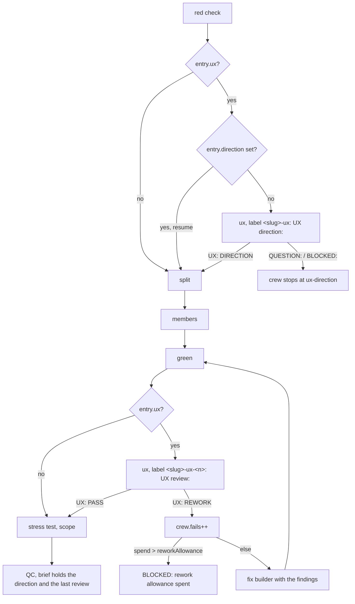
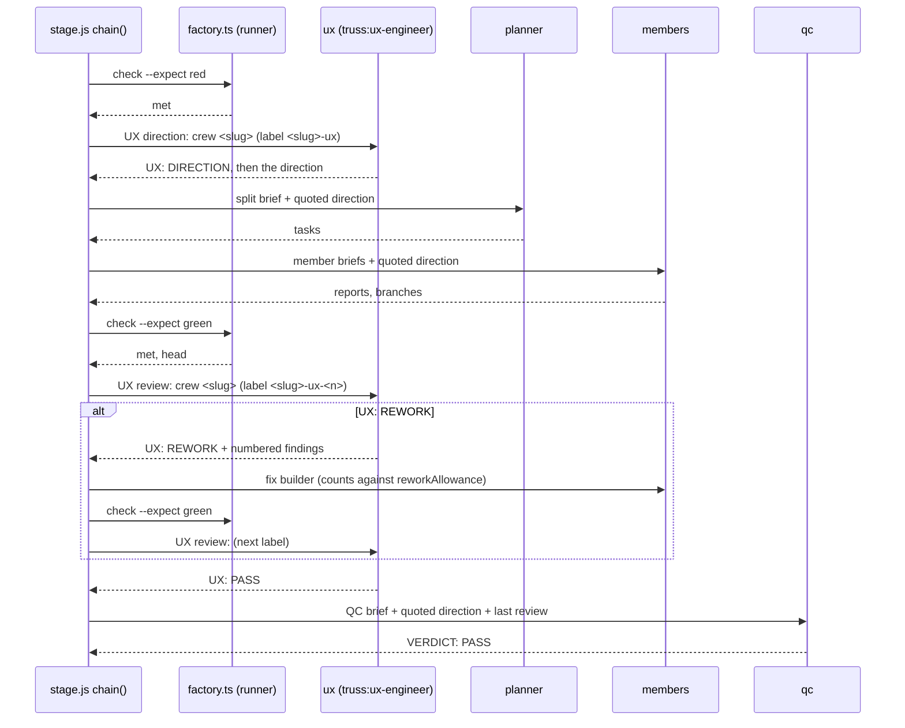

# ADR-0022: the UX engineer (`truss:ux-engineer`, role `ux`), plugin bugs 22 and 23, and the `## Members` refusal

Status: proposed, 2026-11-02. Written by the design crew `ux-design` (stage 0 of goal `factory-ux`). It becomes accepted when the PM merges this crew. The goal's approval is `auto`, and its plan is revision 2 (`plan-factory-ux.md` in the truss dir). Sources: amend brief items U1 to U7, and the send-back's PO rulings R1 to R6 and findings F1 to F5. Stage 1 crews ux-runtime and ux-agent build from this ADR; it changes no code itself. Line numbers are those of the crew base 032569a.

Amended by [ADR-0026](0026-factory-fixes5.md) (proposed 2026-11-03, goal `factory-fixes5`): item 50's `factory start --model <role>=<model>` sets both `roles.<role>.model` and `members.<role>.model`, over U6's `## Members` precedence. Without `--model`, U6 holds.

## Context

The client, on 2026-11-02: "The ui needs to be impressive, functional. Ensure there is a ux agent spun by truss that provides direction." Today `workflows/stage.js` runs no design role. `chain()` (`stage.js:883`) goes red, split, members, green, stress test, scope, QC, and no step gives builders a design direction or checks the built screens against one.

Two plugin bugs, item 22 and item 23, block the same goal:

- **Item 22.** `runFactory` (`stage.js:201`) asks a Sonnet runner to retype a command's whole stdout into `{exit, stdout}` (`RUNNER_SCHEMA`, `stage.js:32`). On a 1.7 KB reply the runner escaped a quote wrongly, the JSON did not parse, `met` came out false, and crew ui-serve stopped falsely at red (decisions.md, 18:43). Runtime-stage's item 11, `lastJsonObject` (`stage.js:181`), skips chatter lines but still needs the retyped line to be intact.
- **Item 23.** A goal file's `## Members` model and effort never reach a spawn. `spawn()` (`stage.js:76`) takes model and effort only from the run-level roles table, so web-app's goal file asked for an Opus member and all 7 builders ran on Sonnet (decisions.md, 18:50).

Constraints that bind the design:

- ADR-0009 (line 9): "no Opus at high or xhigh". `ROLE_EFFORTS` is `['low', 'medium']` (`stage.js:10`), and `finish` audits `effort high or xhigh` on any labelled role (`bin/factory.ts:1380`).
- ADR-0009 Decision 1 ("start, engine split"): a crew whose client raised a member to `high` or `xhigh` belongs on the foreman path, and the PM writes `## Engine` foreman for it. Nothing in `factory start` enforces that today.
- Goal ui-redesign owns `docs/architecture.md`, ADR-0011 and ADR-0018 while it is in flight (U7). The architecture text for this design therefore lives in this ADR.

## Decision

### U1. The agent `truss:ux-engineer`

`plugins/truss/agents/ux-engineer.md` (built by ux-agent) is a senior product and UX designer. Its tools are read-only: no Write, Edit, MultiEdit or NotebookEdit, inline or as a YAML list (F3). The first line of its brief picks the mode:

- `UX direction:` reads the goal file, the design reference its `## UX` section names, the current UI code and the requirements. It returns a direction: screens and states (empty, loading, error, stuck and long content), layout and hierarchy, tokens and components, motion, accessibility, responsive rules, and a checklist the reviewer can verify.
- `UX review:` reads the screenshots and, when the goal file says how to start a dev server, the live page. It checks them against the direction checklist and the design reference.

On any other first line it stops with `BLOCKED:` and writes no direction. It loads `vercel:shadcn`, `frontend-design:frontend-design` and `vercel:react-best-practices` when the session lists them. When it lacks an input (no `## UX` section, no screenshots, a dev server that won't start, a crew that builds no UI), it ends with `QUESTION:` or `BLOCKED:`, never an invented direction.

### U2. The `ux` role (R1, R6)

`workflows/roles.json` gains one row:

```json
"ux": { "agentType": "truss:ux-engineer", "model": "opus", "effort": "medium", "isolation": "none" }
```

The effort is medium, on Opus, per ADR-0009's no-Opus-at-high ruling (R1). U2 asked for effort high. The PO overruled that, and the row then passes `spawn()` and the `finish` high audit unchanged.

**The ux role has no `typeFromProject` (R6).** It never takes `--type ux=...`, so `rolesWithTypes` (`bin/factory.ts:306`) keeps refusing that with `--type: role ux does not take a project agent type` (`:320`), and the foreman-shape case at `tests/factory.check.ts:840` stays true with no exemption (F2).

`docs/truss-config.schema.json` `roles` (`:44-56`) gains `"ux": { "$ref": "#/$defs/agentType" }`. `rolesWithTypes` lays a non-empty `roles.ux` string on the ux row's `agentType` directly, not through the `typeFromProject` test that guards `build` and `test` (`:310-313`).

### U3. Which crews get a UX engineer

A crew entry's `ux` is true when plan.json's crew has `ux: true`, or when its goal file has a `## UX` section whose body is not empty and does not start with `none`. Either source is enough. A `## UX` section with `ux: false` in plan.json still sets it. A crew with neither runs exactly as today.

- `docs/plan.schema.json` `$defs.crew` (`additionalProperties: false`, `:178`) gains `"ux": { "type": "boolean", "default": false }`.
- `cmdPlanCheck` (`bin/factory.ts:396`) adds the error `<slug>: ux must be a boolean` for any other value.

### U4. Two new steps in `chain()`



**Direction step.** It runs after `redStep` (`stage.js:875`) and before `split`, at step `ux-direction`, through `ask(crew, 'ux', ...)` like any role. It also runs on a resume that has saved tasks but no direction. Its brief opens `UX direction: crew <slug>`, then gives the goal file, the crew worktree, the approved scope, the architecture doc and ADRs, and the answers whose `at` is `ux-direction`. The reply's first non-empty line decides:

- `UX: DIRECTION` gives a direction, kept as `{label, text}`;
- `QUESTION:`, `BLOCKED:` or `PROPOSAL:` stops the crew with that tag at `ux-direction`;
- anything else gets one fresh ux agent, then `BLOCKED: no direction from two UX engineers`.

**The direction is a quoted block.** `plannerPrompt` (`stage.js:585`), `memberPrompt` (`stage.js:273`, so every tester, builder, writer and fix member) and `qcPrompt` (`stage.js:786`) each carry it under one heading line, `The crew's UX direction (report <label>), quoted:`, followed by every line of the direction prefixed `> `. No brief gets a path in its place.

**Review step.** It runs after `green` (`stage.js:627`) and before the stress test, scope check and QC, at step `ux-review`. The review comes before the stress test so the stress engineer tests the screens the reviewer passed. Before each review, `guardAllowance(crew, 'ux-review')` runs, as before QC. The brief opens `UX review: crew <slug>`, then gives the goal file, the crew worktree as checkout, the head, the crew branch, the quoted direction, the last green check's output tail (`clip`, 4,000 characters, where an acceptance test prints its screenshot paths), and the previous review on a rework round. The reply's first non-empty line decides:

- `UX: PASS` goes on to the stress test;
- `UX: REWORK` costs one unit: `crew.fails++`, as QC does at `stage.js:852`. When `spendOf(crew)` is more than `F.reworkAllowance`, the crew stops with `allowanceStop(crew, 'ux-review', text)`. Else the numbered findings go to `fixFindings` under `UX findings`, the same way QC findings do (`stage.js:858`). Then `green`, and a fresh review;
- a stop tag stops the crew at `ux-review`;
- no verdict gets one fresh reviewer, then `BLOCKED: no verdict from two UX reviews`, as QC does (`stage.js:846-848`).

A QC FAIL later does not rerun the review. QC gets the direction and the last review's label, verdict and findings, and checks UI work against the direction itself. A `merge-ready` resume (`stage.js:885-890`) runs no UX step, because its review passed before QC did.

**The crew result's `ux` field.** `qc()` (`stage.js:840`) adds it only on a ux crew: `ux: {direction: <label>, review: <label> | null, verdict: "PASS" | "REWORK" | null, findings: [<string>]}`. `stopResult` adds it too when the crew stopped after a review.



### Labels, reports and the restart

The direction's label is `<slug>-ux`, and the reviews' labels are `<slug>-ux-<n>`, from `nextLabel` (`stage.js:114`). `parseLabel` (`bin/factory.ts:119`) reads both as role `ux`. Once roles.json has the row, `finish` files them under `reports/<slug>/` (`bin/factory.ts:1393`). A direction that reruns after a stop takes the next free number, so stage.js and factory.ts read a report's kind from its first line, never from its number.

**Resume rule.** `crewEntry` (`bin/factory.ts:821`) sets the entry's `direction` to `{label, text}` from the crew's newest ux report (highest label number) whose first non-empty line is `UX: DIRECTION`, or `null`. With a direction in the entry, `chain()` runs no second direction pass.

**Spend across a restart.** `spentOf` (`bin/factory.ts:284`) adds to its QC FAIL count the crew's ux reports whose first non-empty line starts `UX: REWORK`. Interim `.run<k>.md` files don't count, and the `since` rule of `qcFails` (`hooks/register.ts:603`) applies. A logged re-plan resets this count too: only ux reports modified at or after the `<slug>-qc-<k>.md` file the re-plan names count, as `countedQc` (`bin/factory.ts:278`) does for QC files.

### R4. The ux audit

`roleAudit` (`bin/factory.ts:1357`) treats role `ux` like `qc`. The agent type must be the run's ux row `agentType`: `truss:ux-engineer`, or the type truss.json `roles.ux` maps. `finish` builds that table with `rolesWithTypes(PLUGIN, [], configOf(repo).roles)`, in place of its `readRoles` (`:1650`). The reasons are `ux ran as <type>, not <ux agentType>` and `a UX engineer used Write or Edit`.

### U5. Item 22: `met` without a retyped stdout

`runFactory` adds `--status-line` to every factory.ts command it builds. `heavyParts` (`stage.js:229`) puts the flag before the `--`. With the flag, factory.ts prints one more line after its JSON result, as the last line of stdout:

```
truss-status: {"ok":true,"head":"<sha>"}
```

The object holds only what the result has of: the booleans `ok`, `merged` and `admitted`; `head` as a string; `env` cut to 200 characters; and `ran`, copied from `heavy.ran`. That keeps it under about 150 characters, so the runner never retypes kilobytes to give the workflow its decision.

`RUNNER_SCHEMA` gains a required string `status`. The runner prompt says: "copy the last line that starts with `truss-status: ` character for character, or `""` when there is none". `runFactory` parses the JSON after the prefix and sets `met` to `status[key] === true`. It lays the status fields over `lastJsonObject(stdout)`, so `green` gets `head` and `check` gets `heavy.ran` even when the long line is broken. `lastJsonObject` already skips the status line, because the line doesn't start with `{`. An empty or unparseable `status` falls back to today's rule, so the hand-built runner stubs of other checks still run.

### U6. Item 23: `## Members` sets the model and effort (R2, R5)

**Parse (code, not a model).** `factory start` reads each line of the goal file's `## Members`. A line counts when, after an optional `- ` or `* ` bullet, it reads `<n> <role> on <model> at effort <effort>`, with role `builder(s)` or `tester(s)`, case-insensitive. Any other line is prose and is ignored, as today. The entry gains `members: {"builder"?: {model, effort}, "tester"?: {model, effort}}`, with model `opus` or `sonnet` and effort `low` or `medium`; it is `{}` when no line counts.

**Use.** `spawn()` takes `crew.e.members[role]` over the roles row for builder and tester, and over the planner's task effort. The goal file is approved scope; the task effort is the planner's own call below it. Fix members and resolvers follow the builder value.

**The refusal (R2), a rule new in ADR-0022.** `factory start` never lowers an effort silently. A counted line at effort `high` or `xhigh` makes `start` refuse that crew before `ensureWorktree` (`bin/factory.ts:1118`), and the crew stays `planned`. The `refused` entry (as at `:1115`) is `{"slug": "<slug>", "reason": "## Members asks for <n> <role> at effort <effort>; a workflow crew runs members at effort low or medium only (ADR-0009), and factory start never lowers an effort silently. Set ## Engine to foreman in <goal file> to run this crew on the foreman path."}`. A counted line with another model or effort, or two lines for one role that disagree, refuses the crew the same way and names the value. `engineOf` (`bin/factory.ts:796`) reads `## Engine` first, so a foreman crew never reaches the parse. The same check runs on the `--resume` paths before their entry is built.

**R5.** Opus builders from a goal file match architecture.md:131 ("Sonnet for mechanical work, Opus for judgment"), and they keep ADR-0009: the effort stays low or medium, and Opus never runs at high or xhigh inside a workflow crew.

### U7. Release

Ux-agent drops the 0.17.0 "Stage workflow" `TODO:` (CHANGELOG.md:34) after checking it against what runtime-stage merged. It adds `## 0.18.0` with U1 to U6, sets plugin.json and `checks/compose-manifests.check.ts` to 0.18.0, and names the ux role and its `roles.ux` key in the README Roles section.

## Consequences

- A UX crew pays for at least two more Opus medium agents: one direction and one review per green.
- A `UX: REWORK` uses the same allowance as a QC FAIL. With `reworkAllowance` 2 (the default, `bin/factory.ts:353`), a crew with two reworks stops at its first QC FAIL, because the spend is then 3.
- Goal files that ask for a member at `high`, like web-app's (decisions.md 18:50), are now refused on the workflow engine. The PM must write `## Engine` foreman or lower the effort in the goal file.
- Every factory.ts command run with `--status-line` has a two-line stdout. Callers without the flag see no change.
- `ENTRY_KEYS` (`tests/fixtures/workflow-run/start.cases.ts:44`) grows by `direction`, `members` and `ux`. `factory start` always writes all three (`null`, `{}`, `false` for a crew without them). stage.js still accepts an entry that lacks them, as missing means null, `{}` and false.
- The PM still decides by hand which crews get `ux: true` or a `## UX` section. Teaching the planner and the run skill that rule is out of scope.
- The ux-agent prompt must start a direction report with the line `UX: DIRECTION`. Ux-agent's acceptance test doesn't check this line, so its QC must.

## Seams to pin

| Seam | Sides | Exact text and rule |
|---|---|---|
| Brief openings | `agents/ux-engineer.md`, `stage.js` | stage.js sends first lines `UX direction: crew <slug>` and `UX review: crew <slug>`. The agent stops with `BLOCKED:` on any other first line. |
| Report first lines | same | A direction starts `UX: DIRECTION`. A review starts `UX: PASS` or `UX: REWORK`, then numbered findings `<n>. <screen>: <what is wrong>. Fix: <the fix>`. No first-line match gets one retry, then BLOCKED, as QC does. |
| Quoted direction | `plannerPrompt`, `memberPrompt`, `qcPrompt` | Heading `The crew's UX direction (report <label>), quoted:`, then each line prefixed `> `. |
| Labels | `stage.js` `nextLabel`, `bin/factory.ts` `parseLabel` | `<slug>-ux` for the direction, `<slug>-ux-<n>` for reviews, role `ux`. |
| Crew entry | `crewEntry`, `stage.js`, `ENTRY_KEYS` | New keys `ux` (boolean), `direction` (`{label, text}` or null) and `members` (object). stage.js accepts an entry without them. |
| Spend | `spentOf`, `stage.js` `qc()` | `UX: REWORK` costs one unit in a run (`crew.fails++`) and across a restart. |
| `## Members` refusal | `factory start` | Effort high or xhigh refuses the crew with the reason above, which names `## Engine` foreman (R2). |
| ux audit | `roleAudit` | Role `ux` must run as the ux row's `agentType`; Write or Edit gives a reason (R4). |
| Crew result | `stage.js` `qc()` | The `ux` field is present only on a ux crew, shaped as above. |
| runFactory | `runFactory`, factory.ts `--status-line` | Last stdout line `truss-status: <short JSON>`. `met` comes from it, never from a retyped long stdout (item 22). |
| Roles row | `roles.json`, `truss-config.schema.json` | The `ux` row above, with no `typeFromProject`. `roles.ux` uses the `agentType` `$ref`. |

ux-runtime, which also owns the stage-fixes2, factory-fixes2 and harness test files (R3), pins these with the `u2 roles-row`, `u3 entry-ux`, `u4 direction-first`, `u4 direction-briefs`, `u4 rework`, `u4 spent-restart`, `control no-ux`, `i22 long-reply`, `i23 opus-builder`, `i23 high-refused` and `r4 ux-audit` cases. Ux-agent pins the agent side with its `openings`, `verdict`, `states` and `stop` cases.

## Architecture note

Goal ui-redesign owns `docs/architecture.md`, so this text waits here for the next goal that edits it.

- **Agents table.** Add a row after the QC engineer: "UX engineer, `<crew>-ux`, then `-ux-<n>` | stage.js, for a crew with `ux` | Opus, `medium` (ADR-0022) | No; read-only tools, audited by `finish`."
- **The stage chain.** For a ux crew it becomes: red, UX direction, split, members, green, UX review (with rework through green), stress test, scope, QC. The direction travels as a quoted block in the planner, member and QC briefs.
- **On disk.** `reports/<slug>/<slug>-ux.md` holds the direction, and `<slug>-ux-<n>.md` the reviews. A restart reads both: the newest `UX: DIRECTION` report is reused, and each `UX: REWORK` report counts toward `spent`.
- **Engine split.** `factory start` refuses a workflow crew whose `## Members` asks for effort high or xhigh. Its reason names `## Engine` foreman.
- **The runner.** factory.ts commands that stage.js runs end with a `truss-status:` line, and the workflow decides on that line.
