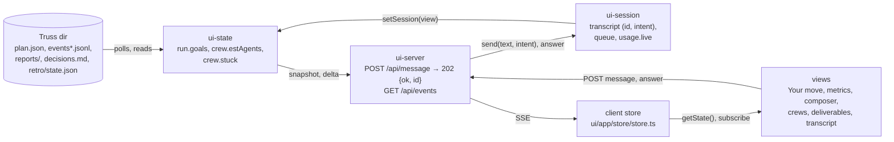
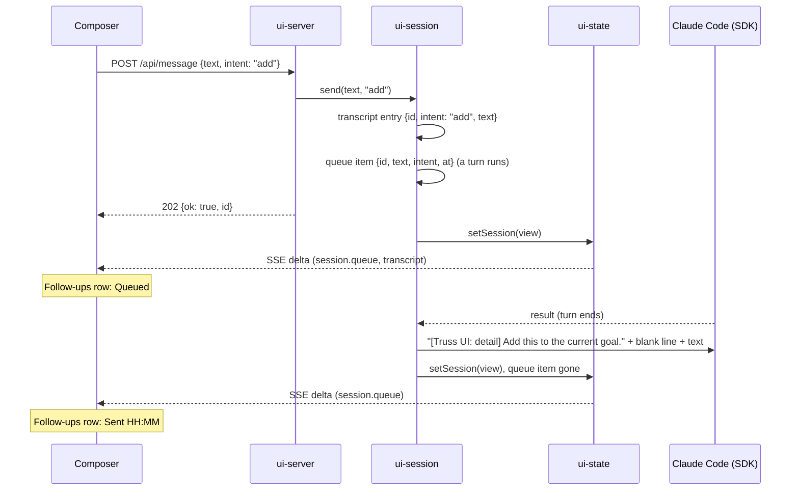
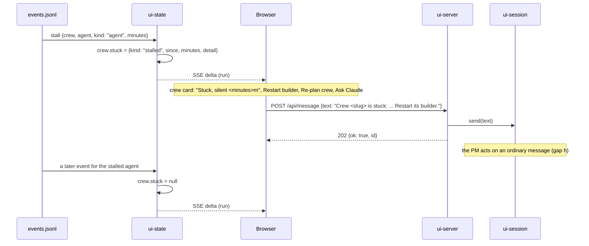

# ADR-0023: the factory floor UI, direction D and D2

Status: proposed, 2026-11-03. Written by the design crew `floor-design` (stage 2 of goal `ui-redesign`, plan revision 5b, approved auto). It becomes accepted when the PM merges this crew. The crews `floor-server`, `floor-shell` (stage 3) and `floor-views` (stage 4) build from it; it changes no code itself.

Decided by: the client, who rejected the revision 4 look and told the PO "go ahead with recommendations"; the PO's revision 5 calls (supersede the crews web-app and ui-serve, build direction D and D2, a UX engineer on every UI crew under [ADR-0022](0022-ux-engineer.md), gaps a, b, d, e, f and g filled, c and h shipped without, the icon in `ui/` only); the PO's revision 5b anti-gaming fixes F1 to F7 and S1 to S4; the plan's "Server gap rulings" and "Layout fixed by this plan" (`plan-ui-redesign.md`); the UX engineer's direction for this crew (report `floor-design-ux`); and this crew for what those leave free. It amends [ADR-0018](0018-ui-redesign.md).

Amends: [ADR-0018](0018-ui-redesign.md). Direction D and D2 replace ADR-0018's visual direction: its idea (section 4), its layouts by width (section 6), its tokens (section 7), its motion, its focus ring (section 8, last item), its screenshot widths (section 6) and its screenshot states (section 10). ADR-0018's behaviour contract stays: the stack (section 1), the file layout (section 2), the missing-build behaviour (section 3), the keyboard rules (section 8) except the focus colour, the client data flow (section 9), and the shell and per-state role assertions of section 10. Where this ADR adds to a section 10 state, both hold. ADR-0011's server contract stays, except for the additive gap fields below.

The reference files are in the run's truss dir, under `design/`: `direction-d.html`, `direction-d2.html`, `direction-d2-light.png` and the phone PNGs. Line numbers below cite `direction-d2.html`.

## Context

The client rejected the revision 4 look of crew web-app. The PO approved direction D, with D2's screens, as the design system. D2 draws ten states of one page and marks where the server lacks data for them. The amend brief lists those as gaps a to h. Each gap is either filled with an additive server change and a contract test, or shipped without, with the UI degraded honestly and no fake data.

## Decision

### 1. Server gap rulings

Every filled gap is additive. No `required` list in `ui/contract/state.schema.json` grows, no existing field changes meaning, and the token and cookie guard and the page CSP don't change. New fields are optional in the schema; the server always sends them once floor-server builds them.

Gap a: fill. A message carries an intent and an id.

- `transcriptEntry` gains `id` (string or null) and `intent` (`"goal"`, `"add"` or null). A `user` entry carries the id of the message that made it. An `assistant` or `error` entry has `id: null` and `intent: null`.
- `POST /api/message` takes `{text, intent?}`. `intent` is `"goal"`, `"add"`, null or absent. Any other value answers `400 {"error": "intent"}`. On success it answers `202 {"ok": true, "id": "<id>"}`. The id is a non-empty string, unique within one server process. Clients compare it and never parse it. The same id is on the message's transcript entry and on its `session.queue` item.
- With an intent, the session prepends one fixed line, then a blank line, then the text as typed. The fixed lines are, exactly:
  - `goal`: `[Truss UI: new goal] Plan this as a new goal for the run.`
  - `add`: `[Truss UI: detail] Add this to the current goal.`
- Text with no intent (null or absent) goes to the session unchanged, as today (`ui/server/session/session.ts:157-162`).
- The transcript entry's `text` is the text as typed, without the fixed line. The fixed line goes only into the session's streaming input.
- Answers still use `POST /api/requests/<id>/answer`. The composer's `Answer the question` intent posts there, with the body the card's `Submit answers` sends, and never to `/api/message`. A reply card answered with a message makes a `user` entry with `intent: null`.

Gap b: fill. `session` gains `queue`: an array, oldest first, of `{id, text, intent, at}`.

- It lists every accepted message the SDK has not yet taken. That is the messages held in `queue` while a turn runs (`ui/server/session/session.ts:76-78`) and those in `outbox` waiting for the input generator (`:58`, `:65`).
- An item leaves `queue` when the input generator yields it (`:58`).
- `id` and `intent` are the message's, as in gap a. `text` is the text as typed. `at` is the server clock when the POST was accepted, RFC 3339 UTC.
- An idle session has `queue: []`.

Gap c: ship without. `run.version` keeps its meaning, the plan.json schema version. The UI shows no plan revision. No text "Plan revision" or "plan revision" appears on the page, and a follow-up row has no "In the plan" status.

Gap d: fill. run.goals lists every goal from plan.json, the run's first goal first as id run.

- `run` gains `goals`: an array of `{id, goal, approval, approvedAt}`.
- The first item is `{id: "run", goal, approval, approvedAt}`, built from plan.json's top-level `goal`, `approval` and `approvedAt`. plan.schema.json says the first goal's id is the reserved word `run` and is not in `goals` (`plugins/truss/docs/plan.schema.json:50-51`).
- Then come plan.json's `goals` entries in file order, each with its `id`, `goal`, `approval` and `approvedAt`. `addedAt` is not carried.
- Without a readable plan.json, `goals` is `[]`.

Gap e: fill. `usage` gains `live`, a running estimate of the session's tokens: `{inputTokens, outputTokens, cacheReadInputTokens, cacheCreationInputTokens, subagentTokens, totalTokens, at}`.

- The first four are sums of the `usage` counters `input_tokens`, `output_tokens`, `cache_read_input_tokens` and `cache_creation_input_tokens` of top-level `assistant` messages (no `parent_tool_use_id`), counted once per `message.id`. The recorded stream repeats one message's usage on each of its content blocks (`ui/contract/fixtures/sdk-stream.jsonl`).
- `subagentTokens` is the sum, over task ids, of the latest `system` `task_progress` message's `usage.total_tokens` for that `task_id`.
- `totalTokens` is the sum of the five counters above.
- `at` is the server clock when the last message that changed `live` arrived, RFC 3339 UTC.
- Usage from `result` messages is unchanged: `costUsd`, `models`, `results` and `at` keep their meaning.
- `session.usage` stays null until the first `result`, because its `results` minimum of 1 stays. So `live` first shows after the first turn ends. See Consequences.
- The client computes the token rate from two successive `live` values. When `live.at` is more than 2 minutes old, the Tokens tile says so (section 4, live-counter).

Gap f: fill. crew.estAgents comes from plan.json; there is no task total, so the tasks tile shows no denominator.

- `crew` gains `estAgents`: plan.json's crew `estAgents` (an integer, at least 1, `plugins/truss/docs/plan.schema.json:234-238`), or null for a crew not in plan.json.
- The Tasks done tile shows a count with no `/` and no total.

Gap g: fill. `crew` gains `stuck`: null, or `{kind, since, minutes, detail}`, derived from the crew's events.

- The source is the crew's latest `stall` event in `events.jsonl` and its rolled files, the line ui-state already parses (`ui/server/state/reduce.ts:160-165`). Its fields are `kind` (`agent` or `idle-foreman`) and `minutes` (`plugins/truss/docs/events.schema.json:80-90`). Today the reducer drops `kind`.
- `kind` is `"stalled"` when the event's kind is `agent`, and `"idle-foreman"` when it is `idle-foreman`.
- `minutes` is the event's `minutes`.
- `since` is the event's `ts` minus `minutes` minutes, RFC 3339 UTC: when the agent went quiet.
- `detail` is the text the reducer already builds for the event, `<agent> stalled <minutes> min` (`ui/server/state/reduce.ts:165`).
- `stuck` is null when the crew has no stall event, when the stalled agent has a later event in that crew (its member `state` is no longer `stalled`), or when the crew's `status` is not `running`.

Gap h: ship without. There are no crew control or pause endpoints.

- The stuck-crew buttons `Restart builder`, `Re-plan crew` and `Ask Claude` each send an ordinary message through `POST /api/message`, with no intent. The PM acts on it. The texts are:
  - `Restart builder`: `Crew <slug> is stuck: <detail>. Restart its builder.`
  - `Re-plan crew`: `Crew <slug> is stuck: <detail>. Re-plan this crew.`
  - `Ask Claude`: `Crew <slug> is stuck: <detail>. What is happening, and what do you suggest?`
- For a crew whose `stuck.kind` is `idle-foreman`, the primary button is `Start a successor foreman` in place of `Restart builder`, followed by `Re-plan crew` and `Ask Claude`. It also sends an ordinary message with no intent, with the text:
  - `Start a successor foreman`: `Crew <slug> is stuck: <detail>. Start a successor foreman for it.`
- The `Pause build` button is `aria-disabled="true"` and described by D2's tip "Pausing needs a server endpoint that doesn't exist yet." (`direction-d2.html:484`).

### 2. The design system: tokens, type and icons

`ui/contract/redesign/tokens.json` is the contract artifact. It is committed, and this ADR describes it without changing it. Its shape is `{colors: {<key>: {light, dark}}, radius, text, shadow: {<key>: {light, dark}}, font: {sans, mono}, shadcn: {"--<var>": "<colour key>"}}`.

- **Colours.** 26 keys, with the light and dark hex values of `direction-d2.html:32-37` and `:43-48`: `bg`, `surface`, `sunken`, `border`, `border-strong`, `fg`, `muted`, `subtle`, `brand`, `brand-strong`, `brand-soft`, `brand-line`, `move`, `move-fg`, `move-muted`, `move-line`, `signal`, `signal-soft`, `signal-text`, `ok`, `ok-soft`, `fail`, `fail-soft`, `fail-text`, `opus`, `sonnet`. There is no 27th key.
- **Radius.** `chip` 6 px, `ctl` 8 px, `card` 12 px, `panel` 16 px, `hero` 20 px.
- **Text sizes.** `micro` 11, `meta` 12, `ui` 13, `body` 14, `lead` 16, `title` 18, `h1` 22, `ask` 24 px.
- **Shadows.** `e1`, `e2` and `e-hero`, light and dark, exactly as `direction-d2.html:38-40` and `:49-51` give them.
- **Fonts.** `sans` is `Geist, ui-sans-serif, system-ui` and `mono` is `Geist Mono, ui-monospace, monospace`.
- **shadcn map.** 18 shadcn variables, each mapped to a D2 key. It stays as it is:

| shadcn variable | D2 key |
|---|---|
| `--background` | `bg` |
| `--foreground`, `--card-foreground`, `--popover-foreground`, `--secondary-foreground` | `fg` |
| `--card`, `--popover` | `surface` |
| `--primary` | `move` |
| `--primary-foreground` | `move-fg` |
| `--secondary` | `sunken` |
| `--muted`, `--muted-foreground` | `muted` |
| `--accent` | `brand-soft` |
| `--accent-foreground` | `brand-strong` |
| `--destructive` | `fail` |
| `--border` | `border` |
| `--input` | `border-strong` |
| `--ring` | `brand` |

A shadcn variable whose name is a D2 key maps to that same key. `--muted` is D2's text colour, so shadcn's muted surface goes on `--secondary`. `--primary` is `move`, not `brand`: `move-fg` on `move` is 6.70:1 in both themes, but `move-fg` on dark `brand` is 3.68:1 and fails.

The built CSS holds every colour key in the light `:root` block and in the `.dark` block, as D2's own sheet does (`direction-d2.html:31-52`). `ui/contract/redesign/tokens.check.ts` checks this against the built `ui/web/assets/*.css`, with hex lowercased and `#fff` expanded to `#ffffff` before comparing.

**Icons.** `ui/contract/redesign/icon.svg` and `ui/contract/redesign/icon-favicon.svg` are byte copies of the approved king-post truss mark, `design/icon.svg` and `design/icon-favicon.svg` in the truss dir. floor-shell serves the favicon. The icon is saved to no developer portal or external service. Other icons are lucide.

### 3. Contrast and focus

Ratios are WCAG relative-luminance contrast, computed from tokens.json:

| Pair | Light | Dark | Rule |
|---|---|---|---|
| `subtle` on `sunken` | 4.34 | 5.41 | fails in light: text on `sunken` uses `muted` |
| `muted` on `sunken` | 6.92 | 8.60 | text on `sunken` |
| `ok` on `ok-soft` | 3.58 | 8.21 | fails in light |
| `ok` on `surface` | 3.77 | 9.29 | fails in light: `ok` is for dots, bars and icons; chip text is `fg` |
| `sonnet` on `surface` | 4.10 | 8.33 | fails in light: badge dots or borders only |
| `signal` on `surface` | 2.15 | 10.69 | never text or a sole boundary on `surface` |
| `brand` on `move` | 1.30 | 1.82 | so the `brand` ring can't show inside Your move |
| `move-fg` on `move` | 6.70 | 6.70 | text and focus inside Your move |
| `border-strong` on `surface` | 1.48 | 1.72 | an input outline alone is not a 3:1 boundary |
| `signal-text` on `signal` | 3.30 | 1.16 | fails: never the Your move pill |
| `signal-text` on `signal-soft` | 6.37 | 10.24 | the Your move pill and the queue note |
| `move` on `move-fg` | 6.70 | 6.70 | the selected answer option |
| `move-fg` on `brand` | 5.17 | 3.68 | fails in dark: the send button is never `brand` |
| `surface` on `fail` | 4.70 | 6.63 | the stuck card's primary button |

The rules:

- `subtle` is never text on `sunken`.
- `ok`, `sonnet` and `signal` are never text. They mark dots, bars, icons, badge borders and edges.
- Focus is a 2 px `brand` outline, offset 2 px (`direction-d2.html:56`), replacing ADR-0018's `patina` ring. Inside Your move, focus is a `move-fg` outline.
- State is never carried by colour alone. A stuck crew shows the word "Stuck" and an icon, and a stuck link in the network gets a still marker.
- Targets are at least 24 by 24 px. The 6 px source dots are decorative and are not targets.

D2 draws four controls with raw hex or with pairs that fail the table above. These rules replace D2's drawing, and no 27th key is added for any of them:

- **The Your move pill** (`direction-d2.html:527`) is a `signal-soft` background with `signal-text` text and a `signal` dot (6.37:1 light, 10.24:1 dark). D2's `bg-signal` and raw `text-[#3B2604]` go: `signal-text` on `signal` is 3.30:1.
- **The selected answer option** (`:535`, `:539`) is a `move-fg` background with `move` text, for both its label and its description (6.70:1 in both themes). D2's `bg-white`, `dark:bg-white`, `text-fg`, `dark:text-[#0F172A]` and `text-[#475569]` go: dark `fg` and dark `muted` on white fail. Unselected options keep D2's `move-line` border with `move-fg` text and `move-muted` descriptions.
- **The `Recommended` chip** (`:538`) is a `move` background with `move-fg` text. D2's `bg-brand-soft` and `dark:bg-[#EFF6FF]` go.
- **The composer send button** (`:627`) is shadcn's `--primary`: a `move` background with `move-fg` text (6.70:1 in both themes). D2's `bg-brand text-white` goes: `move-fg` on dark `brand` is 3.68:1.
- **The stuck card's primary button** (`:408`) is a `fail` background with `surface` text (4.70:1 light, 6.63:1 dark). D2's `text-white dark:text-[#2A0E17]` goes, and so does the same pair on the stuck band (`:424`) and the stage's `1 stuck` chip (`:656`), which take `surface` on `fail` too.

### 4. The page, its states and their copy

There is one page, `/`, served by ui/server. Its regions:

- **Banner.** h1 `Truss`, a `status` named `Session`, the `Turn on notifications` button, and a theme toggle: a `button` named `Dark theme` with `aria-pressed`. The page starts in the OS theme; the toggle switches it for the page's life and stores nothing, since the UI stores nothing (ADR-0011, Context). The link `Skip to Your move` is the first Tab stop.
- **Your move**, a `region` named `Your move`: the one thing waiting on the person. Its primary action is to answer or approve. It is the page's only filled `move` surface (D2's rule: one filled blue surface per screen).
- **Live metrics**, a `region` named `Live metrics`: six `term` and `definition` pairs, Elapsed, Tokens, Spend, Agents, Crews merged and Tasks done. Its chips link to `#your-move`, `#composer` and `#crew-<slug>`.
- **Composer**, a `form` named `Message`: a `radiogroup` named `What this message is`, the textbox `Goal or message`, a send button, and a `region` named `Follow-ups`.
- **Run tabs**, a `tablist` named `Run` with tabs `Crews`, `Decisions and ADRs` and `Design`. The Crews tabpanel holds the `Crews` region, with stage groups and crew buttons. When `retro/state.json` exists, a `Retro stage` region follows the Crews region.
- **Built artifacts and deliverables**, a `region` labelled by its h2: a `group` named `Filter by type` of toggle buttons with `aria-pressed`, a `group` named `Group by`, a `list` named `Deliverables`, and an `aside` named `Preview: <title>`. Below 1024 px the preview opens as a `dialog` named `Deliverable`, with `aria-modal="true"` and a `Close` button. The dialog is the client's own markup. It doesn't use a scroll-locking modal primitive, which ADR-0018 section 1 rules out under the CSP. It traps focus, returns focus to the item on close, and closes on Escape.
- **Transcript**, a `log` named `Transcript` with h2 `Transcript`.

Screenshot states: empty, question, approval, follow-up, crews-running, stuck-crew, artifacts, live-counter, decisions, retro

Each state is a fixture (section 6) and has one spec block that asserts it by role and name. Every state also has ADR-0018 section 10's shell and the `Dark theme` toggle with `aria-pressed`.

**empty.**
- Session `idle`. Your move holds no `article`, and shows h3 `Start a run` and "Type a goal. Truss plans it, and asks you here when it needs a call."
- The intent radiogroup is absent and the send button reads `Send`.
- No Live metrics region: there is nothing to count yet.
- The Crews panel shows `No plan yet.` and no crew button.
- The Deliverables region shows "Nothing built yet. Plans, ADRs and screenshots appear here as crews finish." and no filter chips.

**question.**
- An `article` named `Question from Claude: <header>` on the move surface. In it, a `radiogroup` named by the question text, with the recommended option first and its name ending `(Recommended)`; the textbox `Your own answer`; and the button `Submit answers`.
- The card's `Your move` pill is `signal-soft` with `signal-text` text (section 3).
- The checked option is `move-fg` with `move` text for its label and description; the `Recommended` chip is `move` with `move-fg` text (section 3).
- The page title is `(1) Truss`.
- The composer shows a `signal-soft` note: "Claude's turn is open on your question. Anything you send now waits in the queue and goes out once you answer it."
- The question text wraps at 52ch.

**approval.**
- Two articles. `Reply needed` is the plan approval, with `Approve`, `Deny` and the textbox `Message with your answer`. `Permission request: <tool>` shows the tool, title, summary, reason and blocked path as text, with `Approve` and `Deny`.
- Only the oldest article is the filled move surface. The second is a `surface` card with a `brand-line` border, under the line "1 more waiting on you".
- The page title is `(2) Truss`.

**follow-up.**
- The `Follow-ups` region lists the `user` transcript entries and `session.queue` items, newest first. Each row shows its intent label (`New goal`, `Add to current goal`), the text (truncated to one line, with the full text in `title`, in its accessible name and on focus) and a time.
- The intent label is sentence case, with no `text-transform: uppercase`. D2's `uppercase tracking-wide` (`direction-d2.html:639`) goes: it breaks the copy rules, and a screen reader spells it out.
- With no entries, the region reads "Nothing sent yet." and holds no list.
- Each row has one status chip. A row in `session.queue` reads `Queued`. A row in the transcript and not in the queue reads `Sent HH:MM`. There is no "In the plan" or "plan revision" status (gap c).
- The radiogroup offers `New goal` and `Add to current goal`, and `Answer the question` only while a question is open.
- The send button's name follows the checked intent: `Add goal`, `Send details` or `Send answer`. With no intent checked it reads `Send`. In every state and both themes it is `--primary`: `move` with `move-fg` text (section 3).

**crews-running.**
- ADR-0018 section 10's stage groups and crew buttons.
- Each crew shows "N agents planned" from `estAgents` (gap f).
- Expanding a crew shows the `<slug> members` list.
- Running work shows the moving dash; under reduced motion it is a solid `brand` segment.

**stuck-crew.**
- One crew has a non-null `stuck` (gap g, kind `stalled`).
- Its button's name holds `stuck: stalled <minutes> min`, or `stuck: foreman idle <minutes> min` for kind `idle-foreman`. ADR-0018's `blocked` wording for `QC FAIL` and `reported BLOCKED` stays.
- The crew card has a `fail` header band "Stuck, silent <minutes>m". Under it are a Why / How long / Next definition list and three buttons: `Restart builder` (primary), `Re-plan crew` and `Ask Claude`. Each sends an ordinary message (gap h). For kind `idle-foreman` the primary button is `Start a successor foreman` instead of `Restart builder`, and it sends `Crew <slug> is stuck: <detail>. Start a successor foreman for it.` The fixture `stuck-crew/idle-foreman.json` holds that kind.
- The primary button is `surface` text on `fail` (section 3).
- An 80-character slug is cut short in view with `text-overflow: ellipsis` on one line, and its full value stays in the crew button's accessible name.
- The `Pause build` button is `aria-disabled` and described by the tip "Pausing needs a server endpoint that doesn't exist yet."
- The metrics chip `1 crew stuck` links to the card.
- Your move holds no card for it: a stuck crew is the PM's to handle.

**artifacts.**
- The deliverables list is grouped by stage, with type filter chips and counts.
- The type filter always offers `All`, `Docs`, `Code`, `Plan` and `Images`, each with its count, 0 included. Images come from `design.images`; an image whose crew is not merged is a pending item.
- A type filter that matches nothing shows "No <type> yet." (the type in lower case, such as "No images yet.") and a `Show all types` button, which presses `All` again. The fixture `artifacts/no-images.json` is `artifacts/state.json` with `design.images: []`.
- One item is pending: "Arrives when <crew> merges. Nothing to open yet." It is not a link.
- At phone and tablet width, activating an item opens the `Deliverable` dialog. Focus moves into it, Escape closes it, and focus returns to the item.

**live-counter.**
- Elapsed reads "since you approved, <day HH:MM>", from `run.goals[0].approvedAt` (goal id `run`, gap d).
- Tokens shows the total and the rate, and "as of HH:MM" from `usage.live.at` (gap e). When that stamp is more than 2 minutes old, the sub-line reads "as of HH:MM, not updating" in `signal-text`.
- Spend reads "as of turn end HH:MM", from `usage.at`.
- Tasks done shows a count with no denominator (gap f).
- D2's "from events today / needs a server change" legend and its hollow dots are not product copy; the page has neither.
- The tick animation runs only without reduced motion.

**decisions.**
- As ADR-0018 section 10: the tab is selected, and the panel holds the `Decisions` and `ADRs` regions.
- No "Plan revision N" text anywhere (gap c). The idea panel reads "Approved by you at HH:MM", from `run.goals[0].approvedAt`.

**retro.**
- A `Retro stage` region after Crews, holding five items named `Extract: <status>`, `Judges: <status>`, `Triage: <status>`, `Fix goal: <status>` and `Fixes applied: <status>`, drawn as a stepped rail. A running step shows its detail text.

**Error and stuck paths.** These are spec cases, not screenshot states.
- Loading. Before the first `snapshot` event, the page shows the banner and placeholder blocks at the final heights of Your move, the metrics bar and the Crews panel, with no `article` and no spinner in the page body. The `Session` status reads `connecting`. After 10 s with no snapshot, it reads "Can't reach the Truss session. Is `truss ui` still running?" and a `Retry` button follows it, which opens the stream again.
- A session error: the status reads `error: <first line>`, and the composer keeps its typed text.
- A send error. When `POST /api/message` answers anything but 202 (and not the token 401 below), an `alert` under the textbox reads "Not sent: <reason>. Your text is still here." The textbox names the alert in `aria-describedby`, keeps its value, and gets focus back. `<reason>` is the response's `error` string, or its HTTP status when there is none.
- An expired token. When the server answers 401 `{"error": "token"}` ([ADR-0011](0011-local-web-ui.md)), the `Session` status reads "Session link expired. Open the link `truss ui` printed again." The composer keeps its text and is disabled, so nothing more is sent on the dead link.
- A lost stream: the reconnect spec asserts a `Status:` notice "Reconnecting…", then recovery.
- Long content: crew slugs and deliverable titles truncate, with the full value in the accessible name. The fixtures hold one 80-character slug and one 300-character follow-up.

### 5. Layout, widths and motion

Screenshot widths: phone 360 px, tablet 768 px, desktop 1440 px

360 px is narrower than D2's 390 px drawing, on purpose, to catch overflow. 768 px exercises the stacked layout below 1024 px. 1440 px gets the six-column metrics.

- **1024 px and up.** A left rail (the idea, Pause, the ADR timeline) and a main column. The main column runs metrics (sticky), Your move, composer, tabs, deliverables and transcript, in that order.
- **Below 1024 px.** The order is banner, Your move, composer, metrics, crews, deliverables, transcript, as D2's `max-lg:order-*` classes give it (`direction-d2.html:456`, `:466`, `:522`, `:580`, `:619`, `:817`, `:859`). The preview becomes a sheet (the `Deliverable` dialog).
- **Metrics.** Six columns at 1280 px and up, three below 1280 px, two below 1024 px. The sticky metrics bar never changes height, so nothing shifts under the pointer.
- **Overflow.** At each width, `scrollWidth <= clientWidth`. The type filter and the intent group scroll sideways inside themselves, never the page.
- **200% zoom.** Emulated as a 720 px viewport (200% of 360 px). With the question card and the stuck card shown, the page still has no horizontal scroll.
- **Hierarchy.** The eye lands first on Your move, then the metrics chips, then stuck crews. Spacing uses a 4 px base. Each view has one primary action: the move card's submit, or the composer's send when there is no card.
- **Keyboard.** The skip link comes first and jumps to Your move, then the composer. Radios move by arrow keys. Dialogs trap focus and return it. Async updates go through `status` and `log` regions.

**Motion.** From `direction-d2.html:57-64`: `arrive` 360 ms, `tick-up` 420 ms, and the `ping`, `dash`, `scan`, `sheen` and `stuck-glow` loops. Every one stops under `prefers-reduced-motion: reduce` (`direction-d2.html:65`). The specs assert this with `page.emulateMedia({ reducedMotion: 'reduce' })` and a computed `animation-name` of `none` on the `stuck-glow` and `ping` elements.

### 6. Fixtures

- One directory per state: `ui/contract/fixtures/run/<state>/state.json`, for each of the ten states above.
- Each `state.json` is a whole state snapshot: the `$defs.state` shape of `ui/contract/state.schema.json`, gap fields included.
- Times are relative to a fixed anchor, which the specs shift to now before they plant the state.
- `live-counter/` also holds `stale.json`, whose `usage.live.at` is more than 2 minutes before the anchor.
- `stuck-crew/` also holds `idle-foreman.json`: the same state, with the stuck crew's `stuck.kind` `idle-foreman` and its foreman the stalled agent.
- `artifacts/` also holds `no-images.json`: the same state, with `design.images: []`, so the `Images` filter matches nothing.
- The stuck-crew and artifacts fixtures hold an 80-character slug and a 300-character follow-up.
- The specs plant a fixture into the fake interface of `ui/e2e/harness.ts` (`startInterface`, `:264`). Session fields go through `setSession` (`:242`, `:341`). Requests go through the interface's `question()`, `permission()` and `reply()` (`:244-248`), so the page can answer them.
- The existing root files `ui/contract/fixtures/run/plan.json`, `events.jsonl` and `decisions.md` stay unchanged.
- The specs never write a fixture in place. They copy what they change to an `mkdtemp` dir.

### 7. The store seam

`ui/contract/redesign/store.check.ts` pins the client store against the fixtures (ADR-0018 section 9). Each case:

1. imports `createStore` from `ui/app/store/store.ts` inside the case, so a missing module fails that case only;
2. passes `StoreDeps {open, reload}`, where `open` returns a fake `SourceLike` (`addEventListener(type, listener)` and `close()`);
3. calls `start()`, then emits one `snapshot` message carrying the state's `state.json`;
4. reads `getState()` and asserts the state's fields: `queue`, `live`, `goals` (first goal id `run`), `estAgents`, `stuck` and `intent`.

These names are those of `ui/app/store/store.ts` on branch `truss-web-app`, which floor-shell may salvage.

### 8. Data flow

*Where each gap field comes from. Session fields reach the state through `setSession`; file fields through ui-state's reads.*

*A message with an intent. With no turn running, the message skips the wait and goes straight to the SDK; it still sits in `queue` until the input generator takes it.*

*A stuck crew. Restart builder and Ask Claude send ordinary messages; no control endpoint exists.*

## Rename table

The redesign titles renamed by this ADR (the axe row covers all 10 states in both themes):

| Old title | New title |
|---|---|
| [redesign] pending-question | question |
| [redesign] pending-approval | approval |
| [redesign] blocked-crew | stuck-crew |
| [redesign] axe: <state> in <theme> has the ADR-0018 roles and no WCAG 2.2 AA violations | axe: <state> in <theme> has the D2 roles, tokens and no WCAG 2.2 AA violations |

Every `[ui]` and `[contract]` test title is kept as it is, so the table has no `[ui]` or `[contract]` row. A later re-pin that must change one hands it back to the foreman, who adds its row here in the form `| [ui] <old title> | <new title> |`.

## Consequences

- `ui/contract/redesign/support.ts` reads the `Screenshot states:` and `Screenshot widths:` lines from this ADR, not ADR-0018 (`support.ts:14` reads this file). The screenshot set is 10 states, 3 widths and 2 themes: 60 files at `ui/screens/<state>-<phone|tablet|desktop>-<light|dark>.png`, at `deviceScaleFactor: 1`.
- The schema gains optional fields only. A client that ignores them still works, and the existing contract checks stay green.
- The live counter shows nothing live during the first turn of a session, because `session.usage` is null until the first `result` (gap e).
- ADR-0018's "Light and dark follow the OS only" no longer holds: the `Dark theme` toggle overrides the OS for the page's life.
- ADR-0018's "no modal" holds for primitives: the `Deliverable` dialog is the client's own markup.
- For floor-shell and floor-views (beyond this crew):
  - D2's raw hex goes, by the rules of section 3: the Your move pill is `signal-soft` with `signal-text` text and a `signal` dot, the selected option is `move-fg` with `move` text, the `Recommended` chip is `move` with `move-fg`, the send button is `--primary`, and the stuck primary button is `surface` on `fail`. No 27th key is added.
  - shadcn components that use `bg-muted` (Skeleton, TabsList) are retargeted to `bg-secondary`, because `--muted` is a text colour.
  - The `border-strong` input outline is 1.48:1 on `surface`. Inputs sit inside a bordered card or get a 3:1 focus and boundary treatment.
