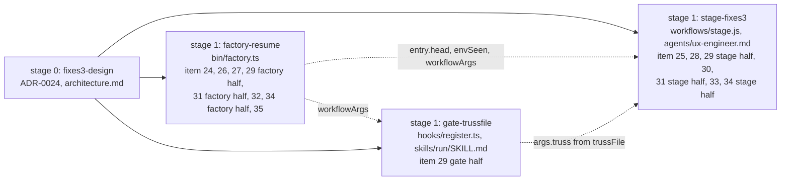
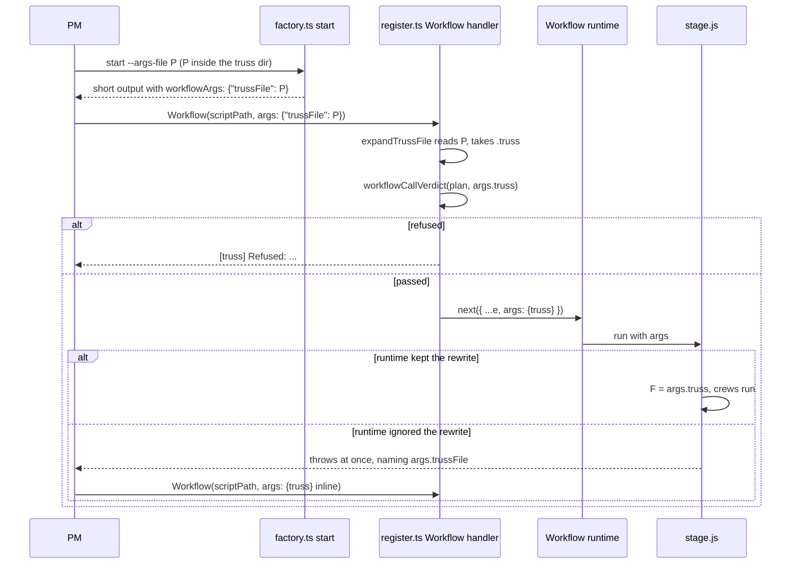

# ADR-0024: factory-fixes3: plugin bugs 24 to 35, fixed and pinned

Amended by [ADR-0025](0025-factory-fixes4.md) (proposed 2026-11-03, goal `factory-fixes4`): seam 1's crew entry gains `livePage` (item 40), and item 24's newer-than-session warning text gains a parenthesised detail (item 41). The can't-tell text stays word for word.

Status: proposed, 2026-11-03. Written by the design crew `fixes3-design` (stage 0 of goal `factory-fixes3`). It becomes accepted when the program manager (PM) merges this crew. The goal's approval is `auto`, and its plan is `plan-factory-fixes3.md` in the truss dir. The client's words: "Don't just log a plugin bug, fix it."

VERDICT: change. Three modules change: the **Workflow gate** (`hooks/register.ts`), the **factory CLI** (`bin/factory.ts`) and the **stage workflow** (`workflows/stage.js`). Three extend: the **ux-engineer agent** (`agents/ux-engineer.md`), the **run skill** (`skills/run/SKILL.md`) and the **plugin docs** (this ADR and two lines in `architecture.md`).

This ADR edits no text of ADR-0009, ADR-0019 or ADR-0022. Where an item adds to a contract one of them set, the addition is recorded here, by number.

## Context

The ui-redesign run logged twelve plugin bugs in `decisions.md` between 23:34 and 05:53, numbered 24 to 35. Each one is shown below with the code on main at `693a307`. Every fix is pinned by a test that fails without it: `tests/stage-fixes3.check.ts`, `tests/factory-fixes3.check.ts` and `tests/gate-trussfile.check.ts` hold one `i<k> N:` case per item.

| Item | What the code does on `693a307` |
|---|---|
| item 24 | Only the stress role gets an "agent file changed after the session" warning: `stressWarnings` (`bin/factory.ts:942-963`). A `truss:ux-engineer` added mid-session was unspawnable ("agent type 'truss:ux-engineer' not found") and nothing warned. |
| item 25 | `answersFor` (`workflows/stage/answers.js`) sends every answer whose `at` is not a task name to every member. That includes `ux-direction` and `ux-review`, which already reach their own step (`workflows/stage/ux.js` `uxDirectionPrompt`, `uxReviewPrompt`). |
| item 26 | Hotfix `08ae9bd` makes member briefs merge with `--no-ff`, pinned in `tests/workflows.check.ts:687` ("bug 26"). A resume still never looks for member worktrees that have vanished. |
| item 27 | `doneTasks` (`bin/factory.ts:1033-1047`) skips every result whose `marker !== 'DONE'` (`:1037`). A BLOCKED task whose branch the PM merged by hand is never done. |
| item 28 | `testsBackstop` (`workflows/stage/fixes.js`) goes through `fixBuilder` (`workflows/stage/tasks.js`) and `fixPrompt` (`:431`), whose brief opens with a `git merge --no-ff` step and "Work in your own worktree" (`:445`), then tells the agent to rewrite the crew branch "not in your own worktree" (`:603`). The tester role runs with isolation `worktree` (`workflows/roles.json:5`), where the worktree guard refuses `git -C <crew worktree>`. |
| item 29 | `const F = args.truss` (`workflows/stage/args.js` `F`). `workflowCallVerdict` refuses a call with no object `args.truss` (`hooks/register.ts:766-767`). `--args-file` already writes the object to a file (`bin/factory.ts:1219-1230`), but the PM still pastes it inline. A hook can rewrite a call's input: `next({ ...e, content: stamped })` (`register.ts:2200`). |
| item 30 | `agents/ux-engineer.md:41` stops review mode BLOCKED with no screenshots and no dev server, even for a crew that renders nothing. |
| item 31 | `testsGuard` (`workflows/stage/scope.js`) changes its prompt only per `tests` answer (`Attempt:`, `:859-860`, hotfix `8daf2ac`). The crew entry has no head SHA (`crewEntry`, `bin/factory.ts:883-907`), so a cached guard result outlives a branch rewrite. |
| item 32 | `cmdIntegrate` (`bin/factory.ts:698-704`) always runs `git merge --no-ff <branch>` (`:703`). A resume that replays a stale member branch brings back commits a rewrite removed. |
| item 33 | `uxReviewPrompt` (`workflows/stage/ux.js`) gives the green tail only (`:1046-1047`). It never points to the goal file's `## UX` "Live page" line, and `ux-engineer.md:41-42` still stops for missing screenshots or ports. |
| item 34 | `cmdCheck` sets `env` whenever `envFailure` finds any env line (`bin/factory.ts:580`). `green` stops BLOCKED on any `env` (`workflows/stage/green.js`). One WebKit launch line hid 66 real e2e failures. |
| item 35 | `directionOf` (`bin/factory.ts:313-319`) reads only `reports/<slug>/`, which `finish` fills (`recordRun`, `:1489-1496`, called at `:1778`). A ux crew resumed before `finish` gets `direction: null`. |

## Decision

The goal runs as four crews in two stages. Stage 0 is this crew. The three stage-1 crews own disjoint files and start in parallel once it merges. They meet only at the seams below, and each crew's tests build the other side by hand.

### Rulings

1. **Item 24** takes the warning option the brief offers. A stage.js fallback that inlines an agent body would need that body inside `args.truss`, which works against item 29.
2. **Item 28's** backstop runs as the `resolver` role (isolation `none`, `workflows/roles.json:7`). A worktree-isolated tester can't run `git -C <crew worktree>` under the worktree guard (`workflows/stage/texts.js` `SHELL`, `SHELL`).
3. **Item 32** uses tree equality, not patch id alone. This run's rewrites split commits, which changes their patch ids (decisions 02:18).
4. **Items 30 and 33:** "renders nothing" is mechanical: no "Live page" line and no UI file in owns. A design crew like floor-design gets a file-only review with no PO ruling.

### The items

**Item 24** (factory-resume). `stressWarnings` warns for every `truss:*` agent type a starting crew will spawn: `planner`, `qc`, `writer`, `tester` and `builder` when their type is `truss:*`, `stress` when the goal file says `## Stress test` yes, and `ux` when the entry is ux. A type warns when its agent file is missing, is newer than the session start, or the session start can't be read. Each warning names the fallback: restart the session, or resume with `roles.<role>.agentType` set to `general-purpose` and an answer telling the agent to read `agents/<name>.md` and follow it. The existing stress warning texts (`bin/factory.ts:960-961`) stay word for word.

**Item 25** (stage-fixes3). `answersFor(crew, name)` gives answers at `ux-direction` and `ux-review` to no member, task or fix. They still reach their own step (`workflows/stage/ux.js` `uxDirectionPrompt`, `uxReviewPrompt`), the planner (all answers, `workflows/stage/split.js` `plannerPrompt`) and QC. QC gets them in a new `Answers to earlier stops of this crew:` block that lists only those two steps. An answer at a task name reaches only that task. An answer at a crew-level stop (`red`, `split`, `green`, `R1`, `tests`, `scope`, `stress`, `qc`, or a name the plan no longer has) still reaches every member, which keeps ADR-0019 item 12's intent.

**Item 26** (factory-resume). `start --resume` (every kind) finds the crew's member worktrees by their branch names, `worktree-<run id>-<n>`, for the crew's runs. It lists those whose directory is gone under `missingWorktrees` in its output, writes a decision line, and runs `git worktree prune`. The `--no-ff` pin already exists and isn't duplicated. The prune is a hypothesis, like the item 29 runtime risk: no test can show that pruning stops the harness reaping, or the guard refusing, a recreated member worktree. The first live resume that reports `missingWorktrees` checks it.

**Item 27** (factory-resume). `doneTasks` also counts a task whose newest result isn't DONE when its `branch` has at least one commit not on the target, and every such commit is in `truss-<slug>`, as an ancestor or by patch id (`git cherry` all `-`). A result with no `branch` isn't counted. A branch with no commits of its own isn't counted, because a fresh member branch is always an ancestor.

**Item 28** (stage-fixes3). `testsBackstop` stops calling `fixBuilder` and spawns the `resolver` role, which works in the crew worktree as `resolveConflicts` does (`workflows/stage/integrate.js`). Its prompt is its own and opens `Task: tests backstop, <what>`. It has no `git merge` first step and no "Work in your own worktree" line, and names the crew worktree as the place to work. It keeps the split rule (tester-file changes in their own commit, with `Truss-Crew: <slug>` and `Truss-Role: test-writer` trailers), the identical-tree rule and the report of the branch. It integrates nothing, since the rewrite is on the crew branch itself. The second tests-check runs as today.

**Item 29** (gate-trussfile, factory-resume, stage-fixes3). The PM passes a path, not a 10-45 KB object.

- *Factory half.* As seam 3. When `--args-file P` resolves outside the truss dir, `start` prints no `workflowArgs` and adds a line to the existing `warnings` key. It adds no other output key, and the file's content is unchanged.
- *Gate half.* A pure exported function, `expandTrussFile(args, trussDir, read)`, returns `{args}` with `args.truss` filled in, or `{deny}`. The Workflow handler calls it before `workflowCallVerdict`, for plugin scripts only. It refuses when both `truss` and `trussFile` are given; when `trussFile` is not absolute or doesn't resolve inside the session's truss dir; or when the file can't be read, isn't JSON, or holds no object `truss` (`.truss` of the start output). On a pass the handler calls `next({ ...e, args: <expanded args> })`, as a string when the original args were a string. Without `trussFile` the handler behaves exactly as today. SKILL.md tells the PM to pass `workflowArgs` when `start` printed it, and inline `args.truss` otherwise.
- *Stage half.* When `args.truss` is not an object, stage.js throws before any agent call: `args.truss is missing: the Workflow gate expands args.trussFile into args.truss; pass args.truss inline when the gate did not run`.

This adds an input form to the gate ADR-0009 Decision 6 defined. Every check `workflowCallVerdict` makes still runs, on the expanded object.

**Item 30** (stage-fixes3). `uxReviewPrompt` adds a `Review mode:` line. It reads `files` when the crew renders nothing: the goal file's `## UX` has no "Live page" line, and no file the crew owns is a page, component or style (`.tsx`, `.jsx`, `.vue`, `.svelte`, `.css`, `.html`). Otherwise it reads `live`. The brief says a `files` review judges the direction's checklist from the files and diff alone. In `ux-engineer.md`, the "No screenshots" stop applies to no review: a review with no screenshots reviews file-only and says so in its report.

**Item 31** (factory-resume, stage-fixes3). As seam 1, both halves.

**Item 32** (factory-resume). As seam 4, using `git merge-tree --write-tree HEAD <branch>` (git 2.56.0 on this host). On a conflict, or when merge-tree fails, `cmdIntegrate` falls back to today's `--no-ff` merge, unchanged. The trailer check (`bin/factory.ts:701-702`) still runs first. Known limit: a stale member branch that also carries new work changes the tree, so it still merges whole, stale commits included. Tree equality catches only a branch the crew head already contains.

**Item 33** (stage-fixes3). The review brief tells the UX engineer how to take its own screenshots. It quotes the goal file's `## UX` "Live page" line when there is one; the parser matches the line's real form, `Live page (how review takes its own screenshots): ...`. Otherwise a crew that owns `ui/**` gets a default: `npm --prefix ui run build`, start `node ui/server/main.ts` in the background, wait for its listening line, capture each screen with `@playwright/test` chromium from `ui/node_modules`, then kill the server by its pid. The brief says never to stop BLOCKED for missing screenshots: after two failed starts, review from the files and say so. `ux-engineer.md:41-42` change to match, and the "No port" stop becomes a note, because the review serves on a port the OS picks. This adds to ADR-0022's review step; its text is unchanged.

**Item 34** (factory-resume, stage-fixes3). As seam 2. "Every failure is explained" works on failure blocks: Playwright's `N) [project] › ...` headers, node:test TAP's `not ok N - ...`, and otherwise the whole output as one block. `env` is set only when every block holds an env line, or no block is found and an env line is. Otherwise the record gets `envSeen`. A red with `envSeen` and no `env` counts as red. When `env` is set, `green` behaves as today.

**Item 35** (factory-resume). In `cmdStartResume`, when `directionOf(dir, slug)` is null, the entry takes the newest `<slug>-ux*` agent result in the crew's runs (`crewRunsOf`, `bin/factory.ts:971`; highest label number, later run on a tie) whose first non-empty line, after `unbannered`, is `UX: DIRECTION`, as `{label, text}`. The text is trimmed as `directionOf` trims it (`:318`).

### The trussFile path, end to end

**Risk to check on the first live run.** No test can show that the Workflow runtime honours a `tool.call` hook's rewritten `args`. The Write and Edit rewrite (`register.ts:2200`) is the only precedent, and it rewrites `content` and `new_string`, not `args`. If the runtime ignores the rewrite, stage.js's item 29 error fires before any agent call, and the PM falls back to inline `args.truss`. Nothing runs half-configured.

## Seams to pin

1. **`entry.head`** | factory.ts `crewEntry` → `workflows/stage/scope.js` `testsGuard`/`testsBackstop`. Every `start` form puts `git rev-parse refs/heads/truss-<slug>` in the entry as `head` (a 40-hex string). stage.js adds the line `Head: <entry.head>` to the tests guard's and the backstop's runner prompt (after `Attempt:` when there is one). An entry without `head` gives no line.
2. **`envSeen`** | factory.ts `cmdCheck` record and body → `workflows/stage/green.js` `green`. A failing check whose env lines don't explain every failure has no `env`. It carries `envSeen: <first env line>`. green's fix-builder detail then names that line, and says the cases it hits belong to the host, not the fix.
3. **`trussFile` / `workflowArgs`** | factory.ts `argsFileOut` → the PM → register.ts Workflow handler → stage.js. When `--args-file P` resolves inside the truss dir, the short output gains `workflowArgs: {"trussFile": P}`. The gate reads P, takes its `truss` object and checks it with `workflowCallVerdict`, then calls `next` with `args: {truss}`. stage.js, run without an object `args.truss`, throws at once with a message that names `args.trussFile`.
4. **`contained`** | factory.ts `cmdIntegrate` → `workflows/stage/integrate.js` `integrateNow`. A branch whose merge would leave the crew head's tree unchanged isn't merged. integrate returns `{"merged": true, "contained": true, "head": <HEAD>}`, so `met` stays true and stage.js needs no change.

stage.js keeps accepting old-form entries (no `head`, no `ownTests`, no `guarded`), because the compose-runtime, stage-resources and harness-banner checks build entries by hand and no crew of this goal owns them. `start.cases.ts`'s `ENTRY_KEYS` gains `head` and nothing else.

## Consequences

- A resume after a branch rewrite re-runs the tests guard without a PM answer at `tests` (item 31), and no longer re-merges a member branch the crew head already contains (item 32). A stale branch with new work on it still merges whole; the tests guard and QC are what catch its stale commits.
- The PM's Workflow call carries a path, not 10-45 KB of JSON (item 29). If the first live run shows the runtime drops the rewrite, the inline form still works and the ADR's fallback stands.
- A green check with one env line among code failures goes to fix builders, with the env line named (item 34). `env` alone still stops BLOCKED, as before.
- A crew that renders nothing gets a file-only UX review, and a UI crew's reviewer takes its own screenshots (items 30, 33). No review stops for missing screenshots.
- A resume keeps a hand-merged task done (item 27), recovers a UX direction before `finish` (item 35), and names vanished member worktrees (item 26).
- Every new `truss:*` role a crew spawns warns when its agent file is newer than the session (item 24); the warning never holds or refuses a crew.
- `envSeen` and `contained` are new optional keys in check records and integrate output. `workflowArgs` is a new optional key in `start`'s short output. No stored shape changes in a hard-to-undo way.
- `architecture.md`'s "Workflow calls" section gains the `trussFile` seam line. Its older register.ts line numbers are stale on `693a307`: `fencedBlock` is at `:1109`, not `:915`; `workflowCallVerdict` at `:737`, not `:594`; the Workflow handler at `:2085`, not `:1796`. This crew may add only the link and seam lines, so the old numbers stay for the doc's next edit.
