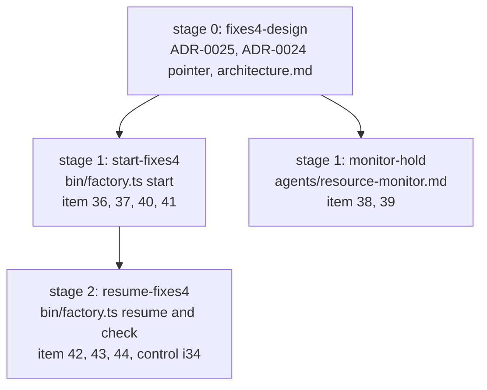
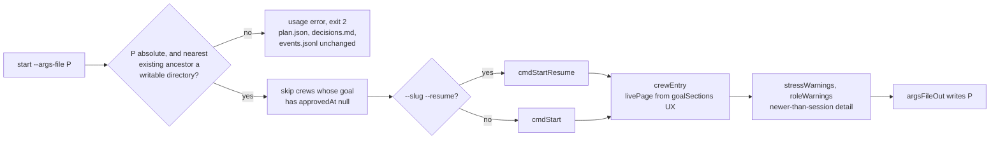
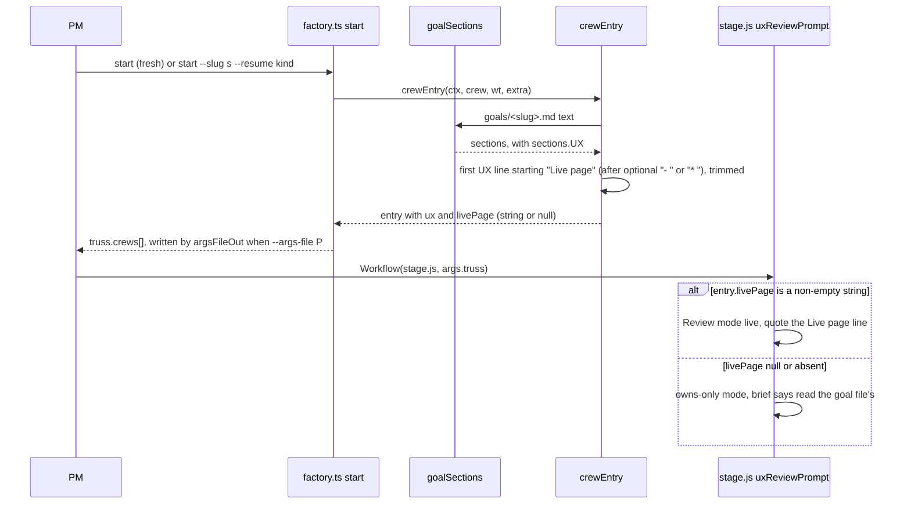

# ADR-0025: factory-fixes4: plugin bugs 36 to 44 in factory start, resume and the resource monitor

Status: proposed, 2026-11-03. Written by the design crew `fixes4-design` (stage 0 of goal `factory-fixes4`). It becomes accepted when the program manager (PM) merges this crew. The goal's approval is `auto`, and its plan is `plan-factory-fixes4.md` (revision 2) in the truss dir. The client's words: "Don't just log a plugin bug, fix it."

Amended by [ADR-0026](0026-factory-fixes5.md) (proposed 2026-11-03, goal `factory-fixes5`): item 45's up bar of three times `minFreeMB` replaces the four times that items 38 and 39 kept, and item 57 adds two down conditions (`memPressure` above 10, `swapUsedPct` above 70). The item 38 hold and the item 39 step-3 text stay.

Amended by [ADR-0026](0026-factory-fixes5.md) (proposed 2026-11-03, goal `factory-fixes5`): item 44's `factory.ts` behaviour (`doneTasks`, `failureBlocks` and `cmdIntegrate`) is amended by item 58 of `plan-factory-fixes6`, built by crew `factory-fixes6-build` and recorded in ADR-0026's left-out factory items.

VERDICT: change. One module changes: the **factory CLI** `start` (`bin/factory.ts`), only because the crew-entry seam gains `livePage`. Three extend: the **factory CLI** resume and check helpers, the **resource-monitor agent** (`agents/resource-monitor.md`) and the **plugin docs** (this ADR, one line in ADR-0024 and two lines in `architecture.md`). `admit` and `admission` don't change.

This ADR edits no text of ADR-0015, ADR-0019 or ADR-0024. ADR-0024 gains one "Amended by" line that points here. Where an item adds to a contract one of them set, the addition is recorded here, by number.

## Context

The factory-fixes3 run logged the bugs below in `decisions.md` (06:27, 06:43, 06:46, 07:01, 08:08). The new items are numbered 36 to 44, so no test title clashes with ADR-0024's items 24 to 35. Bugs 36, 37 and 38 keep their `decisions.md` numbers. Item 42 is ADR-0024's item 27 and item 44 is ADR-0024's item 32; both are factory-resume QC deferreds. Every fix is pinned by a test that fails without it, in `tests/factory-fixes4.check.ts`, `tests/factory-fixes4-monitor.check.ts` or `tests/factory-fixes4-resume.check.ts`, as one `i<k> N:` case per item.

Each item is shown with the code on main at `9fba182`. `bin/factory.ts` and `agents/resource-monitor.md` are unchanged between `9fba182` and this crew's base.

| Item | What the code does on `9fba182` |
|---|---|
| item 36 | The dispatch is `start: (f) => argsFileOut(f, cmdStart(f))` (`bin/factory.ts` `COMMANDS`). The absolute-path check is inside `argsFileOut`, after `cmdStart` has already run `ensureWorktree`, `savePlan` (status `running`), the `spawn` event and the decision line. A relative `--args-file` lost the entry, and the re-run listed `fixes3-design` as unfinished with no run. |
| item 37 | `cmdStart` builds `open`, `goalNext` and `startsNow` from every planned or running crew. It never reads `plan.goals[].approvedAt`, so `start` offered crews of the unapproved goal `ui-followups`. They were refused only because their goal files were missing. |
| item 38 | `resource-monitor.md` (the "Go down one when" rule) goes down one on high load or low memory, with no other condition. While running is above parallelism, every crossing lowers it again, though no new crew was admitted to cause the load. On 2026-11-03 it went from 3 to 2 at 06:46 and to 1 at 07:01 with 3 crews running. |
| item 39 | `admission` checks parallelism only when `crew.status === 'planned'`. The monitor's step 3 runs `admit --slug <any slug>` and says admit "exits 1 when it holds a start" (`resource-monitor.md` step 3). With a running slug, admit said `admitted: true` at running 3 / parallelism 3 while `start` held a planned crew. |
| item 40 | `crewEntry` reads `sections.UX` only for the boolean `ux`. It carries no Live page line. The PO ruling at 08:08 gives stage.js an optional `entry.livePage`, and leaves filling it to this goal. |
| item 41 | `stressWarnings` and `roleWarnings` compare the agent file's `mtimeMs` with `sessionStart()` and say only "changed after this session loaded its agents". They give no size and no commit. |
| item 42 (item 27) | `doneTasks` calls `ownCommits`. When no first-parent crew commit is in the member branch (`fork === undefined`, so the crew branch was rewritten), `ownCommits` returns `reach.length`. A fresh BLOCKED branch left on the old crew head then counts as having commits of its own, so its task never re-runs. |
| item 43 | `failureBlocks` runs each block until the next header. An env line printed after the last TAP `not ok` block lands inside that block and "explains" a code failure, so `envVerdict` returns `env` instead of `envSeen`. |
| item 44 (item 32) | `cmdIntegrate` returns `contained: true` from `merge-tree` tree equality. It never looks at `MERGE_HEAD`, so it can answer `contained` while a merge is still in progress in the crew worktree. |
| item 34 | `c1c4861` made `[project] › ` optional in the `header` regex in `failureBlocks`. What is left is the QC nit: no committed test for project-less Playwright headers. |
| item 26 | ADR-0024's item 26 leftover: member branches with no `git worktree` registration. Dropped; see `## Dropped`. |

## Decision

The goal runs as four crews in three stages. Stage 0 is this crew. In stage 1, `start-fixes4` owns `bin/factory.ts` and `monitor-hold` owns `agents/resource-monitor.md`; they share no file. `resume-fixes4` needs `bin/factory.ts` again, so it runs in stage 2, after `start-fixes4` merges.

`start` after this goal, in order:

### Rulings

1. **Item 39 changes no code.** For a running slug, admit answers `admitted: true` at running equal to parallelism, by design. stage.js runs `admit --slug <running crew>` before every member spawn and reads only `admitted` (`workflows-src/stage/crew.js` `ask` on `9fba182`; the `admit` function). Putting parallelism into that answer would block members mid-run. admit already prints `running` and `parallelism` (`bin/factory/resources.ts` `admission`), so the monitor's step 3 only has to say how to read the line. `admission`, `cmdAdmit` and admit's output shape don't change.
2. **Item 38 lives in the monitor text only.** ADR-0015 Decision 5 keeps load out of plain-code admission: load holds no start, the monitor reads it, and the PM, not factory, writes `parallelism.json`.
3. **Item 42 reuses the reflog rule** factory-resume added for the fast-forward case, instead of a patch-id test. A patch-id test would count a fresh branch's old crew commits as "in `truss-<slug>`", which is the bug.
4. **Item 41 is fixed because it is cheap:** one helper shared by both warning functions, with read-only git. Only the newer-than-session text gains a parenthesised detail. The can't-tell text stays word for word.

### The items

**Item 36** (start-fixes4). `start`, in both forms, validates `--args-file` before `cmdStart` or `cmdStartResume` runs. A relative path is a usage error (exit 2). So is a path whose nearest existing ancestor isn't a writable directory. When that happens, plan.json, decisions.md and events.jsonl stay byte-identical, and no `truss-<slug>` branch or worktree exists. A valid path keeps today's output.

**Item 37** (start-fixes4). `start` skips every crew whose goal is in `plan.goals` with `approvedAt` null. Such a crew isn't started, refused, held or counted in `goalNext`.
- A `--stage N` that only an unapproved goal has is refused as "not the next stage of any goal".
- Crews of the top-level goal (`run`) keep today's behaviour.
- `--slug ... --resume` of a crew in an unapproved goal is refused with a reason that names the goal.

**Item 38** (monitor-hold). The step rule gains a hold. When the running crews already exceed the current effective parallelism, the monitor doesn't go down. The load comes from crews admitted before the last step-down, and a lower number would hold no extra start. The monitor keeps the current value unless the up rule applies. The up rule is unchanged and applies whatever the running count, so it is the way back up. The PM already starts the monitor at every stage start and every held crossing (`skills/run/SKILL.md` section "6. Write the goal files and start the foremen by stage"), so once load falls a lowered number rises one step at each start.

**Item 39** (monitor-hold). Step 3 replaces "exits 1 when it holds a start" with what admit's answer means:
- `admitted` and the exit code answer for the slug given only.
- For a running slug they check memory only, so `admitted: true` while running equals parallelism is expected and is not a start answer.
- The monitor reads only `minFreeMB`, `running` and `parallelism` from the line. It never takes `admitted` or the exit code as its recommendation.

The i39 case reads the step-3 paragraph only, the text between `3.` and `4.`, and pins both points. The monitor test reads `agents/resource-monitor.md` relative to the test file (`import.meta.url`), so the base-copy run reads the base text.

**Item 40** (start-fixes4). As seam 1. Cases cover a goal file with the bulleted form, one with the bare form, and one with no Live page line.

**Item 41** (start-fixes4). Only the newer-than-session warning gains a detail, in `stressWarnings` (`bin/factory/warnings.ts`) and `roleWarnings`.
- **Where it goes.** In parentheses right after "changed after this session loaded its agents" and before the `;`. The stress form becomes `... changed after this session loaded its agents (<detail>); restart the session to load it`. The role form becomes `... changed after this session loaded its agents (<detail>); restart the session to load it, <fallback>`.
- **Plugin dir in a git work tree.** The detail gives the lines added and removed in the agent file since the session start, from `git diff --numstat` against the last commit before `sessionStart()`, working tree included. It names the newest commit since then that touched the file, by short sha and subject, or says `uncommitted` when no commit did.
- **Plugin dir outside git.** The detail gives the file's mtime and the session start as ISO times.
- **Unchanged.** The can't-tell texts in `stressWarnings` and `roleWarnings` stay word for word, including the assertion at `tests/factory-fixes3.check.ts` test "control 1: the stress warning texts are unchanged, newer-than-session and can't-tell". The restart advice and the role fallback don't change.
- **The two assertions that change.** The exact newer-than-session assertions at `tests/factory-fixes3.check.ts` test "i24 5: a stress-yes crew still gets the stress warning word for word, next to the new ones" (`ws.includes(...)` in `i24 5`) and test "control 1: the stress warning texts are unchanged, newer-than-session and can't-tell" (`deepEqual` in `control 1`) change to the new text, with the detail the test world produces. Both test titles stay, so the title diff still passes, and QC doesn't count them as lost base cases.
- **Tests** use `TRUSS_SESSION_START` and a git-initialised plugin copy.

**Item 42 (item 27)** (resume-fixes4). `ownCommits` changes for the case where no first-parent crew commit is in the member branch, which means the crew branch was rewritten after the member forked. The count then comes from the existing reflog rule (a commit, cherry-pick or revert made on the branch, `bin/factory/start.ts` `doneTasks`), not from `reach.length`.
- A fresh BLOCKED branch left on the old crew head is then not done in `doneTasks`, and its task re-runs.
- A branch with a hand-made commit whose patch is in the rewritten crew branch still counts as done.
- A missing reflog counts 0, so the task re-runs, which is the safe direction.

**Item 43** (resume-fixes4). In `failureBlocks`, a node:test TAP failure block ends at its YAML diagnostic's closing `...` line, or at a TAP plan or summary line (`1..N`, `# tests`). Lines after that, up to the next header, belong to no block. A code failure followed by an echoed env line gives `envSeen` and no `env` from `envVerdict`. A real env failure inside the YAML `error:` still gives `env`. Playwright blocks are unchanged.

**Item 44 (item 32)** (resume-fixes4). `cmdIntegrate` takes the `contained` shortcut only when `git rev-parse -q --verify MERGE_HEAD` fails in the crew worktree. While a merge is in progress it falls through to `mergeIn`, which answers as it does today, and it never returns `contained: true`.

**Item 34 control** (resume-fixes4). A `control N: i34 ...` case: Playwright output with project-less headers (`1) a.spec.ts:<line>:<col> › api`), one code failure and one browser-launch env failure, gives `envSeen` and no `env`. It passes on the base code and on this goal's code.

### The `livePage` path, end to end

stage-fixes3 builds the consumer side, which reads `livePage` as optional; this goal builds the producer side.

## Seams to pin

1. **`entry.livePage`** | factory.ts `crewEntry` → `workflows-src/stage/ux.js` `uxReviewPrompt` (stage-fixes3 reads it as optional).
   - Every `start` form, fresh and every `--resume` kind, sets `livePage`.
   - Its value is the first line of the goal file's `## UX` section that starts with `Live page`, after an optional `- ` or `* ` bullet marker. The line is trimmed and given whole, for example `Live page (how review takes its own screenshots): ...`.
   - It is `null` when there is no such line or no `## UX` section.
   - `ENTRY_KEYS` in `start.cases.ts` gains `livePage`.

This adds one key to ADR-0019 item 7's lean entry and to ADR-0024 seam 1's entry. No admit field is added, and no other output shape changes.

## Consequences

- A bad `--args-file` no longer loses a crew: `start` refuses it before any state changes (item 36).
- `start` no longer offers crews of a goal the client hasn't approved, and a stage only such a goal has can't be started (item 37).
- The monitor no longer ratchets parallelism down while running already exceeds it, and reads admit's line as a memory reading, not a start answer (items 38, 39). The up rule is the only way back up, and it needs a monitor run, which the PM starts at each stage start and held crossing.
- A UX review gets the goal file's Live page line from the entry, so stage.js needs no file system (item 40).
- A stale-agent warning says how much the file changed and in which commit (item 41). The can't-tell warning is unchanged.
- A resume re-runs a fresh BLOCKED task after a crew-branch rewrite (item 42), a trailing env line no longer hides a code failure (item 43), and integrate doesn't report `contained` mid-merge (item 44). Project-less Playwright headers are pinned (item 34).
- `livePage` is a new key in factory output, not in a stored file. No stored data shape changes.
- `architecture.md` gains a pointer to this ADR and one seam line for `livePage`.

## Dropped

- **`crewStart` (revision 1's item 39 fix).** No reader would use it. The monitor reads only `minFreeMB`, `running` and `parallelism`, and stage.js reads only `admitted` (`workflows-src/stage/crew.js` `ask` on `9fba182`). admit already prints `running` and `parallelism` (`bin/factory/resources.ts` `admission`). Item 39 is fixed in the monitor's step-3 text instead, and admit's output shape doesn't change.
- **Item 26 leftover (unregistered member worktrees).** `missingWorktrees` (`bin/factory/start.ts`) reads only `git worktree list` registrations. A member branch with no registration and no directory leaves nothing to prune, and listing it changes no state. No real caller produced it (stress report: "I did not produce either case"). The no-`--transcript` part of the same nit is already fixed by `c1c4861` (`bin/factory/start.ts` `missingWorktrees`).
