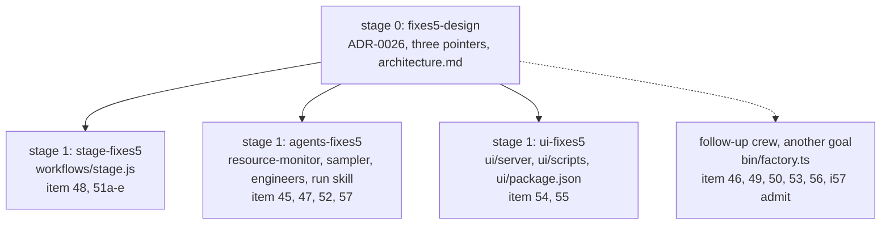
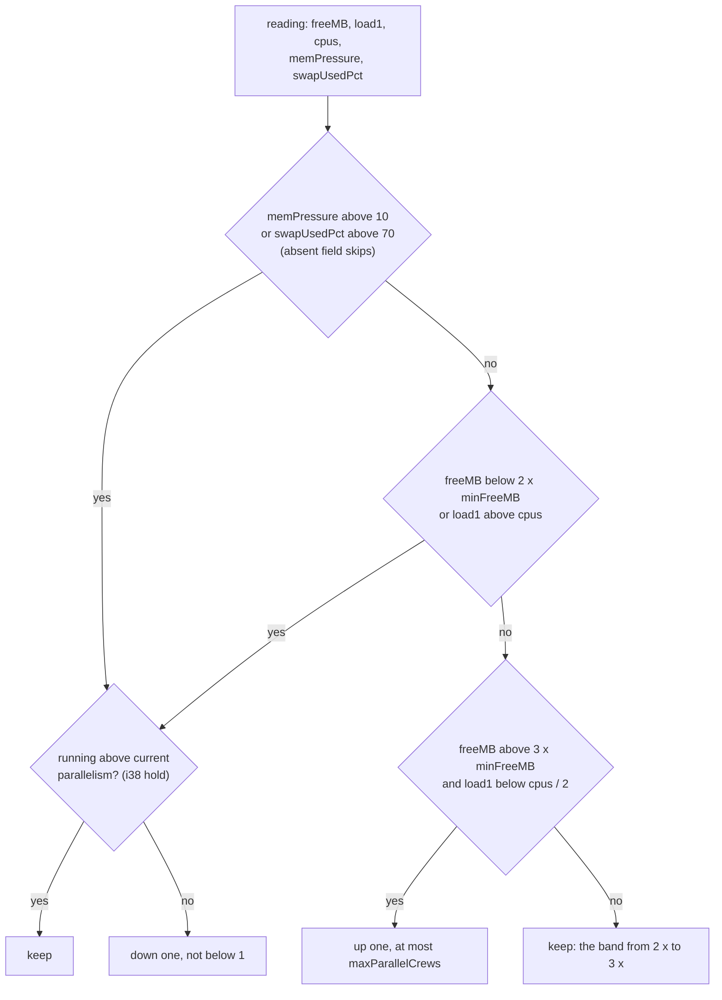
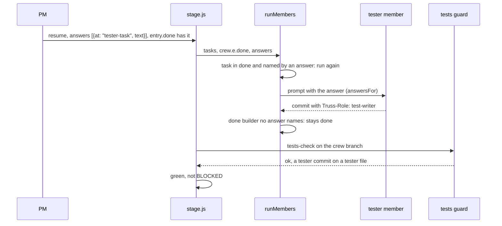

# ADR-0026: factory-fixes5: plugin items 45 to 57 in the monitor, the sampler, the stage workflow, the agents and the ui server

Status: proposed, 2026-11-03. Written by the design crew `fixes5-design` (stage 0 of goal `factory-fixes5`). It becomes accepted when the PM merges this crew. The goal's approval is `auto`, and its plan is `plan-factory-fixes5.md` (revision 2) in the truss dir. The client's words: "Don't just log a plugin bug, fix it." and, for item 57, "we want truss to not hit that".

VERDICT: change. The **stage workflow** (`workflows/stage.js`) changes, because item 48 changes the answer seam of ADR-0019 item 12. The resource-monitor agent, the sampler, the engineer agents, the run skill, the ui server and scripts, and the plugin docs extend. The **factory CLI** items (46, 49, 50, 53, 56 and the item 57 admit hold) are decided here and built by a follow-up crew. ADR-0019, ADR-0022 and ADR-0025 each gain only an "Amended by" line.

## Context

The factory-fixes4 and ui-followups runs logged these items in `decisions.md` (08:43 to 10:55 on 2026-11-03). They are numbered 45 to 57, so no test title clashes with ADR-0025's items 36 to 44. Each case is titled `iNN M: ...`; a case that pins behaviour the base code already has is titled `control N: iNN ...`.

Line numbers are those of this crew's base, main at `47975ae`.

| Item | What the code does |
|---|---|
| item 45 | `agents/resource-monitor.md:23` goes up one only when `freeMB` is above four times `minFreeMB`, 8192 MB with `DEFAULT_MIN_FREE_MB` 2048 (`resources/index.ts:8`). The down rule fires below 2 x (`:22`). Logged idle readings kept parallelism at 1: 8189 MB / load1 0.49, 8152 / 0.68 and 8178 / 1.5, on 4 cpus with 0 running. |
| item 46 | `start --slug` without `--resume` is a usage error: `start --slug and --resume go together` (`bin/factory.ts:1334`). The PM can't run first the crew that unblocks others. |
| item 47 | The ui-server-fixes acceptance test grepped `by: *['"]` in a test file and stopped a crew whose behaviour was right. The design engineer has no rule against pinning source spelling. |
| item 48 | `runMembers` returns early for every task in `crew.e.done` (`workflows/stage.js:541`, `:546`). `answersFor` sends an answer at a task name to that task only (`:329-331`). An answer at a done tester task reaches no one. |
| item 49 | `roleWarnings` (`bin/factory.ts:1038`) warns whenever an agent file is newer than the session start, on every `start`, with nothing stored between starts. |
| item 50 | `spawn` lets the entry's `## Members` value win over the roles row (`workflows/stage.js:93-98`, ADR-0022 U6). monitor-hold's builder ran on sonnet while `roles.builder` said opus. |
| item 51a | `ownsUiFile` matches only UI file suffixes (`stage.js:1079`), so an owns of `ui/**` alone gives `Review mode: files` (`:1084`). |
| item 51b | `backstopPrompt` says "Work in the crew worktree" (`:604`), while `memberPrompt` adds an own-worktree proof line (`:318`) and "Commit on your branch" (`:389`). |
| item 51c | `testsBackstop` turns any resolver marker but DONE into BLOCKED (`:636`). |
| item 51d | `testsCheckExtra` builds `Head:` from `crew.e.head` (`:336`), while `crew.head` moves within the run (`:783`). |
| item 51e | stage.js reads `args.truss` straight off `args` (`:10-11`). `expandTrussFile` returns a JSON string when it was given one (`hooks/register.ts:823`, `:862`). |
| item 52 | The stress engineer's probe went to a fixed name in the shared scratchpad and overwrote `probe.mjs`. `agents/stress-engineer.md:17` allows "scratch and `mkdtemp` dirs". |
| item 53 | `crewEntry`'s `livePage` match (`bin/factory.ts:944`) accepts "Live pages are not built" and gives null for `-  Live page` and `1. Live page`; `checkArgsFile` (`:1433`) passes a read-only existing P that `argsFileOut` then fails to write; `changeDetail` (`:1017`) gives the mtime form for a file committed and then reverted. |
| item 54 | `tally.seen` is a Record trimmed by `Object.keys` (`ui/server/session/fold.ts:180-183`), so integer-like ids sort first and break oldest-first order. `reduce.ts:221` excludes `main`, `factory` and `workflow:*` from credit, unpinned. No case rolls a stall into `events.1.jsonl`. A successor foreman `a-2` never clears `a`'s idle-foreman stall. |
| item 55 | ui `pretest` is `npm run build` (`ui/package.json:11`), and build starts with `tsc` (`:10`). A partial `node_modules` fails with "tsc: command not found". |
| item 56 | An agent file changed by a merge (resource-monitor.md in monitor-hold) is used by no running session until restart. `cmdFinish` (`bin/factory.ts:1972`) warns of nothing. |
| item 57 | `sample()` reads only `freeMB`, `totalMB`, `cpus` and `load1` (`resources/index.ts:65-67`). A `TRUSS_SAMPLE` file is checked for `freeMB` and `totalMB` only (`:61-63`). This host's kill switch is systemd-oomd keyed on memory pressure: `/etc/systemd/oomd.conf.d/10-omarchy.conf` sets `DefaultMemoryPressureLimit=50%` for `DefaultMemoryPressureDurationSec=20s`. The brief gives oomd's 90% swap limit. `/proc/pressure/memory` here reads `some avg10=0.00`; `/proc/meminfo` gives SwapTotal 32455736 kB and SwapFree 23878156 kB, 26% used. |

## Decision

The goal runs as four crews in two stages. Stage 1's crews own disjoint files, so they run in parallel. The factory items wait for a follow-up crew, because plan-check refuses an owns overlap between crews of different goals while either is unmerged (`bin/factory.ts:481`), and resume-fixes4 owned `bin/factory.ts` when this goal was planned.

### The monitor's step rule (items 45 and 57)

**Item 45** (agents-fixes5). The one up rule reads: go up one when `freeMB` is above three times `minFreeMB` (3 x, 6144 MB at the default) and `load1`, where present, is below half of `cpus`. The 4 x rule is replaced, not kept beside it.
- These stay: one step per crossing, the `maxParallelCrews` cap, the down rule at 2 x, the item 38 hold and the item 39 step-3 text.
- `minFreeMB` stays 2048 (client, 10:55: "keep 2048, go ahead").
- Not 2 x: the down rule fires below 2 x, so a 2 x up bar leaves no gap and flaps. The band between the down point (4096 MB) and the up point (6144 MB) is 1 x `minFreeMB`. A reading inside it keeps the value.
- factory admit's `minFreeMB` floor stays the safety net (`bin/factory.ts:1533`).
- Tests read the rule as behaviour: an evaluator takes the multipliers from the "Go down one" and "Go up one" lines and applies them to a reading. `i45 2:` replays each logged idle reading; `control N: i45 ...` puts freeMB at 2.5 x, inside the band, and keeps the value.
- The two base cases that name four times are re-pinned with "three times": `control 2: the up rule still names three times minFreeMB and half of cpus` in `factory-fixes4-monitor.check.ts`, and `agent states the up rule: above three times minFreeMB, load1 below half of cpus` in `monitor-wiring.check.ts`. The acceptance test exempts exactly the two old titles.

**Item 57, sampler and monitor** (agents-fixes5). As seam 4. Down one also fires when `memPressure`, where present, is above 10, or `swapUsedPct`, where present, is above 70. The up rule also needs neither to fire. An absent field skips both conditions. The item 38 hold applies to these down conditions too. The bars sit well below oomd's 50% pressure for 20s and 90% swap, so truss backs off before oomd kills a cgroup. Cases `i57 1:` to `i57 4:` pin the sampler, with `TRUSS_SAMPLE` fixtures; `i57 5:` (down on pressure 12 or swap 75) and `i57 6:` (pressure 12 blocks an up step) pin the monitor.

**Item 57, admit hold** (left out; the follow-up crew builds it as `i57 7:`). `admission` refuses a new crew when `memPressure` > 10 or `swapUsedPct` > 70, with a `why` naming the reading. An absent field skips the rule.

### Answer at a done task (item 48)

**Item 48** (stage-fixes5). As seam 1. `i48 1:` and `i48 2:` re-run a done tester and a done builder; `i48 3:` takes the re-run tester's commit through the tests guard to green. Control: an answer at `green` with every task done spawns no member.

### The other built items

**Item 47** (agents-fixes5). design-engineer.md's acceptance rules say an acceptance test pins behaviour by a test's title and its ok or not-ok outcome, or by an assertion's result, and never greps the literal text of a source or test file (`i47 1:`). checking-engineer.md names a spelling pin as a reason to send a plan back (`i47 2:`). `skills/run/SKILL.md` gives the same reason beside "gameable" at `:167` and `:187` (`i47 3:`); "gameable" stays, because `speed-rules.check.ts:88` pins it.

**Item 51** (stage-fixes5), five parts:
- **Item 51a.** An owns that includes `ui/**` counts as owning UI in `ownsUiFile`: with no `livePage`, the crew gets `Review mode: live` and the `ui/**` default steps. Control: an owns of docs only still gets `files`. (`i51 1:`)
- **Item 51b.** `backstopPrompt` tells the resolver to work and commit on the crew branch in the crew worktree. It has neither the own-worktree proof line nor "Commit on your branch". Member prompts are unchanged. (`i51 2:`)
- **Item 51c.** A backstop resolver that reports QUESTION, PROPOSAL or CHECKPOINT stops the crew with that tag. BLOCKED and a missing report stay BLOCKED. (`i51 3:`)
- **Item 51d.** `testsCheckExtra`'s `Head:` line names `crew.head` once the run has moved it. (`i51 4:`)
- **Item 51e.** As seam 2. (`i51 5:`)
**Item 52** (agents-fixes5, and this ADR). `agents/stress-engineer.md` puts every probe and fixture in a fresh `mkdtemp` directory of its own. Nothing goes at a fixed name in the shared scratchpad, and the stress engineer overwrites no file it didn't create (`i52 1:`). Two controls pin what already works: `control N: i52 ... symlink` (a trussFile through a symlinked spelling of the truss dir) and `control N: i52 ... version-1` (expansion under a version-1 plan).

**The live trussFile proof.** gate-trussfile left one untested risk: that the runtime ignores the args the Workflow handler rewrites. The PM then launched fixes4-design with `args.trussFile`, and `decisions.md` records at 09:10: "trussFile args ran the whole stage live". ui-server-fixes, ui-store-fixes, start-fixes4, monitor-hold and resume-fixes4 were launched the same way; the first four passed QC and resume-fixes4 is merged in main (`47975ae`). The risk is disproved, and no case is added for it.

**Item 54** (ui-fixes5).
- `i54 1:` `tally.seen` keeps the arrival order of message ids, as a Map, Set or array, and stays bounded at 256: ids "1" to "300" keep "300" and drop "1".
- `i54 2:` an idle-foreman stall of crew `a` clears on a later event line of a successor foreman `a-<n>`. A stall of kind `agent` still needs the stalled agent itself.
- **`reduce.ts:221` exclusions: pinned, not removed.** A member or crew can carry these names: any event line's `agent` becomes a member, and `factory` is a valid slug. Removing them would let the factory or a workflow runner clear a stall. Controls passing on base: `control N: i54 ... member main`, `... member workflow:x` and `... crew factory` (a spawn `by` that name doesn't clear the foreman's stall), and `... events.1.jsonl` (a stall there clears on the stalled agent's later line in `events.jsonl`). A control that fails on base is a real bug: retitle it `i54 N:`, fix it, tell the PM.

**Item 55** (ui-fixes5). As seam 3. `i55 2:` pins the PO's case: `node_modules` exists but `typescript` is missing, so the script exits 1 naming `typescript`.

### The factory items (decided here, built by the follow-up crew)

**Item 46.** `start --slug S` without `--resume` considers crew S only. S must be planned, in its goal's next stage, and in an approved goal. Then `admission` runs as today, under the same parallelism. Any other case is refused with a reason.

**Item 49.** (a) When `changeDetail` finds an empty numstat, no newer-than-session warning is given; this also fixes item 53's reverted-file case. (b) `start` writes `<truss dir>/agent-warnings.json`, which maps each warned file to the sha256 of its content. The same hash warns no more. The file is per session and cheap to drop.

**Item 50.** `start --model <role>=<opus|sonnet>`, repeatable, sets `roles.<role>.model`, and also `members.<role>.model` where `## Members` gives one. Without it, ADR-0022 U6 holds, and `start` warns once per crew whose `## Members` model differs from its roles row. `skills/run/SKILL.md` tells the PM to use `--model`.

**Item 53.** A tolerant `livePage` match, for the three Context cases ("Live pages are not built", `-  Live page`, `1. Live page`). `checkArgsFile` refuses a P that isn't writable, so `argsFileOut` never fails after `start` changed state. The reverted file is item 49 (a).

**Item 56.** `cmdFinish` warns for each `agents/*.md` the merge changed in the plugin's own repo, naming the item-24 fallback (spawn as general-purpose with the agent file inlined). Until then the PM does that by hand for resource-monitor and design-engineer.

**Drafted follow-up crew** (for example `factory-fixes6-build`, verdict extend):
- **Owns:** `plugins/truss/bin/factory.ts`, `plugins/truss/skills/run/SKILL.md`, `tests/factory-fixes5.check.ts`, the factory test files resume-fixes4 owned, and `tests/factory-fixes4.check.ts`.
- **Acceptance test:** the build-crew shape with ids `i46 1:`, `i49 1:`, `i49 2:`, `i50 1:`, `i53 1:` to `i53 3:`, `i56 1:`, plus `i57 7:` for the admit hold.
- **Proved red on afa044e:** "factory-fixes5.check.ts is missing". estAgents 7.

## Seams to pin

1. **Answer at a done task** | stage.js `runMembers` and `answersFor`. On an answers resume, a task whose name is in `entry.done` and is the `at` of an answer runs again, with that answer in its prompt. A tester task commits with `Truss-Role: test-writer`, and that commit passes the tests guard. Done tasks no answer names stay done. This amends ADR-0019 item 12.
2. **String args** | stage.js head (`args`). `args` may be an object or a JSON string holding one. Both give the same `args.truss`. Anything else throws the item-29 error unchanged.
3. **`check-deps`** | `ui/scripts/check-deps.mjs [uiDir]`. `uiDir` defaults to the script's parent directory. Every name in `dependencies` and `devDependencies` of `uiDir/package.json` must have `uiDir/node_modules/<name>/package.json`. When any is missing, the script prints one stderr line naming each one and `npm --prefix ui ci`, then exits 1. This covers a missing `node_modules` and a single missing package. Otherwise it is silent and exits 0. pretest runs it before the build.
4. **Sample pressure fields** | `resources/index.ts` `Sample`, `sample()`, new `pressureOf(paths?)`. `pressureOf({ pressure, meminfo })` defaults to `/proc/pressure/memory` and `/proc/meminfo`. It returns `memPressure`, the `some` line's `avg10`, a number from 0 to 100, and `swapUsedPct`, `round((SwapTotal - SwapFree) / SwapTotal * 100)`. It leaves a field out when its file is absent or unreadable, and leaves `swapUsedPct` out when SwapTotal is 0. `sample()` adds both on the host path. A `TRUSS_SAMPLE` file may carry either field; a field present that is not a number from 0 to 100 throws, like `freeMB`. Both fields are optional in `Sample`. The monitor and, later, factory admit read them; factory's other readers read only `freeMB` and don't change.

## Consequences

- An idle host steps back up after a step-down: each logged reading (above 8150 MB, load1 at most 1.5 on 4 cpus) clears the 6144 MB bar (item 45). A reading in the 2 x to 3 x band holds, so the monitor doesn't flap.
- The monitor backs off on memory pressure and swap, the signals oomd kills on, not only on free MB (item 57). Hosts without PSI or swap keep today's rule. factory admit holds on them only after the follow-up crew.
- A resume answer can send a change to the tester, and the tester's commit passes the tests guard, so no one resets a crew branch by hand (item 48).
- Acceptance tests pin behaviour, not spelling, and the checking engineer sends a spelling pin back (item 47).
- Item 51 closes stage-fixes3's five GAPs; items 52, 54 and 55 close those of gate-trussfile and ui-server-fixes and the stale `node_modules`.
- Until the follow-up crew merges: `start --slug` still needs `--resume`, the stale-agent warning repeats, `--model` doesn't exist, the item 53 gaps stay, `cmdFinish` warns of no changed agent, and admit ignores pressure (items 46, 49, 50, 53, 56, 57).
- New stored data: none in this goal. The follow-up adds `<truss dir>/agent-warnings.json` (item 49). The new sample fields are optional and additive.

## Dropped

- **Item 52, the symlink mutant and the handler case.** Commit `f53b5ec` (in main) added `i29 13` to `i29 16` in `tests/gate-trussfile.check.ts` (`:297`, `:309`, `:321`, `:335`). They drive the real Workflow handler with object args, string args, a symlinked file and a symlinked directory, and the gate-trussfile tester's report shows the mutant killed. agents-fixes5 still adds the two `control N: i52` cases.
- **Item 54, "tally.tasks is unbounded".** `tasks` holds one number per subagent task id, so the number of agents bounds it. `withTally` sums it into `subagentTokens` (`ui/server/session/fold.ts:151`). Dropping an entry would lose or double-count tokens.
