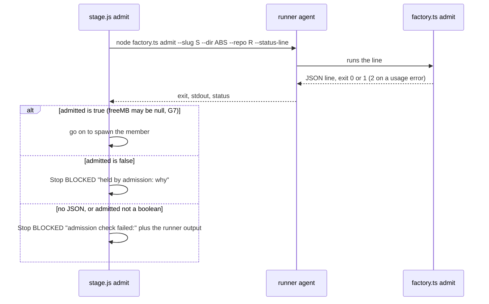
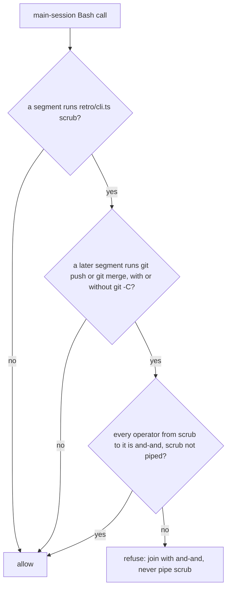

# ADR-0027: retro-fixes2: fail-closed admission, green fix routing, the QC foreground rule, `factory.ts decide`, the scrub gate on push and merge, and two catalog narrowings

Status: proposed, 2026-11-03. Written by the design crew `retro-fixes2-design` (stage 0 of goal `retro-fixes2`). It becomes accepted when the program manager (PM) merges this crew. The goal's approval is `auto`, and its plan is `plan-retro-fixes2.md` (revision 3) in the truss dir. The client's words: "Don't just log a plugin bug, fix it."

VERDICT: change. The **stage workflow** changes: `admit` fails closed, reversing a seam ADR-0015 documents. The **factory CLI** changes: every command but `start` refuses a relative `--dir`, and `decide` writes `decisions.md`. The run skill, the hooks, `agents/qc-engineer.md` and the retro catalog extend. ADR-0009, ADR-0012 and ADR-0015 each gain only an "Amended by" line. The four stage-1 crews build this.

## Context

Retro 2 (2026-11-03) triaged five findings fix now, and the PO added two catalog narrowings (decisions.md 13:42). Line numbers are those of this crew's base, main at `9caa6f1`.

- **F-67.** `runFactory` (`workflows-src/stage/runner.js`) puts `--dir ${sh(F.dir)}` on the runner's line unresolved, while `heavyParts` (`workflows-src/stage/gates.js`) resolves a relative `F.dir` against `F.repo`. In run wf_25e6716a-c99 at least 17 runner calls of `factory.ts admit --dir .git/truss/<id>` exited 2 with "cannot read .git/truss/<id>/plan.json". `admit` (`workflows-src/stage/crew.js`) stops a crew only on `admitted === false`, so admission was silently off for the stage. [ADR-0019](0019-factory-fixes2.md) item 18 already makes `start` and `start --resume` resolve `--dir`, so no current caller makes a relative `F.dir`; the live bug is the fail-open admit.
- **F-70.** `green` (`workflows-src/stage/green.js`) sends every failure to `fixBuilder` with the builder role and runs no `testsBackstop`. `fixFindings` (`workflows-src/stage/fixes.js`) does both. A green failure in a tester-owned file reached a builder, who ended BLOCKED.
- **F-72.** `memberPrompt` carries the foreground rule (`workflows-src/stage/prompts.js`); `qcPrompt` (`workflows-src/stage/qc.js`) does not. A QC engineer backgrounded the acceptance run and was blocked on `sleep 240`.
- **F-73.** The PM's Edits to `decisions.md` failed as "not found" or "Found 24 matches". `appendDecision` (`bin/factory/shared.ts`) can write only `- HH:MM | <text> | none | followed`, so it can't carry the grammar architecture.md declares: the four-field decision line, the `checker-` line, continuation lines and the `## Run` heading.
- **F-74.** The PM ran `node retro/cli.ts scrub... 2>&1 | tail -5; git push origin main`. Scrub exits 1 on a hit and 2 on an unreadable file (the header comment of retro/cli.ts), but `;` ignores that, and a pipeline's status is `tail`'s, so a home path reached origin main. R-32 (requirements.md section "R-32: Raw transcript text stays local; committed files stay clean") keeps committed files clean; SKILL.md section "9. Merge" asks for the scrub, and base register.ts has no `Bash` handler to enforce it.
- **Catalog.** `trailers-format-unquoted` (catalog.json key `entries`) matches `--format=%\(trailers`, which also hits the quoted form the fix asks for. `webkit-host-missing-dependencies` (catalog.json key `entries`) matches the `ENV_LINE` constant in factory test fixtures (for example factory-fixes6.check.ts). Each false hit reports a recurrence that isn't one.

## Decision

### F-67: the `--dir` split, and admit fails closed

1. **`runFactory` resolves `F.dir`** the way `heavyParts` does (`workflows-src/stage/gates.js`): an absolute `F.dir` as is, else `${F.repo}/${F.dir}`. One helper serves both, so the two can't drift.
2. **factory.ts refuses a relative `--dir`** on every command except `start` and `start --resume`, with a usage error, exit 2 (`usage`, factory.ts). The check sits in `dirOf` (`bin/factory/shared.ts`), which every command shares; `cmdStart` and the resume path keep resolving it themselves (`bin/factory/start.ts` `cmdStart`, `cmdStartResume`), as ADR-0019 item 18 left them.
3. **`admit` fails closed.** A runner result with no parsed JSON object, or whose `admitted` isn't a boolean, stops the crew BLOCKED. The stop text starts `admission check failed:` and carries `r.out`, the runner's exit code and stdout. It must not start `held by admission:`, because the run skill reads that prefix as a memory hold and starts the resource monitor (SKILL.md section "6. Write the goal files and start the foremen by stage"). `admitted: false` stops as today, with `held by admission: <why>`. `admitted: true` admits.
4. **G7 is kept.** ADR-0015 Decision 2 (adr/0015-resource-aware.md section "Decision 2: admission, `factory admit` and `factory start`") admits on a sampler error and prints `freeMB: null`. That result is still JSON with `admitted: true`, so it admits. Fail-closed covers a result truss can't read, not a host truss can't sample.
5. **All crews exit 2.** When the runner exits 2 on every crew (a bad `--dir`, a missing plan), every crew stops BLOCKED at its first `admit`, each with its own runner output. The stage returns one BLOCKED result per crew, so the PM sees every one.

### F-70: the narrow trigger, the both-named order and the backstop

1. **The builder still goes first** on every green failure, as `green` does today. Routing on "the output names a tester file" would send nearly every failure to a tester, since a failing case always names its test file, and `testerFiles` (`workflows-src/stage/prompts.js`) includes the guarded acceptance-test files.
2. **The trigger.** When a green fix builder ends BLOCKED or QUESTION (`runMember` throws a `Stop`, `workflows-src/stage/members.js`) and the stop text names a tester file (`namesFile` against `testerFiles`, `workflows-src/stage/prompts.js`), `green` catches it and runs a fix member with the tester role on that text instead of stopping the crew. Any other stop still stops the crew.
3. **Both named.** When that text names a tester file and also a code file (`namesCode`, `workflows-src/stage/prompts.js`), the tester fix runs first, then a builder fix for the code half, in the order `fixFindings` uses (`workflows-src/stage/fixes.js`).
4. **The backstop.** `testsBackstop` runs after each green fix: after the builder fix, and after each fix of a re-route.
5. **The control.** A green failure whose output names the acceptance test file and a code assertion goes to the builder, as today.

The tester gets only a case a builder has declared not code, and the QC engineer still judges the whole diff.

### F-72: where the foreground rule goes

Both places. `qcPrompt` gains the line `memberPrompt` carries (`workflows-src/stage/prompts.js`), word for word: foreground, a Bash timeout up to 600000, no `run_in_background`, no `Monitor`, no `sleep` or polling. `agents/qc-engineer.md` gains the rule as plain prose in its body, so a QC engineer started outside `stage.js` gets it too. The prose adds no code snippet ahead of the fenced `git diff --no-color` that contract-evals.check.ts test "parseSnippets: ADR-0007 yields at least the five listed lines, in order, with fills keeping their angle brackets" expects first.

### F-73: `factory.ts decide`

`node <plugin>/bin/factory.ts decide --dir <absolute D> ...` appends exactly one line to `D/decisions.md` and prints one JSON line. It has three forms. The flag names below are this ADR's proposal; the cases pin behaviour, not flag names.

| Form | Call | Line written |
| --- | --- | --- |
| decision | `decide --line '<decision> \| <reason> \| <checker> \| <outcome>'` | `- HH:MM \| <decision> \| <reason> \| <checker> \| <outcome>` |
| checker | `decide --checker <n> --recommend <answer\|defer\|pass> --text '<text>' --outcome '<outcome>'` | `- HH:MM \| checker-<n> RECOMMEND <answer\|defer\|pass>: <text> \| <outcome>` |
| run heading | `decide --run '<goal>'` | `## Run <start> \| <goal>` |

- `HH:MM` is the clock's local time, from `localTime` as `appendDecision` uses it (`bin/factory/shared.ts`). `<start>` is the clock's UTC time in the form `date -u +%Y-%m-%dT%H:%M:%SZ` prints (SKILL.md section "Decisions and the decision log"). The caller never types a time, so no line is stamped ahead of the clock.
- **decide and `appendDecision`.** Both go through one append step: `appendDecision`'s read-old-file, newline guard and `appendFileSync` (`bin/factory/shared.ts` `appendDecision`). `appendDecision` keeps its signature and output: `plan approve` (`bin/factory/plan.ts` `cmdApprove`), `mark merged` (`bin/factory/crew.ts` `cmdMarkMerged`) and its other callers still write `- HH:MM | <text> | none | followed`. `decide` is the PM's route; `appendDecision` stays the factory's own.
- **Refusals.** Each refusal exits 2 and writes nothing.
  - Decision form only: a field count other than four. Fewer than four fields, and five or more (`a | b | c | d | e`, which holds four or more `|`), are refused. decide checks the count, not the words: `- HH:MM | a | b | c | d` is a valid line.
  - Checker form and heading: checked by their own modes. `<n>` is a positive integer, the answer is one of `answer`, `defer` or `pass`, and the goal isn't empty. The field-count rule doesn't apply to them.
  - Every form: a newline (`\n` or `\r`) in any value.
  - Every form: a relative `--dir` (F-67 item 2).
- **Continuation lines: the grammar drops them.** decide writes no continuation line and has no flag for one. decide refuses a newline in every form, so a multi-line value has nowhere to go; and `read_decisions` (scripts/retro.py) skips every line that is neither a `## Run` heading nor starts `- `, so a continuation line carries nothing the retro reads. A longer note goes in a work file the line names. Older files with continuation lines still parse.
- SKILL.md section "Decisions and the decision log" names `factory.ts decide` as the only route and drops "with Edit or Write".

### F-74: the R-32 push and merge gate in register.ts

A new main-session handler, `on('tool.call', { tool: 'Bash' })`, of the same kind as the Workflow handler (register.ts the `tool.call` handler for `Workflow`: gated on `e.agentId === undefined`, refusing through `refuse`, register.ts the `tool.call` handler for `Workflow`, and wrapped in `.catch(failOpen)`, the `tool.call` handler for `Workflow`). A scrub subcommand would be a step the PM can skip; a PreToolUse rule is not.

**The rule.** Split the command into segments at the operators `&&`, `||`, `;`, `|` and newline. A redirection such as `2>&1` is not an operator. If no segment runs `retro/cli.ts scrub`, allow. Otherwise, take the first scrub segment. For each later segment that holds `git push` or `git merge` anywhere in it, matched as `git (-C <one word> )?(push|merge)` followed by whitespace or the segment's end, scrub gates it only when every operator from the scrub segment up to it is `&&`. That excludes a pipe right after scrub. If any such push or merge is not gated, refuse, and name the rule and the fix: join scrub and push or merge with `&&`, and never pipe scrub's output.

The match ends at whitespace or the end, not at `\b`: `/git (-C \S+ )?(push|merge)\b/` matches `git merge-base main HEAD`, because `\b` falls between `merge` and `-`.

| Command | Result |
| --- | --- |
| `scrub f; git push` and `scrub f; git -C <wt> push` | refused (`F74 1:`) |
| `scrub f; git merge x`, `scrub f; git -C <wt> merge x`, `scrub f \|\| git push`, scrub then a newline then `git push` | refused (`F74 2:`) |
| `scrub f \| tail -5 && git push` (a pipe before the push) | refused (`F74 3:`) |
| `scrub a && echo x; git push` (a `;` on the path) | refused (`F74 3:`) |
| `scrub f && git push` and `scrub f && git -C <wt> merge x` | allowed |
| `scrub f && git push 2>&1 \| tail` (a pipe after the push) | allowed: the operators after the push don't matter |
| a plain `git push`, with no scrub | allowed |
| `scrub f; git merge-base main HEAD`, `scrub f; git log` | allowed: not push or merge |

**An earlier call is not seen, by design.** The hook judges one command, so a scrub in an earlier call followed by a push passes. Tying calls together would need state about what a scrub covered and what changed since; SKILL.md section "9. Merge" covers that path in prose.

### The two catalog narrowings

The catalog's shape doesn't change; only the two `patterns` arrays do. The matcher tests each pattern with `new RegExp(p)` per line (retro/catalog.ts `matchLine`), and transcript lines are JSON, so a quote reaches it escaped.

- **`trailers-format-unquoted`.** Neither pattern matches when a quote sits right before `--format`, for example `(?<!["'])--format=%\(trailers`. The JSON-escaped quoted form `\"--format=%(trailers` and the single-quoted form no longer match; the unquoted command from F-24's evidence still does.
- **`webkit-host-missing-dependencies`.** The pattern doesn't match the message inside a string literal assigned in source, for example a leading `(?<!= *\\?['"][^'"]*)`. The fixture text `const ENV_LINE = 'Error: browserType.launch: Host system is missing dependencies to run browsers.'` no longer matches; F-17's quote, "Host system is missing dependencies to run browsers ... sudo apt-get install libicu74 libxml2 libflite1", still does.

catalog-narrow picks the final text; `P1 1:`, `P1 2:` and the P1 controls decide it.

## Consequences

- A truss-dir mistake now stops a whole stage loudly instead of switching admission off. G7 keeps a sampler failure from doing the same.
- stage-fixes6 must merge before factory-decide (plan "Order and merge notes"), or `runFactory` breaks whenever `F.dir` is relative.
- Each green fix pays one `testsBackstop` run.
- No `decisions.md` line can be stamped ahead of the clock, and a multi-line note no longer fits in it.
- The Bash gate reads command text, not shell grammar. An operator inside a quoted string, or `git push` anywhere in a segment, can cause a false refusal, which costs the PM a rewrite; a miss would cost a leak. A `-C` path with a space isn't matched. Like every truss hook, the gate fails open on a throw (architecture.md, "Failing open").
## Seams to pin

Each case passes on the crew's tree and is `not ok` on the base code; each control passes on both. The test-writer uses these titles exactly.

**stage-fixes6** (stage.js, qc-engineer.md; tests/retro-fixes2-stage.check.ts):
- `F67 1:` With a relative `F.dir`, the command line runFactory sends to the runner carries `--dir` resolved against `F.repo`.
- `F67 2:` An admit result that isn't JSON, or has no boolean `admitted`, stops the crew BLOCKED with the output. When the runner exits 2 on every crew, every crew stops BLOCKED.
- `control N: F67 …` (stage) A sampler-error result `{admitted: true, freeMB: null}` admits.
- `F70 1:` A green fix builder that ends BLOCKED or QUESTION naming a tester file is re-routed to a fix member with the tester role, and the crew doesn't stop.
- `F70 2:` `testsBackstop` runs after each green fix.
- `F70 3:` When the builder's report names both a tester file and a code file, the tester fix runs first, then a builder fix for the code half.
- `control N: F70 …` A green failure whose output names the acceptance test file and a code assertion goes to the builder.
- `F72 1:` The prompt of the QC call, captured from a stubbed `runStage` run, carries the foreground rule.
- `F72 2:` The body of qc-engineer.md after the frontmatter carries the rule's key terms.

**factory-decide** (factory.ts, skills/run/SKILL.md; tests/retro-fixes2-factory.check.ts):
- `F67 3:` A non-start factory command given a relative `--dir` exits 2 with a usage error. `start` given a relative `--dir` still resolves it.
- `control N: F67 …` (factory) An absolute `--dir` works.
- `F73 1:` `decide` appends one four-field decision line, `- HH:MM | a | b | c | d`.
- `F73 2:` In the decision form, fewer than four fields or five or more fields (`a | b | c | d | e`) exit 2 and write nothing. A newline in the text exits 2 and writes nothing in every form.
- `F73 3:` The body of SKILL.md names `factory.ts decide` as the only route and drops "with Edit or Write".
- `F73 4:` decide writes the `## Run <start> | <goal>` heading.
- `F73 5:` decide writes the checker form `- HH:MM | checker-<n> RECOMMEND <answer|defer|pass>: <text> | <outcome>`.
- `F73 6:` A decision line and a `## Run` heading that decide writes are read by scripts/retro.py (`read_decisions`) the same way as the hand-written equivalents: the same fields, and the same run split.
- `control N: F73 …` An existing `appendDecision` caller (for example `plan approve` or `mark merged`) still appends `- HH:MM | <text> | none | followed`, and scripts/retro.py reads that line under a hand-written `## Run <start> | <goal>` heading as before. This holds on base and after. It uses an absolute `--dir`.
- `F74 4:` (factory-decide) The body of SKILL.md's "Scrub before merge" says to join scrub and push or merge with `&&` and never pipe scrub's output.

**push-gate** (register.ts; tests/retro-fixes2-hooks.check.ts). The controls run through the full `tool.call` dispatch, so on base they show "allowed":
- `F74 1:` `node <plugin>/retro/cli.ts scrub <f>; git push` is refused, and so is the `git -C <wt> push` form.
- `F74 2:` The same holds with `git merge` (and `git -C <wt> merge`), and with `||` or a newline in place of `;`.
- `F74 3:` `scrub f | tail -5 && git push` and `scrub a && echo x; git push` are refused.
- `control N: F74 …` These run: `scrub f && git push`, `scrub f && git push 2>&1 | tail` (a pipe after the push), `scrub f && git -C <wt> merge x`, a plain `git push`, `scrub f; git merge-base main HEAD`, and `scrub f; git log`.

**catalog-narrow** (retro/catalog.json; tests/retro-fixes2-catalog.check.ts):
- `P1 1:` The trailers pattern doesn't match the quoted form as the matcher sees it in the transcript, JSON-escaped: `\"--format=%(trailers`.
- `P1 2:` The webkit pattern doesn't match the factory fixture's `const ENV_LINE = '...'` text.
- `control N: P1 …` Each pattern still matches its real incident text: webkit, F-17's quote; trailers, the unquoted `--format=%(trailers` command from F-24's evidence lines.
