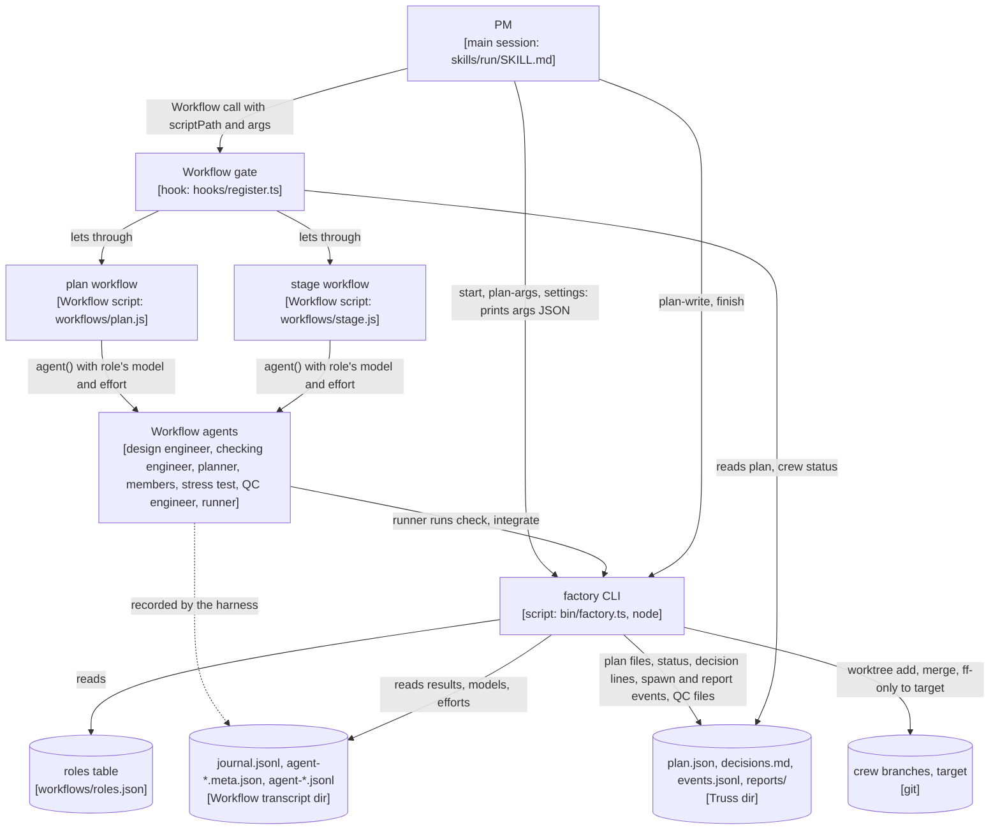
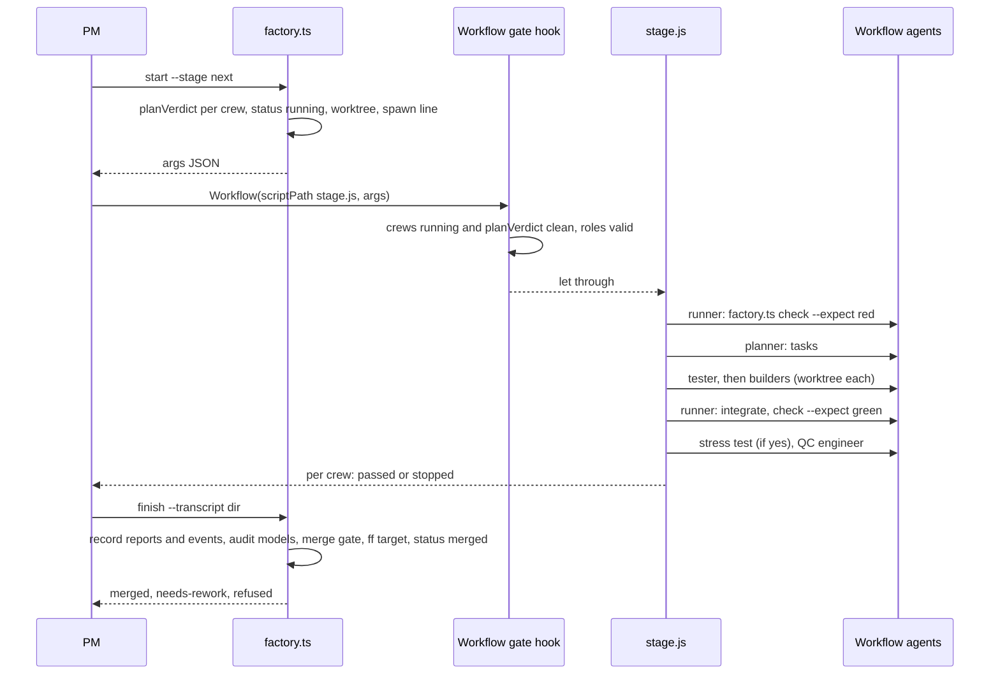
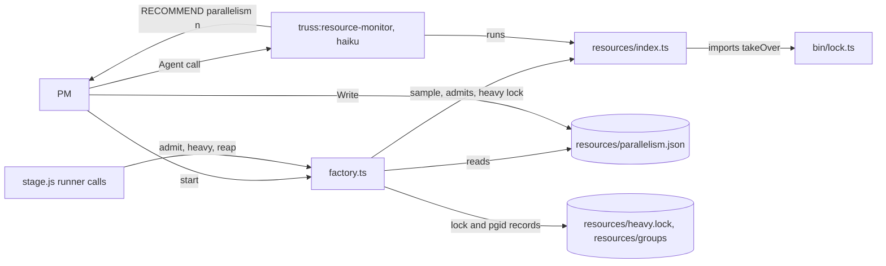

### `bin/` modules (0.25.0)

`bin/factory.ts` spreads the command tables of four modules into its own (`INBOX_COMMANDS`, `COST_COMMANDS`, `QUEUE_COMMANDS`, `WORKTYPE_COMMANDS`, `PLUGIN_COMMANDS` in `bin/factory.ts`). Each module imports only `node:` built-ins and relative paths, and never `factory.ts`, whose top-level `await` would make an import cycle (each file's header comment).

| Module | ADR | What it owns |
| --- | --- | --- |
| `bin/core.ts` | 0049 | The helpers every module shares: `CliError`, `usage`, `refuse`, the flag and JSON helpers (`flat`, `str`, `need`, `listOf`, `readText`, `readJson`, `isObj`), `configOf`, `parseLabel`, and the git roots `git`, `commonDir` and `sharedDir`. `sharedDir(repo)` is S. |
| `bin/lock.ts` | 0037, 0048, 0049 | The only lock (`withLock`, `takeOver`, `StoreBusy`, with `STALE_AGE_MS` and `OWNERLESS_MS`) and lease (`takeLease`, `refreshLease`, `releaseLease`), atomic-write (`writeJsonAtomic`, `createExclusive`) and JSONL (`appendJsonl`, `readJsonl`) code, and the fs seam `FsLike`. |
| `bin/transcripts.ts` | 0037, 0049 | Transcript finding (`transcriptsOf`) and the inbox proof seams (`proofTranscriptRoot`, `readProofFile`). |
| `bin/store.ts` | 0049 | A barrel that only re-exports `core.ts`, `lock.ts` and `transcripts.ts`, so the old import path keeps working until a later goal drops it. No module under `bin/` or `resources/` imports it. |
| `bin/inbox.ts` | 0037 | `S/inbox.jsonl`: the commands `escalate`, `inbox`, `resolve` and `mark-applied`; the gate helpers `blockingFor` and `budgetRaises`; the typed-proof check that a client resolve has a prompt the client typed after the item opened, holding the decision word, the id and the item's code (`typedProof`, `bin/inbox.ts`). The escalation kinds and who may resolve each are its `KINDS` table (`bin/inbox.ts`). |
| `bin/notify-run.ts` | 0037 | Runs the client's `notify` command for one new inbox item in a child process, with `{repo, row}` on stdin. Exit 0 when the command exits 0 within 10 s; on a timeout it kills the whole process tree (`taskkill /T /F` on win32; elsewhere the descendants, walked from `/proc` on linux and with `pgrep -P` on macOS, then the process group). `escalate` starts it after the inbox lock is released (`notify`, `bin/inbox.ts`). |
| `bin/guard.ts` | 0034 | The long-term cost guard: `ltcLines`, `ltcTriggers`, `ltcPlan` (writes `D/ltc-plan.json`), `ltcPlanGate` (read by `approve`) and `ltcCrewGate` (read at merge). |
| `bin/cost.ts` | 0038 | The cost meter: `sweep` into `D/usage.jsonl`, `budgetVerdict`, `crewCost` and the `cost` command (see Cost meter). |
| `bin/worktypes.ts` | 0041 | The built-in work types (`feature`, `docs` and `refactor` solo; `bugfix` lean with `red`; `dependency` lean; `migration` full with a stress test), `profilesOf`, which lets `workTypes` in `.claude/truss.json` only tighten a profile, `workTypeErrors`, and the `worktypes` command (`bin/worktypes.ts` `Profile`). |
| `bin/ledger.ts` | 0038 | `ledgerAppend(repo, row)`: one merge row appended to `S/ledger.jsonl` under its lock. |
| `bin/queue.ts` | 0040, 0039 | The work queue under `S/queue/items/`: the commands `intake`, `queue`, `queue-next` and `queue-set`, plus `unattended --on`/`--off`, which writes and removes `D/unattended.json`. Item states are `new`, `claimed`, `running`, `triage`, `done` and `dropped` (`bin/queue.ts` `STATES`). |

Since 0.32.0 ([ADR-0049](adr/0049-hub-split.md)) the three old hubs `bin/store.ts`, `bin/factory/shared.ts` and `bin/factory/resources.ts` are barrels. Other sections of this doc may still cite a symbol in an old hub. Read such a citation as the leaf that now holds the symbol. The lock, lease, atomic-write and JSONL code (`withLock`, `takeOver`, `takeLease`, `STALE_AGE_MS`, `OWNERLESS_MS`, `sweepTmp`) is in `bin/lock.ts`. `sharedDir` is in `bin/core.ts`. `appendDecision` is in `bin/factory/log.ts`. `scriptPathFor` and `sessionScriptsDir` are in `bin/factory/roles.ts`. `holdOf` is in `bin/factory/admit.ts`. New code imports the leaf, never a barrel, and `tests/hub-split-032.check.ts` fails on a barrel import from `bin/` or `resources/`.

### Factory modules (0.31.0)

`bin/factory.ts` is only the dispatcher: argument parsing, `main`, the command table (`CORE_COMMANDS`, `PLUGIN_COMMANDS`), the `--status` and `--reap-first` flags, and re-exports of every name it exported before, so existing imports keep working. Each command group lives in its own module under `bin/factory/`, so two crews rarely change the same file.

The helpers the modules share live in five leaf modules (0.32.0, [ADR-0049](adr/0049-hub-split.md)):

- `cli.ts` holds `PLUGIN`, `FACTORY`, `parseFlags`, `run`, `gitOrFail`, `repoOf`, `startDirOf`, `dirOf`, `intOr`, `crewWorktree`, `baseOf` and `archPath`.
- `plan-file.ts` holds `loadPlan`, `savePlan` and `patchPlan`.
- `settings.ts` holds `settingsOf` and the knowledge config (`docKeysOf`, `knowledgeCfgOf`, `knowledgeCfgFrom`, `knowledgeArgsOf`).
- `log.ts` holds `appendEvent`, `appendDecision` and `appendDecisionLine`.
- `roles.ts` holds the roles table (`readRoles`, `roleDefaults`, `rolesWithTypes`, `modelsOf`) and the stage script copy (`scriptPathFor`, `sessionScriptsDir`).

The heavy slot and admission live in three more leaves:

- `slot.ts` holds the slot wait (`HEAVY_WAIT_MS`, `HEAVY_WAIT_MAX_MS`, `explicitWaitMs`, `heavyWaitMs`, `slotWaitMs`, `recordHeavyTime`), the slot count (`slotsAt`, `heavySlotsOf`), `acquireSlot`, `sleepSync`, `pidAlive` and `GROUPS`.
- `admit.ts` holds `admission`, `cmdAdmit` and `heldOnBusy`, with the unexported `holdOf` and `effectiveParallelism`.
- `reap.ts` holds `cmdReap`.

`shared.ts` and `resources.ts` are barrels that only re-export those leaves. They stay until a later goal drops them, and new code imports the leaf, never a barrel. `runs.ts` reads Workflow runs and QC reports. `retro-mods.ts` is the lazy load of `retro/` and imports no sibling. The command modules are `plan.ts`, `check.ts`, `doctor.ts`, `crew.ts`, `start.ts`, `warnings.ts`, `personas.ts`, `heavy.ts`, `gates.ts`, `finish.ts`, `audit.ts`, `retire.ts`, `decide.ts`, `decisions.ts` and `knowledge-cmds.ts`; each one's header comment says what it owns. No module imports `factory.ts`, whose top-level `await` would make an import cycle. `gates.ts` needs `main`, so it exports `gatesRun(argv, main)` and `factory.ts` binds it as `gatesMain`. `heavy.ts` and `gates.ts` run the CLI again through `FACTORY`. `factory-split-031.check.ts` and `hub-split-032.check.ts` pin this layout.

### The Workflow path (ADR-0009)

[ADR-0009](adr/0009-workflow-factory.md) gives Truss a second crew engine. Its files exist: `bin/factory.ts`, `workflows/roles.json`, `workflows/plan.js`, `workflows/stage.js` and `agents/planning-engineer.md`. The steps 0 to 11 above stay as the project manager path, the fallback. When the PM's session has the Workflow tool, planning runs as a Workflow script, and every crew whose goal file's `## Engine` section says `workflow` runs as one too (Decision 1, "start, engine split"):

*The Workflow engine's parts and what passes between them, as designed.* Traces to: `docs/adr/0009-workflow-factory.md` section "Decision" (the diagram, copied), which traces to `hooks/register.ts`, its line numbers re-taken at `f01caf4`: the `tool.call` handler for `Agent` (the Agent gates it mirrors) (`gateOf` and `planVerdict`) (`qcRuling`, `patchIdOf` and `headVerdict`, with `branchOf` and `examinedVerdict` between them) and (`fencedBlock` and the plan-file route); and to the probe run's `journal.jsonl` and `agent-*.meta.json`. ADR-0009's own caption keeps the line numbers it took when it was written.

*One stage on the Workflow path, from start to merge, as designed.* Traces to: `docs/adr/0009-workflow-factory.md` section "Decision", which traces to `skills/run/SKILL.md` sections 6 and 9, `agents/project-manager.md` sections 1, 3, 6, 7, 9 and 12, and the probe's `journal.jsonl`.

The run on this path, step by step (ADR-0009, Decision 7, "The PM's procedure"):

- **Plan (step 4).** The PM writes the brief to `<truss dir>/plan-brief.md` and runs `factory.ts plan-args`, then `Workflow(plan.js)`, then `factory.ts plan-write` and `plan-check`. `plan.js` runs `truss-designer` and `truss-checker`, with no reconcile round (a gameable acceptance test the checking engineer finds sends the PM back to the plan step with the findings); client items are collected and returned, never asked from the script. A failed `plan-check` gets one fix run (`truss-designer-3`, `truss-checker-3`, no reconcile), and a second failure goes to the client (Decision 3). `plan-write` overwrites an unapproved `plan.json`; over an approved one it refuses while any crew of it is `running` or `planned`, and otherwise, under the `plan` lock, renames `plan.json` and `plan.md` to `plan-<stamp>.json` and `.md`, where `<stamp>` is the first 20 letters and digits of `approvedAt` (a `-<n>` suffix when the name is taken), before it writes the new plan; `decisions.md` and `usage.jsonl` are left as they are, so a second run in one truss dir shares them (`keepExisting` in `cmdPlanWrite`, `bin/factory/plan.ts`); only a plan already approved at the first unlocked check is archived, so an approve that lands during the `plan` lock wait is refused with "kept the existing plan: it is approved".
- **Approval (step 5).** Merge mode and target are read from `.claude/truss.json` by `factory.ts settings` (missing `merge` is `sequential`, missing `target` is the current branch), shown in the plan table as information and logged; the PM never asks for them, in either kind of run. This repo's `.claude/truss.json` holds `"merge": "sequential"` and `"target": "main"` beside `architecture` and `adr`. Approval itself stays: a plan with `approval: "client"` still waits for the client (ADR-0044 decoupled that from stage 0), and since [ADR-0045](adr/0045-approve-proof.md) the client's typed `/truss:inbox approve` of the plan's `client-trigger` item sets `approvedAt`; the PM never runs `approve --by client`. The question is deleted from `skills/run/SKILL.md` section 5 itself, so step 5 above stops asking it once `run-procedure` merges.
- **Start (step 6).** `factory.ts start --stage next` applies `planVerdict`, marks each workflow crew `running`, makes its worktree `.claude/worktrees/truss-<slug>` on branch `truss-<slug>`, appends a `by: "factory"` spawn line, and prints the `stage.js` args. `args.truss` carries `approvedAt` when the plan's is a string (`stageOut`, `bin/factory/start.ts`), so a crew's product-call refs are per run ([ADR-0047](adr/0047-crew-decisions-reach-pm.md)); the pinned key list is `TRUSS_KEYS` in `tests/fixtures/workflow-run/start.cases.ts`. Project manager crews come back under `projectManagers`, and the PM starts and merges them as on the project manager path. From [ADR-0031](adr/0031-right-size-process.md) (Decision 6, designed), a `solo` or `lean` crew comes back under a top-level `direct` key, as `{slug, process, qc, red, worktree, branch}`, and never in `truss.crews`, the Workflow args. `start` makes its worktree, marks it `running` and logs `started direct crew <slug> (process 
) ...`, but appends no `by: "factory"` spawn line, so `finish` never picks it up. `start` counts all three kinds against `maxParallelCrews` (Decision 1, `start`).
- **Inside each crew (step 7).** `stage.js` runs each crew's chain, `agents/project-manager.md` sections 1 and 3 to 9 as code: red first (`check --expect red`), split (the planning engineer), members (testers before builders, each `integrate`d by the runner), green with the escalation ladder in code, stress test when the goal file says yes, `owns-check`, then a fresh QC engineer (Decision 4). Since [ADR-0046](adr/0046-factory-throughput.md) items 6 and 7, the reply checkpoint, UX review and stress test come before the knowledge step, and the knowledge step and its lint re-run after each QC fix round. From [ADR-0014](adr/0014-retro-fixes.md) (proposed, Decision 4), a QC or stress finding that names a file a tester task owns goes to a tester fix member, `<slug>-tester-<n>`, and a fix builder's "Files you may change" leaves out the tester tasks' files. A stopped crew returns its tag and text; the PM handles it as in step 8 and restarts it with `start --slug <s> --resume answers` (Decision 4, "Restarts"). From [ADR-0046](adr/0046-factory-throughput.md) item 5, every resume carries the crew's earlier rulings still unbuilt (`<truss dir>/crews/<slug>/answers.json`, `carriedAnswers` in `bin/factory/start.ts`), so the PM's answers file holds only the new ones.
- **Resume ([ADR-0048](adr/0048-resume-guard.md)).** `start --slug <s> --resume <kind>` first takes the crew's finisher lease and refuses with `{slug, why: "finisher live"}` while another finisher holds it; it releases the lease when it returns (`cmdStartResume`, `bin/factory/start.ts`). It then merges the target into the crew branch with `mergeIn`, as `sync` does; on a conflict `mergeIn` aborts the merge, leaving the worktree clean, and the paths go on the crew entry as `syncConflicts` (`cmdStartResume`). A merge, rebase, cherry-pick or revert already in progress in the worktree (the resolver's) is neither merged into nor aborted: its unmerged paths become `syncConflicts` and `sync` refuses with `inProgress` (`cmdStartResume`, `cmdSync` `bin/factory/crew.ts`; ADR-0048 item 6). The sync runs before the answers are carried (ADR-0046 item 5), so `carriedAnswers` and `doneTasks` read the synced branch. In `workflows-src/stage/chain.js`, `chain` runs `syncStep` first on every resumed run, before the red check and any member (`chain` in `workflows-src/stage/chain.js`). `syncStep` runs `sync --slug <s>`; a conflict goes to the resolver and the sync runs again, and a sync still unmerged stops the crew `BLOCKED` at `R1` (`syncStep`). `finish` takes the same lease for each crew it records: a crew whose finisher is live is listed under `refused` with `why: "finisher live"` and is not merged, and the leases are released on every return and throw (`cmdFinish` and `finishRun`, `bin/factory/finish.ts`; the lease is taken in `finishRun` and refreshed before each merge in `mergeCrew`).
- **A ruling at QC on resume (0.31.0 item 6).** `start --resume` puts `freshAnswers`, the count of the PM's new answers, on the crew entry; `carriedAnswers` puts them first, so the rest are rulings an earlier run already had (`cmdStartResume`). In `workflows-src/stage/chain.js`, `chain` runs `rulingStep` on every resume after the members and before green. It first integrates each earlier fix member's stopped branch in `entry.prior` (an `at` of `fix, <what>`): no fix member of this run may reach the round that would carry it, so before 0.31.0 a fix builder's commits made before a PROPOSAL stop were dropped. A branch that does not merge goes through `integrate` as any member branch does: a conflict goes to the resolver, and a refusal stops the crew naming the branch. `priorOf` then skips the merged branches. Second, on an answers resume where no task member ran (every saved task done; a member that runs gets the ruling in its prompt through `answersFor`), the new answers at `qc` (`freshAnswers`) go to one fix builder, `Task: fix, the program manager ruling at qc`, through `fixBuilder` at step `qc`; its branch is integrated before green, so green and QC run on a head that holds it. Before 0.31.0 such a ruling reached no builder when every saved task was done, and a fix happened only after the next QC FAILed (`fixFindings`). A carried ruling at `qc` spawns no builder. A new ruling at `qc` that orders no change spawns no builder: `rulingOrdersChange` reads its text, treats an edit or cherry-pick word as an order, and ignores a denial such as "no changes needed", so "waive and proceed" goes straight to green. An ambiguous ruling is still built. Tests: `tests/ruling-031.check.ts`.
- **Merge (steps 9 and 10).** A `solo` or `lean` crew merges through `factory.ts land --dir D --repo R --slug S` ([ADR-0031](adr/0031-right-size-process.md), Decision 6, designed). `land` runs `mergeCrew`'s steps with the red gate on only when `red` is true and the QC gate on only when `qc` is true: worktree on `truss-<slug>`, `owns-check`, the gates its booleans name, the target merged in, `check --expect green` on the merged head when `red` is true or the QC head moved, the fast-forward, `status` `merged`, and the decision line `crew <slug> merged into <target> at <head> | land: process 
, qc <bool>, red <bool>...`. It exits 0 with `{merged: true, ...}`, 1 with `{merged: false, slug, why}` on a refusal (a `full` or absent `process` included), and 2 on a usage error or a `single`-mode repo. A `full` crew merges through `finish` as follows. `factory.ts finish` records each agent's report under `reports/<slug>/<label>.md`, audits every agent's real model and effort, then merges in plan order: the newest QC file this run must be a PASS with no UNSCOPED line, the red record `checks/<slug>-<n>.json` must exist, `qcFails` must not exceed `reworkAllowance`, and the head or patch must match under `mergeHeadVerdict`, a fail-closed wrapper around `headVerdict`. It fast-forwards the target locally and never pushes (Decision 1, "finish, merge step"). Only `merge: sequential` is supported on this path; a `single` run is all project manager path.
- **Goal check (step 9).** Once a goal's last crew merges, the PM runs `factory.ts goal-check --dir D --repo R [--goal ID]` (`goalCheckMain`, `bin/factory/decide.ts`). It takes the plan's `goalCheck`, or with `--goal` that goal's own, and exits 2 when there is none (`goalCheckOf`). It resolves the target from `settingsOf` to a commit and runs the check as a heavy background job (`heavyMain`), since a goalCheck is a suite run: the job is detached, holds a heavy slot and waits for it up to `slotWaitMs`. The caller waits at most `HEAVY_ATTACH_MS`; a wait that runs out prints `{ok: false, pending: true, error: "goalCheck still running after N s ..."}` with exit 1, and the same command again collects the result. The wrapper stops a job that runs past the run limit (`TRUSS_HEAVY_RUN_MS`, default `slotWaitMs`) and reports `timedOut: true` ([ADR-0054](adr/0054-heavy-slot-run-limit.md)); whether Claude Code's TaskStop reaches a detached job has not been tried in a live session. Inside the job, the internal `goal-check-job --at <sha>` (`cmdGoalCheckJob`) adds a detached worktree at it under a fresh `mkdtemp` dir, runs the command there with `bash -c`, then removes the worktree, prunes and deletes the temp dir whatever the result. It appends one decision line, `goalCheck[ of <id>] passed|failed (exit <n>) at <target> <sha12> | run by factory goal-check in a temporary worktree`, and prints `{ok, goal, target, head, exit, output}` with the last 4000 characters of output, exiting 1 when the check fails. It never runs in the main checkout, never pushes and never moves a branch. It checks only the target's head, so in `single` mode the integration branch check stays a hand-run in the integrator's worktree.

The stress-test bound is an open client decision: whether every stress-test round after a crew's first counts against `reworkAllowance` on the Workflow path (ADR-0009, Client decisions, item 1; the ADR recommends yes, and `stage.js` step 5 is written that way). While a stage runs, `/truss` doesn't see its agents; they show in `/workflows`, and `/truss` fills each crew in when `finish` records it (ADR-0009, Consequences).

#### Resource-aware sizing (ADR-0015, proposed)

[ADR-0015](adr/0015-resource-aware.md) adds a module, `resources/index.ts`, and three factory commands. It is built: `resources/index.ts` and the factory commands `admit` in `bin/factory/admit.ts`, `reap` in `bin/factory/reap.ts` and `heavy` in `bin/factory/heavy.ts`.

- **Sampler.** `sample()` returns `freeMB` and `totalMB` from `os.freemem()` and `os.totalmem()`, plus `cpus` and `load1`. It leaves `load1` out where `os.loadavg()` is all zeros (Windows). `TRUSS_SAMPLE` (a JSON file, or `error`) and `TRUSS_MIN_FREE_MB` are its test seams. The default threshold is 2048 MB.
- **Admission.** `admit --slug S` exits 0 when admitted and 1 when held. A planned crew is also held while the running crews fill the effective parallelism. `start` applies the same rule and lists held crews under `held`; they stay `planned`. `stage.js` runs `admit` as a runner call before every non-runner spawn, and stops the crew `BLOCKED` with text `held by admission: ...` when it's held.
- **Heavy slots.** Only the runner-run red and green checks go through `heavy`; members' own builds and tests don't (a proven gap for the plugin fix goal). [ADR-0017](adr/0017-member-heavy-commands.md) (proposed) picks a member-side heavy path: each member brief would carry one literal `factory heavy` line. It isn't built yet. Up to `heavySlots` heavy runs go at once ([ADR-0046](adr/0046-factory-throughput.md) item 4): the truss.json key, else `TRUSS_HEAVY_SLOTS`, else `max(1, min(4, floor(cpus/4), floor(totalGB/8)))` (`heavySlotsOf` in `bin/factory/slot.ts`, `defaultHeavySlots` in `resources/index.ts`). Slot 1 is the lock `D/resources/heavy.lock/`, slot n is `D/resources/heavy-<n>.lock/`; a heavy run takes the first free one, and a lock whose owner pid is dead, or that is past its `until` deadline ([ADR-0054](adr/0054-heavy-slot-run-limit.md)), is stale. The slots are not FIFO. Since 0.31.0 (speed goal item 2) the wait for a slot scales with the measured suite time: `slotWaitMs` in `bin/factory/slot.ts` is twice the longest of the last 10 slot runs in `D/resources/heavy-times.jsonl` (`recordHeavyTime`), never below `HEAVY_WAIT_MS` (540 s) and never above `HEAVY_WAIT_MAX_MS` (2 hours); `--wait-ms` or `TRUSS_HEAVY_WAIT_MS` still wins (`heavyWaitMs`). `check()` in `workflows-src/stage/check.js` runs a busy check up to `HEAVY_WAIT_ROUNDS = 3` times with no sleep between rounds, then stops the crew BLOCKED with `heavy slot busy:`. A crew can still lose every round. This repo's `.claude/truss.json` sets no `heavySlots`, so it runs at the host default.
- **Background heavy jobs (0.31.0, speed goal item 2).** A runner's Bash call ends at 600 s, and before 0.31.0 that killed the `heavy` parent while its detached child suite ran on; the slot's owner pid was then dead, so another crew took the slot and more suites ran than `heavySlots` allows. Now `heavyMain` starts a detached wrapper, `factory heavy-job` (`heavyJobMain`), keyed by crew, label, worktree, its HEAD and the command (`jobKey`, which drops a factory command's `--dir`, `--repo` and `--status-line`, so the gates call and stage's own heavy line share a job). The wrapper owns the slot for exactly the command's lifetime: it takes the slot (`acquireSlot`), runs the command in its own process group with output under `D/resources/jobs/<key>/`, releases the slot the moment the command exits, records the time, and writes `result.json` last, atomically. The caller waits up to `HEAVY_ATTACH_MS` (540 s, `TRUSS_HEAVY_ATTACH_MS`) and otherwise prints `{heavy: {pending: true, job}}` with exit 1 and `"pending":true` in the status line (`statusLine`). The pending reply carries the job's `ageMs` and its `budgetMs`, fixed when the job starts: the slot wait plus `slotWaitMs` for the run itself. Running the same line again attaches to the same job; `check()` in `workflows-src/stage/check.js` does that until `ageMs` reaches `budgetMs` (`pendingOutOfBudget`), then stops the crew BLOCKED with `heavy run still going after N s (budget M s)`. So stage gives up on the factory's own budget and never stops a crew whose job is still queued for the slot. The spawner writes the wrapper's `pid.json` itself when `spawn` returns (`startJob`), and `job.json` names the spawner until then, so a wrapper slow to start on a loaded host is never taken for dead and started twice (`jobAlive`). A job whose wrapper died with no result is started once more. The wrapper skips the slot when the command is `factory check`, which takes the slot itself and only for a full suite (`suiteRun`), including an acceptance test that is nothing but the suite (`npm test`).
- **Targeted tests (0.31.0, speed goal item 1).** `factory check --expect green` cuts only the whole-suite step (`npm test` and its redirects and `||` handler, as a line or an `&&` segment) from the acceptance command and keeps every other step (`stripBlanketSuite` in `bin/testmap.ts`), runs it, then runs the tests the crew's diff reaches (`checkTests`). `selectForCheckout` reads `git diff base...HEAD` and `git ls-files`. The candidates are the files the `node --test` globs of package.json's test script match (`suiteGlobs`), so a stray `*.test.ts` outside them is never picked; with no globs, every test file outside a nested package is one. `selectTests` picks the candidates whose dependencies (`symbolGraph` `depsOf`) hold a changed file. The graph works at the level of names, from the scan in `bin/testmap-parse.ts` (`facts`): an import of `{x}` reaches the declaration of `x` and what that declaration uses, through re-export barrels to the module that defines it. A namespace import used only as `ns.name` reaches those names; any other use of it, a dynamic import, a side-effect import and a file named in a string literal of a test-side file (a test, or a file in a test dir; a literal with a dir part matches by path suffix) take the whole file. A literal that is only a write target (`writeFileSync('stage.js', ...)`) names nothing. A test that runs the factory CLI (a file with a `COMMANDS` table and an `isMain` guard, found from the code, not a list) reaches the dispatcher's load-time code and entry block plus the handlers of the commands it names: a command literal, a word after `factory.ts`, a regex alternation `factory\.ts\s+(a|b)`, or a word after a template's `${}`. Only text that leads to the run counts, so a data literal in a module the run merely loads names nothing, and comments and `type` declarations never name a command. A run that names no command reaches every handler. A handler that dispatches back through the table (`gatesMain` hands its steps to `main`) runs the commands its own code names. A source module that only compares text with the dispatcher's file name (`cmd.includes('factory.ts')`) does not run it. When no test reaches a changed file by name, the old file-level reach (`usedBy`) selects instead and its `why` line says "file-level". Two things stay coarse on purpose. The stage tests run the generated `workflows/stage.js`, and running the bundle runs every `workflows-src/stage/` module, so each module selects every stage test. A module's load-time side effects are not followed by name; a test that loads the file still catches its load errors. It picks the full suite instead when reach is unclear: a diff over `maxFiles` (40), a `fullOn` glob, `.claude/truss.json`, a manifest or config file, a deleted code file, a shared test helper or fixture, non-JS code or JS code no test reaches when no `targetedTests.map` entry covers it, or JS tests with no known runner. The targeted set runs outside the heavy slot; the full suite takes the slot for its own run only. `--full` forces the full suite. A whole-repo check runs when its own inputs change: the repo's `.claude/truss.json` map sends each doc root the citation lint walks (`CITATION_DOC_ROOTS` in `tests/fixtures/citations/line-citations.ts`) to `doc-citations-031` and `release-026`, and `doc-citations-031.check.ts` fails when a root is not mapped. The result carries `tests: {mode, why, files, commands}` and `record`, the check file in `D/checks/` that holds the same `tests`. `stage.js` logs the selection and keeps it as `crew.greenRecord` (`noteTests`); `qcPrompt` gives QC a `Green result:` line with the record and the rule not to re-run a suite green on that head (`greenResultLines`). After a QC PASS, `fullSuite` runs `check --full` through heavy once, unless green already ran the full suite on that head; a failure gets a green-fix round, the targeted green and a new QC. `plan-check` warns about an acceptance test that ends in a whole-suite step. The `targetedTests` key (`docs/truss-config.schema.json`) sets `runner`, `full`, `maxFiles`, `fullOn` and `map` entries `{paths, tests?, run?}` for paths the import graph can't see and for non-JS stacks. `takeHeavySlot` and `releaseHeavySlot` take the platform as a parameter, and on win32 `releaseHeavySlot` removes the lock with `maxRetries: 5, retryDelay: 20` (`resources/index.ts` `releaseHeavySlot`).
- **Reaping.** `heavy` starts its command in a new process group and records it under `D/resources/groups/`. `stage.js` runs `reap --label <slug>-check` after each non-runner spawn and when the crew ends. Since [ADR-0046](adr/0046-factory-throughput.md) item 1 the reap after a spawn costs no runner spawn: it rides as `--reap-first <slug>` on the crew's next factory call, and `factory.ts` reaps before running that command (`takeReapFlag`, `reapFirst`); only the crew-end reap is a call of its own. `reap` signals only the recorded groups, never by name. The same item has green, owns-check and the tests check skip a re-run while the crew head has not moved since they passed (`crew.moves`, set from the head `integrate` and `sync` print).
- **Gates call.** Since 0.29.0 (ADR-0046 item 1) the checks before QC are one runner call: `factory gates --slug S --steps green,owns,tests,lint,admit` (`gatesMain`) runs the named steps in order, each as its single command would (green through `heavyMain`), stops at the first unmet one (`gateMet`) and prints `{ok, stopped, gates, codes, head, env, heavy, steps}`, each `steps` body being the single command's output. `workflows-src/stage/gates.js` `gates(crew, want)` sends only the due steps (none when fewer than two are due) and caches the results in `crew.gates` with the move count; `check`, `scope`, `testsGuard`, `knowledgeLint` and `admit` take theirs with `takeGate` and fall back to the single command. `runFactory` drops the cache (`dropGates`) on any other factory call.
- **Parallelism.** `D/resources/parallelism.json` holds `{"parallelism": n}`, used only when `n` is an integer from 1 to `maxParallelCrews`. The PM starts `truss:resource-monitor` at each stage start and when `held` or a `held by admission:` stop reaches it, then writes the file itself.
- **Out of scope.** The project manager path (`agents/project-manager.md`) gets only `start`'s admission. Proof covers Linux only.
- **Holds before memory (0.25.0).** `admission(dir, repo, plan, crew, command, running)` runs `holdOf()` first (`holdOf`, `admission`, `bin/factory/admit.ts`). `blockingFor` from `bin/inbox.ts` gives `awaiting: true` while a blocking inbox item names the crew. Then, only when `budget` in `.claude/truss.json` is an object, `budgetVerdict` from `bin/cost.ts` gives `budget: true` with `scope`, `spentUsd`, `limitUsd` and `why`, a `budget-hold` event and a `budget` escalation. A failed escalation never lifts the hold; its error goes into the hold's `escalateError` field. Free memory, memory pressure, swap and parallelism are checked only after that. `workflows-src/stage/crew.js` `admit()` runs `admit --wait-ms 90000`, which re-checks only a memory hold, every 2 s inside factory (a budget or awaiting hold refuses at once; `cmdAdmit` loop, `bin/factory/admit.ts`), and maps the answers to `BLOCKED: budget: <why>`, `BLOCKED: awaiting client: <why>` and `held by admission: <why>`. On exit 2 `store busy` it retries once, straight away: factory's own 5 s lock wait (`withLock`) is the pause, since a Workflow script has no timers (`admit`, `workflows-src/stage/crew.js`). `start` output has no top-level `entries`: full crews are in `truss.crews`, direct crews in `direct`, project manager crews in `projectManagers`, held ones in `held` with `why`.
- **Owns and trailers (0.26.0, gates).** `factory.ts owns-extend --slug S --glob G --reason R` adds a glob to a crew's `owns` under the `plan` lock and appends a decision line (`cmdOwnsExtend`); it replaces hand-editing `plan.json`. Since [ADR-0043](adr/0043-crews-share-files.md) neither `owns-extend` nor `plan-check` refuses `owns` that overlap another crew's, in one stage or across goals, and `plan-check` no longer requires a crew of each stage to own a matched rule file. `integrate` refuses a non-merge commit with neither `Truss-Crew` nor `Truss-Role` that the target does not already hold (`untrailered`, `bin/factory/crew.ts`). `mergeCrew` refuses a target that is not a local branch and says how to fix it (`bin/factory/finish.ts`). `holdOf` uses the budget verdict's `ref` when it carries one (`holdOf`, `bin/factory/admit.ts`). `untrailered` fails closed: an unreadable `git log` range refuses with a `why` containing "trailers are unchecked" (`untrailered`), and `workflows-src/stage/integrate.js` `integrateNow` stops BLOCKED on a `why` with no `conflicts`, but sends an `inProgress` refusal to the resolver (`integrateNow`, `workflows-src/stage/integrate.js`). `plan.json` writers all take the `plan` lock (`patchPlan` re-reads under it, `cmdPlanWrite` re-checks inside it that no approve landed since its first check; only a plan already approved at that first check is archived, `keepExisting`), and `savePlan` goes through `writeJsonAtomic`, so unlocked readers never see a truncated file (`patchPlan`, `savePlan`, `bin/factory/plan-file.ts`; `cmdPlanWrite`, `bin/factory/plan.ts`).
- **Work type in the plan (0.25.0).** `plan.schema.json` forbids a crew `workType` below version 4 (the crew `not`/`anyOf` list, line 136), and `cmdPlanCheck` says `workType is version 4 only` (`bin/factory/plan.ts`). It also checks the value against the repo's work-type profiles and requires a `workType` on every crew while the session is unattended (`workTypeErrors`, `bin/worktypes.ts`). The enum `WORK_TYPES` lives in `bin/factory/plan.ts`. `state.schema.json` holds the stored row shapes as `$defs`: `inboxOp`, `ledgerRow`, `usageRow`, `usageCursor`, `queueItem`, `unattended` and `ltcPlan`. In `workflows-src/stage/qc.js`, `qc()` returns `longTermCosts` only when the QC text holds a long-term cost line (`workflows-src/stage/qc.js`).
- **LONG-TERM-COST lines ([ADR-0034](adr/0034-long-term-cost-guard.md)).** `ltcLines(text)` reads a line that starts, after any bullet, number, quote, bold, italic or code markup, with the case-sensitive marker `LONG-TERM-COST:` (`LINE_RE`, `bin/guard.ts`); `ltcLinesOf` in `workflows-src/stage/qc.js` holds the same regex. The line's fields are `<what> | later: <the cost> | reversal: cheap|costly|irreversible`. A body that is only `none`, `n/a` or `-` is no cost (`NONE_RE`, `bin/guard.ts`). A bare marker or an empty `what` is kept as `(unnamed cost)`, and a missing or invalid reversal counts as `costly` (`bin/guard.ts` `ltcLines`), so a sloppy line blocks rather than slips through. `ltcCrewGate` escalates every line not marked `cheap`, plus the triggers `ltcTriggers` finds in the diff (a dependency added to a `package.json`, a file added under a `migrations/` dir, matched case-insensitively, a new `*.sql`, `*.schema.json` or `schema.*` file), and refuses the merge until each item is resolved `approve` (`ltcTriggers`, `bin/guard.ts`; `ltcCrewGate`, `bin/guard.ts`).
