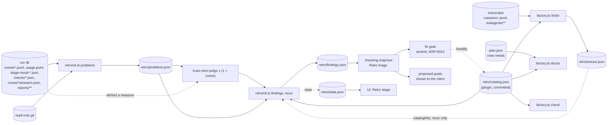

### The self-improving retro (ADR-0012)

[ADR-0051](adr/0051-generic-retro.md) (accepted 2026-11-13, goal `retro-generic`, amends ADR-0012) makes the retro generic. A counting step reads the run's structured files, never a transcript, and publishes named measures. A judge's finding must quote those measures, and its category is open: `CHECKLIST` is a starting list, never a filter. Findings are ranked by measured cost, and a finding about product code becomes a proposed goal for the client instead of a fix. The retro works on a plain project dir too. The rest of ADR-0012 holds: the state steps, triage's `TRIAGE:` sentence, the fix goal through amend, the scrub and the catalog.

This section is the design of goal `retro-judge`, whose stage-1 and stage-2 crews have merged: `retro/`, `agents/retro-judge.md` and `factory.ts doctor` exist at `f01caf4`. [ADR-0012](adr/0012-self-improving-retro.md) holds the rules ADR-0051 leaves standing; this section maps the parts as they are after goal `retro-generic`.

| Part | Path | What it does | Built by |
| --- | --- | --- | --- |
| retro-core | `retro/**` (`extract.ts`, `catalog.ts`, `scrub.ts`, `cli.ts`, `catalog.json`) | Reads the session's transcripts into the extract, holds and matches the known-problems catalog, checks committed text for names, emails, home paths and tokens, and gives the PM the `extract`, `findings`, `problems`, `recur`, `scrub` and `state` commands (`retro/cli.ts` `COMMANDS`). Node built-ins only. | crew `retro-core`, stage 1; `problems` by goal `retro-generic` |
| The counting step | `retro/problems.ts`, `retro/problems-code.ts`, re-exported from `retro/counts.ts` | `problems(directory)` counts measures and ranked findings from structured files; see "The counting step of the generic retro (ADR-0051)" below. | goal `retro-generic` |
| `truss:retro-judge` | `agents/retro-judge.md` | Opus at `medium`, `Read`, `Grep` and `Glob` only. Starts from `retro/problems.json`, opens the structured run files behind a measure when it needs more, never a transcript, and returns `finding` blocks of any category. One per crew with counted measures, plus one combining judge. | crew `retro-skill`, stage 1; rewritten by goal `retro-generic` |
| The retro skill and triage | `skills/retro/SKILL.md`, `agents/checking-engineer.md` | Runs the steps in order and records each in `retro/state.json`; the checking engineer's `Retro triage.` brief returns `TRIAGE:` lines and never drops a finding for its category. | crew `retro-skill`, stage 1 |
| Run wiring | `skills/run/SKILL.md`, `agents/design-engineer.md`, `skills/init/SKILL.md` | `doctor` in section 5, the automatic retro in section 10, crew `needs` in the plan, and truss writing `.claude/settings.json` with the classifier's refusal shown, never worked around. | crew `run-wiring`, stage 1 |
| The UI's retro stage | `ui/server/state/**`, `ui/web/**` | The state's `retro` key from `retro/state.json`, shown as the region `Retro stage` after the crew lanes. | crew `ui-retro`, stage 1 |
| factory doctor | `bin/factory/doctor.ts`, `workflows/stage.js` | `doctor` probes needs and catalog entries; `check` adds `catalog` hits; `finish` writes the extract; `stage.js` names known problems in its stop and fix-builder texts. | crew `factory-doctor`, stage 2 |
| The grader | `retro/evals/`, `tests/fixtures/retro-generic/rubric.ts`, `tests/retro-generic-live.e2e.ts` | Grades the judge's and triage's output in code; see "Grading the judge and triage" below. | goal `retro-generic` |

`doctor` runs after `plan-check` and before any crew starts; its bundle (allow rules, downloads, standing rulings) goes to the client with the plan as one approval. The retro starts after the end-of-run sweep without the client asking. Each step writes `retro/state.json` through `retro/cli.ts state`, and the UI shows it. The step names are unchanged (`retro/cli.ts` `STEPS`), but the `extract` step now runs `retro/cli.ts problems` instead of the transcript extract (`skills/retro/SKILL.md`, section 6, step 1).

`factory.ts finish` still writes `retro/extract.json` from the transcripts (`bin/factory/finish.ts`), and `recur` still reads that file's `catalogHits` (`retro/cli.ts` `runRecur`). That is the one place the retro still touches transcript-derived data. No judge and no finding reads the extract.

#### The counting step of the generic retro (ADR-0051)

`retro/problems.ts` `problems(directory)` is the counting step, re-exported with `CHECKLIST` from `retro/counts.ts`. `retro()` and the `counts` command are unchanged. It returns `{ retro: 2, dir, measures, findings }`. `measures` is a flat map from a dotted key to a number counted from the files, such as `time.slotWaitMs.<crew>`, `quality.qcFail.<crew>`, `rules.refusals.<source>.<category>` and `cost.tokens.<crew>.<role>`. `put` stores only a positive finite number, so a quantity the files cannot give, or a zero, has no key.

The step reads `events*.jsonl`, `usage.jsonl`, `stage-result-*.json`, `checks/*.json`, `crews/<crew>/answers.json`, whether `plan.json` exists, the repo's `.claude/truss.json` `pricing` key, and the runner and QC reports through `retro/timing.ts` `analyze`, which is unchanged. `retro/problems-code.ts` `codePart` adds the code structure and tests findings from read-only git, the run's events and stage results, `checks/*.json` and the plan's `owns`. The step never opens a transcript and never calls `bin/cost.ts` `crewCost`, because that reads transcript metadata. Tokens map to a crew through the spawn event that has the row's `agentId`. A null `agentId` is the main session, and an id with no spawn event is `unattributed`. A model the client's `pricing` does not price gives tokens and no USD. `readCtx` reads `.claude/truss.json` with a tolerant `readJson` and treats a failure as no pricing, because `bin/store.ts` `configOf` throws a `CliError` on text that is not JSON.

`problems` runs a part per category (`timePart`, `codePart`, `qualityPart`, `rulesPart`, `costPart`) and hands them to `assemble`. `assemble` drops a finding whose evidence names no measure or a different value, then sorts the rest with `rankCmp`: `cost.wallMs` descending, then `cost.tokens` descending, null last in both, then `id`. Category never orders a finding.

A finding is `{ id, category, title, evidence, cost, fix, target }`, and `target.kind` is `plugin`, `project-config` or `proposed-goal`. A dir with a `plan.json` is a truss run and may target a plugin file (`plug`). A dir without one targets the project's `CLAUDE.md`, or a proposed goal for product code, because there is no plugin file to fix. `retro/problems-code.ts` imports `retro/problems.ts`, which imports it back, so every import in `problems-code.ts` is used only inside a function.

`node <plugin>/retro/cli.ts problems <truss dir>` prints the JSON and writes `<truss dir>/retro/problems.json` atomically (`retro/cli.ts` `runProblems`, its only writer).

#### Findings and triage after ADR-0051

The judge's fenced `finding` block is the finding shape without `id`, plus an optional `signature` list. `retro/cli.ts` `findings <truss dir> <label> <report>` loads the measures from `retro/problems.json` (`loadMeasures`, which refuses a file whose `retro` is not 2) and runs `parseFindings`. `parseFindings` keeps a finding of any non-empty category, inside `CHECKLIST` or not. It drops a block whose evidence names a measure that is not counted, or a value that differs from the count, and the reason names the measure. It sets target kind `proposed-goal` on a target path that is product code: any path that is not `CLAUDE.md`, under `.claude/` or under `plugins/truss/`. A bare top-level plugin dir such as `bin/` or `hooks/` counts as the plugin only when the judge declared kind `plugin` (`isProductPath`). The `KEPT:`, `DROPPED:` and `OK:` lines keep their ADR-0012 form.

`parseTriage(text, findings)` reads `TRIAGE: <finding id> | <fix now|defer|drop> | <reason>` lines, a sentence `skills/run/SKILL.md` shares word for word. It never drops a finding for its category. A `fix now` on a `proposed-goal` finding goes to `proposedGoals`, which the PM shows the client. Only a fix-now finding with target kind `plugin` or `project-config` goes to `fixGoal`. A malformed line, an unknown id or a repeated id goes to `dropped` with a reason. The checking engineer's `Retro triage.` brief no longer drops a finding as `out of scope (R-30)`; product code becomes a proposed goal instead.

#### Grading the judge and triage

The judge and triage are LLM agents, so a rubric in code grades their output. `tests/fixtures/retro-generic/rubric.ts` `grade(judgeReport, triageReport, problems)` reads the `finding` blocks and `TRIAGE:` lines itself, without importing `retro/cli.ts` or `retro/counts.ts`, so a wrong parser cannot hide a failure. It requires counted evidence, a cost, a fix, a target and cost ranking. The default suite grades the recording in `retro/evals/wave4-judge.md` and `retro/evals/wave4-triage.md`, which lives outside `tests/` because builders may not write there, and checks that a doctored recording with an uncounted claim fails (`tests/retro-generic-032.check.ts`).

`tests/retro-generic-live.e2e.ts` runs a fresh judge and a fresh triage through `claude -p` on the scrubbed wave-4 fixture and grades them with the same rubric. It runs only with `TRUSS_RETRO_LIVE_EVAL=1`, needs the `claude` CLI on `PATH`, uses the network and a model, and is never part of the default suite. It is for the PM at release. A grade on the recording proves nothing about a fresh judge run; only the live eval does.

`tests/retro-generic-032.check.ts` also pins R-148: `retro/timing.ts` bounds a crew period by its first and last agent activity, not by the recorded start and end around a long idle gap. And it pins R-130: on a fixture with wave-4's event, usage and crew counts, the counting step opens none of the transcript files and ends within the 300 s test timeout.

| Seam | Producer | Consumer | Contract | Pinned by |
| --- | --- | --- | --- | --- |
| `<truss dir>/retro/extract.json` | `factory.ts finish`, `retro/cli.ts extract` | `recur` only | `extract.schema.json`; ADR-0012 Decision 2 | `tests/retro-contract.check.ts`, `tests/retro-replay.check.ts` |
| `retro/counts.ts` `problems`, `CHECKLIST`; `<truss dir>/retro/problems.json` | the counting step; `retro/cli.ts problems` | the judges, `findings`, the retro skill's `extract` step | ADR-0051 Decisions 1, 3 and 5 | `tests/retro-generic-032.check.ts`, `tests/retro-generic-fixture.check.ts` |
| `retro/catalog.json`, its six seed ids and anchors | retro-core | the extractor, `check`, `doctor`, `stage.js`, `recur` | `catalog.schema.json`; ADR-0012 Decision 3 | `tests/retro-contract.check.ts` |
| `finding` blocks and `<truss dir>/retro/findings.json` | the judges; `retro/cli.ts findings` and `recur` | triage, the PM | ADR-0051 Decisions 2, 4 and 6 | `tests/retro-contract.check.ts`, `tests/retro/cli.check.ts`, `tests/retro-generic-032.check.ts` |
| `retro/cli.ts` `parseTriage`, the `TRIAGE:` sentence | retro-core; the checking engineer | the PM | ADR-0051 Decision 7 | `tests/retro-generic-032.check.ts` |
| `retro/cli.ts` commands and exports | retro-core | the PM, the retro skill | ADR-0012 and ADR-0051 Seams | `tests/retro-contract.check.ts` |
| `factory.ts doctor`, crew `needs` | factory-doctor; the plan design engineer | the PM | `plan.schema.json` `$defs.need`; ADR-0012 Decision 9 | `tests/doctor-contract.check.ts` |
| `check`'s `catalog` key, `finish`'s extract | factory-doctor | `stage.js`, the PM | ADR-0012 Decision 10 | `tests/doctor-contract.check.ts` |
| The retro skill, the judge and triage prompts | retro-skill; goal `retro-generic` | the PM, the judges, the checking engineer | ADR-0012 Decisions 1, 4 and 6; ADR-0051 Decision 8 | `tests/retro-skill.check.ts`, `tests/retro-cause.check.ts`, `tests/retro-generic-032.check.ts` |
| `retro/evals/`, the rubric, `TRUSS_RETRO_LIVE_EVAL=1` | goal `retro-generic` | the default suite; the PM at release | ADR-0051 Decision 10 | `tests/retro-generic-032.check.ts`, `tests/retro-generic-live.e2e.ts` |
| Run skill sections 5 and 10, the init sentence | run-wiring | the PM | ADR-0012 Decisions 6 and 12 | `tests/run-retro.check.ts`, `tests/init.check.ts` |
| `<truss dir>/retro/state.json`, the `retro` state key and the `Retro stage` region | `retro/cli.ts state`; ui-retro | ui-state; the client | `retro-state.schema.json`, `ui/contract/state.schema.json`; ADR-0012 Decision 8 | `ui/contract/state.check.ts` |

Every file in the "Pinned by" column exists. The build crews' own tests add to them: `tests/retro/catalog.check.ts`, `cli.check.ts`, `extract.check.ts` and `scrub.check.ts`, and `tests/factory-retro.check.ts` (the stress cases and `stage.js`'s `known problem` text, its header says).

Three contracts still describe the old retro. `docs/findings.schema.json` still holds the seven kinds, transcript evidence and string `cost` and `target`. `docs/retro-state.schema.json` still says the `extract` step writes `extract.json`. And `skills/retro/SKILL.md`, section 6, step 4, still hands triage "the extract" rather than `retro/problems.json`. TODO: update these three files; each is outside goal `retro-generic`'s owns.

### Doc fragments (0.31.0)

Crews used to edit the same shared docs, such as the feature map, the product decisions file and the knowledge docs, and the second crew to merge hit a conflict on them. Now a crew never edits the body of a shared doc that already exists. It writes the sections it adds or changes to its own fragment of that doc. The shared docs are the feature map, the product decisions file, the architecture doc, every knowledge doc and every rule file. The fragment of `docs/features.md` is `docs/features.d/<crew>.md`. A rule file's fragment sits outside the rules dir, because Claude Code loads every file in that dir: `.claude/rules/<area>.md` takes `.claude/rules.d/<area>/<crew>.md`. The builder prompt (`docsLines`) and the knowledge writer prompt (`knowledgePrompt`) both carry the rule through `fragmentLine` in `workflows-src/stage/texts.js`. The knowledge QC (`knowledgeLines`) counts a fragment as an update of its doc.

`bin/fragments.ts` holds the logic, with node built-ins and git only. `stitchDoc` folds fragments into a doc in byte order of their names, so the result never depends on read order. A fragment section at the fragment's shallowest heading depth replaces the doc's section with the same depth and title, down to the next heading of that depth or shallower. A new title is appended at the end. A section whose body is only `<!-- remove -->` deletes the doc's section. A fragment cannot add to a doc's preamble, the text before its first heading, such as the ADR summary list under the architecture doc's H1: `fragmentSections` returns text before the fragment's first heading as `preamble`, and `stitchDoc` drops it with a warning. A crew's ADR summary therefore goes into a `###` section it replaces, or the PM adds it at stitch time. Fragment frontmatter merges in: a list key gains the fragment's items and a scalar key takes the fragment's value. The output has LF line ends and exactly one trailing newline, and stitching it again with the same fragments changes nothing. When two fragments write one section, the one whose name sorts last wins and the stitch returns a warning.

`factory stitch [--repo R] [--dry]` (`cmdStitch` in `bin/factory/knowledge-cmds.ts`) stitches every committed fragment of a shared doc (`sharedDocOf`), deletes the fragments and commits once as `docs: stitch doc fragments`. A `.d/` dir beside any other markdown file is left alone. It refuses while a stitched doc or fragment has uncommitted changes. The run skill runs it once the run's last crew has merged, before it reconciles what the run learned.

A crew still edits `verified` and `sources` in the doc itself, so two crews that re-read one doc both change its frontmatter. Such a conflict resolves itself (`resolveFrontmatterConflicts`, `concludeFrontmatterMerge`). For each conflicted file it reads the three index stages and merges the bodies with `git merge-file`. It merges the frontmatter key by key: a key one side left alone takes the other side's value, two changed lists become their union less what either side dropped, and two changed `verified` stamps keep the one that descends from the other (`git merge-base --is-ancestor`). Each crew stamps its own branch head, so two stamps can sit on diverging branches; then the later commit date wins, and the larger sha on a tie, so both merge directions give the same stamp. A stamp that is no commit leaves the file conflicted. Any other key that both sides changed, or a body conflict, leaves the file conflicted. When every conflicted file resolved, the merge is committed with git's own message. `mergeCrew` in `bin/factory/finish.ts` (step 2, the merge of the target into the crew branch) and `mergeIn` in `bin/factory/crew.ts` (`sync`, `integrate` and the resume merge in `start`) both call it before they treat a conflict as one. `sync` then reports `frontmatterResolved: true`.

Knowledge-lint skips fragment files in its unreachable, budget and stale checks (`isFragment` in `structural` and `sourcedDocs`), since a fragment is part of its doc. `knowledgeDocs` in `bin/factory/crew.ts` gives a fragment the standing of its doc: a fragment of the feature map or the architecture doc is a free doc, and a fragment of the product decisions file or of a rule file is a prompt, which only the knowledge commit may change. Tests: `tests/doc-fragments-031.check.ts`.
