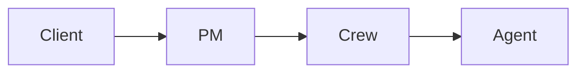

# Architecture

The factory has a server, a state reducer and a web page.

## Overview

Work flows from the client to the PM, then to crews and agents.



## Failure paths

This block does not parse on purpose.

```mermaid
flowchart LR
  Client -->
  PM ==>> [
```

## Change log

- 2026-10-01: first draft, mentions the Zebra change-log entry.

## History

- v1 was a single page. The Quokka history paragraph.

## Modules

ui-state reads the Truss dir. ui-server serves it.
